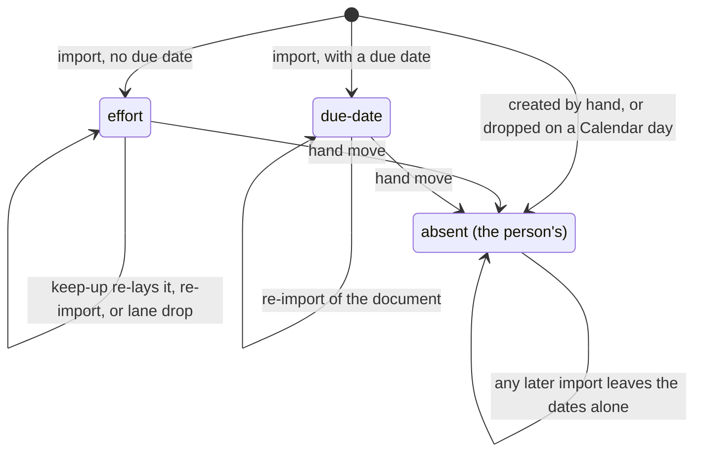

# Roadmap Planning

```meta
type: domain
```

> One chapter per Aggregate, Domain Service, Domain Event, or Shared Value
> Objects / Shared Enums grouping in this bounded context; each chapter's
> `type` records which of those it is. An Aggregate's owned Entities, Value
> Objects, and Enums are chapters directly beneath it, typed `entity`,
> `value-object`, and `enum`. Value Objects/Enums shared across multiple
> aggregates get their own chapter at the end instead of being duplicated.

What Roadmap Planning owns and what it leaves to Tasks and Devbook is in
[context.md](context.md). The plan is stored in its own right, not as a view over
[Tasks](../tasks/domain.md#task), because it holds work not yet refined into a
task. A Roadmap Item may name the task that executes it. Every item names its
repositories from the
[Repository Registry](../repository-management/domain.md#repository-registry) by
alias, so a portfolio-wide plan reads as one [band](#band) per repository.

## Roadmap Plan

```meta
type: aggregate
related: [.devbook/domain/tasks/domain.md#task, .devbook/domain/repository-management/domain.md#repository-registry, .devbook/arc42/08-crosscutting-concepts.md#shared-data-types, .devbook/domain/roadmap/domain.invariants.md#roadmap-plan]
aliases: [RoadmapPlan, plan, the plan]
```

**Who placed an item's window**



The states are the values of `placed_by_import` on a
[Roadmap Item](domain.md#roadmap-item), which defines a
[hand move](domain.md#roadmap-item). Both transitions to the person's state are
[a hand move](domain.invariants.md#invariant-a-hand-move-hands-the-window-to-the-person),
and none leaves it, because
[the importer never moves a window a person placed](domain.invariants.md#invariant-the-importer-never-moves-a-window-a-person-placed)
and an import never deletes an item.

The single plan for the workspace, and the consistency boundary for every item,
milestone, and dependency in it.

*The plan* in these chapters means this aggregate. The features and requirements
also say *a plan* for one imported plan, which the roadmap holds as one
[Roadmap Item](#roadmap-item). Where both meanings are near, the chapters say
*item* for the one item.

The plan is the aggregate root rather than the Roadmap Item, because
**acyclicity is an invariant across items, not within one**. An item cannot tell
whether a dependency it is about to accept closes a loop three items away, and a
boundary around one item would push that rule outside the model. The plan is also
read and written as a whole, so the boundary and the transaction share a shape.
This mirrors
[Repository Registry](../repository-management/domain.md#repository-registry),
the other singleton-registry aggregate in this product.

The rules the plan holds are in [its invariants](domain.invariants.md#roadmap-plan),
including those of the value objects below.

### Roadmap Item

```meta
type: entity
aliases: [RoadmapItem, roadmap_item_id, planned work, planned item]
related: [.devbook/domain/roadmap/features.md#placing-a-plan-in-time, .devbook/domain/roadmap/features.md#planning-work-that-has-no-task-yet]
```

A single piece of planned work, identified by `roadmap_item_id`. It holds:

- a `title` and its [Roadmap Tag](#roadmap-tag);
- its [Planned Window](#planned-window) and [Planning Priority](#planning-priority);
- its [Repository Scope](#repository-scope) and [Planning Lane](#planning-lane);
- its [Dependency](#dependency) set;
- an optional [Task Link](#task-link) and a set of [Knowledge Refs](#knowledge-ref);
- optional `notes`;
- `placed_by_import`, when an import placed its window;
- `completed_on`, the day a person completed it by hand, while it stays completed.

`placed_by_import` records which rule an import placed the window by, as drawn in
[Who placed an item's window](domain.md#roadmap-plan). The value reads:

- `effort`: the start comes from its predecessors, and the length from the
  gathered effort over the reader's pace.
- `due-date`: the end is the `due:` the plan wrote.
- Absent: a person placed the window.

A **hand move** is a person changing the window's dates by dragging or resizing
the bar, from the keyboard, or in the item's editor. A drop onto another lane, or
a Save that leaves the dates alone, is not one. A hand move
[hands the window to the person](domain.invariants.md#invariant-a-hand-move-hands-the-window-to-the-person),
and from then on
[the importer never moves it](domain.invariants.md#invariant-the-importer-never-moves-a-window-a-person-placed).

When a plan is dropped on a day of the Tasks Calendar, the import is told that
day. It places the window from it by the `effort` rule and leaves the value
absent, because the day was the person's. That day wins even over work that has
begun, and the end is counted from there for the points still open.

While the value is `effort` and its work is not finished, the item **keeps up
with its work** without being asked, over the reader's
[Working Week](#working-week) (ADR 0019), as
[its requirement](requirements.md#requirement-a-plan-sized-by-its-effort-keeps-up-with-its-work)
says. The value stays `effort`, because the window is still the importer's rule
(ADR 0013, ruling 5 as amended on 2026-09-27 and on 2026-10-07). See
[Placing a plan in time](features.md#placing-a-plan-in-time) for where the
re-laid window starts.

The effort is laid out one [part](#part) per repository, and the window the item
stores is the one
[its parts make together](requirements.md#requirement-each-repository-draws-its-own-part-at-its-own-pace).

It has no status and no percentage, because execution belongs to Tasks. An item
that gathers tasks shows their progress. An item that gathers none can be
**completed by hand**: `completed_on` records the day, and reopening clears it.
Once tasks carry the item,
[their progress wins](domain.invariants.md#invariant-gathered-tasks-outrank-a-completion-by-hand)
and the day is kept but not read. The id is stable across every reschedule,
because it is a dependency endpoint and the tag other contexts file work under.

An item gathers the work it stands for two ways, by name and by tag, and
[counts something reached both ways once](domain.invariants.md#invariant-something-reached-both-ways-is-counted-once).
Over everything it gathers it reports its
[total registered effort](#effort), with the count of gathered things that
registered no estimate beside it. The item owns none of these values:
[Roadmap Item Gathering](#roadmap-item-gathering) gathers and totals them.

### Milestone

```meta
type: entity
aliases: [roadmap_milestone_id, fixed point]
```

A point in time the plan is read against, identified by `roadmap_milestone_id`.
It holds:

- a `title`;
- the single day it falls `on`;
- its `Milestone Kind`;
- its optional `Repository Scope` and `Planning Lane`.

A Milestone is an entity of this aggregate, not a degenerate Roadmap Item. It has
no duration, rescheduling it moves one date rather than two, and "Is this late"
is answered against a day rather than a span. It is also a dependency endpoint:
work waits on a release, and a release waits on work. Both entities live in one
aggregate so that a dependency between them is validated on one side of a
boundary.

### Planned Window

```meta
type: value-object
aliases: [PlannedWindow, start, end, span]
```

When an item is intended to run: `start` and `end`, both inclusive. Equality is
by value.

It is inclusive on both ends because that is how a plan is spoken: "through the
31st" means the 31st. An exclusive end would make the shortest piece of work
indistinguishable from no work.

### Repository Scope

```meta
type: value-object
aliases: [RepositoryScope, repository_aliases, repos, scope]
```

The repositories an item or milestone belongs to, as aliases. How the aliases are
normalized, and what an empty scope means, are
[invariants of the plan](domain.invariants.md#invariant-scope-aliases-are-normalized-and-distinct).

Aliases are the shared key with
[Repository Management](../repository-management/domain.md#repository), held as
opaque strings and resolved by
[Repository Scope Resolution](#repository-scope-resolution).

### Dependency

```meta
type: value-object
aliases: [depends_on, depends_on_id, waits on, blocked by]
```

An edge from the node that must land first to the node that waits for it:
`depends_on_id`, referencing a [Roadmap Node](#roadmap-node) in the same plan.
What the plan accepts as a dependency is in
[its invariants](domain.invariants.md#invariant-a-dependency-declared-twice-is-one-dependency).

It is held on the waiting node, because "what am I waiting for" is the question a
reader asks of an item and the direction in which a plan is edited.

### Planning Lane

```meta
type: value-object
aliases: [PlanningLane, lane, row]
```

A free-form row label within a [band](#band), such as "platform" or "migration":
whatever the person actually calls it. What a blank lane reads as is
[an invariant of the plan](domain.invariants.md#invariant-a-blank-lane-is-the-default-lane).

It is a string rather than an enum, as `area` is on a
[Task](../tasks/domain.md#task): the taxonomy is the person's, and an enum would
need a release for every new workstream.

### Task Link

```meta
type: value-object
aliases: [TaskLink, task_id]
```

An optional foreign id naming the
[Task](../tasks/domain.md#task) that executes this
item. Equality is by value. The link
[may dangle](domain.invariants.md#invariant-links-are-never-validated-or-repaired),
because a task can be deleted while the plan still intends the work. It reads as
unlinked, not as an error.

### Roadmap Tag

```meta
type: value-object
aliases: [RoadmapTag, tag, roadmap tag, slug]
related: [.devbook/domain/tasks/requirements.md#requirement-a-sync-never-creates-a-roadmap-item]
```

The slug other contexts file work under to say it belongs to this item. Equality
is by value. The tag starts from the item's title and is then freely editable in
its own right. Its shape, where it comes from, and what a rename does to it are
[invariants of the plan](domain.invariants.md#invariant-every-item-has-a-tag).

The tag is load-bearing, because other contexts have written it down: a Task
filed under it, or a devbook chapter naming it in its `roadmap` list. Reslugging
on a rename would make every such reference silently stop matching. So the tag
drifts away from the title on purpose.

Tags are **not required to be unique** across items:
[two items may share one](domain.invariants.md#invariant-two-items-may-share-a-tag)
to group them. A tag names a grouping, so the plan reports the tags in use and the
items under each.

The [Tasks](../tasks/domain.md#task) tag picker offers every roadmap tag, and a
devbook chapter names roadmap tags in its `roadmap` list. The tag's stability
across a rename is therefore a contract with them. On a Task the tag wears the
[Plan Sigil](#plan-sigil), while the item holds the bare slug.

An outside system can file work under a tag too. A [Source Label](#source-label)
written `+slug` on a GitHub issue or a spec-manager item becomes the plan tag on
its [Linked Task](../tasks/domain.md#linked-task), and the item gathers that task
like any other. The sync that writes the tag
[never creates an item](../tasks/requirements.md#requirement-a-sync-never-creates-a-roadmap-item):
a tag with no item waits on the [shelf](features.md#laying-out-a-plan-whose-tasks-arrived-first)
until the person places it (local ADR 0013, ruling 3).

### Knowledge Ref

```meta
type: value-object
aliases: [KnowledgeRef, knowledge_refs, knowledge reference]
```

A direct reference from the item to a devbook chapter that informs it:
`<path>#<slug>`, naming a chapter in one of the devbook folders. Equality is by
value; an item may hold several or none.

It is the knowledge counterpart of the `Task Link` and behaves the same way. The
chapter can be moved, renamed, or deleted while the plan still points at where it
was, so the reference
[may dangle](domain.invariants.md#invariant-links-are-never-validated-or-repaired)
and reads as unresolved, not as an error. The plan
[never reads through it](domain.invariants.md#invariant-a-knowledge-ref-is-never-read-through);
[Roadmap Item Gathering](#roadmap-item-gathering) looks it up when a reader asks.
Refusing a reference to something temporarily missing would lose its intent.

### Planning Priority

```meta
type: enum
aliases: [PlanningPriority, planning priority]
```

How much the plan wants this item relative to the others: `low`, `medium`,
`high`, `critical`.

It uses the same four words as [Priority](../tasks/domain.md#priority) in Tasks,
so no conversation about priority starts with "which kind". They remain different
values owned by different contexts.

### Milestone Kind

```meta
type: enum
```

What kind of fixed point it is: `release`, `freeze`, `review`, `commitment`.

These are business kinds, not shapes. The view decides how each is drawn.

## Plan Sequencing

```meta
type: domain-service
related: [.devbook/domain/roadmap/domain.md#roadmap-plan, .devbook/domain/roadmap/domain.invariants.md#plan-sequencing]
```

Answers the questions that are about the graph rather than about any one node:
the order the dependencies imply, which nodes are reachable from which, and where
the plan holds a [Contradiction](#contradiction).

It [reports a contradiction and never corrects it](domain.invariants.md#invariant-a-contradiction-is-reported-never-corrected).
A plan may be temporarily wrong: that is how a person discovers a date does not
fit, and silently shifting dependent work would hide that fact. Cycle rejection
stays [a rule of the root](domain.invariants.md#invariant-a-cycle-is-refused).

It is a service because each answer needs the whole graph. Invocation semantics:
query/composition-oriented, and command-invoked as the validation step behind
adding a dependency.

## Repository Scope Resolution

```meta
type: domain-service
related: [.devbook/domain/repository-management/domain.md#repository, .devbook/domain/environment/domain.md#environment-shortcut-resolution]
```

Turns the opaque aliases in a Repository Scope into the repositories the reader
recognizes, by asking the
[Repository Registry](../repository-management/domain.md#repository-registry),
and reports which aliases did not resolve.

It keeps the aggregate free of a foreign repository model and of the registry
being reachable. An unresolved alias
[is kept](domain.invariants.md#invariant-an-unresolved-scope-alias-is-kept) and
shows in the [band](#band) for work under no repository. Invocation semantics:
query/composition-oriented, on the read path.

## Roadmap Item Gathering

```meta
type: domain-service
related: [.devbook/domain/roadmap/domain.md#roadmap-plan, .devbook/domain/tasks/domain.md#task, .devbook/domain/devbook/domain.md#shared-value-objects, .devbook/domain/sessions/domain.md#agent-session, .devbook/domain/roadmap/domain.invariants.md#roadmap-item-gathering]
```

Assembles, for one Roadmap Item, everything it reaches across Tasks and Devbook,
and totals the registered story points over the result. It reaches work two ways:

- **By name**: the task its [Task Link](#task-link) names, and the chapters its
  [Knowledge Refs](#knowledge-ref) list. The item wrote these references down
  outright.
- **By tag**: every Task filed under its [Roadmap Tag](#roadmap-tag), and every
  devbook chapter whose own `roadmap` list names that tag. The item reaches
  these without naming them.

It is a service because none of this is in the item's own state: Tasks and
Devbook hold the entries and chapters and register the effort. Like
[Repository Scope Resolution](#repository-scope-resolution), it reads foreign data
on the read path and holds none, so an unreachable supplier degrades a total and
never corrupts a plan.

- **[Something reached both ways is counted once](domain.invariants.md#invariant-something-reached-both-ways-is-counted-once)**,
  and carried in the result as reached both ways. A person may both link a task
  and tag it, and a single count would hide that and invite deleting the link
  that was holding the work.
- **The total is the [total registered effort](#effort)**, with the count of
  gathered things that registered no estimate reported beside it. Folding them in
  silently would make the total read smaller than the work.

Each gathered thing is carried with **how far along it is** and **what else in the
same gathering it waits on**, so the item reads as a sequence of steps and not
only a total. Progress is the plan's own four-state reading: planned, ready, in
progress, done. A dependency is the key of another gathered thing, never a foreign
identifier. A supplier's vocabulary is translated once, at the boundary.

A thing that registers no progress, such as a devbook chapter,
[is never read as finished](domain.invariants.md#invariant-unknown-progress-is-never-finished).
A dependency on work this item did not gather
[is dropped](domain.invariants.md#invariant-a-wait-on-work-the-item-did-not-gather-is-dropped):
it blocks, but this item has no edge to draw for it.

The same "registered values only" rule governs how much registered effort is
**finished** and **how many** things are finished
([invariant](domain.invariants.md#invariant-finished-effort-counts-registered-estimates-only)).
The total less the finished effort is the effort **still to do**, which an item
still sized by its effort is laid out from.

A gathered backlog entry also carries **when** its work happened, as Tasks
recorded it: the day it first moved to in progress, the day it was ticked off,
and the day it was created. When every backlog entry the item gathered is done,
the item is **finished** and its work ran from the earliest start to the latest
end. A devbook chapter is not asked, having no work to finish. Each entry's dates
come from the first source in this order that has one:

| Tried | Actual start of an entry | Actual end of a finished entry |
|---|---|---|
| First | The day it first moved to in progress | The day it was ticked off |
| Then | The day the first AI session linked to it began | The day the last AI session linked to it ended |
| Last | The day it was created | None |

An entry has no start of its own when it predates the in-progress stamp.
[The entry's own dates win over its sessions'](domain.invariants.md#invariant-an-entrys-own-dates-win-over-its-sessions),
and [a session never ends open work](domain.invariants.md#invariant-a-session-never-ends-open-work).
When no entry was ticked and no session dates the end, the item has no actual end
and its planned end stands. Like progress, the actual dates are read off the
gathering each time, and the Planned Window is left as it was.

Ordering the steps is tolerant arithmetic.
[Nothing is placed before what it waits on](domain.invariants.md#invariant-nothing-is-placed-before-what-it-waits-on),
and [things equally free to go next keep the order they were gathered in](domain.invariants.md#invariant-steps-equally-free-keep-the-order-they-were-gathered-in).
Tasks permits a cycle, so
[a cycle is released at the earliest waiter](domain.invariants.md#invariant-a-cycle-of-waits-is-released-at-the-earliest-waiter)
and the item is not refused.

A whole plan is also gathered in one pass: one read of each supplier, not one per
item, and
[both readings answer the same way](domain.invariants.md#invariant-a-whole-plan-is-gathered-the-way-each-item-is).
The per-item reading serves the item a person opened, and the plan-wide one
[answers every item](domain.invariants.md#invariant-every-item-of-a-plan-is-answered).
A thing may sit under two items, because a tag is not exclusive, and each item's
reading names it. Whoever draws them decides which may draw it.

Invocation semantics: query/composition-oriented, on the read path.
[It never writes](domain.invariants.md#invariant-gathering-never-writes).

## RoadmapItemScheduled

```meta
type: domain-event
related: [.devbook/domain/roadmap/domain.md#roadmap-plan]
```

Published when a Roadmap Item's Planned Window is set or changed: on creation,
and on every reschedule that actually moves a date.

### Payload

- `roadmap_item_id` — stable identity of the item, unchanged by the reschedule.
- `title` — the item's title at the time of the event, for readability.
- `start`, `end` — the new Planned Window, both days inclusive.
- `previous_start`, `previous_end` — the window it replaced; absent when the item
  is newly planned, which is how a consumer tells the two apart.
- `planning_priority` — the plan's own priority, not any task's.
- `repository_aliases` — the item's Repository Scope as written, unresolved.
- `task_id` — the task the item names, when there is one.

### Consumers

- [Monitoring & Dashboard](../monitoring/domain.md#progress-signal) —
  compares the plan against what actually happened, so drift between intent and
  delivery becomes visible without Monitoring reading the plan's internals.

### Published language rules

- The window is always inclusive at both ends. A consumer that treats `end` as
  exclusive will be one day short on every item.
- `repository_aliases` are opaque and unresolved by design. A consumer that needs
  repository facts asks Repository Management, not this payload.
- Absent `previous_start`/`previous_end` means "newly planned". It does not mean
  "unchanged".
- The event carries no status and no progress. Those are Tasks's
  published language; a consumer that wants both correlates on
  `task_id`.

## Ubiquitous Language

```meta
type: ubiquitous-language
```

### Roadmap Node

```meta
type: term
aliases: [RoadmapNodeId, node, dependency endpoint]
related: [.devbook/domain/roadmap/domain.md#dependency]
```

Either end of a dependency: a Roadmap Item or a Milestone. A dependency does not
care which, and a shared base type would imply a lifecycle they do not share.

### Part

```meta
type: term
aliases: [repository part, part of a plan]
related: [.devbook/domain/roadmap/domain.md#roadmap-item, .devbook/domain/roadmap/domain.md#roadmap-item-gathering, .devbook/domain/roadmap/features.md#placing-a-plan-in-time, .devbook/domain/roadmap/features.md#forecasting-work-in-flight, .devbook/domain/roadmap/context.md#story-points-a-week]
```

The work a [Roadmap Item](#roadmap-item) gathered that is filed in one
repository. An item's effort is laid out one part per repository, each at the
reader's pace for that repository. Each part
[counts the full effort of its own tasks and of the shared tasks it carries](requirements.md#requirement-each-repository-draws-its-own-part-at-its-own-pace).
A part is finished when every task it counts is done. When the work hands over to
another repository and back, that repository has one part per phase.

A part waits on the parts holding the tasks its own tasks wait on, as
[Roadmap Item Gathering](#roadmap-item-gathering) carries them. The item's window
runs from the earliest part start to the latest part end and is what the item
stores. Parts are worked out on every reading and never stored. See
[Placing a plan in time](features.md#placing-a-plan-in-time) for where a part
starts and how it is drawn.

### Band

```meta
type: term
aliases: [band, repository band]
related: [.devbook/domain/roadmap/domain.md#planning-lane, .devbook/domain/roadmap/domain.md#repository-scope-resolution, .devbook/domain/roadmap/features.md#reading-the-plan-by-repository, .devbook/domain/roadmap/features.md#telling-one-project-from-another-at-a-glance]
```

One horizontal section of the roadmap's timeline. Each configured repository has
a band, drawn in that repository's colour, holding its
[Planning Lanes](#planning-lane) and its own pace. An item filed under several
repositories draws its [part](#part) in each of their bands.

The last band holds work under no repository, or under a repository nobody
configured. It takes no colour, shows no name, and carries the default pace. The
plan's milestones share a band at the top, which takes no colour either.

### Own Task

```meta
type: term
aliases: [own task, own work]
related: [.devbook/domain/roadmap/domain.md#part, .devbook/domain/roadmap/domain.md#shared-task, .devbook/domain/tasks/domain.md#task, .devbook/domain/roadmap/requirements.md#requirement-each-repository-draws-its-own-part-at-its-own-pace]
```

A [Task](../tasks/domain.md#task) a plan gathered that is filed under one
repository alone. It always counts in that repository's [part](#part). A band's
**own work** is its own tasks. Once they are all done, the band's part is
finished, unless it is where the plan's open [shared tasks](#shared-task) are left.

### Shared Task

```meta
type: term
aliases: [shared task]
related: [.devbook/domain/roadmap/domain.md#part, .devbook/domain/roadmap/domain.md#own-task, .devbook/domain/tasks/domain.md#task, .devbook/domain/roadmap/requirements.md#requirement-a-shared-task-counts-where-own-work-is-still-open]
```

A [Task](../tasks/domain.md#task) a plan gathered that is filed under several
repositories, such as a sign-off every repository in a rollout takes part in. It
counts in full in each of its bands that still holds open
[own tasks](#own-task). When none does, it counts in the bands whose own work
ended last, or in all of them when none had own tasks. A shared task therefore
keeps no band open whose own work is done while another of its bands still has
own work open.

### Column Head

```meta
type: term
aliases: [head, day head, week head]
related: [.devbook/domain/roadmap/features.md#reading-the-near-term-closely, .devbook/domain/roadmap/features.md#blocking-and-unblocking-a-day, .devbook/domain/roadmap/domain.md#day-override, .devbook/domain/roadmap/domain.md#actual-hours]
```

The heading of one column on the roadmap's time axis: a day, a week, a month or a
quarter. A day or week head carries an hours figure, and a day head is a button
that blocks or unblocks its date as a [day override](#day-override). See
[Reading the near term closely](features.md#reading-the-near-term-closely).

### Plan Sigil

```meta
type: term
aliases: [plan sigil]
related: [.devbook/domain/roadmap/domain.md#roadmap-tag, .devbook/domain/tasks/domain.md#roadmap-tag, .devbook/domain/inbox/domain.md#plan-tag, .devbook/arc42/adr/0013-imported-plan-is-a-roadmap-item-laid-out-by-import.md]
```

The `+` a [Roadmap Tag](#roadmap-tag) wears on a Task: `+release-q4`. It tells a
plan tag apart from a `#` general tag and an `@` person. The item holds the bare
slug, the word a devbook chapter names in its `roadmap` list. The gathering
[matches a task's tag with or without the sigil](domain.invariants.md#invariant-a-plan-tag-matches-with-or-without-its-sigil),
so a task tagged before the sigil existed still counts. Only the adapters on the
two edges lift the sigil: the rollup and the shelf when they read, and the intake
when it writes (ADR 0013).

### Effort

```meta
type: term
aliases: [effort, story points, story-point estimate, total registered effort]
related: [.devbook/domain/roadmap/domain.md#roadmap-item-gathering, .devbook/domain/tasks/domain.md#effort]
```

Size measured in story points. Tasks and devbook chapters register effort;
Roadmap Planning only **totals** it. The *total registered effort* of a Roadmap
Item is plain arithmetic over the points actually registered, reported beside the
count of gathered things that registered none. It is never a measurement of time
or an inference, and unestimated work is not a zero hidden in the sum.

Tasks' [Effort](../tasks/domain.md#effort) is one task's own estimate. Roadmap's
is the sum over an item's gathered work, and it never sets any task's value.

### Working Week

```meta
type: term
aliases: [working week, working hours, workingWeek, WorkingHours]
related: [.devbook/domain/productivity/context.md#working-week, .devbook/domain/roadmap/context.md#story-points-a-week, .devbook/domain/roadmap/domain.md#day-override, .devbook/arc42/adr/0019-roadmap-counts-the-working-week.md]
```

The hours the person means to work. Its **weekly pattern** is
[Productivity's Working week setting](../productivity/context.md#working-week).
Roadmap adds the [day overrides](#day-override) on top of it, set from a
[column head](#column-head) or in the Days off dialog. The pattern and the
overrides both travel with the pace.

Roadmap Planning reads the working week for two things. An effort-sized Planned
Window [counts its hours forward](requirements.md#requirement-an-effort-window-counts-the-overrides)
from its start, dates and overrides included. A **week** of the pace is the
weekly pattern's total hours whatever the overrides, as
[a measured pace](requirements.md#requirement-a-measured-pace-counts-the-hours-in-its-stretch)
counts it. A day not worked, or one whose end is not after its start, adds no
hours (ADR 0019).

### Day Override

```meta
type: term
aliases: [day override, overrides, blocked day, blocked date, unblocked day, vacation day, holiday]
related: [.devbook/domain/roadmap/domain.md#working-week, .devbook/domain/roadmap/features.md#blocking-and-unblocking-a-day, .devbook/domain/roadmap/features.md#setting-days-off-in-a-list, .devbook/domain/roadmap/requirements.md#blocking-and-unblocking-a-day, .devbook/domain/roadmap/requirements.md#setting-days-off-in-a-list, .devbook/arc42/adr/0019-roadmap-counts-the-working-week.md]
```

One calendar date that the person works differently from their weekly pattern. A
**blocked** date is one the pattern works and the person does not: a holiday, a
vacation day. An **unblocked** date is one the pattern does not work and the
person does, such as a Saturday. An override says only whether the date is
worked. An unblocked date takes the start and end the pattern stores for its
weekday.

An override exists only while it differs from the pattern: a date that matches
its weekday again
[holds none](requirements.md#requirement-returning-to-the-pattern-removes-the-override).
A weekend in the pattern is a day off, not an override; the word is kept for the
dates that break the pattern (ADR 0019). That is why
[a range of days off blocks only the worked dates](requirements.md#requirement-a-range-of-days-off-blocks-only-the-worked-dates).

The person sets an override by pressing a date's [column head](#column-head) or
in the Days off dialog, which also lists them all. Both write the same override.

### Actual Hours

```meta
type: term
aliases: [actual hours, actual]
related: [.devbook/domain/roadmap/domain.md#working-stretch, .devbook/domain/roadmap/features.md#reading-the-near-term-closely, .devbook/domain/roadmap/requirements.md#reading-the-near-term-closely, .devbook/domain/roadmap/dependencies.md, .devbook/domain/productivity/features.md#hours-worked, .devbook/domain/productivity/domain.md#office-hours, .devbook/arc42/adr/0019-roadmap-counts-the-working-week.md]
```

How long the person worked on one working day. A working day runs from 04:00
local on its date to 04:00 the next morning, so an evening that goes on past
midnight counts on the date it began. Actual hours are the union of the person's
[working stretches](#working-stretch) over every session on every paired machine.
How they are counted, across sessions, across 04:00 and up to now, is
[a requirement](requirements.md#requirement-actual-hours-count-the-persons-working-stretches).

Only time the person was there counts, so
[only a human turn makes a stretch](requirements.md#requirement-only-the-persons-turns-make-a-stretch).
Subagents, scheduled sweeps and automated sessions add nothing, and neither does
a Copilot session, whose transcript does not record who made a turn. The owner
decided this on 2026-10-03, after agent-active time had counted 13.1 hours on one
day, most of them overnight subagents.

Actual hours are presentation only: they move no bar and change no pace. A begun
[column head](#column-head) shows them, per
[Reading the near term closely](features.md#reading-the-near-term-closely). The
dashboard's [Hours worked](../productivity/features.md#hours-worked) part
splits the same hours by [office hours](../productivity/domain.md#office-hours).
They come from [Sessions](dependencies.md), never from tasks, because a task
records only the dates it started and finished.

### Working Stretch

```meta
type: term
aliases: [working stretch, stretch of work]
related: [.devbook/domain/roadmap/domain.md#actual-hours, .devbook/domain/sessions/domain.md#human-turn, .devbook/domain/roadmap/requirements.md#reading-the-near-term-closely, .devbook/arc42/adr/0019-roadmap-counts-the-working-week.md]
```

A span of time in one session during which the person was working. Each of its
[human turns](../sessions/domain.md#human-turn) comes less than 30 minutes after
the stretch so far ended, which is when the agent finished answering. A later
turn starts a new stretch
([scenarios](requirements.md#requirement-actual-hours-count-the-persons-working-stretches)).
The gap runs from the end of the answer, not the previous turn, because reading
the answer is work (the owner's decision of 2026-10-05).

The stretch starts at its first turn. It ends when the agent finishes answering
its last turn, which is the end of the run that turn started. When no run follows
the turn, or the run ended before it, the stretch ends at the turn itself. A
stretch is open while the agent is still answering its last turn.

Roadmap Planning draws the stretches from each session's human turns and runs,
which Sessions reads. A working stretch is not the
[measuring period](context.md#story-points-a-week) a measured pace counts over.

### Contradiction

```meta
type: term
aliases: [contradiction, conflicting dates]
related: [.devbook/domain/roadmap/domain.md#plan-sequencing]
```

A plan that disagrees with itself about dates: work opening before the thing it
waits on has closed, or finishing after a milestone it was meant to precede. It
is [reported, never corrected](domain.invariants.md#invariant-a-contradiction-is-reported-never-corrected).
A **cycle** [is refused](domain.invariants.md#invariant-a-cycle-is-refused),
because a contradiction is a date problem and a cycle is not a plan.

### Source Label

```meta
type: term
aliases: [plus label, plan label, +label]
related: [.devbook/domain/roadmap/domain.md#roadmap-tag, .devbook/domain/tasks/domain.md#linked-task, .devbook/domain/tasks/requirements.md#requirement-only-the-first-plan-label-files-the-task, .devbook/arc42/adr/0020-external-items-arrive-as-linked-tasks.md]
```

A label on a GitHub issue or a spec-manager item whose name starts with a plus
sign, such as `+offline-sync`. On the item's [Linked Task](../tasks/domain.md#linked-task)
it is the plan tag of the same name, made into a slug: lower case, spaces to
hyphens. Any other label becomes a general tag and means nothing to the roadmap.

A task counts in one plan only, so no effort is counted twice: when an item
carries several source labels,
[only the first files the task](../tasks/requirements.md#requirement-only-the-first-plan-label-files-the-task).

### Promote to Plan

```meta
type: term
aliases: [promote, Promote to plan]
related: [.devbook/domain/roadmap/domain.md#roadmap-item, .devbook/domain/tasks/features.md#promote-to-plan, .devbook/arc42/adr/0020-external-items-arrive-as-linked-tasks.md]
```

A dropped action that was never built. It was to turn one linked task into a
[Roadmap Item](#roadmap-item) through `IRoadmapPlanIntake`, the port Import
uses. No linked task calls that port. A linked task reaches the roadmap only
through its [Source Label](#source-label), which files it under a tag the
person places from the [shelf](features.md#laying-out-a-plan-whose-tasks-arrived-first).
