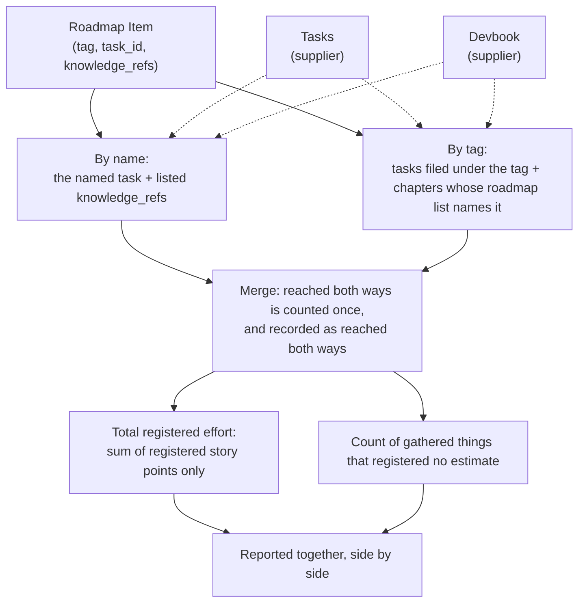
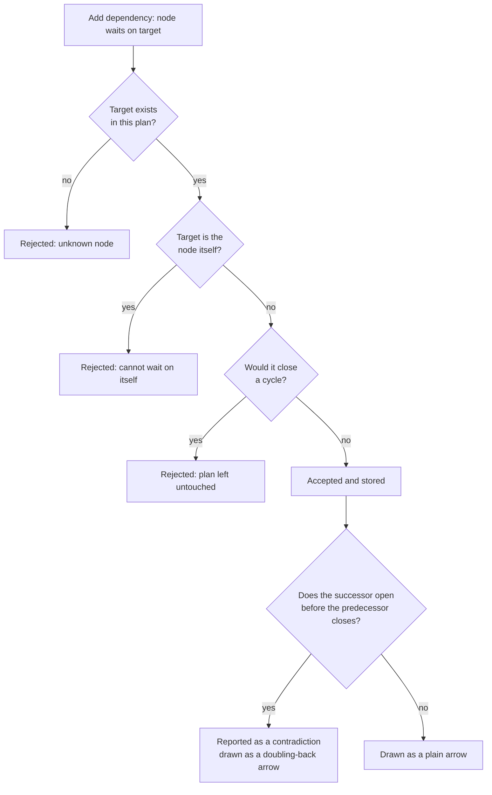
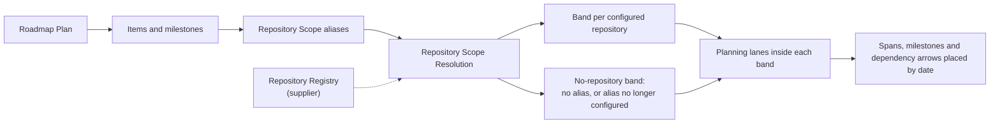
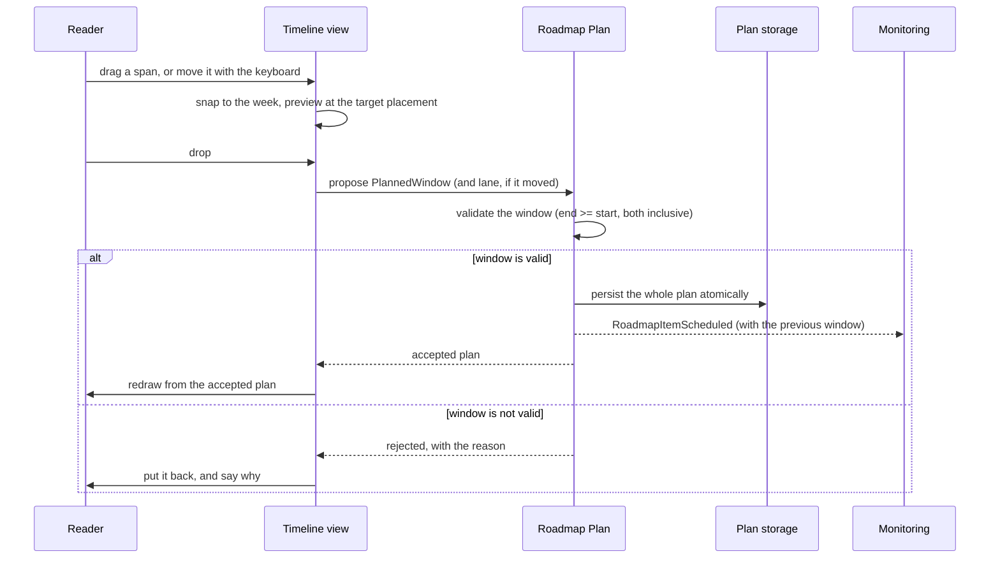
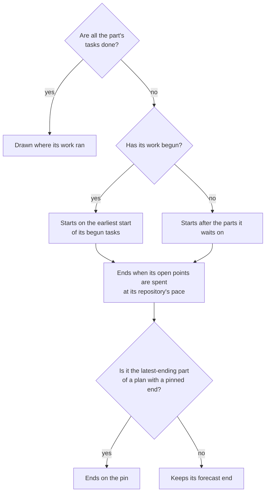
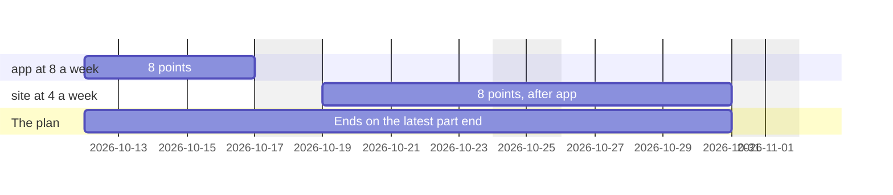

# Roadmap Planning

```meta
type: features
```

> Features and sub-features this bounded context supports, described in
> business/ubiquitous language rather than implementation terms.

## Owning a stored plan

```meta
type: feature
related: [.devbook/domain/roadmap/domain.md#roadmap-plan]
```

Keep a plan that exists in its own right, so intent survives a restart and can be
written down before the work is refined. The plan lives with the person's own
storage location: point the workspace at a different folder and the plan moves
with it. A plan kept apart from the rest of their data is one they lose.

### Planning work that has no task yet

```meta
type: sub-feature
related: [.devbook/domain/roadmap/domain.md#roadmap-item, .devbook/domain/roadmap/requirements.md#planning-work-that-has-no-task-yet]
```

Add an item to the plan with a title and dates alone. Most planning happens before
refinement, and a tool that first demands a refined work item is used after the
decisions are made elsewhere.

Some work is never refined: a launch post, a call, a decision. No task will say it
is done, so the person **completes the item by hand**, from the end of its bar or
from its editor, and reopens it if wrong. The item then reads as finished work,
drawn where it was planned.

Tasks have the last word. Once a task is filed under the item, its progress is
what the roadmap reads, and the hand completion waits until no task is left. See
[the requirements](requirements.md#planning-work-that-has-no-task-yet) and
[the invariant](domain.invariants.md#invariant-gathered-tasks-outrank-a-completion-by-hand).

### Linking an item to the task that executes it

```meta
type: sub-feature
related: [.devbook/domain/tasks/domain.md#task]
```

Name the [Task](../tasks/domain.md#task) that carries out a planned item, so the
plan shows real progress instead of a guess, while the work's status and priority
stay in Tasks. The link is optional in both directions and may dangle.

### Milestones

```meta
type: sub-feature
related: [.devbook/domain/roadmap/domain.md#milestone]
```

Mark the fixed points a plan is read against:

- a release;
- a freeze;
- a review;
- a commitment made to someone else.

A milestone is a day, not a short piece of work, and can be depended on as an
item can.

Milestones share one place at the top of the plan, not each repository's band,
because a release is a fact about the plan, not one project.

### A date the whole plan is read against

```meta
type: sub-feature
related: [.devbook/domain/roadmap/domain.md#milestone]
```

Say that a date, such as a release or a freeze, is one everything is measured
against. It is then drawn through the whole plan, so what lands before it reads
without tracing a vertical line by eye.

That is a planning judgement, so it is recorded on the milestone, not decided by
the view. A plan where every date claimed it would be a plan of lines.

## Syncing the plan between devices

```meta
type: feature
depends-on: [.devbook/domain/roadmap/features.md#owning-a-stored-plan, .devbook/domain/tasks/features.md#multi-device-sync]
related: [.devbook/arc42/adr/0018-roadmap-plan-and-pace-ride-the-task-feed.md, .devbook/arc42/adr/0005-azure-hosted-task-replica-for-multi-device-sync.md, .devbook/domain/roadmap/domain.md#roadmap-plan, .devbook/domain/tasks/domain.md#device, .devbook/domain/roadmap/context.md#story-points-a-week]
```

Keep one plan on every device the person has paired. The whole plan travels
beside the tasks the devices already sync
([Multi-device sync](../tasks/features.md#multi-device-sync)):

- its items;
- its milestones;
- its dependencies;
- its lanes;
- its dates;
- its band colours.

It travels only while sync is on and the device is paired. Otherwise the plan is
that device's own.

The plan is replaced whole, never merged. When two devices have both saved since
they last synced, the **newer save wins on every device** and the older is lost,
as with a task edited in two places. A merge item by item could also form a
dependency loop that neither plan held, while one whole plan was valid when saved.

A device that has **never saved a plan has nothing to send**, so a newly paired
machine shows the other device's plan rather than wiping it with an empty one.
How the plan is being looked at stays with the device: zoom and scroll do not
travel.

### Carrying the pace with the person

```meta
type: sub-feature
related: [.devbook/domain/roadmap/context.md#story-points-a-week, .devbook/arc42/adr/0018-roadmap-plan-and-pace-ride-the-task-feed.md, .devbook/arc42/adr/0019-roadmap-counts-the-working-week.md, .devbook/domain/productivity/context.md#working-week, .devbook/domain/roadmap/requirements.md#carrying-the-pace-with-the-person]
```

The pace travels too, so a bar sized by its effort is drawn the same length on
every device: the typed pace, the chosen source, and each repository's own pace
([Story points a week](context.md#story-points-a-week)). It travels apart from the
plan, so a pace changed on one device and the plan edited on another both
survive. Between two pace changes, the newer wins. A device that has never set a
pace sends none and reads the other's instead of offering its seven. Measured
paces do not travel: each device counts them from the finished work it holds.

The working week travels with the pace, in the same document under the same
newer-wins rule ([ADR 0019](../../arc42/adr/0019-roadmap-counts-the-working-week.md)),
with its [day overrides](domain.md#day-override). Every device then counts a bar
over the same hours.

The person has one working week. The dashboard's hour grids read the weekly pattern only, and its Hours worked part
reads the overrides too ([Working week](../productivity/context.md#working-week)).
A pace saved without a working week reads the device's own until the next change
writes one. See [the requirements](requirements.md#carrying-the-pace-with-the-person).

## Tagging planned work

```meta
type: feature
depends-on: [.devbook/domain/roadmap/features.md#owning-a-stored-plan]
related: [.devbook/domain/roadmap/domain.md#roadmap-tag]
```

Give every planned item a short [tag](domain.md#roadmap-tag) other work can be
filed against, so a Task or a devbook chapter can say "this belongs to that plan
item" without the plan naming it first. The tag is derived from the item's title
at creation and is then editable on its own.

The tag does not move when the title is renamed, every item has one, and two items
may share one. Renaming and retagging are different acts, which makes a tag safe
to write elsewhere. The plan lists the tags in use and the items under each, so
grouping under a shared tag is first-class.

The tag is spelled two ways. The item holds the **bare slug**, `release-q4`. A
[Task](../tasks/domain.md#task) filed under it wears the
[plan sigil](domain.md#plan-sigil), `+release-q4`, which the task's picker offers.
An imported plan becomes one item, and its tag, spelled the same way, is the plan's slug.
[Laying out imported plans](#laying-out-imported-plans) rests on that, and
`.devbook/arc42/adr/0013-imported-plan-is-a-roadmap-item-laid-out-by-import.md`
settles the spellings.

A saved item's dialog has up to two buttons beside the Tag field:

- a copy button, which copies the tag with its sigil, as the Tasks filter bar's plan
  chip does. It shows while the [`copy-entries`](../tasks/context.md#copy-entries)
  flag is on, which it is by default;
- the plan's [queue icon](../sessions/features.md#start-a-session-from-an-entry),
  which shows while [`session-requests`](../sessions/context.md#session-requests)
  is on, and stays when `copy-entries` is off.

A new item, or one without a tag, has no copy button.

## Gathering work under an item and totalling its effort

```meta
type: feature
depends-on: [.devbook/domain/roadmap/features.md#tagging-planned-work]
related: [.devbook/domain/roadmap/domain.md#roadmap-item-gathering, .devbook/domain/tasks/features.md#effort-registration, .devbook/domain/brain/features.md#topic-and-tag-grouping]
```

**Gathering an item's work and totalling its effort**



The rules are in [Roadmap Item Gathering](domain.md#roadmap-item-gathering) and
[its invariants](domain.invariants.md#roadmap-item-gathering). Gathering happens
on the **read** path only and
[writes nothing back](domain.invariants.md#invariant-gathering-never-writes).

An item gathers work by what it **names** and by what carries its **tag**, so its
size is never kept by hand.
Something reached both ways is shown once and marked, so a person about to remove
a link sees whether the tag would still hold the work. The item reports its
[total registered effort](domain.md#effort). It also reports **how many gathered
things carry no estimate**, so a small total cannot hide a pile of unsized work.

## Priority planning

```meta
type: feature
depends-on: [.devbook/domain/roadmap/features.md#owning-a-stored-plan]
related: [.devbook/domain/roadmap/domain.md#planning-priority]
```

Decide what matters most across projects at once, and record it in the plan
rather than in each project. The plan's priority is its own judgement: a task's
priority never overwrites it and setting it never reaches into that task, so
reprioritising a quarter does not mean editing a dozen issues.

## Dependency planning

```meta
type: feature
depends-on: [.devbook/domain/roadmap/features.md#owning-a-stored-plan]
related: [.devbook/domain/roadmap/domain.md#dependency, .devbook/domain/roadmap/domain.md#plan-sequencing]
```

**Dependency validation flow**



Record what has to land before what, between any two things in the plan: item to
item, item to milestone, milestone to item. The order is stated once, and
everything read off the plan respects it.

- The three rejections refuse to store: an
  [unknown node](domain.invariants.md#invariant-a-dependency-names-a-node-in-the-plan),
  [a node waiting for itself](domain.invariants.md#invariant-nothing-waits-for-itself)
  and [a cycle](domain.invariants.md#invariant-a-cycle-is-refused).
- The contradiction check
  [never refuses anything](domain.invariants.md#invariant-a-contradiction-is-reported-never-corrected):
  dates that do not fit are a normal, temporary state, shown by the arrow that
  doubles back through the gutter.
- Cycle detection walks the whole graph reachable from the target, so the root
  checks it before accepting the edge.

### Refusing a circular plan

```meta
type: sub-feature
```

Reject a dependency that would make something wait, however indirectly, on
itself. The plan is left untouched and the reason is reported, because no order
could execute a circular plan.

### Surfacing contradictions instead of fixing them

```meta
type: sub-feature
related: [.devbook/domain/roadmap/domain.md#plan-sequencing]
```

Show every [Contradiction](domain.md#contradiction) in the plan, reported and not
silently corrected, because quietly moving dependent work would hide that a date
does not fit. Only a window the importer still sizes by effort moves by itself,
and only while nothing has started there
([Placing a plan in time](#placing-a-plan-in-time)). That is the importer's own
rule applied again, not a person's date overruled.

## Repository-scoped planning

```meta
type: feature
depends-on: [.devbook/domain/roadmap/features.md#owning-a-stored-plan]
related: [.devbook/domain/roadmap/domain.md#repository-scope, .devbook/domain/repository-management/features.md#repository-registration]
```

Relate planned work to the repositories it happens in, by the repository identity
the rest of the product uses. One plan can span a portfolio and be read one
project at a time.

### Reading the plan by repository

```meta
type: sub-feature
related: [.devbook/domain/roadmap/features.md#placing-a-plan-in-time, .devbook/domain/repository-management/requirements.md#archiving-a-repository]
```

**Reading the plan by repository**



Group the plan into one [band](domain.md#band) per repository, with the person's
own lanes inside each. Each band draws only that repository's [part](domain.md#part)
of a piece of work, at that repository's own pace
([Placing a plan in time](#placing-a-plan-in-time)). The work stays findable under
any of its repositories.

- Resolution happens on the **read** path only.
  [An alias that no longer resolves is kept](domain.invariants.md#invariant-an-unresolved-scope-alias-is-kept),
  so a repository removed today and configured again tomorrow leaves the plan as
  it was.
- An item naming several repositories is drawn in the band of each configured one,
  and the parts can carry different dates. Only the item's one window is stored.
- Dragging any part moves the whole item, because a part has no dates of its own.
  The move is a [hand move](domain.md#roadmap-item), so the item is no longer
  placed by its effort. Every part draws over its one moved window
  ([Placing a plan in time](features.md#placing-a-plan-in-time)).

Work that names no repository, or only unconfigured ones, sits in a last band of
its own. That band takes no colour and shows no name, and a screen reader hears it
called "No repository". The chart always draws it, with one empty "Planned" lane
when nothing is filed there, where the person plans the next project before it has
a repository, by double-clicking or dragging on it.

An [archived repository](../repository-management/domain.md#archived-repository)
is still configured, so its work never falls into that last band. How its own
band is drawn is set by
[its requirements](../repository-management/requirements.md#archiving-a-repository).

### Surviving a repository that is no longer configured

```meta
type: sub-feature
related: [.devbook/domain/roadmap/domain.md#repository-scope-resolution, .devbook/domain/repository-management/requirements.md#archiving-a-repository]
```

The alias an item named is kept as written and reads as unresolved; nothing the
person typed is deleted because a registry changed. An
[archived repository](../repository-management/domain.md#archived-repository) is
not this case, because the registry still holds it.

## Reading and rescheduling on a timeline

```meta
type: feature
depends-on: [.devbook/domain/roadmap/features.md#dependency-planning, .devbook/domain/roadmap/features.md#repository-scoped-planning]
related: [.devbook/design/interaction-guidelines.md, .devbook/design/interaction-guidelines.md#shell-header, .devbook/arc42/adr/0022-the-shell-shows-one-main-view-picked-by-a-view-switch.md, .devbook/domain/roadmap/requirements.md#reading-and-rescheduling-on-a-timeline]
tests: [unit:dotnet:Backlog.Desktop.UI.UnitTests.HomeWorkspaceSurfaceTests.The_roadmap_view_replaces_the_task_list_inside_the_workspace, unit:dotnet:Backlog.Desktop.UI.UnitTests.HomeWorkspaceSurfaceTests.The_devbook_and_the_inbox_each_take_the_screen_over_the_roadmap, unit:dotnet:Backlog.Desktop.UI.UnitTests.HomeWorkspaceSurfaceTests.Escape_heard_at_the_document_leaves_the_roadmap_open, unit:dotnet:Backlog.Desktop.UI.UnitTests.HomeWorkspaceSurfaceTests.A_roadmap_surface_from_before_the_view_switch_reopens_as_the_roadmap_view]
```

**Rescheduling flow**

A reschedule starts as a *proposal*. The view never edits the plan: it reports
where something was dropped, the plan decides whether that stands, and the view
redraws from the answer. Nothing is persisted until the plan accepts it.



- [A drop that moves nothing proposes nothing](requirements.md#requirement-a-drop-that-moves-nothing-proposes-nothing),
  so picking something up and putting it down never rewrites the plan.
- [A reschedule leaves the dependencies alone](domain.invariants.md#invariant-a-reschedule-leaves-the-dependencies-alone):
  dependent work is not dragged along, and any contradiction is the reader's cue.
- The event carries the previous window, so a consumer can tell a first plan from
  a change without keeping history.

See the whole plan against time, with its bands, lanes, spans, milestones and
arrows, and change when something happens by moving it. A reschedule is stored as
a change to the plan.

The roadmap is the last of the views in the header's view switch, after Tasks,
Board and Calendar, under its own Planning heading row and without the Tasks
filter bar. It is a view, not a takeover, so only another view replaces it. The
Inbox and the Devbook take the screen over it as over the task list, and closing
either returns to the roadmap.

Escape does not leave the roadmap: it puts a grabbed bar back and dismisses the
planning dialogs. A narrower window never closes it. Opening the Dashboard, Tools,
the session list or the pull requests list from it and closing them again returns
to it. A roadmap left open from before the view switch reopens as the roadmap
view.

### Rescheduling without a mouse

```meta
type: sub-feature
```

Every move and resize can be made from the keyboard, and each step is announced: a plan that could only be dragged could be read by some people and edited by none.

### Reading the near term closely

```meta
type: sub-feature
related: [.devbook/domain/roadmap/features.md#looking-back-at-finished-plans, .devbook/domain/roadmap/features.md#forecasting-work-in-flight, .devbook/domain/roadmap/requirements.md#reading-the-near-term-closely, .devbook/domain/roadmap/domain.md#actual-hours, .devbook/arc42/adr/0019-roadmap-counts-the-working-week.md]
```

The timeline fills the width it is given and is ruled finer the nearer it is to
today, the same way in both directions:

- last week, this week and next week: a column a day;
- the three weeks either side of those: a column a week;
- then months, for about a quarter;
- then quarters.

The four weeks before this one are always ruled: last week in days and the three
before it in weeks. Earlier months and quarters appear only when something drawn
reaches that far back. Forward, the axis reaches at least to the end of its
months, and further when the plan does. The work in flight sits around today,
where a single week column would stack every bar that started in it on a few
pixels. Every column widens by the same factor
until the chart from last week on fills the screen, so a short plan never leaves
the right empty, and the chart opens on last week.

The day and week columns also show the person's
[working week](domain.md#working-week), with the dates they blocked or unblocked.
A date the person does not work, blocked or a weekend in the pattern, wears the
weekend's colours and hatching. A date they do work looks like any ordinary day.
A small marker on the
[column head](domain.md#column-head) is the only sign that a date differs from its
pattern.

Each head carries one hours figure. A head still to come shows its planned working
hours. A head that has begun, today and the current week included, shows the
[actual hours](domain.md#actual-hours) worked so far instead, such as "6.2h", or
"0h" for a worked day with no work recorded. A head never shows both, because
two figures side by side were hard to read. The tooltip can name both, such as
"6.2h worked of 8.5h planned".

A wide column reads the figure inline, such as "Wed 23 · 8.5h" and "W41 · 42.5h".
A narrow one shows it on a line under the label. The Hours switch on the toolbar
hides the line. It is on by default and stays with the device, because how the
axis is read is not part of the plan.

Every column keeps its width, because the axis is still time. Narrowing the days
off was rejected: a drag of the same distance would move a bar by a different
number of days ([ADR 0019](../../arc42/adr/0019-roadmap-counts-the-working-week.md)).
See [the requirements](requirements.md#reading-the-near-term-closely).

### Blocking and unblocking a day

```meta
type: sub-feature
related: [.devbook/domain/roadmap/domain.md#day-override, .devbook/domain/roadmap/requirements.md#blocking-and-unblocking-a-day, .devbook/domain/productivity/context.md#working-week, .devbook/arc42/adr/0019-roadmap-counts-the-working-week.md]
```

Take a single day off, or work a day the week does not, by pressing that day's
[column head](domain.md#column-head). A weekly pattern alone cannot say that next
Friday is a holiday, and a bar counted over it would land a day early.

Each press records a [day override](domain.md#day-override), and pressing again
returns the day to the weekly pattern. A past date can be changed too, because
measured paces count the hours that were actually there. The head is a real button
for the pointer, keyboard and screen reader, but does not look like one. The
weekly pattern stays in
[Productivity's setting](../productivity/context.md#working-week). See
[the requirements](requirements.md#blocking-and-unblocking-a-day).

### Setting days off in a list

```meta
type: sub-feature
related: [.devbook/domain/roadmap/domain.md#day-override, .devbook/domain/roadmap/features.md#blocking-and-unblocking-a-day, .devbook/domain/roadmap/requirements.md#setting-days-off-in-a-list, .devbook/domain/productivity/context.md#working-week, .devbook/arc42/adr/0019-roadmap-counts-the-working-week.md]
```

See every day off and extra worked day in one list, and set a two-week holiday in
one go. The **Days off** button on the roadmap toolbar opens the dialog. Only a
day column has a head to press, so the dialog is also how a person blocks a date
the axis shows inside a week column.

The dialog lists each [day override](domain.md#day-override) with its date,
weekday and whether it is blocked or unblocked, dates still to come first and past
ones behind "Show past". The person can add a range of days off, which blocks only
the dates the weekly pattern works because a weekend inside a holiday needs no
override. The person can also add a single worked date, which unblocks a day the
pattern leaves off, and remove any entry.

The dialog writes the same overrides a press on a head writes, they travel the
same way inside the working week, and every bar is laid out again at each change.
See [the requirements](requirements.md#setting-days-off-in-a-list).

### Looking back at finished plans

```meta
type: sub-feature
related: [.devbook/domain/roadmap/domain.md#planned-window, .devbook/domain/tasks/domain.md#started, .devbook/domain/tasks/domain.md#completed, .devbook/domain/roadmap/features.md#reading-the-near-term-closely, .devbook/domain/roadmap/features.md#forecasting-work-in-flight, .devbook/domain/roadmap/requirements.md#looking-back-at-finished-plans]
```

A plan whose tasks are all done is drawn where its work actually ran: from the day
its first task was started to the day its last was ticked off. Scrolling back
shows what was finished and how long it really took. When nothing says when the
work ended, the planned end stands, but never later than today, because finished
work cannot end in the future.

History is ruled as the horizon is, mirrored. The four weeks before this one are
always there, last week in days and the three before it in weeks. Months and
quarters appear before them only when something drawn reaches that far back.

A finished plan cannot be dragged, because its dates are read off the work.
Opening it still edits the stored item. A plan still being worked on is drawn from
its work too, to a forecast end
([Forecasting work in flight](#forecasting-work-in-flight)).

The Completed switch on the toolbar, beside Hours, takes the finished plans off
the chart when the person wants only what is left to do. It is the one narrowing
the roadmap offers: a filter bar by repository, priority, lane or tag was dropped,
because the bands already sort by repository and a plan is small enough to read
whole. Off, the lanes close up over the open work, and an arrow to a hidden plan
goes with it. The switch is on by default and stays with the device, as the Hours
switch does, because what is shown of the plan is not part of the plan.

### Forecasting work in flight

```meta
type: sub-feature
related: [.devbook/domain/roadmap/domain.md#planned-window, .devbook/domain/roadmap/domain.md#effort, .devbook/domain/roadmap/domain.md#working-week, .devbook/domain/roadmap/features.md#looking-back-at-finished-plans, .devbook/domain/roadmap/features.md#reading-the-near-term-closely, .devbook/domain/roadmap/features.md#placing-a-plan-in-time, .devbook/domain/roadmap/requirements.md#forecasting-work-in-flight, .devbook/domain/tasks/domain.md#started, .devbook/arc42/adr/0019-roadmap-counts-the-working-week.md]
```

A plan is in flight when some of its tasks are in progress or done and some are
still open. Its forecast shows where it will really land, not where it was hoped
to. A planned window that stretches finished work over months, or ends before the
work left could, is the hope and not the reading.

A plan in flight is forecast one [part](domain.md#part) at a time, the same parts
[Placing a plan in time](#placing-a-plan-in-time) lays out:



The plan's forecast end is the latest part end. These rules apply on top of it:

- A begun part may start earlier or later than the plan's planned start, and that
  holds for a plan placed by hand too. A task's start is its own started date,
  else the start of the session linked to it, else the day the task was created.
- The open points count an unestimated task as one. The count starts on the first
  worked day on or after the later of today and the part's start. The hours are
  counted through the person's [working week](domain.md#working-week), the same
  way every other window is counted
  ([ADR 0019](../../arc42/adr/0019-roadmap-counts-the-working-week.md)).
- A pinned end is a person's date and outranks the forecast, but only on the part
  that ends latest. Every part tied for that end ends on the pin, and every other
  part keeps its own forecast. The pin never ends that part before the first day
  its open work can be drawn on.
- Pulling the end of an earlier part pins the plan's end as many days later as the
  pull moved it. The forecast still shows in the detail of the part the pin moved,
  with the pace it was read at, so pinning does not hide what the pace says.
- When the plan hands work over between repositories, every open part is placed
  after the parts it waits on, at its own repository's pace. None is given a
  share of the window by its size. A done part is drawn where its work ran, not
  stretched over the future.

The bar is locked like a finished one, because its dates are read off the work.

A finished part wears a done style of its own, because the lock and a full fill
do not tell it apart: every part of a plan in flight is locked. See
[the requirements](requirements.md#forecasting-work-in-flight).

The parts are never stored. A plan placed by hand or by its due date keeps its
[planned window](domain.md#planned-window), and its forecast is read off the work
at every draw. A plan whose window is still sized by its effort stores the window
its parts make ([Placing a plan in time](#placing-a-plan-in-time)).

### Telling one project from another at a glance

```meta
type: sub-feature
related: [.devbook/design/color-scheme.md#band-identity-tokens, .devbook/domain/repository-management/features.md#repository-identity-colour]
```

Draw each repository's band in that repository's own colour, so a plan spanning a
portfolio reads one project at a time without tracing rows back to a label.

The colour is an **identity and nothing more**: it says which repository, never a
status, severity or priority, and never alone. The band is labelled and every span
names its band when read aloud, so a reader who cannot tell two hues apart loses
nothing. Priority is the ordinal shade ramp on the spans, one colour.

**The plan does not decide or store the colour.** A repository's colour is a fact
about it, settled in the registry and told to the plan, as repository aliases are
held opaque. A colour of the plan's own could differ from the registry's and
would need rewriting whenever the choice changed.

The band for work under no repository, and the band carrying the plan's dates,
take no colour, because a colour here means "which repository".

## Editing the plan in place

```meta
type: feature
depends-on: [.devbook/domain/roadmap/features.md#owning-a-stored-plan]
related: [.devbook/domain/roadmap/domain.md#roadmap-plan, .devbook/domain/roadmap/features.md#dependency-planning]
```

Add planned work, change it, and take it off the plan, from the place the plan is
read. Dates move, priorities change, and what something waits for turns up late.

An edit submits the whole item (title, window, priority, repositories, lane,
notes), because a partial edit cannot tell "leave this alone" from "clear this".
The item's identity survives every edit, so anything waiting on it still is.

Naming a repository is optional: an item saved with none lands in the band for
work under no repository.

### Editing what something waits for

```meta
type: sub-feature
related: [.devbook/domain/roadmap/features.md#refusing-a-circular-plan]
```

Add and remove dependencies while looking at the item that has them. A dependency
is answered on the spot, not when the rest of the edit is saved, because it can be
refused for a reason no field explains: it would make the plan circular.

### Refusing an edit rather than half-applying it

```meta
type: sub-feature
```

An edit that cannot stand, such as one with no title or with dates that do not
make a window, changes nothing. It says why without closing the editor, so a
refusal never looks like a save.

## Publishing planned intent for observation

```meta
type: feature
depends-on: [.devbook/domain/roadmap/features.md#owning-a-stored-plan]
related: [.devbook/domain/roadmap/domain.md#roadmapitemscheduled, .devbook/domain/monitoring/features.md]
```

Announce when planned work is scheduled or moved, so
[Monitoring & Dashboard](../monitoring/domain.md#progress-signal) can
compare intent against delivery. Roadmap publishes and does not subscribe: nothing
observed downstream reaches back in and edits the plan.

## Laying out imported plans

```meta
type: feature
depends-on: [.devbook/domain/roadmap/features.md#tagging-planned-work, .devbook/domain/roadmap/features.md#gathering-work-under-an-item-and-totalling-its-effort, .devbook/domain/roadmap/features.md#dependency-planning]
related: [.devbook/arc42/adr/0013-imported-plan-is-a-roadmap-item-laid-out-by-import.md, .devbook/domain/tasks/features.md#import, .devbook/domain/tasks/features.md#re-importing-an-updated-plan, .devbook/domain/roadmap/features.md#sequencing-work-into-tracks, .devbook/domain/roadmap/features.md#reading-and-rescheduling-on-a-timeline, .devbook/domain/roadmap/domain.md#roadmap-item-gathering]
```

Put a plan that was [imported](../tasks/features.md#import) on the roadmap without
typing it in again. An imported plan becomes **one planned item**, tagged with the
plan's slug. The tasks the import created are gathered under it by the tag they
carry, so nothing links or copies them. The plan's steps are read inside that
item, sized by their registered effort, and its progress is the tasks' progress,
read every time and stored nowhere.

A plan reaches the roadmap two ways, both the same import.

- A **roadmap document** describes the items outright, in the entry text a
  task-level plan uses, with the type word `plan` on each entry. Each entry gives
  a title, the plan's tag, repositories, priority, what it waits on, and
  optionally a due day.
- Or **the tasks come first** and the plan is laid out later from their tag (see
  [the shelf](#laying-out-a-plan-whose-tasks-arrived-first)).

Either way, the person pressing Import is the person changing the plan, and the
item it creates is theirs to move. The reasoning is in
`.devbook/arc42/adr/0013-imported-plan-is-a-roadmap-item-laid-out-by-import.md`.

### Placing a plan in time

```meta
type: sub-feature
setting: [.devbook/domain/roadmap/context.md#story-points-a-week]
related: [.devbook/domain/roadmap/domain.md#roadmap-item, .devbook/domain/roadmap/domain.md#roadmap-item-gathering, .devbook/domain/roadmap/domain.md#dependency, .devbook/domain/roadmap/features.md#reading-the-plan-by-repository, .devbook/domain/roadmap/features.md#forecasting-work-in-flight, .devbook/domain/roadmap/domain.md#planned-window, .devbook/domain/roadmap/domain.md#plan-sequencing, .devbook/domain/roadmap/features.md#surfacing-contradictions-instead-of-fixing-them, .devbook/arc42/adr/0013-imported-plan-is-a-roadmap-item-laid-out-by-import.md#4-the-importer-places-the-window-velocity-is-the-readers, .devbook/arc42/adr/0019-roadmap-counts-the-working-week.md, .devbook/domain/roadmap/domain.md#working-week, .devbook/domain/roadmap/requirements.md#placing-a-plan-in-time]
```

Give an imported plan a window nobody had to guess. In this chapter, *a plan* is
one imported plan and the [Roadmap Item](domain.md#roadmap-item) that holds it.

- The **end** is the day the plan says it is due, when it says one.
- The **start** is never in the document. It is the day after the last thing the
  plan waits on finishes, or today when it waits on nothing.
- A plan with no due date gets a **length from its effort**: the story points its
  tasks registered, divided by the person's
  [pace](context.md#story-points-a-week) in points a working week.

The plan never starts on a day the person does not work; such a start moves to
their next working day. From there it counts their working hours forward,
skipping the days and hours they do not work, and ends on the day the hours run
out ([ADR 0019](../../arc42/adr/0019-roadmap-counts-the-working-week.md)). It is
never shorter than its start day. It takes one working week when nothing is
gathered yet or nothing is sized. The hours are the person's
[working week](domain.md#working-week), so a date they blocked on the axis counts
none and a day off they unblocked counts its hours
([requirements](requirements.md#placing-a-plan-in-time)).

A due date that falls before the plan could start is kept. The plan is then placed
on that one day, so the [contradiction shows](#surfacing-contradictions-instead-of-fixing-them)
rather than being smoothed over.

The pace is the person's reading pace, not an estimate, kept per
[band](domain.md#band). [Story points a week](context.md#story-points-a-week)
says which pace each band uses and how it is measured, shown and stored.

**A plan filed under several repositories is laid out one
[part](domain.md#part) per repository**, each placed at its own pace. In the
example below, a plan holds one 8-point task in `app` and one 8-point task in
`site` that waits on it. `app` gets through 8 points a week and `site` 4.



- **Each part counts the full points of its own tasks and of the shared tasks it
  carries.** An [own task](domain.md#own-task) is filed under that repository
  alone. A [shared task](domain.md#shared-task), filed under several, counts in
  full in each of its bands that still has own work open, so a shared sign-off
  never keeps open a band whose own work is done. When no band of a shared task
  has own work open, it counts where own work ended last, or in all its bands when
  none had any
  ([requirements](requirements.md#requirement-a-shared-task-counts-where-own-work-is-still-open)).
  A task filed under none goes to the first part.
- **A part waits on what its work waits on.** Every part waits on the plans this
  plan [depends on](domain.md#dependency). A part also waits on every other part
  that holds a task one of its own tasks waits on: these are the waits
  [the gathering](domain.md#roadmap-item-gathering) carries. A wait on work the
  plan did not gather is not counted. A circle of waits between parts is broken at
  the earliest part still waiting, the way the gathering breaks one between tasks.
- **A part starts on the later of today and the day after the latest end among
  what it waits on.** A start on a day the person does not work moves to their next
  working day. From there the part's points are counted through the working week at
  its own repository's pace.
- **Work that hands over and back gets a part per phase.** When work passes from
  one repository to another and returns, the first repository has one part before
  the hand-over and one after it. Each is placed after the parts it waits on.
- **A part with nothing sized takes one working week**, as a plan does. A repository
  the plan names that holds none of its tasks draws its part over the plan's own
  window.

**The plan's own window ends on the latest part end** and starts on the earliest
part start. The importer stores that window, and contradictions, milestones and
the plans that wait on this one read it, so work that waits on a plan starts after
its last part ends. **Parts are worked out every time the
roadmap is drawn and never stored.**

Parts are placed this way only while the plan's window is still sized by its
effort, or while its work is [in flight](#forecasting-work-in-flight). A plan
moved by hand, or ending on its due date, draws every part over its one stored
window. Dragging any part moves the whole plan, a [hand move](domain.md#roadmap-item)
like any other, after which the plan is no longer sized by its effort
([ADR 0013, ruling 4](../../arc42/adr/0013-imported-plan-is-a-roadmap-item-laid-out-by-import.md#4-the-importer-places-the-window-velocity-is-the-readers),
as amended on 2026-10-07).

**Keeping up with its work.** A plan whose window is still sized by its effort is
laid out again from what is **not done yet** every time the roadmap opens and
every time a task changes. It is laid out part by part, each at its own
repository's pace, from today. A part whose work has begun is drawn from the day
that work began
([Forecasting work in flight](#forecasting-work-in-flight)), and the plan keeps the
earliest part start as its own. A plan nobody has started whose start has passed
starts today, or on the next working day when the person does not work today.

Finished tasks do not count toward the plan's length, so a plan that ran late
shows the day the rest will land and one that ran ahead pulls its end in. A
changed pace, or a measured pace moving as work is finished, re-draws the same
way.

A finished plan keeps its window and is drawn over the days its work ran. A plan
moved by hand, or ending on its due date, keeps its dates (ADR 0013, ruling 5 as
amended on 2026-09-27 and on 2026-10-07).

An item the import placed remembers it in `placed_by_import`. The first time a
person moves it by hand, that memory is cleared and the importer never touches
its dates again. The item's editor shows the window as laid out, and a Save that
leaves the dates alone is not a hand move. Re-importing works like this:

- Re-importing the roadmap document brings the item's title, repositories,
  priority and dependencies up to date. It re-places only the windows the
  importer still owns.
- Re-importing the plan's tasks changes nothing on the item but the length of a
  window still sized by effort.
- **Nothing is ever removed** from the plan by an import. A plan the document has
  stopped describing stays planned, because taking work off the roadmap is a
  planning decision: other work waits on it. The person makes it
  [in place](#editing-the-plan-in-place).

Work that waits on a plan that moved follows it when nothing has started there
and its own window is still sized by effort. It starts the day after that plan
ends and keeps its length. Work that has begun, or was placed by hand or by a due
date, keeps its dates, and a resulting conflict is
[named, not moved](#surfacing-contradictions-instead-of-fixing-them).

An import says what it could not do rather than guessing:

- A plan entry with no tag is skipped and named, because the tag is how the next
  import finds it.
- A tag several planned items already carry updates the first of them and names
  the rest.
- A dependency that names nothing is dropped and named.
- A document whose dependencies would make the plan circular is
  [refused whole](#refusing-an-edit-rather-than-half-applying-it). Nothing is
  created and nothing revised, and the person sees which edge did not fit.

### Reading a plan's steps inside its item

```meta
type: sub-feature
related: [.devbook/domain/roadmap/domain.md#roadmap-item-gathering, .devbook/domain/tasks/features.md#task-dependencies, .devbook/domain/tasks/features.md#effort-registration, .devbook/domain/roadmap/features.md#sizing-a-track-by-the-effort-it-gathers]
```

Open a planned item on the timeline and see the steps it gathers laid end to end
inside its bar. They run in the order the tasks' own dependencies put them, ties
broken by which was written first. Each step is as wide as its share of the plan's effort.
A step nobody sized is drawn at a fixed small width and marked unsized. Each step
wears its task's status colour.

The item's bar fills with the effort done over the effort registered, with the
count of unsized steps beside it, so a small fill over unsized work cannot pass
for a plan nearly finished.

The widths are **proportions of the window, not dates**: a step drawn across a
Tuesday is not scheduled for Tuesday. This is the reading
[the tracks idea](#sizing-a-track-by-the-effort-it-gathers) asked for, and it
settles that idea's first question: dates stay and effort sizes the steps within
them.

Everything drawn here is read from Tasks each time the band draws, and again
whenever a gathered task is written or an import lays items out. The plan stores
no status, progress or order of its own.

### Laying out a plan whose tasks arrived first

```meta
type: sub-feature
related: [.devbook/domain/tasks/features.md#filing-a-task-against-a-roadmap-tag, .devbook/domain/roadmap/features.md#planning-work-that-has-no-task-yet]
```

Find the plans that were imported as tasks and never placed. Every plan tag the
backlog carries that no planned item holds is listed on a **shelf** beside the
timeline. Picking one creates its item, tagged with that slug so it gathers the
tasks already there, and [places it](#placing-a-plan-in-time) from the effort
they registered.

The Import dialog offers the same at import, as an option that is off unless
asked for. A document of task entries with no `plan` entry can then be laid out as
one item per plan tag it carries. Someone only refreshing a plan's tasks does
not grow an item they did not ask for.

Only a tag written with the [plan sigil](domain.md#plan-sigil) reaches the shelf.
A plan filed under a general tag before the sigil existed still gathers under an
item whose tag matches it, but the item is the person's to create.

The shelf is a column beside the timeline, or beside the empty state when nothing
is planned yet, because the tasks-first order is the one that starts with no roadmap. It moves under the timeline on a narrow window. It holds one card
per plan, showing:

- the plan tag in full;
- how many tasks carry it;
- the points they registered, and how many registered none;
- for a plan whose tasks are filed in more than one repository, a line per
  repository with that repository's share.

Picking a card is one gesture, **Plan it**. It runs the same import a roadmap
document runs, with the effort those tasks registered: the item is titled from its
tag, filed under those repositories, and placed from that effort. The card then
leaves the shelf and what was planned is announced. A shelf with nothing to offer
is not drawn.

The Tasks [Calendar](../tasks/features.md#calendar-view) offers the same shelf as
**Plans without a window**, and there a plan is dropped on a day instead. The same
import places it, with one difference. The window opens on the first worked day
on or after the day it was dropped on, or today for a day already past. Its end is
counted from there as it would be from today.

The window opens there even when some of the plan's work has begun, and its end is
counted for the points still open. The window is the person's from then on, as one
dragged on the timeline is: it does not
[keep up with its work](#placing-a-plan-in-time), and a later import does not move
it.

## Sequencing work into tracks

```meta
type: feature
depends-on: [.devbook/domain/roadmap/features.md#tagging-planned-work, .devbook/domain/roadmap/features.md#gathering-work-under-an-item-and-totalling-its-effort]
related: [.devbook/domain/roadmap/features.md#dependency-planning, .devbook/domain/roadmap/features.md#reading-and-rescheduling-on-a-timeline, .devbook/domain/roadmap/domain.md#planning-lane, .devbook/domain/tasks/features.md#effort-registration, .devbook/domain/brain/features.md#topic-and-tag-grouping]
```

**An idea, written down to be argued with, not an agreed model.** No status
vocabulary has `idea`, so `proposed` carries it. Nothing below is settled, and the open questions matter as much as the description. Some are
answered by [laying out imported plans](#laying-out-imported-plans) and
`.devbook/arc42/adr/0013-imported-plan-is-a-roadmap-item-laid-out-by-import.md`;
each is marked below, and the rest are open.

Plan a repository's work as **tracks** rather than as dates. A track is an *area
within one repository* holding a chain of work that has to be done in order. Each
piece is written against the one before it, the way one feature depends on
another. What the plan then answers is not *when does this run*, but **what can be
picked up right now, and what would collide if two workers picked up at once**.

The goal is parallel work without conflicting changes. Two tracks are different
areas, so the head of each can be worked at the same time, while two pieces inside
one track cannot, because the later is written against the earlier. The plan then
states **safe concurrency** rather than a forecast. A
[Planned Window](domain.md#planned-window) says two items overlap in *time*, never
whether they overlap in *code*.

The idea would be built on what this context already has, not beside it:

- The chain is the existing [Dependency](domain.md#dependency). Acyclicity, and
  [Plan Sequencing](domain.md#plan-sequencing)'s reachability answers, are
  exactly what an ordered chain needs.
- The work a track holds is reached the way an item already reaches it: by named
  link and by tag, across Tasks and Devbook.
- **The repository line stays as it is.** A track sits inside a repository band
  exactly as lanes and items do today, so a portfolio still reads one project at
  a time.

**Open questions.** Each of these changes what the idea is, not merely how it is
built:

- **Replacement or addition?** *Answered: addition, so dates stay.*
  - The question: if dated planning went, the Planned Window and the timeline
    reading would go with it, and so would
    [RoadmapItemScheduled](domain.md#roadmapitemscheduled). That event is the one contract
    [Monitoring](../monitoring/domain.md#progress-signal) consumes, so comparing
    intent against delivery would need a new answer or a different question. If
    both were kept, one plan would carry two ways of ordering the same work, and
    something would have to say which one a reader is looking at.
  - The answer: effort sizes the steps
    [inside a dated window](#reading-a-plans-steps-inside-its-item). The window,
    the timeline and the event all survive, and Monitoring's contract holds. The
    drawing itself says which reading a person is looking at: the bar is the
    window, and the steps inside it are proportions, never dates.
- **Is a track a [Planning Lane](domain.md#planning-lane) with an order and a size,
  or a new node?** *Partly answered.* A lane today is a free-form label the person
  owns and nothing depends on. A track is ordered and depended upon. Making the
  lane ordered would change what every label already written means, so this is a
  rename with consequences rather than a small extension. An imported plan is an
  existing node, the [Roadmap Item](domain.md#roadmap-item), and its steps are the
  tasks it gathers, so no new node and no ordered lane was needed. Whether a track
  drawn by hand, with no plan behind it, is a lane or an item stays open.
- **What is an "area", and who decides that two areas cannot collide?** The safety
  claim rests entirely on this. If an area is the person's own word, as a lane is,
  the guarantee is their judgement. The plan should then say so rather than imply
  otherwise. If the product derives it from paths the repository actually has,
  Roadmap starts holding repository facts it has deliberately never owned.
  [Repository Scope](domain.md#repository-scope) keeps opaque aliases for exactly
  that reason, and resolving them is a supplier's job.
- **Does a track hold work, or gather it?** *Answered: it gathers.* If the chain
  runs between plan nodes, it is the existing Dependency and nothing moves. If it
  runs between Tasks, the dependency is Tasks' own. Tasks models one, `after:`,
  since `.devbook/arc42/adr/0007-import-reuses-the-entry-text-grammar.md`
  ([task dependencies](../tasks/features.md#task-dependencies)). Roadmap is the
  only context that holds a dependency between two pieces of *planned* work, and
  Tasks holds the one between two *tasks*. An item
  [reads the tasks' chain](#reading-a-plans-steps-inside-its-item) to order its
  steps and never holds it; the chain between plans stays here.
- **Do milestones survive?** *Answered: yes*, because dates do. A
  [Milestone](domain.md#milestone) is a day, and a plan with no dates would have
  had nowhere to put one. With the window kept, it stays the fixed point an
  imported plan can wait on and be placed after.

### Sizing a track by the effort it gathers

```meta
type: sub-feature
related: [.devbook/domain/roadmap/domain.md#roadmap-item-gathering, .devbook/domain/tasks/features.md#effort-registration]
```

Read how big a track is from the **total registered effort** of the work it
gathers (story points) instead of from a span of days. "This track is twice the
one beside it" is a judgement a person can make; "this track ends on the 14th"
mostly is not.

The arithmetic is that of
[gathering work under an item](#gathering-work-under-an-item-and-totalling-its-effort),
unchanged, for the same reason: a track hiding its unestimated work would read as small when it is least understood.

### Picking work that cannot collide

```meta
type: sub-feature
related: [.devbook/domain/roadmap/domain.md#plan-sequencing]
```

Ask the plan what is safe to start now: the head of every track whose predecessor
has landed, with the tracks sharing an area held back. It is answered from the
chain and the areas instead of comparing two spans by eye.

Whether the plan may state this as a **guarantee** or only as advice is the
unresolved part, and it decides how much the idea is worth. See the open question
about what an area is.
