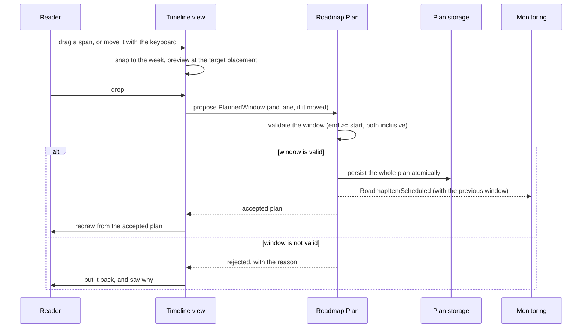
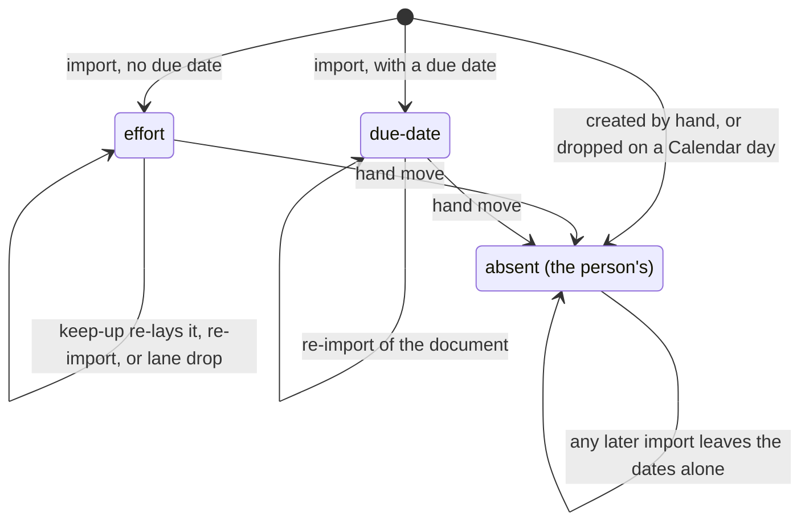
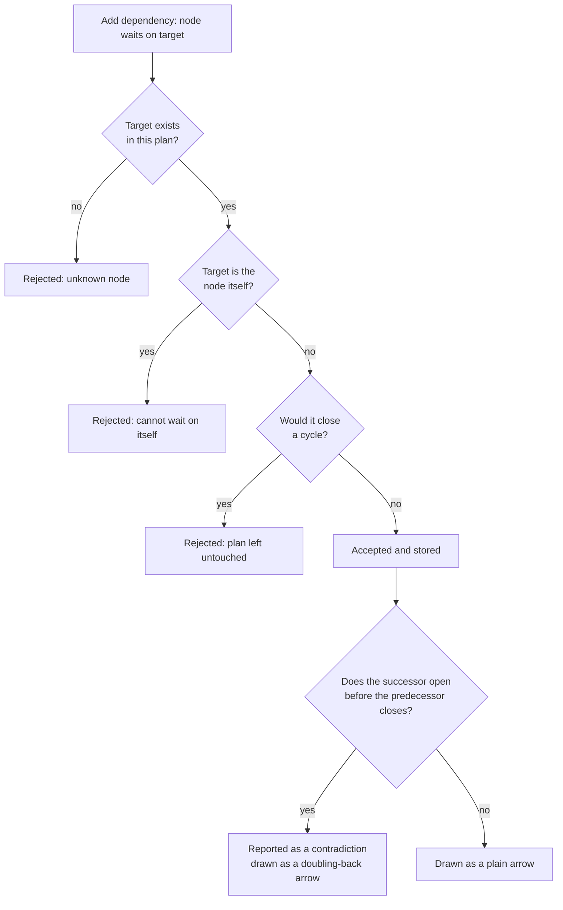
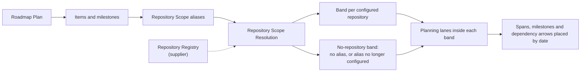
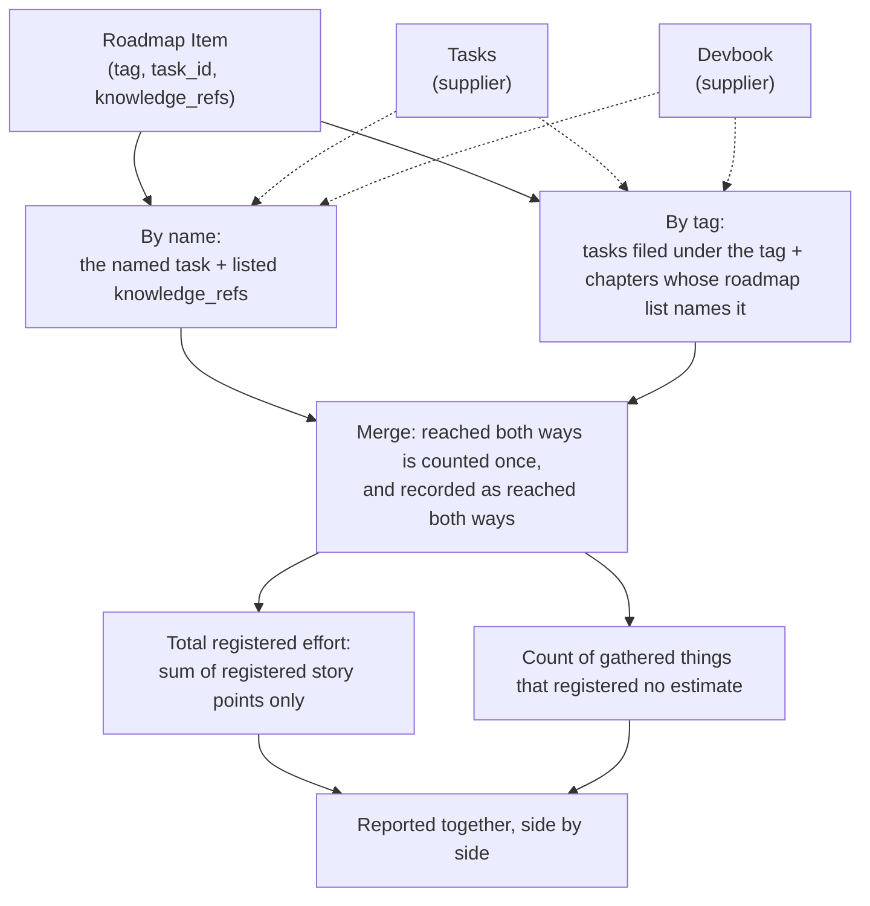

# Roadmap Planning

```meta
type: flow
status: draft
related: [.devbook/domain/roadmap/domain.md#roadmap-plan, .devbook/domain/roadmap/domain.md#plan-sequencing]
```

> Lifecycle and process flows for this bounded context: how a plan changes and
> how a proposed change is accepted or refused. Complementary to `model.md`
> (structure) and `domain.md` (responsibilities/invariants).

## Rescheduling flow

A reschedule starts as a *proposal*, not a change. The view that draws the plan
never edits it. It reports where something was dropped, the plan decides whether
that placement stands, and the view redraws from what it gets back. Nothing is
persisted until the plan has accepted it.



- A drop that moves nothing produces **no proposal at all**. That is a drop of
  less than half a week, or an edge clamped against the opposite edge. Picking
  something up and putting it down must not rewrite a plan the reader only wanted
  to look at.
- A reschedule never touches dependencies. Dependent work is *not* dragged along:
  the plan is allowed to contradict itself, and that contradiction is the reader's
  cue (see below).
- The event carries the previous window, so a consumer can tell a first plan from
  a change without keeping its own history.

## Who placed an item's window



The states are the values of `placed_by_import` on a
[Roadmap Item](domain.md#roadmap-item), and that chapter defines a
[hand move](domain.md#roadmap-item). Only an import creating the item anew sets
a value again, and an import never deletes an item, so the person's window is
final. A drop on a Calendar day still places the window by the `effort` rule, from
the day dropped on. The window is the person's because they chose that day.

## Dependency validation flow



- The three rejections are refusals to store, not warnings. The plan is unchanged
  and the reason is returned to the caller.
- The contradiction check is the opposite: it never refuses anything. Dates that
  do not fit are a normal, temporary state of a plan being worked out. The arrow
  that has to double back through the gutter is how the reader sees it.
- Cycle detection walks the whole graph reachable from the target. It is an
  invariant of the plan rather than of a node, which is why it is checked on the
  root before the edge is accepted.

## Reading the plan by repository



- Resolution happens on the **read** path only. Nothing in the plan is rewritten
  when the registry changes, so a repository removed today and configured again
  tomorrow leaves the plan exactly as it was.
- An item naming several repositories is drawn in the [band](domain.md#band) of
  each configured repository it names. Each band draws only that repository's
  [part](domain.md#part) of the item, so the parts can carry different dates
  ([Placing a plan in time](features.md#placing-a-plan-in-time)). Only the item's
  one window is stored.
- Dragging any part moves the whole item, because a part has no dates of its own
  to keep. The move is a [hand move](domain.md#roadmap-item), so the item is no
  longer placed by its effort, and every part then draws over its one moved
  window.
- The filter is built from what an item names rather than from where it was
  drawn, so the item stays findable under any of its repositories.

## Gathering an item's work and totalling its effort



The rules behind each box are in
[Roadmap Item Gathering](domain.md#roadmap-item-gathering). Gathering happens on
the **read** path only and writes nothing back to the plan, a task, or a chapter.
An unreachable Tasks or Devbook therefore shrinks a total rather than corrupting
a plan.
