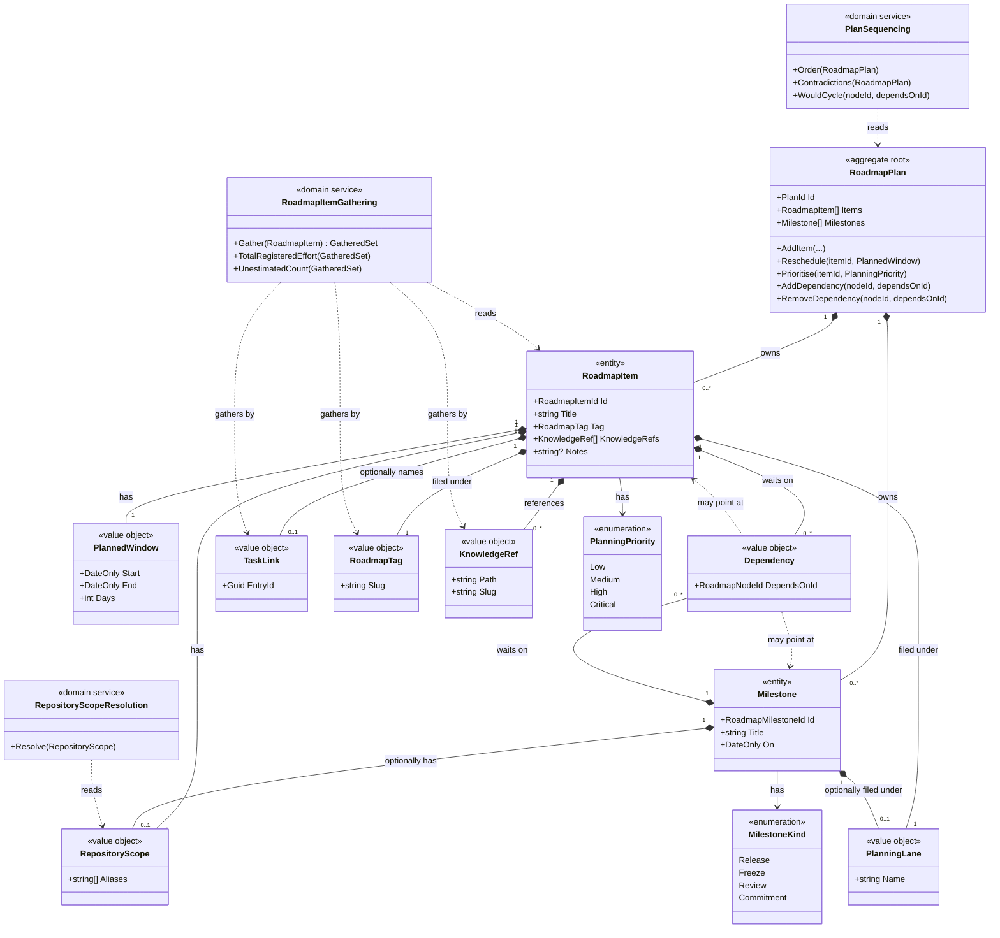

# Roadmap Planning

```meta
type: model
related: [.devbook/domain/roadmap/domain.md#roadmap-plan]
```

> Structure and relationships of this context's aggregates, entities, and value
> objects. Keep it in sync with `domain.md`.

## Model diagram



## Relationship notes

- `RoadmapPlan` is a **singleton per workspace**: one plan per storage location,
  not per repository or project. The model has no `Plan` selector because a person
  has one set of intentions, read in different groupings.
- `RoadmapItem` and `Milestone` are owned entities, drawn with composition because
  they have no life outside the plan. Deleting the plan deletes them, and neither can be loaded, validated or saved
  on its own.
- `Dependency` points at a **Roadmap Node**, the union of `RoadmapItem` and
  `Milestone`, which is why both dotted associations leave the same class. They
  share an id space and a role as a dependency endpoint, and nothing else. There
  is no inheritance between them, because a common base class would suggest a shared
  lifecycle they do not have.
- The dependency association is **one-way, held by the waiting side**. The plan
  answers "what depends on this" by scanning, so no reverse edge is stored.
- `RepositoryScope` holds aliases as **plain strings, by value**, never a
  reference to a `Repository` from
  [Repository Management](../repository-management/model.md). That keeps the two
  contexts independent and makes resolution a read-path service.
- `TaskLink` is likewise **an id, not an association**: `Task` is a separate
  aggregate in another context, related by Partnership (see `dependencies.md`).
- `RoadmapTag` is a **value object held by the item, not a shared registry**,
  because two items may carry the same slug (no `Tag` table). No line runs from `Title` to `Tag`,
  because [renaming keeps the tag](domain.invariants.md#invariant-renaming-keeps-the-tag).
- `KnowledgeRef` is **an id-shaped reference, not an association**, like
  `TaskLink`. The chapter it names lives in [Devbook](../devbook/model.md). Both
  foreign references may dangle and neither is validated.
- `RoadmapItemGathering`, `PlanSequencing` and `RepositoryScopeResolution` are
  services because no answer they give is in a single node's own state. Gathering
  reads foreign tasks and chapters
  ([Roadmap Item Gathering](domain.md#roadmap-item-gathering)), sequencing needs
  the whole graph, and resolution needs a foreign registry. The dotted lines from
  gathering are the two ways it reaches work; the foreign tasks and chapters are
  not this context's model.
- Both enumerations are the plan's own. `PlanningPriority` shares its four values
  with Tasks's `Priority`, but the types are distinct, with no association or
  conversion.
