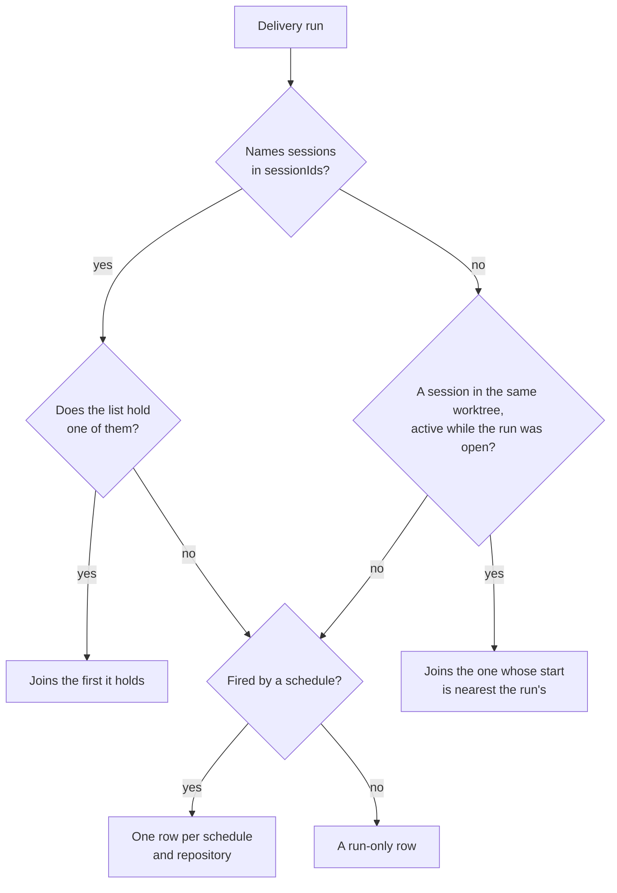
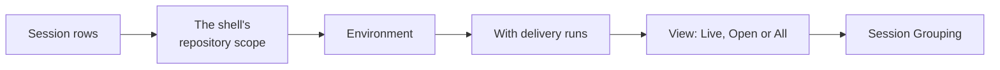
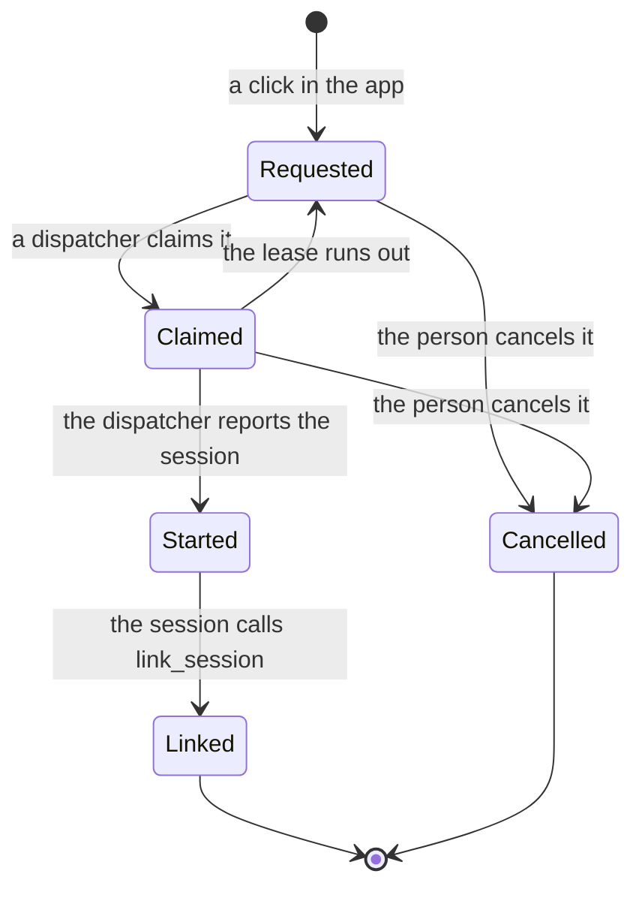
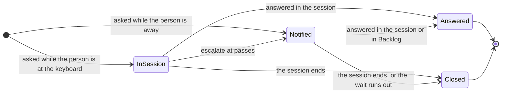

# Sessions

```meta
type: domain
```

> One chapter per Aggregate, Domain Service, Domain Event, or Shared Value
> Objects / Shared Enums grouping in this bounded context; each chapter's
> `type` records which of those it is. An Aggregate's owned Entities, Value
> Objects, and Enums are chapters directly beneath it, typed `entity`,
> `value-object`, and `enum`. Value Objects/Enums shared across multiple
> aggregates get their own chapter at the end instead of being duplicated.

## Session Log

```meta
type: aggregate
related: [.devbook/domain/dev-pc-management/domain.md#machine-registry, .devbook/domain/sessions/dependencies.md, .devbook/arc42/08-crosscutting-concepts.md#session-record-sync, .devbook/arc42/adr/0005-azure-hosted-task-replica-for-multi-device-sync.md, .devbook/domain/sessions/domain.invariants.md#session-log]
```

Everything one environment can say about the agent sessions it has a record of.

The consistency boundary is **one environment**, not one fleet. An environment is
the only thing that can read its own agents' records, so a log that spanned several
would assert facts nobody had gathered. A view over many environments is a
composition of several Session Logs. That is why grouping by environment is a
derivation rather than a structural relationship.

The rules the log holds every reading to are in
[its invariants](domain.invariants.md#session-log).

**Records replicate, and none of those rules changes when they do.** Local ADR 0005
puts session records in the same cloud replica as tasks. So a record gathered on one
machine can be read on another. The path is built. It is off until switched on, and
it has not yet run against provisioned infrastructure. Replication decides whether
another machine's sessions are in front of a reader. It decides nothing about what
one of them means. Every [rule of the log](domain.invariants.md#session-log)
survives, because the thing that replicates is a record, not an authority:

- **Still single-writer.** A session ran on one environment, and only that
  environment holds the evidence for it. So there is nothing to reconcile between
  environments: no second version of another's record and no lost edit. None of
  that rests on good behaviour, and
  [the single-writer invariant](domain.invariants.md#invariant-only-the-gathering-environment-writes-a-session-record)
  says where it is enforced. A reading knows how it came by each record: read here,
  or arrived from elsewhere. Re-publishing another environment's records is how a
  single-writer rule fails without anyone editing anything.
- **Still one environment per log.** A reading that spans machines is a composition
  of several Session Logs, as grouping by environment already is. A replicated record
  names the environment that gathered it, so nothing asserts a fact nobody gathered.
- **Still derived, never asserted.** `Session State`
  [never travels on the record](domain.invariants.md#invariant-state-is-derived-never-carried).
  It is worked out from the evidence that reached the reader. A state on the wire
  would freeze the gathering machine's reading of its own clock. It would
  go on saying `running` about a session that ended before the last exchange. A
  record from another machine is stale rather than wrong, and the derivation says so
  from the timestamps it has. A record carries no liveness marker: the same record
  arrives whether the session is still going or ended a month ago. So silence past
  the `Stale Threshold` reads `finished` and never `stalled`. That is the rule this
  context already applies locally to an agent that leaves no marker. `stalled` claims
  that something is still there and quiet, and nothing in a record can tell that
  apart from something that is gone.
- **Only a whitelist travels.** Local ADR 0005 fixes it, in the table below, and
  [an invariant](domain.invariants.md#invariant-only-the-published-fields-travel)
  holds every record to it.
- **The list carries this context's identity in full.** Local ADR 0005 settled that
  in the whitelist rather than in the pushing code. A record without its agent
  would let the receiving log merge two unrelated sessions, which is the failure
  [the identity invariant](domain.invariants.md#invariant-a-session-is-identified-by-agent-and-session-id-together)
  exists to prevent.
- **Retention is the store's, not this context's.** A replicated record expires
  after twelve months by container TTL. Nothing here reaps or deletes a record.
- **An environment keeps a [Session Record](#session-record) of each of its own
  sessions.** The record answers once the transcript is gone. The assistant
  cleans its transcripts away; Claude does so after a month by default. A session
  read from nothing is a session the log no longer holds. So the environment reads its
  sessions in full for the record's own sake and amends the local record from that
  reading, whether sync is on or not. A consumer's reading never amends it, and
  [what an amendment may change](domain.invariants.md#invariant-a-session-record-is-added-to-and-never-taken-from)
  is an invariant.

  The answer for one session comes from the files as read now, then from this
  environment's record, then from what sync carried. With sync on, the records an
  environment pushed also come back down the feed, and are kept as a second copy.
  That does not make the log multi-writer, because
  [such a copy is never pushed again](domain.invariants.md#invariant-only-the-gathering-environment-writes-a-session-record).
  Those copies show under the environment's own identity rather than the machine
  id the sync service issued.

| Field on the wire | Why it travels, and on what terms |
| --- | --- |
| agent and session id | The `Session Identity` in full. |
| environment id | Stamped by the sync service from the sender's token, never sent by the device. |
| environment name | The name that environment goes by. |
| repository alias | The alias, never the working folder. |
| resolved repository alias | On the same terms ([Working Location](#working-location)). |
| branch | As recorded. |
| started at, last activity at | The `Activity Window`. |
| turn count | Absent where the agent records none. Zero would be a claim about the session, where absence is the truth about the record. |
| duration | Carried for the transport only. A reading derives it from the two timestamps, so it cannot disagree with them. |
| runs and waits | [Activity runs](#activity-run) and [waits](#wait) as pairs of timestamps, so a reading machine can measure a session whose transcript it never held. |
| human turns | The instant of each [human turn](#human-turn), never its text (local ADR 0019). Roadmap Planning counts the person's hours from them on every paired machine. |
| title | By the owner's decision of 2026-09-23, although the agent writes it from what the person typed. A session is recognised by its title, on another machine and after its transcript is gone. A record from a device older than the field is headed by its session id. |
| worktree key | The folder's leaf and a one-way hash, so a record still meets the delivery runs filed under that folder. |
| usage-limit refusals | When, which bucket, when it resets, and what it said about paid overage, never the refusal's sentence. A usage limit is the account's, so a refusal on one machine bounds the week on every other. |
| where the agent was run from | Such as the desktop app or the command line. |
| pull requests the session linked | Repository, number and address. |
| tokens per model | Counts, never content. |

`working_folder` is not in the table: it describes one machine's disk and means
nothing on the other.

The desktop record's archived flag and scheduled task are not in it either. They
describe this machine's Claude desktop app, and a session record keeps no copy of
them. `CompositeAgentSessionSource` clears them from every Recorded or Replicated
answer, so [they never travel](domain.invariants.md#invariant-the-desktop-records-facts-never-travel).

Runs, waits and human turns are instants, the same kind of fact as the activity
window. A record keeps three cases apart, and a reader never reads an absence as a
measurement of zero:

- a list of intervals;
- an empty list, where the agent's own format cannot mark a boundary;
- nothing, where the gathering environment had no parsable activity record.

**Replication is not the Collections MCP and changes nothing about it.** The
[Collections MCP](#collections-mcp) stays optional, reached through an
anti-corruption layer, and never authoritative for whether a session existed. It
supplies a second kind of evidence about a session this context already knows.
Replication moves records this context already holds. Neither stands in for the
other. A replicated record with no activity stream is a complete record. It may
carry the runs and waits its gathering environment folded, which measure the
session's time and are not a stream of what it did.

### Agent Session

```meta
type: entity
aliases: [AgentSession, session, session_id, AgentSession.Archived, ScheduledTask, AgentSession.DesktopTitle]
related: [.devbook/domain/sessions/domain.md#session-view, .devbook/domain/sessions/dependencies.md]
```

One working session of one agent. Identified by `Session Identity`, the agent plus
the identifier that agent gave the session, because a session id is only unique
within the agent that issued it.

Holds the [environment](#environment) it ran on, as its display name and its
`EnvironmentId`. It also holds a display title, its `Working Location`, its
`Activity Window`, and its `Session State`. The display name can change while the
session stays on the same machine, which is why
[a machine is told apart by its id](domain.invariants.md#invariant-an-environment-is-told-apart-by-its-id).
When external activity evidence exists, the
entity also carries a `Session Activity Stream`, a `Session Enrichment Summary`, and
a `Reporting Capability` reading for that stream.

A Claude session may also carry three facts from the Claude desktop app's own record of it:

- **archived** says whether the desktop app still holds the session in its sidebar.
  It is open, archived, or unknown. Unknown means there is no record, or the record
  states no flag, and [unknown is never open](domain.invariants.md#invariant-unknown-is-never-open).
- **scheduled task** names the desktop app's routine that the session is a run of. It
  is not the schedule on a [Session Row](#session-row), which is a delivery run's.
- **sidebar title** is the name the desktop app's sidebar shows for the session,
  whether the app, a tool or the person gave it. It is not the display title, which
  comes from the transcript and is often only the worktree folder's name, and it never
  replaces it: the display title is what a session record keeps.

The environment reads all three off its own disk and never derives them from `Session
State`. [None ever travels](domain.invariants.md#invariant-the-desktop-records-facts-never-travel).
Some running sessions, such as side sessions, have no desktop record, so they are
never open however live they are.

Its lifecycle is not this context's to run. It appears when an agent first leaves a
record, and it stops changing when the agent stops writing.

### Session Identity

```meta
type: value-object
aliases: [SessionIdentity]
```

What makes a session that session: `agent` plus `session_id`. Why the agent is
part of it is
[an invariant of the log](domain.invariants.md#invariant-a-session-is-identified-by-agent-and-session-id-together).

### Working Location

```meta
type: value-object
aliases: [WorkingLocation, cwd, working_folder]
```

Where the session was working. It has four fields, and equality is by all four:

- `working_folder`;
- `repository`, optional, in `owner/name` form, as the agent recorded it;
- `resolved_repository`, optional, as this product placed it (below);
- `branch`, optional.

The repository and the branch are optional because of what the agents actually
write down, not because the value is unimportant. Copilot records the repository
and the branch outright. Claude records the branch, which it states in its
transcript, and never the repository, in any path. The folder is the only thing to
go on, and a repository read off a path leaf would be a wrong fact where absence is
a true one. So a Claude session carries a branch and no repository, and a Copilot
session carries both. Absent means "the agent did not say".

A replicated session is the one case where the folder is missing for a different
reason. The machine that ran the session recorded it, and it deliberately did not
travel: a path describes that machine's disk, and the reading machine would act on
it. Absent there means "cannot be shown here", not "was never written down". Either
way nothing on this side reconstructs one:
[the log never fills a gap](domain.invariants.md#invariant-the-log-never-fills-a-gap),
whether an agent left it or the boundary made it.

The **resolved repository** is the `owner/name` of the registered repository whose
clone directory contains the working folder, on the environment that read the
session. It
[sits beside the recorded repository, never in its place](domain.invariants.md#invariant-a-resolved-repository-sits-beside-the-recorded-one).
This is not
the inference ruled out above. A path leaf is a guess about which of GitHub's
several `Backlog`s a folder is a clone of. A registered clone directory is a fact
the person stated on the Repositories screen, and a folder is either under it or
not. It is still a fact about the reading environment's registrations rather than
about the session, which is why it is a second field. The two fail differently, and
a surface must be able to tell "the agent said" from "this product placed".

It resolves on the environment that ran the session, the only one holding both the
folder and the clone. It travels with the record and is held as it arrived
everywhere else.

### Activity Window

```meta
type: value-object
```

When the session was alive: `started_at` and `last_activity_at`. Equality by both.
[A session always has a last activity](domain.invariants.md#invariant-a-session-always-has-a-last-activity),
while its start may be unknown, because some evidence is only a file with a timestamp
on it.

### Session Activity Stream

```meta
type: value-object
aliases: [SessionActivityStream, activity stream, session updates]
```

Optional externally reported activity about one known session, ordered as that
session reported it.

The stream is keyed by `Session Identity`, not by a collection row id, because the
context cares which session the activity belongs to and not how the storage happened
to key it. It is optional because a session without Collections MCP reporting is
still a complete session record.

### Session Activity Entry

```meta
type: value-object
aliases: [SessionActivityEntry, event_id, sequence, activity summary]
```

One externally reported milestone about a session: what kind of activity it was, when
it happened, its per-session sequence, and a short summary fit to be shown back to a
person.

Identity inside the stream is by external `event_id`; order is by the session's own
sequence and then by occurrence time. Both are needed: duplicates must collapse, and
late arrivals must still land in the right place.

### Session Enrichment Summary

```meta
type: value-object
aliases: [SessionEnrichmentSummary, latest activity, enrichment]
```

The one-line answer derived from a `Session Activity Stream`: the latest meaningful
activity text, when external activity last arrived, and what correlation facts can be
shown beside the base session row.

It is a value object because it is a reading over the stream, not a second entity. A
new activity entry replaces the summary by deriving a later one rather than by
editing a stored record.

### Delivery Run

```meta
type: entity
related: [.devbook/domain/sessions/features.md#delivery-runs-beside-their-sessions]
aliases: [DeliveryRun, run, orchestration run, flow run]
```

One orchestrated delivery run, as the run file records it. A run is a flow or
orchestration skill driven through a dashboard. It is identified by the run id
within the worktree folder it was filed under.

Two things write that file:

- a dashboard this product only reads from;
- this product itself, through `Delivery Run Recording`, for a session that chose
  Backlog as the surface it reports to.

The file has one shape either way. A run recorded here and one imported from a
dashboard's folder are the same kind of thing to everything that reads them. Which
of the two wrote it is provenance, not a difference in kind.

It holds what the file states:

- which dashboard wrote it, and the worktree key it was filed under;
- the skill, the title, the status word verbatim, and the change kind;
- the `Delivery Run Reference`s it names;
- when it started and when it was last updated;
- its stages, each with its status, duration, how many times it was marked done, and
  its own record of how it ran, with the round, blockers and defects that record
  reported (below);
- per stage, every sub-agent call its `insights` saw, with that call's time, tokens
  and tool calls where recorded, and how many tool calls the stage made;
- its token usage in total, for delegated agents, and per stage, with the models seen;
- the owner session's context gauge, with its peak;
- its tool activity summed by category and by MCP server;
- the sessions that drove it, what started it, and a sweep's verdicts (below).

`insights` is the run file's list of the tool calls and delegated agents the driving
session reported, each filed under the stage it ran in.

The run also carries the environment its file was read on, stamped by the source the
way a session's is: a run file found here was written here.

The worktree key is the dashboards' own: the folder's leaf and eight hex characters
of a hash of its lower-cased path. It is one-way, so the path cannot be recovered from
it. The same key can be derived from a session's `Working Location`, which is what
`Run Attachment` does.

**A run can name the sessions that drove it, and then no guess is made.** A run
started through `Delivery Run Recording` with the caller's session id carries it in
`sessionIds`, and
[a session that picks the run back up is added beside it](domain.invariants.md#invariant-a-session-that-picks-a-run-back-up-is-added-beside-the-others).
`Run Attachment` then
[joins such a run by identity](domain.invariants.md#invariant-a-run-that-names-its-sessions-joins-by-identity).
Only a run that names none
[is attached by worktree key and overlapping activity](domain.invariants.md#invariant-a-run-that-names-no-session-joins-by-place-and-time):
every dashboard file written before the field existed, and any writer that does not
send one.

**A stage can say what its pass found.** The delivery phases report three counts on a
stage's record of how it ran: Implement and Review the implement ⇄ review `round`,
counting from 1; Review the `blockers` it left open in that round; Verify the
`defectsFound` that review had passed. They describe the stage's latest pass, because
each record replaces the one before. A count reads only as a whole number from zero
up. A run file from before the phases sent them, or a stage that did not run the work,
reads them as absent, never as zero: zero is a clean round, and nobody reported one.

**A run can keep its quality facts across every pass.** Because a stage's counts are
its latest pass, a review that ended on a clean round reads zero blockers, and a Verify
that found a defect and re-ran clean reads zero defects. The delivery contract's Quality
Facts are the run's cumulative record: `reviewRounds` with its slices, `blockers` with a
row per round, and `escapedDefects` with the stage that found each one. `finish_run`
sends them as the run's `quality`, and the flow keeps the running count in
`runContext.quality`; a run is read from the first of the two that it holds. A reader
takes a run's rounds, blockers per round and Verify's defects from those facts where the
run carries them, and from the stages' own counts otherwise. A run with neither reads
them as absent, never as zero.

**A run can say what started it, and a sweep what it found.** Where the writer said,
a run carries its trigger, `attended` or `scheduled`. It also carries the schedule
that fired it and the repository it worked in.
[A run that says nothing reads as attended](domain.invariants.md#invariant-a-run-that-names-no-trigger-was-attended). A devbook
sync sweep closes its run with its verdicts: one row per sync unit, with each
chapter's own verdict, kept as sent. The repository is what places a scheduled run,
since every scheduled run cuts a worktree of its own.

**One run reported to two surfaces is one run here.** A flow reports its run to every
surface it is bound to, and each surface files it under an id of its own. So one piece
of work can be two files, in two dashboards' folders. The reading folds such a pair
into one `Delivery Run` before anything else sees them.
[When two files are one run](domain.invariants.md#invariant-two-surfaces-reports-of-one-run-are-one-run)
is an invariant of the log.

A shared session crosses folders because the dashboard server keys its folder by its
own working directory. That is the repository's main checkout, whichever worktree the
flow ran in. The backlog surface keys by the worktree the flow named. A session id is
identity and a folder key is not, so a shared session is enough across folders and two
files naming none are not. Where partners of both kinds qualify, the one in the same
folder is taken.

[One surface's file is the merged run's record](domain.invariants.md#invariant-the-preferred-surfaces-file-is-a-merged-runs-record),
so the run shows one measurement rather than the sum of two that overlap, and
[it stays in the worktree the flow named](domain.invariants.md#invariant-a-merged-run-stays-in-the-worktree-the-flow-named).
Which surfaces reported it is kept beside which one wrote the file, as provenance.

The window is five minutes because a surface reattaches a run of the same skill in the
same worktree rather than opening a second. So one surface cannot hold two runs that
start close together. What the window prevents is a run whose partner never arrived
pairing with the next run's file from the other surface.

*Delivery* run, with the adjective, because this context already has an
[activity run](#activity-run): a stretch of transcript in which an agent was
producing. A delivery run is another tool's record of work it was tracking, with a
status that tool assigned. The two share a word and nothing else.

[Its status is the word its file wrote](domain.invariants.md#invariant-a-runs-status-is-the-word-its-file-wrote),
never derived from a reading. The dashboards wrote seven spellings for it across two
generations, and mapping them onto fewer members would decide what a writer meant
rather than report what it wrote. A surface that needs a chip normalises at the last
moment, where a new spelling degrades to a plain label rather than to a dropped row.

**Reading accepts every spelling; writing uses one.** The asymmetry is deliberate. A
run imported from a dashboard is somebody else's record and is reported as written,
`completed` and `success` included. A run this context records is its own, and
[is written in one status vocabulary](domain.invariants.md#invariant-a-recorded-run-is-written-in-one-status-vocabulary).

### Delivery Run Recording

```meta
type: domain-service
related: [.devbook/domain/sessions/domain.md#delivery-run, .devbook/domain/sessions/features.md#record-a-run-as-it-happens, .devbook/domain/sessions/domain.invariants.md#delivery-run-recording]
```

The capability a session uses to record a `Delivery Run` here as it happens, rather
than this context finding one afterwards in a folder another tool wrote. It has eight
operations, named by the delivery engine and not by this context:

1. bring the surface forward;
2. start a run;
3. record a prompt;
4. set a run's context;
5. update a stage;
6. finish a run;
7. list runs;
8. get one run.

**The names belong to the engine.** A session finds a surface by matching operation
names against the tools it has, so these names are a wire contract with something
outside this repository. Renaming one is not a rename: the surface stops being found.
The session then reports no surface attached, which is also a normal outcome, and so
cannot be told from the fault.

**Scope is a worktree the caller states, never a folder this product is sitting in.**
The process recording a run is the application's. One clone's worktrees share a
repository and have as many directories. The caller names the folder its run is about,
and the worktree key is derived from it. `Run Attachment` runs the same derivation from
the other side, which puts a recorded run and the session that drove it on one row.

**Starting a run for a skill already under way
[reattaches to it](domain.invariants.md#invariant-starting-a-run-already-under-way-reattaches-to-it).**
A session that picks work back up says so by starting again. A second file would not be
a second run: it would be the one run, listed twice, with its stages split between them.

**A stage is addressed by its position, not its name.** The whole stage list is fixed
when the run begins, so the surface can show what is still to come. A name is a label
on a position rather than a key, and two stages may carry one name.
[An index outside the list is refused](domain.invariants.md#invariant-a-stage-outside-the-runs-list-is-refused)
rather than ignored.

**What started a run is
[written once](domain.invariants.md#invariant-what-started-a-run-is-never-rewritten).**
Starting a run takes the trigger, the schedule and the repository, and
[refuses a trigger the engine does not name](domain.invariants.md#invariant-an-unknown-trigger-is-refused).
Finishing a run takes a sync sweep's verdicts. They are
kept on the run, and, where the run named its repository, filed per chapter as the
Devbook context's `Sync Verdict`.

**It records what it observes and claims nothing else.** The model a run resolved is
something the run states, so it is kept. What a run consumed is not something an
operation can say, because a call arrives without the session that made it. Those
figures come from `Delivery Run Telemetry` or are absent, and
[an absent figure is left out](requirements.md#requirement-a-figure-a-run-did-not-measure-is-left-out).

### Delivery Run Telemetry

```meta
type: domain-service
related: [.devbook/domain/sessions/domain.md#delivery-run-recording, .devbook/domain/sessions/features.md#what-a-run-cost-reported-by-the-session-itself, .devbook/domain/sessions/requirements.md#what-a-run-cost-reported-by-the-session-itself]
aliases: [DeliveryRunTelemetry, hook telemetry, telemetry forwarder]
```

The measured half of a `Delivery Run`. A coding session reports events about itself,
and this service attributes them to the run the session is driving. The events are a
tool starting and finishing, a delegated agent, the context being compacted, and a
turn or the session ending. `Delivery Run Recording` keeps what the run is told; this
service keeps what is measured.

**The run is found from the event, never from a pointer.** The event names the session
and the folder it runs in. The worktree is that folder, or the nearest one above it
with runs filed, and
[the session's telemetry reaches only a run it drives there](requirements.md#requirement-a-sessions-telemetry-reaches-only-a-run-it-drives).

**Tokens are read from the session's transcript.** The event carries no usage. The
transcript it names does, with each delegated agent's in a file of its own beside it.
Each file is read on from where the last event left it, so
[a message is counted once](requirements.md#requirement-a-messages-tokens-are-counted-once).
A session first seen mid-way
[counts from there on](requirements.md#requirement-a-run-never-counts-what-came-before-its-session-was-seen):
a gap is lost rather than a whole conversation counted as the run's.

**A delegated agent carries what its call reported.** The Agent call's response states
the tokens the sub-agent moved and the tool calls it made. Both are kept on the agent's
record, under the names the dashboard writes them, and
[a response that states neither adds nothing](requirements.md#requirement-a-delegated-agent-with-no-figures-adds-nothing).

**Best effort, and never the session's problem.** The reporter is a hook, and
[telemetry never fails the tool call it reports on](requirements.md#requirement-telemetry-never-fails-the-tool-call-it-reports-on).

### Stage Resolution

```meta
type: domain-service
related: [.devbook/domain/sessions/domain.md#delivery-run, .devbook/domain/sessions/features.md#how-each-stage-of-a-run-ran, .devbook/domain/sessions/domain.invariants.md#stage-resolution]
aliases: [DeliveryRunStageResolution, stage execution]
```

How each stage of a `Delivery Run` ran, read off the run. It reads the stage's own
record of how it ran, the sub-agents seen in it, and the [phase map](#phase-map) the
run resolved before it ran. It ports the delivery engine's own run view, so this
product and that view say the same thing about one run.

Each value is taken from the first source in its row that has one:

| Value | Read from, in order |
| --- | --- |
| Mode | Personal Validation is always the gate. Otherwise the mode the run recorded, reading `delegated` as `delegate` and `forked` as `fork`. Otherwise `delegate` where a sub-agent worked in the stage, and `inline` for the rest; a mode found this way is marked inferred. |
| Worker | The agent the phase map binds, when it is among the sub-agents that ran. Then the agent behind a `delivery:runner-<effort>` effort runner: the configured agent, or `general-purpose` where none is. Then the longest-running call. A stage that recorded running inline with no agent ran in the owner session, whatever was configured. |
| Model and effort | What the stage recorded running, then the runner's, then the configuration's. |
| Configured | The phase map's entry for the stage under the qualifier it ran under, then under any name its title goes by. Its origin is the entry's own origin, or else the team default with the overlays the run context lists merged over it. |
| Sub-agent calls | Each call the run's `insights` saw, with its own time, tokens, tool calls and outcome. Where they saw none, each call the stage's record lists, except the slices the owner session worked itself. Then each agent the stage declared that neither shows running. |
| A call's round | The round the stage's record lists against that call. Calls the `insights` saw take the listed rounds per agent, in order, only where the record lists as many calls of that agent as were seen. Otherwise the stage's own round, when the call is the only one the stage made. A round several calls shared stays the stage's. |

**Configured against ran.** A stage is compared on its agent, its model's family and
its effort.
[A pending stage and the gate are never compared](domain.invariants.md#invariant-a-pending-stage-and-the-gate-are-never-compared).
An effort is compared only where the run recorded what ran. A configured agent that did
not resolve is a difference too.

**Inferred.** Where the run records no resolved phases, mode and agent are inferred
from what was seen, and
[the stage says so](domain.invariants.md#invariant-an-inferred-value-says-it-was-inferred).

A call under the gate is a [revise round](#revise-round)'s.

### Claude API Request Log

```meta
type: domain-service
related: [.devbook/arc42/adr/0024-claude-code-telemetry-arrives-on-the-mcp-listener.md, .devbook/domain/sessions/features.md#cost-as-claude-code-reports-it, .devbook/domain/sessions/domain.md#delivery-run-telemetry, .devbook/domain/sessions/domain.invariants.md#claude-api-request-log]
aliases: [ClaudeApiRequest, IClaudeApiRequestStore, ClaudeCodeOtlpLogs, cost receiver]
```

The model requests Claude Code reported making, as it reported them. There is one
record per `claude_code.api_request` event that its OpenTelemetry exporter sends to the
desktop app at `/v1/logs` (local ADR 0024). Each record names the session, the prompt,
the sub-agent and the skill it ran under. It holds the model, the effort, Claude Code's
cost estimate in whole micro-dollars, the four token counts and the duration.

**A request is kept once.** The API's `request_id` is its identity. An exporter
retries a batch it did not see acknowledged, so the same event arriving again is
ordinary: [a request is stored once](domain.invariants.md#invariant-a-request-is-stored-once),
and [one without a `request_id` is not kept](domain.invariants.md#invariant-a-request-without-a-request-id-is-not-kept).

**Only this event is kept.** Claude Code sends many events, such as prompts, tool
results, hook runs and errors, and
[only `claude_code.api_request` is kept](domain.invariants.md#invariant-only-the-api_request-event-is-kept).
Of the one kept,
[who made the request is not stored](domain.invariants.md#invariant-who-made-a-request-is-not-stored).

**An unknown figure stays unknown.** That is
[an invariant of the log](domain.invariants.md#invariant-an-unknown-figure-stays-unknown),
and the rule every measured figure in this context follows.

The records are this machine's: they are kept in the app's local database and do not
replicate. `Delivery Run Telemetry` counts tokens from the transcript. This log holds
the figures Claude Code itself reported, cost among them.

### Cost Attribution

```meta
type: domain-service
related: [.devbook/domain/sessions/domain.md#claude-api-request-log, .devbook/domain/sessions/domain.md#stage-resolution, .devbook/domain/sessions/domain.md#model-price-table, .devbook/domain/sessions/features.md#cost-as-claude-code-reports-it, .devbook/domain/sessions/features.md#a-price-table-for-runs-without-telemetry, .devbook/domain/sessions/domain.invariants.md#cost-attribution]
aliases: [DeliveryRunCosts, CostFigure, DeliveryRunStageCost, cost attribution]
```

Says what a session, each stage of a delivery run and each sub-agent call cost. A
figure is the cost in whole micro-dollars and which of two sources it came from:

- **reported**: the requests in the `Claude API Request Log`, where Claude Code
  reported them;
- **estimated**: the run's own token counts at the `Model Price Table`, where it did
  not. Every estimate is marked as one.

| Unit | Reported cost | Estimated cost |
| --- | --- | --- |
| Session | The sum of every request it reported. | Its own tokens per model, read from its transcript, plus the sub-agent share of each of its runs' stages. A row with no transcript of its own sums its runs' whole stages. |
| Stage | The owner session's main-loop requests inside the stage's window, plus its workers' requests (below). | The owner session's share at the stage's model where it ran inline, else at the owner's. The sub-agents' share at the one model their calls ran on; calls on several models are each priced at their own. |
| Sub-agent call | Its agent's requests from the call's end less its duration to its end, two seconds either way for the two clocks. | The stage's sub-agent tokens, in proportion to the tokens the call reported. |

**A stage's window** runs from its latest start to its completion; a stage still under
way has no end yet. The owner session is each session the run names, or the one it was
joined to by worktree and time. A request a sub-agent made has an `agent.name`, or a `query_source` of `agent:<name>`. Its agent
is one of the stage's workers when the two match the way `Stage Resolution` matches
agents: the same name, or one the other with a plugin prefix.
[A stage claims only its own requests](domain.invariants.md#invariant-a-stage-claims-only-its-own-requests):
the owner's main loop by its window, its workers' by its window or by their own call.
So a sub-agent still running after its stage was marked done is still its stage's.

**When the reported cost cannot be told apart,
[the unit is estimated](domain.invariants.md#invariant-a-cost-that-cannot-be-told-apart-is-estimated).**
A stage re-entered after requested changes is the common case. Its start is stamped
again on every pass, so its window holds the latest pass only, and a figure over it
would read as the whole stage. A stage whose window holds a sub-agent's request that
names no agent is another: a session that exports without `OTEL_LOG_TOOL_DETAILS` sends
no `agent.name`, and every custom agent's `query_source` reads `agent:custom`, so the
stage could claim only its main loop. A call that recorded no end, unless it is the
stage's one call of that agent, and two overlapping calls of one agent, such as a
fan-out, are the others.

**An estimate with an unpriced part is no figure at all.** A partial sum would read as
the whole, so
[the estimate is absent rather than zero](domain.invariants.md#invariant-an-estimate-with-an-unpriced-part-is-no-figure).
With no request and no price, there is no cost.

### Cost Baseline

```meta
type: domain-service
related: [.devbook/domain/sessions/domain.md#cost-attribution, .devbook/domain/sessions/features.md#each-stage-against-its-usual-cost, .devbook/domain/sessions/domain.invariants.md#cost-baseline]
aliases: [DeliveryRunBaselines, CostAgainstUsual, CostBand, DeliveryRunCostComparison, DeliveryRunCostInsight, usual cost, cost baseline]
```

Reads a run's cost against its usual, from the figures `Cost Attribution` gives the run
and the runs before it. The median is used rather than the mean, because one runaway run
would otherwise move the baseline for the next thirty.

**The earlier runs** are
[the latest 30 finished runs of the same skill that started before this one](domain.invariants.md#invariant-a-run-is-compared-with-the-latest-thirty-finished-runs-of-its-skill),
never the run itself.

**A stage** is matched to the earlier runs' stages by name. Its figures are its cost, its
share of what the run's priced stages cost, and its ratio to the median cost of that
stage in the earlier runs that finished it and priced it. A stage that has not finished
has no ratio. Neither has a stage that fewer than five of those runs priced.

**The bands** come from the ratio:

| Ratio | Reads | Drawn |
| --- | --- | --- |
| 0.8 or below | lower than usual | green |
| within 5% of 1, either side | typical | "typical" |
| 1.5 or above | higher than usual | highlighted |
| anything between | the plain ratio | plain, such as "1.2×" |

A ratio is written to one decimal, "2.4×". It gets two where one decimal would round it
across a band's edge, so 1.46 is "1.46×" rather than "1.5×" without the highlight. It
also gets two below 0.1.

**The run** is compared like for like. An earlier run is a sample only when it finished
and priced every stage this run priced, and its total is the sum of those same stages.
Summed over whatever each earlier run priced, a run from before per-stage tokens were
counted would read as a cheap run. The median would sink, and every later run would read
many times its usual while each of its stages read typical. The run needs at least five
samples and is compared only once it has finished: a run still active, blocked or
parked is owed the stages that would move its total.

**The insight** names the run's ratio and the stage that explains most of the
difference. When the run cost more than usual, that is the stage whose cost exceeds its
own median by the most. When it cost less, it is the stage furthest below its median. A
typical run names no stage. The stage's re-entries are its done count less one, which
counts the implement–review loop and every revise round. Where the stage is Implement
or Review, the insight adds the run's review rounds: the Quality Facts' total where the
run carries them, else the highest round Implement or Review reported.

### Weekly Usage

```meta
type: domain-service
related: [.devbook/domain/sessions/domain.md#cost-attribution, .devbook/domain/sessions/domain.md#claude-api-request-log, .devbook/domain/sessions/features.md#share-of-the-week-and-the-weekly-limit, .devbook/domain/sessions/domain.invariants.md#weekly-usage]
aliases: [WeeklyUsage, UsageWeek, WeeklyLimit, UsageShare, share of the week]
```

Says what part of the week a session or a run makes up, and, once a refusal has sized
it, what part of the weekly limit. Reported cost only: the share is of the week's
telemetry cost, and a token estimate divided by a reported sum would compare two
measurements.

**The week** is the seven days ending at the reset time that the latest all-models
weekly refusal carried. With none, it ends at the latest Fable refusal's reset time. A
reset that has passed rolls forward a whole week at a time, because the allowance
renews on the same beat each week. The reset instant belongs to the next week. With no
refusal carrying a reset time, the week is the seven days up to now. Only refusals of
the last 28 days are read: an older one is forgotten, and places the week and sizes a
limit no more than a refusal never recorded. The total is every
request reported inside the week up to the moment it was read. A share counts nothing
later, so a session still running cannot outgrow the total it is divided by.

**A weekly limit** is sized by the most recent refusal of its kind. Its size is the cost
reported from seven days before that refusal's reset time up to the refusal. A refusal
that carried no reset time counts from seven days before the refusal itself. Fable's
limit counts the requests to a Fable model only. A refusal with no reported cost before
it sizes nothing. The percentage of a limit is always an estimate, and
[it is labelled one](requirements.md#requirement-a-share-of-the-weekly-limit-is-labelled-an-estimate).
Nothing the product reads states the limit's size, and requests made on another machine
never reach this one.

**A session's share** is its own requests inside the week. **A run's** is the requests
its stages and their sub-agent calls claim, matched as `Cost Attribution` matches them.
[Nothing reported inside the week is no share](domain.invariants.md#invariant-nothing-reported-inside-the-week-is-no-share),
never zero.

### Model Price Table

```meta
type: value-object
related: [.devbook/domain/sessions/features.md#a-price-table-for-runs-without-telemetry]
aliases: [ModelPriceTable, ModelPrice, IModelPriceStore, model prices]
```

The rates the person entered in Settings, one row per model: input, output, cache read
and cache write, each in US dollars per million tokens, each optional. Empty until filled
in. A model a run names finds its row in this order:

1. by the same id;
2. by the same model written another way, such as "Opus 5.5" for `claude-opus-5-5`;
3. by its family, such as `opus`.

A context suffix such as `[1m]` is ignored. An estimate needs a rate for every kind of
token spent, and has none otherwise. The table is this machine's, kept in the app's
local database beside the request log, and does not replicate.

### Delivery Run Reference

```meta
type: value-object
related: [.devbook/domain/sessions/features.md#the-work-a-run-is-linked-to]
aliases: [DeliveryRunReference, linked work, tracker item]
```

One piece of work a `Delivery Run` is linked to: the Backlog entry it was started from,
a tracker issue it was working, or a pull request it opened. It carries:

- which of those it is, and what to call it;
- the item's own title, where the file recorded one;
- its address, where it has one;
- the repository it belongs to;
- for a Backlog entry, the plan and the entry's stored id, where something named them.

Equality is by all of them.

A run holds a list of references rather than a single tracker item, because it has more
than one link and they are not the same link. It starts from an item and ends in a pull
request, and a reader wants to reach either.

The address is optional, and its absence is a fact rather than a gap. A Backlog entry is
in this product, not on a page, and nothing here invents a URL for one. Such a reference
names the entry in one or both of two ways:

- the plan and item, where the prompt's plan item marker named them. That pair
  identifies an entry across plan versions.
- the entry's stored id, where the line the app puts on a copied entry named it.

An imported entry copied out of the app carries both markers. The stored id is the surer
of the two, so a surface that opens the entry tries it first. Opening the entry is the
surrounding application's job; this context names the entry and never opens it.

A reference can also reach a run from outside its file. Where the run names no entry,
the surrounding application supplies, by session id, the entry that linked the run's
session. So this context never reads Tasks for it. A surface shows that entry as the
run's own outcome rather than as a chip of its own. The entry is the work the run was
answering about, and two controls to one place is one too many.

No state rides on a reference. Whether the issue is open or the pull request merged is
a reading of the tracker, and this context has not performed one. A `Session Log` that
reported one would be filling a gap nobody looked into, which
[its invariants](domain.invariants.md#invariant-the-log-never-fills-a-gap) already
forbid for a session's own fields.

### Session Row

```meta
type: value-object
related: [.devbook/domain/sessions/domain.md#run-attachment, .devbook/domain/sessions/features.md#delivery-runs-beside-their-sessions]
aliases: [SessionRow, row]
```

One row of the session list. It is one of three things:

- an `Agent Session` and the `Delivery Run`s it drove;
- a single `Delivery Run` the list holds no session for;
- every such run that one schedule fired in one repository.

The row is the unit the list shows, because a session and a run describe the same work
from two sides, and either may be the one this environment still has.

Every fact read off a row comes from whichever source has it, and the row says nothing
either source did not.
[A run-only row speaks with its run's facts](domain.invariants.md#invariant-a-run-only-row-speaks-with-its-runs-facts):
a schedule's row is titled by the schedule, since each of its runs cut a worktree
nobody reopens. [A session row is called what the desktop app calls it](domain.invariants.md#invariant-a-session-row-is-called-what-the-desktop-app-calls-it)
where the app's sidebar names it. [A run-only row is Finished](domain.invariants.md#invariant-a-run-only-row-is-finished),
because there is no liveness evidence for it. A session row's repository is
the session's. Where the agent recorded none, it is the tracker item a run of it named:
a recorded fact from a second source, not the guess from a path the Session Log forbids.

A row also answers four questions the list shows on it. Each answer comes from
whichever side recorded it, and never from a default:

- **Model**: the model the session spent the most output on, else the first model a
  run of it observed.
- **Effort**: the reasoning effort the owner session ran at. Telemetry answers first:
  the effort on the owner session's most recent main-loop request in the
  `Claude API Request Log`, on the row's model. A main-loop request is one whose
  `query_source` is `repl_main_thread` or `sdk`, so a side query such as a compaction
  or a title is not one. The requests are read for the selected row, so a row reads
  telemetry once it has been selected and the run files until then. Otherwise it is read
  from the latest stage of a run on the row that ran inline, in the owner session, and
  recorded its effort. A sub-agent's request and a delegated stage carry the
  sub-agent's effort and say nothing about the session. With neither, the effort is not
  recorded.
- **Output**: the session's own output tokens, summed over its models, else its runs'
  totals.
- **Duration**: from its start to its last activity, where the start is dated.

### Delivery Run Catalog

```meta
type: value-object
```

What a reading of one environment's dashboards answers with. It holds every `Delivery
Run` every readable folder holds, and names the dashboards or folders that could
**not** be read. It carries no count of what was left out, because nothing is. A run
is work somebody started on purpose, there are hundreds rather than thousands, and most
attach to rows the list already has. Equality by both parts.

### Session Catalog

```meta
type: value-object
aliases: [AgentSessionCatalog]
related: [.devbook/domain/sessions/domain.md#session-limit, .devbook/domain/sessions/features.md#say-how-much-was-left-out]
```

What a reading of one environment answers with:

- the `Agent Session` list it will describe;
- the sources it could **not** read, by name;
- how many sessions it discovered before any limit was applied;
- how many of its sessions are open ones older than the newest session the
  [Session Limit](#session-limit) dropped (`OpenBeyondCap`).

Several parts rather than one list, because "no sessions" and "could not look" are
different answers. A reader who cannot tell them apart will go looking for a fault
that is not there. The fourth part keeps "the most recent" true: the list is the most
recent sessions plus the older ones still open. Equality is by all four.

### Agent

```meta
type: enum
aliases: [AgentSessionKind, agent, agent_kind]
```

Which assistant ran the session: `claude`, `copilot`.

A type on the session rather than a list per vendor. A list per vendor would make
"what has been running here" unanswerable without first knowing how many vendors
there are.

### Session State

```meta
type: enum
aliases: [AgentSessionState, state]
```

How far along a session is, as far as the evidence goes:

- `running` — the agent is present on the environment and something moved recently.
- `stalled` — still registered as present, but nothing has moved for longer than the
  `Stale Threshold`.
- `waiting` — live, and holding an open [Waiting Question](#waiting-question): it
  asked the person something and no answer has reached it yet.
- `finished` — over. Only its record is left.

[An open Waiting Question makes a live session
Waiting](domain.invariants.md#invariant-an-open-waiting-question-makes-a-live-session-waiting).
Waiting takes the place of running or stalled while the question is open. A session
that reads finished is never waiting, because its end closes its questions. Local
[ADR 0041](../../arc42/adr/0041-agent-questions-reach-backlog-by-presence-and-come-back-through-the-hook-or-the-manager.md)
made the state derivable: the question relay registers every question a session asks.

Starting and failed are left out on purpose. An agent could be in either, but neither
can be derived from what it leaves behind, so this context does not claim them.

### Reporting Capability

```meta
type: enum
aliases: [reporting status, capability, enabled, degraded]
```

Whether a session can report activity to the optional Collections MCP:

- `enabled` — the capability is configured and reachable enough to accept updates.
- `disabled` — no Collections MCP reporting is configured for this session or environment.
- `degraded` — reporting is configured, but delivery is currently failing or the MCP
  cannot be reached.

This is about the reporting path and not about the session's own health. A running
session can have degraded reporting, and a finished session can still have an enabled
path that already delivered its last update.

## Run Attachment

```meta
type: domain-service
related: [.devbook/domain/sessions/domain.md#delivery-run, .devbook/domain/sessions/domain.md#session-identity, .devbook/domain/sessions/features.md#under-the-session-that-drove-it, .devbook/domain/sessions/domain.invariants.md#run-attachment]
aliases: [SessionRows, attached run, run-only row, stray run]
```

Builds the list of `Session Row`s from the sessions and the runs. It decides which
`Agent Session` each `Delivery Run` ran in, and which runs stand on their own. It is a
pure function over what it is given, like `Session Grouping`.



**Identity first.**
[A run that names its sessions joins by identity](domain.invariants.md#invariant-a-run-that-names-its-sessions-joins-by-identity),
with no worktree or window test, even where the list holds none of them. The run said
whose it is, and a guess would put it on someone else's row.

**[A run that names no session needs both a place and a time](domain.invariants.md#invariant-a-run-that-names-no-session-joins-by-place-and-time).**

- **The worktree.** The run's key is compared with the key derived from the session's
  `Working Location`, or from a folder above it, since a session may be started below
  the worktree's top level. Letter case is ignored, because the dashboard slugs git's
  casing of the leaf and a session records the folder as it was launched in. A
  replicated record has no working folder, so it is matched on the worktree key its
  record carried.
- **The window.** A worktree is worked in by several sessions over its life, so the
  worktree alone names a place, and only the overlap of the two `Activity Window`s
  names a time.

Where more than one session passes both tests, the one whose start is nearest the run's
own wins, because the session that opened the run started with it. A run whose file
does not date its start is placed by its last update, the one moment it is known to
have existed.

[A run that matches nothing is never dropped](domain.invariants.md#invariant-a-run-that-matches-nothing-is-never-dropped):
it becomes a row of its own. Its session may be older than the `Session Limit` keeps, or may have been read on another
environment, and neither is a reason to hide the work. The rows come back in the order
the sessions were given, then the schedules' rows, then the other run-only rows, most
recently updated first. Ordering for display is `Session Grouping`'s job.

## Liveness Assessment

```meta
type: domain-service
related: [.devbook/domain/sessions/domain.md#session-state, .devbook/domain/sessions/flow.md]
```

Decides whether a session with liveness evidence is `running` or `stalled`, by
comparing its `last_activity_at` against the `Stale Threshold`.

A service rather than a property of the session, because the answer depends on the
current time and an `Agent Session` holds no clock. The threshold itself is a policy
of this context; see [Stale Threshold](#stale-threshold).

Invocation semantics: query-oriented; evaluated per reading, and
[never persisted](domain.invariants.md#invariant-state-is-derived-never-carried). Nothing
moves a session into `stalled`. It reads as stalled while the silence lasts, and reads
as running again the moment the agent writes.

## Session View

```meta
type: domain-service
related: [.devbook/domain/sessions/domain.md#session-log, .devbook/domain/sessions/domain.md#session-state, .devbook/domain/sessions/domain.md#session-row, .devbook/domain/sessions/domain.md#agent-session, .devbook/domain/sessions/features.md#open-on-the-live-sessions, .devbook/domain/sessions/features.md#sessions-from-another-machine, .devbook/domain/sessions/features.md#only-the-rows-with-a-run, .devbook/domain/sessions/domain.invariants.md#session-view]
aliases: [AgentSessionView, view, live, open, all, AgentSessionEnvironments]
```

Narrows a set of `Session Row`s to the ones a reader currently wants in front of
them: the live ones, the ones open in the Claude desktop app, or all of them. A row is a session with its runs, or a run the
list holds no session for, and the view narrows both alike.
[A run-only row is Finished](domain.invariants.md#invariant-a-run-only-row-is-finished),
so the live view never keeps one.



**[Narrow first, then group](domain.invariants.md#invariant-rows-are-narrowed-before-they-are-grouped).**
A surface applies the narrowings in the order drawn above, and only then carves what is
left into groups, so an environment with nothing live on it loses its section. The shell's
repository scope is the shell's, not this context's; the surface applies it first. Each
narrowing only removes rows, so their order does not change which rows remain. It does
decide what Live's and Open's tallies count: the live or open rows among what the other
narrowings kept.
No narrowing reorders. Ordering is the grouping's answer to give, and a narrowing that
sorted would be a second answer to what "most recently active first" means.

The view decides nothing about liveness. The `Session Log`'s
[invariant on derived `Session State`](domain.invariants.md#invariant-state-is-derived-never-carried)
has already settled that, and this service only reads the answer. That
is why "live" here can only mean running or stalled. A second place that worked out
for itself whether a session was still going would be a second definition of live,
free to drift from the first. The two would disagree first on exactly the sessions a
reader most needs to trust.

**Open answers a question about the desktop app's record, not about liveness.**
[It admits a row](domain.invariants.md#invariant-open-admits-on-the-desktop-record-never-on-state)
when its session's archived flag is false, and never on `Session State`. The desktop
app ends an idle session's process, so an open session with no process reads Finished
and never enters Live. A row whose session has no desktop record is never open, and
neither is a run-only row. Open reads only this machine's desktop app, so a session
from another machine is never in it.

A service of its own rather than one more member of `Session Grouping`. Grouping
guarantees that every row in is a row out. A "live" grouping would break that guarantee
while sitting in the same strip as environment and agent. The reader would then have
one control whose options sometimes rearrange the list and sometimes shorten it.

**The environment narrowing sits beside it.** `AgentSessionEnvironments` narrows the
same rows to the ones on one environment, or hands every row back when none is named.
It keys on the environment's id rather than its name, because a machine can be renamed
and two can share a name. It offers only the environments the rows name, in the order
a grouping by environment draws its sections. It is a separate narrowing rather than a
fourth view, because a view answers a question about a session's standing, its
liveness or the desktop sidebar, and the environment answers one about place. Folded together, "Live" would mean "live here" on some presses
and "live anywhere" on others.

**Grouping is the one operation that
[never removes rows](domain.invariants.md#invariant-grouping-never-removes-a-row).** The narrowings are the ones
that do: the environment, the view, and the surface's own
[with delivery runs](features.md#only-the-rows-with-a-run) toggle. Because only the
narrowings shorten the list, the surface can say what they left out.

Pure, like `Session Grouping`: no clock, no I/O, no state. `Liveness Assessment` already
spent the clock. So a reader can change view without anything being read again, and two
views of one reading are two renderings of the same facts. `All` hands back the list it
was given, as an environment narrowing with no environment named does.

Invocation semantics: query/composition-oriented; invoked per view, never stored. Which
view is in force is the reader's choice. It is not part of this context's state, nor of
what a reading returns. A surface holding it starts at the live view every time it is
opened.

One thing besides the reader changes the view. When a surface is asked to focus one
session and the current narrowings hide that session's row, the surface switches to
`All`, turns the "with runs" toggle off and clears the environment. A request to show a
session that then shows an empty list would answer a question nobody asked.

## Session Grouping

```meta
type: domain-service
related: [.devbook/domain/sessions/domain.md#session-log, .devbook/domain/sessions/domain.md#session-row, .devbook/domain/sessions/domain.md#environment, .devbook/domain/sessions/features.md#session-grouping, .devbook/domain/sessions/domain.invariants.md#session-grouping]
aliases: [AgentSessionGrouping, ScheduledApart]
```

Carves a set of `Session Row`s, run-only rows included, into sections. Each section is
ordered most recently active first, and the sections sit in a stable order. There are
five groupings:

| Grouping | Section key | Sections, in order | Heading | On the session list |
| --- | --- | --- | --- | --- |
| When | Live state, then the day last active on the reader's clock | Live now (Running or Stalled, whatever day they started), Earlier today, Yesterday, Past week, Older | The bucket's name | Yes, and the list opens on it |
| Repository | The repository the row shows, ignoring case | By name; the rows that name no repository close the list under "No repository" | The spelling its most recent row carries | Yes |
| Environment | The environment's id | By name, ignoring case, then by id | The name its most recent row carries | Yes, as Machine |
| None | None | One section, holding every row | None | No |
| Agent | The agent's name | The order the `Agent` enum declares | The agent's name | No |

A bucket or a section with nothing in it is not drawn. No rows means no sections at
all, not one empty section. Because the Environment heading is the most recent row's
name, a renamed machine shows the name it has now. Two machines that share a name are
two sections.

Each section carries the key that made it one, so a surface can tell apart two
sections whose headings match.

**In the Open view, the scheduled runs close the list.** After any grouping,
`ScheduledApart` takes every row whose session is a run of a desktop scheduled task
out of its section. It puts them in one trailing "Scheduled" section, key `scheduled`,
most recently active first. It moves rows and drops none, a section it empties is not
drawn, and with nothing scheduled the sections are unchanged. Live and All never apply
it.

The surface folds that section every time it opens, and the detail panel never shows a
folded row. A session the surface is asked to focus that sits behind the fold unfolds
it.

A service because grouping spans sessions rather than belonging to any one of them,
and a pure one: no I/O and no state.
[Only When reads a clock and a time zone](domain.invariants.md#invariant-a-rows-day-is-read-against-the-moment-the-list-was-read),
and both are handed in. It guarantees two properties that a reader relies on without
being told:

- **Grouping rearranges and
  [never filters](domain.invariants.md#invariant-grouping-never-removes-a-row).** A
  count taken before grouping is still correct after it.
- **Group order does not depend on group size.** When's buckets keep their own order,
  repositories and environments sort by name, and agents follow the `Agent` enum. So a
  section does not move under the reader as sessions come and go.

Invocation semantics: query/composition-oriented; invoked per view, never stored.
Which grouping is in force is the reader's choice and is not part of this context's
state.

## Session Request Queue

```meta
type: aggregate
status: draft
related: [.devbook/arc42/adr/0038-backlog-queues-session-requests-and-a-manager-session-dispatches-them.md, .devbook/domain/sessions/features.md#start-a-session-from-an-entry, .devbook/domain/sessions/context.md#session-requests, .devbook/domain/sessions/domain.invariants.md#session-request-queue]
```

The sessions a person has asked for and no session has answered yet. It is the one
part of this context that is not a reading of evidence: a person creates a request
with a click, a dispatcher outside the context turns it into a running session, and
the request then joins the session the [Session Log](#session-log) reads. The queue
never starts a session itself (local
[ADR 0038](../../arc42/adr/0038-backlog-queues-session-requests-and-a-manager-session-dispatches-them.md)).

The queue is this machine's: a request names a clone folder on this machine, and is
kept in the app's local database. It does not replicate.

Invocation semantics: command-oriented. A click creates a request and the person
cancels it. A dispatcher claims it and reports its session through the MCP listener.
`link_session` from the started session links it. A dispatcher reads the next request
by waiting on the listener's long poll.

| Dispatcher call | What it does |
| --- | --- |
| `GET /session-requests/wait` | Answers the oldest Requested request at once, or holds the call up to 50 seconds and answers `204`. It hands the request out without claiming it. |
| `claim_session_request` | Claims a request for the dispatcher under the lease, or answers that it was taken. The holder asking again is told it holds it; the lease is not renewed. |
| `mark_session_request` | `started` with the session id moves the claim to Started; `released` gives it back to Requested. Only the dispatcher holding the claim may mark it. |
| `list_session_requests` | Lists the requests, or those in one state, for a dispatcher that restarts. |

Every answer carries the request's brief, built by the server from its kind and id. A
dispatcher passes the brief on and never writes its own. All four sit behind the
`session-requests` flag: off, the route answers `404` and the tools leave the endpoint.

### Session Request

```meta
type: entity
status: draft
aliases: [SessionRequest, session request, entry request, plan request, dispatcher, Manager session]
related: [.devbook/domain/sessions/domain.md#agent-session, .devbook/domain/tasks/features.md#copy-as-a-runnable-paste]
```

A person's ask for a session that runs one entry or one plan. It carries:

- its **kind**, an entry request or a plan request;
- the **entry id** of an entry request, or the **plan tag** of a plan request;
- the **repository**, as `owner/name`;
- that repository's **clone folder** on this machine;
- its **state**, and while Claimed, the dispatcher that claimed it and the lease's end;
- once Started, the **session id** the dispatcher reported;
- when the person asked, which orders the queue.

[It carries nothing of the entry's text](domain.invariants.md#invariant-a-request-carries-no-entry-text):
the brief a dispatcher hands the new session is fixed by its kind.

| Kind | Brief |
| --- | --- |
| Entry request | `/backlog-tools:run-plan-item entry `<id>`:` |
| Plan request | `/backlog-tools:execute-plan +<tag>` |

**States.**



- **Requested.** Waiting for a dispatcher. The long poll hands out the oldest first.
- **Claimed.** One dispatcher holds it. The dispatcher may release it back to
  Requested before the lease ends. [Only a Requested request can be
  claimed](domain.invariants.md#invariant-only-a-requested-request-can-be-claimed),
  so two dispatchers never start the same request.
- **Started.** The dispatcher reported the session it started.
- **Linked.** The started session called `link_session`. For a plan request, on any
  entry of its plan.
- **Cancelled.** The person cancelled it.

**The lease.** A claim holds the request for two minutes. [A lease that runs out
returns the request to Requested](domain.invariants.md#invariant-a-lapsed-claim-returns-the-request-to-requested),
so a dispatcher that stopped mid-dispatch does not keep it.

**One open request per target.** [A second ask returns the open
request](domain.invariants.md#invariant-one-open-request-per-entry-or-plan): an entry or plan
with a request in Requested, Claimed or Started gets that request back rather than a second one.

**No expiry.** [A request never expires](domain.invariants.md#invariant-a-request-never-expires):
it waits for a dispatcher until the person cancels it. Linked and Cancelled are final.

A **dispatcher** is whatever claims requests and starts their sessions. The first is
the **Manager session**, a long-lived Claude Desktop session running a skill. A direct
launch from the app is a later one. The context holds no record of a dispatcher beyond
the claim it made.

## Question Relay

```meta
type: aggregate
status: draft
related: [.devbook/arc42/adr/0041-agent-questions-reach-backlog-by-presence-and-come-back-through-the-hook-or-the-manager.md, .devbook/domain/sessions/domain.invariants.md#question-relay, .devbook/domain/sessions/features.md#answer-a-sessions-question-from-elsewhere, .devbook/domain/notifications/context.md]
```

The questions sessions are waiting on, and when each one should reach the person
outside the session. A session registers a question through MCP `ask`. The relay
reads the person's [Presence](#presence) and decides whether the question stays in the
session for now or becomes a notification at once. It then routes the answer back to
the session (local
[ADR 0041](../../arc42/adr/0041-agent-questions-reach-backlog-by-presence-and-come-back-through-the-hook-or-the-manager.md)).

The relay owns the waiting and the route. [Notifications](../notifications/context.md)
owns the notification, the replies and which reply becomes the answer. The relay
publishes through it as the Sessions source, about the session as subject, and takes
the accepted answer through the Sessions answer handler.

The relay is this machine's, like the [Session Request Queue](#session-request-queue):
presence is read on this desktop, and the questions are kept in the app's local
database. It sits behind the `notifications` flag and adds none of its own.

Invocation semantics: command-oriented, with one scheduled step. Hooks in the session
call `ask`, `get_answer` and `close` on the MCP listener. A timer publishes a question
whose notify delay has run out. The Manager claims and marks deliveries through the
dispatch wait route of the [Session Request Queue](#session-request-queue).

| Call | What it does |
| --- | --- |
| `ask` with a session id | Registers a Waiting Question, or answers the one already registered for that tool use. Answers the route, the question's id and the dialog wait. |
| `get_answer` | Holds the call for at most 55 seconds, and answers the moment an answer is accepted, or that the question closed. |
| `close` | Closes the question with a reason: answered in the session, with the answers; timed out; or session ended. |
| `GET /session-requests/wait` | Hands a waiting Manager a delivery before any session request. |
| `claim_delivery`, `mark_delivery` | Claim a delivery under a two-minute lease, then mark it `delivered`, or `released` when the session is gone. |

### Waiting Question

```meta
type: entity
status: draft
aliases: [WaitingQuestion, waiting question, relay question, delivery, answer delivery]
related: [.devbook/domain/sessions/domain.md#session-state, .devbook/domain/notifications/domain.md#notification, .devbook/domain/notifications/domain.md#answer]
```

One question a session asked the person and is waiting on. It carries:

- the **session id** of the session that asked;
- the **tool use id** of the question dialog, for a dialog;
- the **notification ids**, one for each question it published, once it is Notified;
- its **kind**: Dialog, one to four questions in a question dialog, or Prose, one
  question written at the end of a turn;
- its **route**: `session` when asked while the person was at the keyboard, or
  `backlog` when asked while they were away;
- when it was **asked**, and when it **escalates**: the moment it becomes a
  notification if still open, the notify delay after it was asked;
- its **delivery state**, once an answer must reach the session through the Manager;
- its **state**.

**States.**



- **InSession.** Asked while the person was at the keyboard. Nothing is published
  yet, and the question waits for its escalate at.
- **Notified.** Published as one notification per question, under the session as
  subject. [Coming back to the keyboard never takes it
  back](domain.invariants.md#invariant-presence-never-takes-a-question-back).
- **Answered.** Answered in the session, or every one of its notifications has an
  accepted answer. An answer given in the session closes the notifications with the
  answers, so every viewer shows where it was answered.
- **Closed.** The session ended, or a dialog's hook stopped waiting. Its
  notifications close with it.

**How the answer returns.** A Dialog on the `backlog` route is answered by the hook
that holds it, which reads the answer through `get_answer`. A Dialog that escalated
from InSession, and every Prose question, are answered through a **delivery**: the
relay records the answer as one for the Manager to send to the session.

**Delivery state.** A delivery is Pending until the Manager claims it, then Claimed
under a two-minute lease, then Delivered once the Manager sent the message, or
Released back to Pending when the session could not be reached. A lease that runs out
reads as Pending again. A question answered in the session, or through the hook,
never gets a delivery.

[A session has at most one open question per tool
use](domain.invariants.md#invariant-one-waiting-question-per-tool-use): hooks installed
at two scopes that both register the same dialog get the same question back.

### Presence

```meta
type: value-object
status: draft
aliases: [presence, away, at the keyboard, away after, notify after, dialog wait]
related: [.devbook/arc42/adr/0041-agent-questions-reach-backlog-by-presence-and-come-back-through-the-hook-or-the-manager.md]
```

Whether the person is at this desktop's keyboard, as the desktop reads it at the
moment a question is asked. It is made of:

- the time since the last keyboard or mouse input on this desktop;
- whether the screen is locked;
- when the person last typed a prompt in the asking session, from hook telemetry.

The person is **away** after 10 minutes without input, or while the screen is
locked. Otherwise they are **at the keyboard**. Presence is read on the desktop only:
a phone never sees it and it never travels.

Three desktop settings shape the relay, each with its default:

| Setting | Default | What it decides |
| --- | --- | --- |
| Away after | 10 minutes | How long without input makes the person away. |
| Notify after | 15 minutes | How long an InSession question waits before it is published. |
| Dialog wait | 8 hours | How long a dialog's hook waits for an answer from Backlog. |

[Presence picks the route once, when the question is
asked](domain.invariants.md#invariant-presence-picks-the-route-once). Equality is by
its parts.

The context reads it through the `IPresence` port: `IsAway`, `LastInputAt` and
`LastPromptAt(sessionId)`. The rule itself is platform-free and takes the platform's
reading of the input; the Windows desktop head answers that reading from
`GetLastInputInfo`, sampled when asked, and from the session-switch events Windows
raises on lock and unlock. An input the platform cannot read counts as at the
keyboard, so the notify delay still publishes a question nobody answers. The last
prompt per session comes from the `UserPromptSubmit` events the hook telemetry
endpoint receives, is kept in memory, and is forgotten on `SessionEnd` or a restart.

The settings are kept in the desktop's workspace settings file and edited on the
Notifications settings page, in whole minutes for away after and notify after (1 to
480) and whole hours for dialog wait (1 to 24). A value outside those bounds is
refused with the setting named.

## Session Activity Publishing

```meta
type: domain-service
status: proposed
related: [.devbook/domain/sessions/features.md#session-activity-enrichment, .devbook/domain/sessions/flow.md, .devbook/domain/sessions/dependencies.md]
```

Emits sanitized activity updates for a running session to the optional Collections
MCP when that session has reporting configured and reaches a meaningful milestone.

The service publishes the beginning of a session, meaningful activity deltas while it
runs, and a final update when it finishes. It never publishes prompts, transcripts,
tool output bodies, or secrets. It publishes only the coarse facts this context is
willing to read back later as activity evidence.

Invocation semantics: event-triggered policy/process-manager behavior. It is invoked
from session milestones, queued asynchronously, and retried without blocking session
work. It may fall back to local-only behavior when reporting is unavailable.

## Session Activity Enrichment

```meta
type: domain-service
status: proposed
related: [.devbook/domain/sessions/features.md#session-activity-enrichment, .devbook/domain/sessions/flow.md, .devbook/domain/sessions/dependencies.md]
```

Layers optional `Session Activity Stream` evidence onto the locally read `Agent
Session` so the session row can say more than the local record alone can say.

The service de-duplicates entries by external `event_id`, and orders them by
per-session sequence and occurrence time. It derives the `Session Enrichment Summary`
and `Reporting Capability` that belong on the session. Local evidence stays
authoritative for whether the session exists, where it worked, and what `Session
State` it reads as. External activity enriches those facts and never replaces them.

Invocation semantics: query/composition-oriented; evaluated per reading when external
activity evidence exists, and skipped entirely when it does not.

## Shared Value Objects

```meta
type: shared-value-objects
```

> Value Objects used by more than one aggregate in this bounded context.

No value object is shared yet: the Session Log's are documented under it, and the
[Session Request Queue](#session-request-queue) shares none of them.

## Shared Enums

```meta
type: shared-enums
```

> Enums used by more than one aggregate in this bounded context.

`Agent` and `Session State` belong to the Session Log alone, so they are documented
under it. The Session Request's states are its own.

## Ubiquitous Language

```meta
type: ubiquitous-language
```

### Environment

```meta
type: term
aliases: [environment, machine_name, environment_id]
related: [.devbook/domain/sessions/domain.md#session-log, .devbook/domain/environment/domain.md#environment, .devbook/domain/tasks/domain.md#device]
```

Where an agent ran. Today that is a development PC, named as that machine names
itself.

It also carries a stable identity beside the name it displays: `EnvironmentId`, the
product-wide device identity issued by the shared kernel
([Device](../tasks/domain.md#device)), which no bounded context owns. The display
name can change without changing which environment it is, which is why grouping keys
on the id rather than on the name.

**This is not the Environment context's Environment.** That one is a launchable
destination, such as a local harness, a staging app or a cloud dashboard, and belongs
to a person's shortcuts. This one is the place a session happened. The words collide
and the concepts do not. The `related` link above exists so that a reader who lands on
either finds the other rather than assuming they are the same thing.

It is also not Dev PC Management's **Machine**, though today every environment is
one. A Machine is a registered, wakeable, compliance-tracked box. An environment is
wherever an agent can run, and nothing in this model stops that being a container or
a hosted runner later. Where the two name the same box, that is a lookup; see
`dependencies.md`.

### Stale Threshold

```meta
type: term
aliases: [StaleAfter]
related: [.devbook/domain/sessions/domain.md#liveness-assessment]
```

How long a session with liveness evidence may be silent before it reads as `stalled`
rather than `running`.

A policy, and therefore this context's rather than a rendering detail. The control
library that draws a stalled chip refuses to own it for exactly that reason. Deciding
"how long is too long" needs a clock and a product opinion, and neither belongs in a
component.

### Collections MCP

```meta
type: term
status: proposed
aliases: [collections mcp, collection store, activity collection]
related: [.devbook/domain/sessions/dependencies.md]
```

The optional MCP-backed collection a session can report sanitized activity into and the
Sessions context can read back from.

It is a transport and storage capability, not the owner of session meaning. The
session model stays in this context even when the activity passes through that store.

### Session Limit

```meta
type: term
aliases: [AgentSessionLimits, PerAgent, OpenBeyondCap]
related: [.devbook/domain/sessions/features.md#say-how-much-was-left-out, .devbook/domain/sessions/domain.md#session-catalog]
```

How many of an agent's most recent sessions a reading for a list will describe.

**[An open session is never dropped by the limit](domain.invariants.md#invariant-an-open-session-is-never-dropped-by-the-session-limit).**
The sessions the Claude desktop app holds open are read beside the limit, not inside
it, so the most recent sessions stay the same ones. A list reading therefore
describes up to the limit plus every open session. The
[Session Catalog](#session-catalog) says how many of its sessions are open ones older
than the newest session the limit dropped, so "the most recent" stays true of the rest.

Per agent, not overall. An environment can hold hundreds of records, and the agents do
not hold them in equal numbers. A single overall limit would be filled by whichever
agent kept more history, and would quietly empty a list whose purpose is showing both.

A limit on how much is described, never a claim about how much exists:
[the log says how complete it is](domain.invariants.md#invariant-the-log-says-how-complete-it-is).
It applies to the list's reading only, and
[a reading since a horizon is never capped by it](domain.invariants.md#invariant-a-reading-since-a-horizon-is-never-capped-by-the-session-limit)
([Session History](#session-history)).

### Session History

```meta
type: term
aliases: [AgentSessionLimits.History, ReplicatedSessionLimits.History, AgentSessionQuery.Since]
related: [.devbook/domain/sessions/features.md#say-how-much-was-left-out, .devbook/domain/sessions/domain.md#session-limit, .devbook/domain/sessions/domain.md#reading-depth]
```

How far back a reading since a horizon is promised to reach on every source: 26
weeks, the longest period the Dashboard offers.

The Dashboard's longest window and this promise move together. A window longer than
the history would show figures for weeks no source was asked to keep. The weeks before
the history are never read, so a 26-week window has no earlier 26 weeks to compare
with.

[A reading since a horizon describes every session active at or after it](domain.invariants.md#invariant-a-reading-since-a-horizon-is-never-capped-by-the-session-limit),
so a consumer that counts is never handed the session limit as its total. A
source that keeps another environment's records has to keep two sets: the newest
sessions up to the limit, and everything inside the history whether or not it is among
them. A fleet count is only as complete as the least complete store behind it.
Like the list's reading, it can be asked for at either [reading depth](#reading-depth):
the depth changes what each session carries, never which sessions are answered.

### Reading Depth

```meta
type: term
aliases: [AgentSessionDetail, AgentSessionQuery.Detail, AgentSessionQuery.TimestampsOnly]
related: [.devbook/domain/sessions/domain.md#session-log, .devbook/domain/sessions/domain.md#session-limit, .devbook/domain/sessions/domain.md#session-history, .devbook/domain/sessions/domain.md#session-identity, .devbook/domain/sessions/domain.md#session-state, .devbook/domain/sessions/domain.md#activity-window, .devbook/domain/sessions/dependencies.md]
tests: [unit:dotnet:Backlog.Infrastructure.Sessions.UnitTests.AgentSessionSourceTests.The_timestamps_depth_keeps_the_shape_it_was_asked_of, unit:dotnet:Backlog.Infrastructure.Sessions.UnitTests.SessionRecordsTests.The_keeper_reads_its_sessions_at_full_depth, unit:dotnet:Backlog.Infrastructure.Sync.UnitTests.SessionSyncReadingDepthTests, unit:dotnet:Backlog.Infrastructure.FileSystem.UnitTests.LinkedSessionStatesTests.The_states_are_read_from_the_inventory_at_the_timestamps_depth]
```

How much of each session a reading carries: **full**, which is what a reading is
unless it asks otherwise, or **timestamps**. A timestamps reading carries what a
source knows without opening a transcript. That is the session's `Session Identity`,
its `Session State` and its `Activity Window`, each exactly as a full reading gives
it. The list's reading and a reading since a horizon can each be asked for at either
depth.

A depth and not a third kind of reading, because it decides which fields a session
carries and never which sessions are answered. A source that ignores it answers more
than was asked for, which is still a right answer. A horizon is the opposite case:
getting it wrong answers the wrong set of sessions.

What only a transcript states is **absent** from a timestamps reading, never guessed.
The reading leaves out the branch, the turn count, the entry point and the work. A
past session's folder is empty, so its title falls back to the short id. A source
that holds one of those fields without opening anything may still answer it, as a
`Session Record` does. This is the log's rule against filling a gap.

**A record is never built from a timestamps reading.** This environment amends its
own `Session Record` and a push builds the records it sends, each from a full reading
of its own. A thin reading would carry its absences into this log and into every
other machine's. The timestamps depth is for a consumer that asks only when and in
what state: a task's linked-session badge, or a roadmap entry dated by its sessions.

### Human Turn

```meta
type: term
aliases: [human turn, HumanTurn]
related: [.devbook/domain/sessions/domain.md#session-log, .devbook/domain/roadmap/domain.md#working-stretch, .devbook/domain/roadmap/domain.md#actual-hours, .devbook/arc42/adr/0019-roadmap-counts-the-working-week.md]
tests: [unit:dotnet:Backlog.Infrastructure.Sessions.UnitTests.AgentActivitySourceTests.A_prompt_the_person_made_is_a_human_turn_and_its_prompt_source_is_not_what_says_so, unit:dotnet:Backlog.Infrastructure.Sessions.UnitTests.AgentActivitySourceTests.A_task_notification_or_a_hand_back_is_not_a_human_turn, unit:dotnet:Backlog.Infrastructure.Sessions.UnitTests.AgentActivitySourceTests.A_scheduled_tasks_opening_prompt_is_not_a_human_turn, unit:dotnet:Backlog.Infrastructure.Sessions.UnitTests.AgentActivitySourceTests.An_answer_to_the_agents_question_is_a_human_turn_and_no_other_tool_result_is, unit:dotnet:Backlog.Infrastructure.FileSystem.UnitTests.AgentSessionRecordStoreTests.Human_turns_are_kept_with_the_record]
```

A turn the person made in a session: starting the session, or a follow-up prompt.
The person's answer to a question the agent asked is one too. In a Claude
transcript a start or a prompt is a user turn whose `origin.kind` is `human`, and
an answer is the tool result of the agent's `AskUserQuestion` call.

A turn that automation sent is not a human turn. Neither is a task notification,
a subagent's hand-back, a scheduled run or any other tool result. That is what sets it
apart from a prompt: a prompt ends a [wait](#wait) whoever sent it, and most prompts
are sent by an SDK or a skill.

Sessions
[keeps only the instant of each human turn](domain.invariants.md#invariant-a-human-turn-is-kept-as-its-instant-alone),
never its text. A session
whose transcript does not record who made a turn has no human turns; a Copilot
session is one. Roadmap Planning draws the person's
[working stretches](../roadmap/domain.md#working-stretch) from these instants, and
Productivity's [Hours worked](../productivity/features.md#hours-worked) part
counts the same stretches.

### Activity Run

```meta
type: term
aliases: [AgentActivityRun]
related: [.devbook/domain/sessions/domain.md#session-log, .devbook/domain/sessions/domain.md#wait, .devbook/domain/roadmap/domain.md#working-stretch]
```

A stretch in which an agent was producing. This context derives it from the agent's
own transcript: a run of transcript events with no gap longer than five minutes. Runs
of one session never overlap each other. Runs of two sessions may, and that overlap
is part of what they measure.

It is not a [Delivery Run](#delivery-run), which is another tool's record of a piece of
work. Every activity run is an instant pair, never content, so it may travel on a
replicated record.

### Wait

```meta
type: term
aliases: [AgentActivityWait]
related: [.devbook/domain/sessions/domain.md#activity-run, .devbook/domain/sessions/domain.md#human-turn]
```

A stretch in which the agent had stopped and nothing had prompted it yet. A wait is a
gap that ended in a prompt. A gap that ended in anything else is idle or abandoned time,
and is not a wait.

A prompt ended it, not necessarily a person. Most prompts that end a gap are an SDK or
a skill sending the next message, so a wait never claims that a person kept the agent
waiting. A [human turn](#human-turn) is what says a person acted. Copilot cannot mark
where a wait begins, so a Copilot session carries an empty list of waits.

### Session Record

```meta
type: term
aliases: [AgentSessionRecord, AgentSessionRecords]
related: [.devbook/domain/sessions/domain.md#session-log, .devbook/domain/sessions/features.md#sessions-from-another-machine]
```

What this machine keeps about one of its own sessions after the agent's files are gone:
the session as last read, with its working folder and title, and what its transcript
was last folded into. That is its runs, waits, limit hits and human turns. It is kept
on the machine whether sync is on or not, and is keyed on the `Session Identity`.

The record never leaves the machine as itself, so the sync whitelist does not apply to
it. What sync carries is the whitelisted record built from it. How a reading amends the
record, and when the record answers for a session, are the
[Session Log](#session-log)'s rules.

### Phase Map

```meta
type: term
aliases: [phases]
related: [.devbook/domain/sessions/domain.md#stage-resolution]
```

The delivery engine's configuration of how each phase of a flow runs: the agent, the
model and the effort it binds per phase, kept under `phases` in the repository's
`.devbook/config.json`. An entry may carry a **qualifier** after a colon, which narrows
it to one kind of change. `phase-drafting:domain`, for example, binds the drafting phase
for a change to the `domain/` folder. A person may merge an overlay of their own over
the team default. A run records the phase map it resolved, and
[Stage Resolution](#stage-resolution) compares each stage against it.

This context reads the phase map off a run and never writes or resolves one.

### Revise Round

```meta
type: term
related: [.devbook/domain/sessions/domain.md#stage-resolution, .devbook/domain/sessions/domain.md#cost-baseline]
```

One more pass a run makes after a person asks for changes at the gate, the Personal
Validation stage. Work done under the gate is a revise round's. A stage re-entered for
a revise round counts it among its re-entries.
