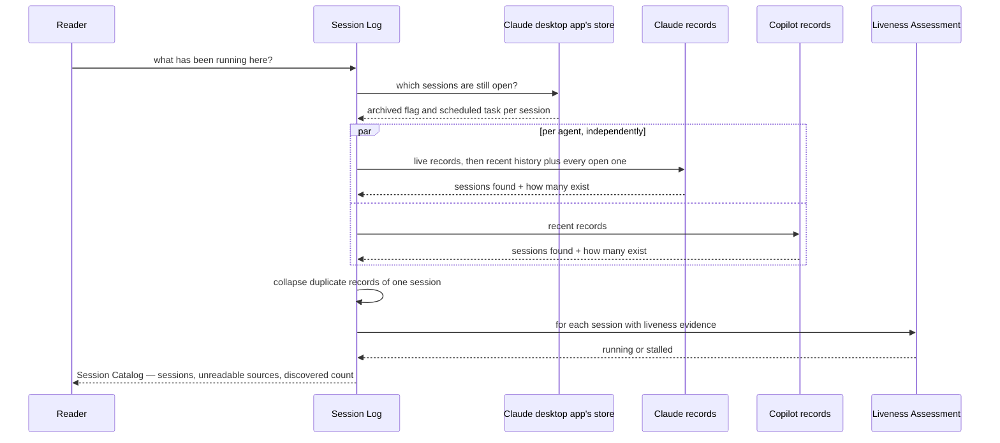
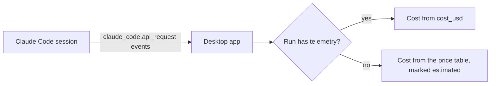
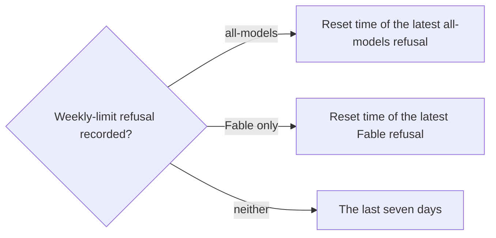
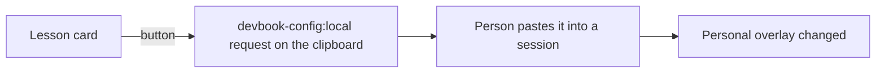
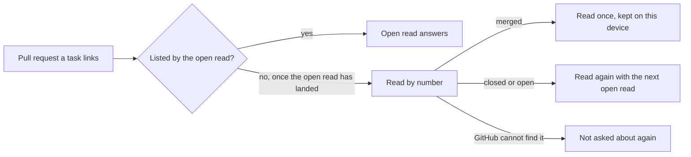

# Sessions

```meta
type: features
```

> Features and sub-features this bounded context supports, described in
> business/ubiquitous language rather than implementation terms.

## Session inventory

```meta
type: feature
related: [.devbook/domain/sessions/domain.md#session-log]
```

**How an environment's sessions are read**



- **The agents are asked independently, and their failures are collected, not
  thrown.** An environment with one agent installed is ordinary, and
  [one unreadable source costs only its own sessions](requirements.md#requirement-one-unreadable-source-costs-only-its-own-sessions).
  Each source contributes its sessions or its name to `unreadable`.
- **The desktop app's store is read once per reading, before the agents.** It alone
  records which Claude sessions the desktop app holds open. A store that
  cannot be walked costs only its two facts: "Claude desktop app" goes on
  `unreadable`, and the Claude sessions still answer, unstamped. A malformed record
  costs only itself, and a missing store is a machine without the desktop app.
- **Duplicates are collapsed first.** One session can leave more than
  one record: a live marker per process beside its transcript, or two transcripts
  when it changed folder. The aggregate's first invariant is
  that it appears once. The most recent record wins, because the agent
  went on writing it, and for a live session it is the running process.
  The collapse comes before the cap and the count, so a session filed twice
  costs one place in the list, and the number travelling back counts sessions.
- **Liveness is assessed last, per session, against one clock.** One clock per
  reading keeps two sessions in a list comparable.
- **How many exist travels back with what was described.** A reading for a list may
  stop at the most recent sessions per agent, except the open ones, which it reads
  whatever their age. The count of what it found is part of the answer, as is
  how many open ones are older than the newest session left out. A reading since a horizon
  stops nowhere inside it, which makes it the shape a count reads.

Answer "what have my agents been doing here" as one list: every session the
environment has a record of, most recently active first, whichever agent ran it.

The list opens from **Sessions** in the header's Goals group, between [Goals](../progress/features.md#the-goals-view) and **Pull requests**, the
open pull requests the sessions shipped. Each of the two lists takes the whole screen
while open. Escape, its close button or a second press of its option returns to
the previous view. Goals, first in the group, is a view instead.

The inventory is one list, not one per agent, because the question is about
the work, not the vendor.

### Live and past sessions together

```meta
type: sub-feature
related: [.devbook/domain/sessions/features.md#open-on-the-live-sessions]
tests: unit:dotnet:Backlog.Modules.Sessions.UnitTests.SessionsPaneTests.An_empty_open_view_names_all_as_the_way_out
```

A session running now and one that finished last week are rows in the same
list, told apart by their state. Two lists would force the reader to know where to
look before knowing whether the session had ended, which is usually what
they want to find out.

The list **opens on part of itself**, which is still one list narrowed by a control:

- the rows left out are one press away under the same heading;
- the count beside the title names both numbers whenever any rows are left out;
- the empty state the narrowing can produce says what it kept, and how many sessions
  are on the other side.

### Open on the live sessions

```meta
type: sub-feature
related: [.devbook/domain/sessions/domain.md#session-view, .devbook/domain/sessions/features.md#sessions-from-another-machine, .devbook/domain/sessions/domain.md#session-grouping]
tests: [unit:dotnet:Backlog.Modules.Sessions.UnitTests.SessionsPaneTests.The_show_strip_offers_open_between_live_and_all_with_its_own_tally, unit:dotnet:Backlog.Modules.Sessions.UnitTests.SessionsPaneTests.An_open_finished_row_reads_idle_in_open_and_finished_everywhere_else, unit:dotnet:Backlog.Modules.Sessions.UnitTests.SessionsPaneTests.Scheduled_runs_sit_in_one_folded_section_at_the_end_of_open, unit:dotnet:Backlog.Modules.Sessions.UnitTests.SessionsPaneTests.The_panel_never_shows_a_folded_row, unit:dotnet:Backlog.Modules.Sessions.UnitTests.SessionsPaneTests.With_only_scheduled_rows_folded_away_there_is_no_panel]
```

A `Live` / `Open` / `All` choice sits first in the row of controls above the list,
before the grouping, because it decides which rows exist before the grouping decides
where they sit. The list opens on `Live`, the sessions still going, because "what is
going on right now" is the question people open it for.

Live means running **or** stalled. Stalled is computed from silence, because nothing writes "I have stopped", so a stalled session is
one nobody can show has ended. Dropping it would hide the row most worth
looking at: the one that may be waiting on the reader.

**Open lists what the Claude desktop app still holds in its sidebar.** It keeps the
sessions the desktop app has not archived, whether or not a process runs for them. The
desktop app ends idle processes, so most read Finished, which is why Live
misses them. Open draws a quiet **Idle** badge where the Finished chip would stand, titled
"Open in the Claude desktop app with no process running; reads Finished". The desktop app's scheduled routine runs sit in one folded
**Scheduled** section at the end of the list.

Open reads only this PC's desktop app, so it never holds:

- a session from another machine;
- a CLI-only session;
- a running session the desktop app keeps no record of, such as a side session.

The desktop app's store is a private format this product
conforms to ([dependencies](dependencies.md)). Each row keeps the title the transcript
gives it, not the title the desktop app shows.

The choice is not remembered. Every open starts on `Live`, as Group by starts at
When. A view silently restored from last week is how a reader concludes the
product has lost their sessions.

**The default is only as good as the evidence under it, and for one agent that is
thin.** Claude leaves a record per running session, so its live rows are evidence.
Copilot leaves no liveness marker. Its sessions read as running while their
record is fresh, and as finished once quiet for longer than the
`Stale Threshold`; they never read as stalled.

So a running Copilot session that has said nothing for half an hour falls out
of this view. That is a limit of what Copilot writes down, and it is why the empty state names the way back to `All`.

A session from another machine is thin for a different
reason: a record carries no liveness marker, whichever agent wrote it, so it too falls
out of this view once quiet long enough. See
[Sessions from another machine](#sessions-from-another-machine).

### Narrow to one machine

```meta
type: sub-feature
related: [.devbook/domain/sessions/domain.md#environment, .devbook/domain/sessions/features.md#group-by-environment]
```

A machine filter sits beside `Live` / `Open` / `All` and opens on "All machines". Choosing a
machine keeps only the rows that machine gathered. The count beside the title names
both numbers, such as "1 of 4 sessions". It composes with the view: `Live` on one machine is the running
and stalled sessions there. `Open` on another machine is empty, because
Open reads only this PC's desktop app, and its empty state says so.

The filter is a list, because the options are however
many machines have reported. An option is offered exactly when
there are rows behind it, named and ordered as Group by environment
names its sections. Like the view, it is not remembered:
every open starts on "All machines".

### Open on the session a task names

```meta
type: sub-feature
related: [.devbook/domain/sessions/features.md#open-on-the-live-sessions, .devbook/domain/sessions/features.md#narrow-to-one-machine]
```

A task that names a session opens the list on that session. Its row is marked, the
focus moves to it, and its runs show, because such a task usually
asks about the run the session drove. When the view or the machine filter would hide the
row, both widen to `All` and "All machines". They widen once: re-reading the list does not undo what the
reader narrowed since.

The shell's repository scope is the shell's and is left alone. The list says so out loud for a session
outside it, and for a session this machine has no record of.

### Only what the agent recorded

```meta
type: sub-feature
related: [.devbook/domain/sessions/domain.md#working-location]
```

Each session shows what its own agent wrote down and no more. Copilot names the repository and the branch; Claude
names the branch and never the repository. A Claude row shows its branch and an em
dash where its repository would be, and a Copilot row shows both.

Inferring the missing repository from the working folder was rejected: a
wrong repository renders as convincingly as a right one.

A row may instead show the **resolved repository**, marked as
resolved. The cell's title says the agent recorded none and the
folder was placed inside a registered clone. This is not inference: it is
looked up against the clone directory the person registered
([Working Location](domain.md#working-location)), not read off the path. A recorded
repository always outranks it, and a session with neither still shows an
em dash.

The repository scope in the shell's header admits a session by either repository, so
a scoped list can hold the Claude sessions running in that repository's clone. Its
narrowing sentence names both terms. A Claude session missing from a scoped list is
one outside every registered clone, not one that never ran.

### What a session cost and what it shipped

```meta
type: sub-feature
related: [.devbook/domain/sessions/features.md#the-work-a-run-is-linked-to, .devbook/domain/productivity/features.md#what-the-sessions-cost-and-shipped, .devbook/domain/sessions/features.md#the-detail-of-one-session]
```

A row also shows three things Claude writes into its transcript and the session record
keeps:

- **the pull requests the session linked itself to**, drawn exactly as a run's are:
  "PR #n", opening on GitHub;
- **its tokens**, output and input, with every model and the cache figures in the
  cell's title;
- **where it was run from**, a quiet badge beside the type, such as "desktop" or
  "cli".

A pull request the row's own run already draws is not drawn again. The tokens are the session's own spend, and the title
says the agents it spawned are not in them. Copilot records none of the three. A row
that could not say shows nothing or an em dash, never a zero, which would claim the
session linked or spent nothing.

### Sessions from another machine

```meta
type: sub-feature
related: [.devbook/domain/sessions/domain.md#session-log, .devbook/domain/sessions/features.md#group-by-environment, .devbook/arc42/08-crosscutting-concepts.md#session-record-sync, .devbook/arc42/adr/0005-azure-hosted-task-replica-for-multi-device-sync.md]
```

A session that ran on one of the person's machines can be read on another. The
record travels and the work stays where it happened. What arrives joins the same list,
not a panel of its own: agents on a desktop and a laptop are one set of sessions.

It is off until the person switches it on, with the one Sync switch that also turns on
pairing and the tasks' sync. A person should agree to let a record of what
the assistants have done leave a machine, not find out it has. One switch is enough because the question
is whether this machine takes part in sync at all. The sanitization
boundary makes that answer safe to give
([Session Record Sync](../../arc42/08-crosscutting-concepts.md#session-record-sync));
[what may travel](domain.invariants.md#invariant-only-the-published-fields-travel)
is an invariant of the log.
Until sync is on, the list holds only what is read here.

**A row from elsewhere says less than a row read here, and visibly so.** What
travelled is:

- which agent and which machine;
- which repository and branch;
- when the session was alive and how much of it there was;
- its title;
- the usage limits that refused it.

Such a row has no working folder to show, because a folder names a disk the reading machine cannot see. The row still carries the delivery runs filed under that folder, matched on the
worktree key its record carried. A record from a device older than the title field is
headed by its session id.

**A session of this machine's outlives its transcript.** The assistant cleans its
transcripts away after a month by default. This machine keeps its own record of every
session it has read, with or without sync. The session stays in the list after the
files are gone. It keeps its title and folder, with its dates and measurements, and the refusals it met.

While the transcript is there the row is read from it. A row answered from the record says so under its folder, in the origin
line's quiet style, and shows what the last reading kept.

The pane amends the records of the sessions that moved each time it opens. **Update
records**, beside Refresh, amends every record the files still hold, under
[the rule every amendment keeps](domain.invariants.md#invariant-a-session-record-is-added-to-and-never-taken-from).
It says how many records it amended and started. With sync on, it
sends every record again so the other machines are amended too.

**And it reads as finished once it goes quiet, sooner than the truth may be.** A
record carries no liveness marker, so a session silent for longer than
the `Stale Threshold` reads as over, as Copilot's sessions already do.

A session still running on the other machine can therefore drop out of the live view
between one exchange and the next. Reading it as stalled would be worse: stalled says something is still
there and quiet, and a record cannot tell that from a session that ended a month ago.

### Re-read on request

```meta
type: sub-feature
```

The list is read when it is opened and again when the reader asks for it. Nothing
polls.

A self-refreshing surface would claim to be live, and the evidence does
not support that: one of the two agents leaves no liveness marker.

Records arriving from another machine change nothing. They arrive on their own schedule, into what this environment has a record of, which is what the
list reads. Nothing appears on screen until the reader
opens the list or asks again, so the rows they are looking at never move.

## Session grouping

```meta
type: feature
related: [.devbook/domain/sessions/domain.md#session-grouping]
```

Carve the same list up, without removing any session, by:

- when they ran;
- which plan they belong to;
- what they are for;
- which repository they were in;
- which machine ran them.

The list opens grouped by When, which puts the standing sessions on top, then the live
ones, and the rest under the day they were last active.

### Standing under When

```meta
type: sub-feature
related: [.devbook/domain/sessions/domain.md#session-title-reading, .devbook/domain/sessions/domain.invariants.md#invariant-a-standing-session-leaves-standing-only-while-it-runs]
```

A session with a [standing purpose](domain.md#session-title-reading) is one the reader
keeps until it is archived. When opens with a Standing section above
Live now, so they do not sink under the days. A running standing session sits in
Live now and returns to Standing when it stops. A scheduled run never stands.

### Group by plan

```meta
type: sub-feature
related: [.devbook/domain/sessions/domain.md#session-title-reading, .devbook/domain/sessions/domain.md#session-grouping]
tests: unit:dotnet:Backlog.Modules.Sessions.UnitTests.SessionTitlesTests.By_plan_is_a_section_per_tag_with_the_plan_then_its_runs_then_its_entries_by_step
```

A section per plan tag, headed `+tag` with the plan's state, Draft or Imported, where
it has one. A section lists the session the plan was agreed in first, then the
execute-plan runs, then the entries by step, so a plan reads in the order
it was worked. The sessions of no plan close the list under "Not part of a plan".

### Group by purpose

```meta
type: sub-feature
related: [.devbook/domain/sessions/domain.md#session-title-reading]
tests: unit:dotnet:Backlog.Modules.Sessions.UnitTests.SessionTitlesTests.By_purpose_is_a_section_per_purpose_in_declared_order
```

A section per purpose, in the order the purposes are declared: Artifact, Design, Plan,
Research, Hold, Plan run, Entry, Scheduled, Other.

### Group by environment

```meta
type: sub-feature
related: [.devbook/domain/sessions/domain.md#environment, .devbook/domain/sessions/features.md#sessions-from-another-machine, .devbook/arc42/adr/0005-azure-hosted-task-replica-for-multi-device-sync.md]
```

A section per environment, named after it, with its own count.

A reader whose machines exchange session records gets a section per machine that has
reported. The environment that gathered a row settles its section, never the one showing it, so a session sits under the machine that ran it, wherever
it is read.

A section for a machine the reader is not sitting at is as fresh as that machine's
last exchange. A session started since is missing, so the count answers for what has arrived, not for what is
happening over there.

The sessions it has are not misreported. Their state is derived against the reader's own clock from the timestamps that
travelled, so a row ages honestly on this side instead of repeating the other
machine's opinion. That is why the staleness is named here once, not on every row.

### Group by agent

```meta
type: sub-feature
```

A section per agent, so Claude's sessions and Copilot's could be read separately
within one list. The session list does not offer it: every row
wears its agent's mark. The grouping remains in the domain.

### Grouping never hides a session

```meta
type: sub-feature
related: [.devbook/domain/sessions/features.md#open-on-the-live-sessions]
```

The total is the same whichever grouping is chosen. The surface keeps it on
screen beside the title, above the controls that act on the list, so a grouping cannot be
a filter in disguise.

The count answers to the filters, never to the grouping: it does not move while `Group by` moves the same rows around. When the filters leave
some rows out, the count names both numbers, kept and total. Show, With delivery runs,
Machine, Purpose, Plan and Plan state remove rows. One number where two are owed would
let them pass for `Group by`, which does not.

## Honest partial answers

```meta
type: feature
related: [.devbook/domain/sessions/domain.md#session-catalog]
```

Say what could not be read and what was left out, rather than presenting whatever
arrived as the whole picture.

### Name the source that could not be read

```meta
type: sub-feature
related: [.devbook/domain/sessions/requirements.md#name-the-source-that-could-not-be-read]
```

When one agent's records are there but cannot be read, the other agent's sessions are
still shown and the unreadable one is named. A source is unreadable when this user may
not read it, or when reading fails.

An agent that was never installed is not unreadable: one agent is the ordinary case, so the absent agent is an empty source and is not
named. Naming it would put a permanent warning on every machine that never ran
that agent. "No Copilot sessions" and "Copilot could not be read" are different facts, and only
one is worth investigating.

### Say how much was left out

```meta
type: sub-feature
related: [.devbook/domain/sessions/domain.md#session-limit, .devbook/domain/sessions/domain.md#session-catalog]
tests: [unit:dotnet:Backlog.Modules.Sessions.UnitTests.SessionsPaneTests.A_capped_subtitle_names_the_older_open_sessions_apart, unit:dotnet:Backlog.Modules.Sessions.UnitTests.SessionsPaneTests.A_capped_subtitle_with_no_older_open_session_reads_as_before]
```

An environment can hold hundreds of session records. Reading all of them costs real
time, and showing all of them buries the few that are running. A reading for a
list therefore describes the most recent sessions per agent, up to the
[Session Limit](domain.md#session-limit), and states how many exist.

The sessions still open in the Claude desktop app are listed whatever their age. The
subtitle names the older ones apart: "The N most recent of D sessions this PC
has a record of, plus K older ones still open in Claude". Counted among "the most
recent", a months-old open session would make that number untrue.

A reading for a count takes the other shape: everything since a horizon, with no
limit. A count over the most recent hundred per agent is the limit posing as a total: every busy machine reads "200". Every source keeps records at least as far
back as the longest horizon a consumer can ask for
([Session History](domain.md#session-history)). A source that cannot reach the
horizon it was asked still says so.

## Delivery runs beside their sessions

```meta
type: feature
depends-on: [.devbook/domain/sessions/features.md#session-inventory]
related: [.devbook/domain/sessions/domain.md#delivery-run, .devbook/domain/sessions/domain.md#run-attachment]
```

Show the orchestrated delivery runs an environment's dashboards recorded in the same
list as the sessions. Each run says which skill ran and what it was called, how it
ended, and how much it cost. A run is work a session was doing, so a reader
wants both answers in one place.

**One list, whichever side arrived first.** A session record and a run file describe
the same work from two sides, and this environment may hold either. The run's session may have aged out of the reading, or been read on another machine. So the row is the unit of the list: a session with the runs it drove, or a run standing on its own.

A dashboard keeps a run's file outside the repository, keyed by the worktree it ran
in. Many run files do not say which session drove them. So this context matches the worktree key derived from a session's folder and the window
the two were open together. [Run Attachment](domain.md#run-attachment) has the full
rule.

A session can also report a run to this product
directly, and then it is recorded here as it happens. It has the same shape, sits in the same list, and is read on the same
terms. See [Record a run as it happens](#record-a-run-as-it-happens).

### Under the session that drove it

```meta
type: sub-feature
related: [.devbook/domain/sessions/domain.md#run-attachment, .devbook/domain/sessions/features.md#how-each-stage-of-a-run-ran, .devbook/domain/sessions/features.md#each-stage-against-its-usual-cost]
```

A run attached to a listed session is shown on that session's run card, in the row's detail
panel. The card reads top to bottom:

1. **The header**: "Delivery run" and the flow it ran in, the linked work, and its
   outcome at the right.
2. **The insight**: a callout on a finished run's cost against its flow's usual run
   ([Each stage against its usual cost](#each-stage-against-its-usual-cost)).
3. **The figures**, as tiles: stages done and the cost, then the context peak and the
   tool calls.
4. **The stages**: the legend, then one row per stage
   ([How each stage of a run ran](#how-each-stage-of-a-run-ran)).
5. **A footnote** saying what Configured means and what "vs typical" is compared with.
6. **Run details**, behind a closed fold.

A figure the run does not carry is left out, never shown as zero. Under the tiles,
quietly, sits the run's share of the week. "vs typical" compares a stage with its median
over the last 30 runs of the run's own flow.

The run details hold:

- the run's own title and id;
- the surfaces that reported it;
- its change kind and schedule;
- its sync verdicts;
- the context gauge;
- the token buckets;
- the tool activity by category and by MCP server.

They sit behind a fold because a run holds ten stages, six token buckets per
stage and tens of thousands of tool calls.

Each stage row says where it stands in a word beside its dot,
so progress reads without a diagram, beside how the stage ran.

A session can drive more than one run. The latest is drawn whole; each earlier one folds
to its header, which opens it.

### One line for a run two surfaces reported

```meta
type: sub-feature
related: [.devbook/domain/sessions/domain.md#delivery-run]
```

A flow reports its run to every surface it is bound to, and each surface files it as
a run of its own. The list shows such a run as one line under its session. The
[Delivery Run](domain.md#delivery-run) says when two files are one run and which is the record. The two must:

- name the same skill;
- come from different dashboards;
- start within five minutes of each other;
- agree on the session.

The line shows the record of the preferred surface: `delivery-surface-dashboard`, then
`orch-dashboard`, then `backlog`. Its run details name the surfaces that reported the
run, so a reader who sees one run where a dashboard shows two knows why.

### The work a run is linked to

```meta
type: sub-feature
related: [.devbook/domain/sessions/domain.md#delivery-run-reference]
```

A run names what it was for and what it produced, shown in its card's
header between its flow and its outcome. The tracker issue it was working and the pull
requests it opened each show as a reference, and each opens where it lives.

The Backlog entry it was started from is not a reference beside them. **The run's own
status is how a reader reaches it**: pressing the status hands the
entry back to whatever holds the task list, which shows and selects it. Where the
prompt names no entry and no entry linked the session, the status stays a plain word.

The run's own title is not in the header, because a dashboard names a run after
the work it was doing and the title would repeat the reference. It stays in the run details.

A run file records its references in three places, and one item named twice is one
reference:

- its own tracker field;
- the links its stages kept;
- the entry in the prompt it was started with.

The prompt names its entry by plan item (the marker the import plan writes) or by stored id (the line the app puts on every entry it copies). The reference is called by the title written under the line, because a reader
does not know their task by an id. An imported entry copied out of the app carries both
markers, and they stay one reference.

**A run naming no entry of its own shows the entry its session was linked to.** A task records that
link through the Backlog MCP server, and the application holding
the task list answers which entry it is. The run's own entry always takes precedence, because
the prompt is what the run was started from: the link is a fallback.

No state travels with any of them, because this environment has not asked the tracker how the
item is doing.

### A row of its own in the same list

```meta
type: sub-feature
related: [.devbook/domain/sessions/features.md#say-how-much-was-left-out]
```

A run no listed session ran in is a row of the same list. It is named after its
worktree, dated by the run, and placed on the machine its file was read on. A line says
that no session record backs it, and which dashboard does.

It answers every control the sessions answer: it is grouped by When, Repository or
Machine, and narrowed by the machine filter. It is out of the live view,
because with no liveness evidence a row is Finished. A session still running would be
in the reading, and the run would be on its row.

### A schedule's runs as one row

```meta
type: sub-feature
related: [.devbook/domain/sessions/domain.md#session-row, .devbook/domain/sessions/features.md#a-row-of-its-own-in-the-same-list]
```

The runs a schedule fired, with no session in the list behind them, are one row per
schedule and repository, titled by the schedule, with every run a line
under it, newest first. Every scheduled run cuts a worktree of its own, so a row per run
would add a line a week for a weekly sweep, each named after a folder nobody
opens again.

Each run carries a *scheduled* chip naming the schedule. Its run details name the
schedule and repository. For a devbook sync sweep, they also count the units it
checked, by verdict. A scheduled run whose session the list does hold sits on that session's
row like any other run, still chipped.

### Only the rows with a run

```meta
type: sub-feature
related: [.devbook/domain/sessions/features.md#open-on-the-live-sessions]
```

One toggle narrows the list to the rows that carry a delivery run: a session that
drove one, or a run standing on its own. It is for the reader who came for the work.
The count says what it hid, it composes with the view and the machine filter, and it is off again on every
open.

### Only what the dashboard recorded

```meta
type: sub-feature
related: [.devbook/domain/sessions/features.md#name-the-source-that-could-not-be-read, .devbook/domain/sessions/requirements.md#only-what-the-dashboard-recorded]
```

The list shows only what a run file recorded:

- A status word is shown as the dashboard wrote it, made readable but never mapped onto
  a smaller vocabulary.
- A figure the file does not carry is left out, not shown as zero.
- A stage whose name the writer lost is numbered.
- A run file cut off mid-write costs that run and nothing else.
- A dashboard folder that cannot be read is named beside the agents that cannot be, in
  the same sentence.

## Record a run as it happens

```meta
type: feature
depends-on: [.devbook/domain/sessions/features.md#delivery-runs-beside-their-sessions]
related: [.devbook/domain/sessions/domain.md#delivery-run-recording, .devbook/arc42/adr/0012-backlog-is-an-mcp-server-inside-the-desktop-app.md]
```

Let a session report its delivery run to this product while it runs. The pane then
shows the work in progress, not a folder another tool wrote and this
product found later. A run recorded here has the same row, figures and stages as one imported from a
dashboard.

Without this, every run in the list is somebody else's record: the list could say what
had happened, never what was happening, and a session with no dashboard installed left
no run at all. Now a row appears when the work starts.

**Asking to see the runs brings the pane forward, and answers with the application.** A
session that reports here can ask for the surface. It gets back what the window
did: it showed the pane, or did not because the area is switched off, or had nothing to
show because no window is open. It never gets an address, because a link would open a second window onto the application the
session is already talking to.

### Picking a run back up

```meta
type: sub-feature
related: [.devbook/domain/sessions/domain.md#delivery-run-recording]
```

A session that resumes work already under way continues the run it left, not a second one. It is told so, and can carry on
from the first stage that is not done. Two rows for one piece of work would count it twice, with its stages split between them, and a reader could not tell that
from two genuine runs.

### What started a run and what it found

```meta
type: sub-feature
related: [.devbook/domain/sessions/domain.md#delivery-run-recording, .devbook/domain/devbook/features.md#sync-verdicts-beside-a-chapter]
```

A run says what started it: a person, or a named schedule, in a repository it names. A
devbook sync sweep closes its run with the verdict it reached on every sync unit and
chapter it checked. Both are kept on the run as sent.

The verdicts are also filed against their chapters, the latest per
chapter, so a reader opening a chapter in the Devbook pane sees what the last sweep
said without finding the run. A run that names no repository keeps its
verdicts on itself alone, because a verdict that cannot say which repository it is
about matches no chapter.

### Scenario evidence from a verify stage

```meta
type: sub-feature
related: [.devbook/domain/sessions/domain.md#delivery-run-recording, .devbook/domain/tasks/features.md#acceptance-from-scenario-parts]
tests: [unit:dotnet:Backlog.Infrastructure.Mcp.UnitTests.SurfaceToolsTests.Update_stage_passes_the_verify_evidence_through_per_part, unit:dotnet:Backlog.Infrastructure.Sessions.UnitTests.DeliverySurfaceLifecycleTests.A_verify_stage_keeps_its_scenario_evidence_per_part, unit:dotnet:Backlog.Infrastructure.Sessions.UnitTests.DeliveryRunReaderTests.A_stage_s_scenario_evidence_is_read_per_part, unit:dotnet:Backlog.Desktop.UI.UnitTests.SessionsPaneRunTests.A_verify_stage_shows_its_scenario_evidence_per_part, unit:dotnet:Backlog.Desktop.UI.UnitTests.SessionsPaneRunTests.A_run_with_no_evidence_draws_no_evidence_list, unit:dotnet:Backlog.Infrastructure.Sessions.UnitTests.DeliveryRunReaderTests.A_stage_s_scenarios_are_read_with_their_screenshots, unit:dotnet:Backlog.Infrastructure.Sessions.UnitTests.DeliveryRunReaderTests.A_stage_s_links_are_read_as_recorded, unit:dotnet:Backlog.Infrastructure.Sessions.UnitTests.DeliveryRunReaderTests.A_stage_link_that_is_not_http_https_or_file_is_left_out, unit:dotnet:Backlog.Desktop.UI.UnitTests.DeliveryRunStagesTests.A_stage_s_scenarios_list_their_screenshots_in_its_panel, unit:dotnet:Backlog.Desktop.UI.UnitTests.DeliveryRunStagesTests.A_stage_s_links_are_drawn_in_its_panel, e2e:dotnet:Backlog.EndToEndTests.ScenarioEvidenceTests.A_verify_stage_shows_its_scenario_evidence_and_screenshots]
```

A run's verify stage can say which parts of which scenario pages it ran. It reports
each part as the page's name, the part, the part's outcome and when the run ran,
read from the run the page committed. The stage keeps what it was last sent, and a
later report without evidence leaves it in place.

The run shows this evidence inside the stage that reported it. Closed, the stage's
row says how many parts passed, as "1 of 2 passing". Opened, the stage's panel
lists them under "Scenario evidence", one row per part with the part's dot. A part
opens nothing: the run only says what the stage ran. A run is evidence, not
a task, so it never says proved. A stage that reported no evidence shows nothing.

A verify stage also reports the scenarios it exercised, each with its status, its
notes and the screenshots it took. For a scenario page those are the page's label
screenshots, and a failed part adds the screenshot taken where it failed, named
`fail.<part>.png`. The stage's panel lists them under "Screenshots". It shows each scenario
with its name and status, then each screenshot by its file name. The tooltip holds the full
path as the stage sent it. A failure screenshot is marked as one in
words, not only colour.

A stage's links show in its panel under "Links". Personal Validation sends them
for the application it started and for each review target. Each link shows its label
(or its address, without one) and opens its address, and its description is the tooltip. Only a web or file address is shown: an agent writes the run, so a link to anything else, such as a script, is left out.

The scope and implement stages report no evidence of either kind, and the panel draws nothing extra for them.

### What a run cost, reported by the session itself

```meta
type: sub-feature
related: [.devbook/domain/sessions/domain.md#delivery-run-telemetry, .devbook/domain/sessions/features.md#only-what-the-dashboard-recorded, .devbook/domain/sessions/features.md#the-cost-of-a-run-and-its-stages, .devbook/domain/sessions/requirements.md#what-a-run-cost-reported-by-the-session-itself]
```

A run recorded here shows what it cost the way a dashboard's run does:

- the tool calls it made, by kind and by MCP server;
- the agents it delegated to;
- the tokens it spent, in total, delegated and per stage;
- how full its context window got.

The session reports these itself, from the moments its own tools run, because a tool call arriving here is not the session that made it. So the
figures come from the session's side or not at all.

A session reports only to a run it is driving. One with no run under way reports
nothing. A run started later does not count the conversation before
it, and a run another session drives is left alone. If the
plugin is not installed or the host is not Claude Code, the run lacks these figures, and they are left out, not shown as zero.

[The cost of a run and its stages](#the-cost-of-a-run-and-its-stages) extends these
figures with what the run and each stage cost in money.

### What every run spent, for a report

```meta
type: sub-feature
related: [.devbook/domain/sessions/features.md#what-a-run-cost-reported-by-the-session-itself, .devbook/domain/sessions/features.md#cost-as-claude-code-reports-it, .devbook/arc42/adr/0012-backlog-is-an-mcp-server-inside-the-desktop-app.md]
tests: [unit:dotnet:Backlog.Infrastructure.Mcp.UnitTests.UsageToolsTests.The_default_window_is_the_last_seven_days_by_start, unit:dotnet:Backlog.Infrastructure.Mcp.UnitTests.UsageToolsTests.A_run_carries_its_totals_and_its_uncached_figure, unit:dotnet:Backlog.Infrastructure.Mcp.UnitTests.UsageToolsTests.Models_are_read_from_the_requests_claude_code_reported_while_the_run_was_open, unit:dotnet:Backlog.Infrastructure.Mcp.UnitTests.UsageToolsTests.A_request_belongs_to_one_run_and_an_abandoned_run_ends_where_the_next_began, unit:dotnet:Backlog.Infrastructure.Mcp.UnitTests.UsageToolsTests.Runs_are_placed_in_a_repository_by_what_named_one]
```

A session reading back the run it drives is never handed these figures: they are
measured, not the run's to claim. A report about many runs reads them through `list_run_usage`, a read-only tool
beside the delivery surface, behind the same Sessions switch.

For a window, the last seven days or a range of whole days, it answers every run
on this machine that started inside it, across every repository:

- the repository the run is placed in: the one it named, else its session's, else the
  work it was linked to; a run nothing places is kept, with no repository;
- its total and delegated tokens, each with the uncached figure beside it — input, cache
  writes and output, the prompt cache's reads left out;
- the same per stage, and per agent it delegated to;
- per model, what Claude Code reported for the requests its sessions made while it was
  open, each request counted for one run only; where nothing was reported, the models
  are named with no figures;
- the fullest its context got and how often it was compacted;
- and a total per repository.

A figure nothing measured is left out, never shown as zero. The `backlog-tools` plugin's
weekly cost analysis reads it, repository by repository.

## The session list and its detail

```meta
type: feature
depends-on: [.devbook/domain/sessions/features.md#session-inventory]
related: [.devbook/domain/sessions/domain.md#session-row, .devbook/domain/sessions/features.md#session-grouping, .devbook/domain/sessions/features.md#delivery-runs-beside-their-sessions, .devbook/design/effort-and-mode-chips.md#effort-chips]
```

The session list has a filter bar above it, rows that say how each session ran, and a
detail panel beside it for the picked row. The list answers "what
have my agents been doing here" at a glance; the panel answers "what exactly
happened in this one".

This extends [Session inventory](#session-inventory) and
[Delivery runs beside their sessions](#delivery-runs-beside-their-sessions), and every rule
there still holds: one list, nothing hidden by a grouping, nothing shown that was not recorded.

### A filter bar over the list

```meta
type: sub-feature
related: [.devbook/domain/sessions/features.md#open-on-the-live-sessions, .devbook/domain/sessions/features.md#narrow-to-one-machine, .devbook/domain/sessions/features.md#only-the-rows-with-a-run]
tests: [unit:dotnet:Backlog.Modules.Sessions.UnitTests.SessionsPaneTests.The_show_strip_offers_open_between_live_and_all_with_its_own_tally, unit:dotnet:Backlog.Modules.Sessions.UnitTests.SessionsPaneTests.A_purpose_narrows_the_list_and_each_option_counts_its_rows, unit:dotnet:Backlog.Modules.Sessions.UnitTests.SessionsPaneTests.A_plan_tag_beside_the_row_narrows_the_list_to_its_plan]
```

The controls that narrow the list sit together in one filter bar above it. From left to
right the bar shows:

1. Show: Live, Open or All.
2. With delivery runs.
3. Machine.
4. Purpose: All, then each purpose.
5. Plan: All plans, then each plan tag the reading names.
6. Plan state: Any, Draft or Imported.

Group by sits beside them, then Clear filters while any of them narrows the list, and
Update records and Refresh at the end. Purpose, Plan and Plan state read the session's
title (see [Session Title Reading](domain.md#session-title-reading)). Clear filters
returns every filter but Show to its first option. The filters share one bar so that every reason a session is missing is in one place. The
order the surface applies them in is the [Session View](domain.md#session-view)'s.

Live, Open and each Purpose option carry how many rows they would show under the other
filters, so pressing one is never a guess. Every filter comes back to its first
option on every opening, and Group by comes back to When.

The count beside the title keeps its promise from
[Grouping never hides a session](#grouping-never-hides-a-session): it names both numbers
whenever the bar leaves rows out. The heading reads "Running now" while Show is on Live,
and "Open in Claude" while it is on Open.

### Grouped rows that show how each session ran

```meta
type: sub-feature
related: [.devbook/domain/sessions/features.md#session-grouping, .devbook/domain/sessions/features.md#how-each-stage-of-a-run-ran, .devbook/design/effort-and-mode-chips.md#effort-chips]
```

The list stays grouped the way the reader chose. Each row also shows the model the
session ran on, the effort it ran at, and the stage strip of the run it drove. The strip is one mark per stage, so a reader sees how far the run got without opening it.

Model and effort sit on the row because they most change what a
session costs and how well it does. A session whose agent recorded no
effort shows none, not a default that would claim a choice nobody made.

The list is grouped by When, Plan, Purpose, Repository or Machine (see
[Session Grouping](domain.md#session-grouping)), and each row reads in three lines:

- the agent's mark, the purpose badge, the title less its prefix, Draft or Imported on
  a plan's own session, its state chip, and on a plan's sessions the plan tag;
- the repository with its [identity edge](../../design/color-scheme.md#the-identity-edge),
  the machine, when it was last active, how long it went on, the model with its effort
  chip, and its output tokens;
- the stage strip of the run it last drove, with one line saying where that run
  stands. That is every stage done, the stage it failed or was parked at, or the stage
  it is on and how far along.

The row is one control: pressing it shows the session in the detail panel. The pull
requests and the task it led to are in the panel, because a
link inside a control is markup no browser agrees on.

The plan tag is the exception: it sits beside the row as a control of its own, narrowing the list to that plan. The row keeps
room for it on its first line, so the tag never covers the state chip.

A row shows its title less its prefix, and the prefix as a badge. The row's tooltip and
the detail panel keep the whole title
([A row shows its title less its prefix](domain.invariants.md#invariant-a-row-shows-its-title-less-its-prefix)).
A row with no prefix the reading recognises shows its title whole and no badge.

### The detail of one session

```meta
type: sub-feature
related: [.devbook/domain/sessions/features.md#what-a-session-cost-and-what-it-shipped, .devbook/domain/sessions/features.md#the-work-a-run-is-linked-to, .devbook/domain/repository-management/features.md#the-detail-panel-of-a-pull-request, .devbook/domain/repository-management/features.md#one-verdict-per-pull-request]
```

Picking a row opens a detail panel beside the list, because the reader is usually
moving down the rows and a panel keeps their place. The pull request card and the task card are the same cards the pull requests pane and
the task list draw.

The panel shows the pressed row, and until one is pressed, the first row the
list draws. A filter that hides the pressed row moves the panel to the first row drawn,
so the panel never contradicts the list. At a
narrow width the panel drops under the list.

The panel holds these, in this order:

- **The facts**: repository, machine, model, effort, started, duration, output, and
  branch. A row whose folder is this machine's also shows the working folder. A model
  or an effort nobody recorded reads "not recorded".
- **Where the record came from**, in a quiet note under the title:
  - a replicated record names the machine that recorded it, and says its folder and
    transcript stayed there;
  - a row the runs alone account for says which dashboard recorded it and under which
    key, or, for a schedule's row, how many runs it holds;
  - a row answered from this machine's own record says the transcript is gone;
  - a Copilot row says its state is read from silence, because Copilot leaves no
    liveness marker.
- **The run card**: every run on the row, latest first, drawn as
  [Under the session that drove it](#under-the-session-that-drove-it) says. A session with no run says so in its place.
- **What it produced**: a pull request card for each pull request, and the task card
  for the Backlog entry it was worked for. Each pull request card wears the readiness
  verdict Repository Management publishes for it, by
  [One verdict per pull request](../repository-management/features.md#one-verdict-per-pull-request).
  A pull request whose verdict could not be read wears no chip rather than a guess.

## How each stage of a run ran

```meta
type: feature
depends-on: [.devbook/domain/sessions/features.md#delivery-runs-beside-their-sessions]
related: [.devbook/domain/sessions/features.md#under-the-session-that-drove-it, .devbook/domain/sessions/domain.md#delivery-run, .devbook/domain/sessions/domain.md#stage-resolution, .devbook/design/effort-and-mode-chips.md#mode-chips, .devbook/design/effort-and-mode-chips.md#effort-chips]
```

Each stage of a delivery run says how it ran, beside how the repository said it should
run. A flow's configuration names an agent, a model and an effort per phase, and a cheap or a poor run is
usually explained by a stage that ran differently.

This deepens the run card in
[Under the session that drove it](#under-the-session-that-drove-it). The stages are
listed on the card under the figure tiles and the legend. Each stage has one row on one
grid, which shows:

- a status dot;
- the stage's name, with its rounds where it took more than one;
- the mode chip;
- the model with its effort chip and mark;
- the time it took, or the word for where it stands ("Failed", "Not yet");
- its cost;
- its cost against its usual;
- a chevron.

The dot never carries the state alone: the word or the time beside it does. The
[Stage Resolution](domain.md#stage-resolution) says what each value means. It is the same reading the delivery engine's own run view uses.

### The mode a stage ran in

```meta
type: sub-feature
related: [.devbook/design/effort-and-mode-chips.md#mode-chips]
```

| Mode | What it means |
| --- | --- |
| inline | The session driving the run did the stage itself. |
| delegate | The session handed the stage to a sub-agent and waited for its answer. |
| fork | The session started the stage in a separate session that runs on its own. |
| gate | The stage waited for a person to decide. |

What a stage's latest pass found sits on its row after its name: Implement's and
Review's round as "· 2 rounds", then the blockers Review left open and the defects Verify
found, such as "no blockers". A blocker left open or a defect found is drawn as an error;
a stage that reported none of the three shows nothing, never a zero.

Every stage shows its mode, because an inline stage
shares the driving session's context and cost, while a delegated stage spends its own.
[Stage Resolution](domain.md#stage-resolution) says how the mode is read and when it is marked as inferred.

### What ran beside what was configured

```meta
type: sub-feature
related: [.devbook/domain/sessions/features.md#only-what-the-dashboard-recorded, .devbook/design/effort-and-mode-chips.md#stage-marks]
```

Each stage shows the agent, model and effort that ran, next to the ones its configuration
named. A ≠ mark says the stage ran differently from its configuration. A ? mark says a
value on the stage was inferred rather than read from the run's own record. When both
apply, ≠ is the one shown, and the open stage states the difference and the inference in
words. The ≠ mark's tooltip lists every difference, for example "model Sonnet → Opus 5.5".

The ≠ mark spares the reader comparing two columns by eye on every stage. The ? mark exists
because an inferred value reads as convincingly as a recorded one.

[Stage Resolution](domain.md#stage-resolution) says what a stage is compared on. The model is compared by family, because a configuration names an alias such as
`opus` and the run records the id it resolved to.

Take a run whose [phase map](domain.md#phase-map) configures Implement on
`sonnet` at `high` effort, while its Implement stage recorded `claude-opus-5-5` at
`medium`. Implement shows ≠ with the tooltip "Not as configured: model Sonnet →
Opus 5.5 · effort high → medium". In a run whose context holds no phase map, a stage a
sub-agent worked in shows as delegate with the ? mark, and its panel says the run records no
resolved phases, so mode and agent are inferred.

### The stage panel

```meta
type: sub-feature
```

A stage expands into a panel, and only one panel is open at a time. The panel is closed by default, because a stage can hold hundreds of tool calls that would bury the stage rows.

The panel says:

- **Ran**: the mode, the agent or the owner session, the model and the effort, and the
  stage's output tokens and tool calls where the run counted them. A stage nobody has
  reported on reads "Not run yet".
- **Found**: what the latest pass found. On Implement, Review and Verify, it adds what the
  run's [quality facts](domain.md#delivery-run) say across every pass: the review
  rounds, the blockers left open over the rounds listed, and the defects Verify found.
  It is left out where neither says anything.
- **Configured**: the agent, model and effort the run resolved, and where that came
  from: the team default, or the team default with an overlay merged over it.
- **Skill** and **MCP servers**: what the stage followed and was given, or "not recorded".
- **Around it**: the skills run before and after the stage.

Under those facts:

- **Why ≠ or ?**: the difference or the inference in words, as a callout wearing the
  stage's mark. A difference wears the warning edge.
- **Sub-agents**: every sub-agent call the stage made, as a table with the columns
  Sub-agent run, Model, Time, Tokens, Tool calls and Result. A figure the run did not
  record reads "—". What a call cost sits under its tokens. A call under the gate is
  marked as a [revise round](domain.md#revise-round), with the round it worked where the
  run lists one, and every other call names its round. A delegated stage whose calls the
  run did not record says so rather than claiming none ran.
- **Scenario evidence**, where the stage reported any.

## The cost of a run and its stages

```meta
type: feature
depends-on: [.devbook/domain/sessions/features.md#how-each-stage-of-a-run-ran]
related: [.devbook/domain/sessions/features.md#what-a-run-cost-reported-by-the-session-itself, .devbook/domain/sessions/domain.md#delivery-run-telemetry, .devbook/domain/productivity/features.md#what-the-sessions-cost-and-shipped]
tests: [unit:dotnet:Backlog.Infrastructure.Sessions.UnitTests.DeliveryRunCostsTests, unit:dotnet:Backlog.Infrastructure.Sessions.UnitTests.DeliveryRunBaselinesTests, unit:dotnet:Backlog.Infrastructure.Sessions.UnitTests.WeeklyUsageTests, unit:dotnet:Backlog.Desktop.UI.UnitTests.ClaudeCodeOtlpLogsTests, unit:dotnet:Backlog.Desktop.UI.UnitTests.ModelPriceSettingsTests, unit:dotnet:Backlog.Desktop.UI.UnitTests.SessionsPaneDetailTests]
```

A run and each of its stages show what they cost in money, and whether that was usual. A
token count does not tell a person tuning a flow whether a stage was
expensive.

This extends
[What a run cost, reported by the session itself](#what-a-run-cost-reported-by-the-session-itself),
and its rule still holds: a figure nobody
reported is left out, never shown as zero.

### Cost as Claude Code reports it

```meta
type: sub-feature
related: [.devbook/domain/sessions/domain.md#delivery-run-telemetry, .devbook/domain/sessions/domain.md#claude-api-request-log, .devbook/domain/sessions/domain.md#cost-attribution, .devbook/arc42/adr/0024-claude-code-telemetry-arrives-on-the-mcp-listener.md]
tests: [unit:dotnet:Backlog.Desktop.UI.UnitTests.ClaudeCodeOtlpLogsTests, unit:dotnet:Backlog.Infrastructure.Sessions.UnitTests.DeliveryRunCostsTests]
```



Each `claude_code.api_request` event carries `cost_usd`, Claude Code's own estimate of what the request cost, which the product shows as
Claude Code's, not as an invoice. It is preferred because Claude Code knows the price it applied; a price the product worked out afterwards would be a second guess.

The desktop app takes Claude Code's OpenTelemetry logs at
`/v1/logs` on the port its MCP server listens on. It keeps each
`claude_code.api_request` event once, in its local database, as the
[Claude API Request Log](domain.md#claude-api-request-log). Settings has a **Claude
Code** page with the endpoint and the `settings.json` block to paste into Claude Code.

The cost is shown in three places:

- The session's detail panel has a **Cost** fact: the sum of every request the session
  reported.
- Each stage row on a run card shows the stage's cost, repeated on the stage panel's **Ran**
  line.
- Each sub-agent call in the panel shows what that call cost.

[Cost Attribution](domain.md#cost-attribution) says which requests belong to which stage and call. With no figure from either
source, nothing is shown, never a zero.

A session sends these events only when its Claude Code settings say to. The person
merges that page's block into the `env` of their user-level `~/.claude/settings.json`.
The block:

- turns telemetry on;
- sets the OTLP logs exporter, the logs protocol, the endpoint and the bearer token as
  a header;
- sets `OTEL_LOG_TOOL_DETAILS=1`, so each request names the sub-agent and the skill it
  ran under.

Without that key a stage whose sub-agents ran is estimated, because its requests cannot
be told to its workers. The block never turns on the prompt or response events. A new session, started after the change, is the
first to report. The exact keys, and the check that the rows arrived, are in
`.claude/skills/run-backlog/SKILL.md`, under Claude Code telemetry.

### A price table for runs without telemetry

```meta
type: sub-feature
related: [.devbook/domain/sessions/domain.md#model-price-table, .devbook/domain/sessions/domain.md#cost-attribution]
tests: [unit:dotnet:Backlog.Desktop.UI.UnitTests.ModelPriceSettingsTests, unit:dotnet:Backlog.Infrastructure.Sessions.UnitTests.DeliveryRunCostsTests]
```

A price table in Settings gives a price per model. It covers the runs that sent no
telemetry, such as runs from before the desktop app received it or from a session that does not send it. The product works out their cost from their tokens, and marks
it as estimated.

The table is the **Model prices** page in Settings, beside the Claude Code page. Each row
names a model and gives four rates in US dollars per million tokens: input, output, cache
read and cache write. The table is empty until filled in, because shipped prices would be wrong the day a price changed.

A row is saved as soon as it names a model. A rate is written with a point, such as
0.30. One that does not read that way, such as one with a comma, is refused and
nothing is saved. So is a second row for the same model. A rate left empty is unknown,
never free, so a stage that spent tokens of that kind is not priced at all.

The page's headline counts the prices saved, as in `2 model prices price the runs Claude Code reported no cost for.`
A row still being typed, or a refused rate, does not move it.

An estimated figure carries the words "estimated from tokens" on the session's detail
and on each sub-agent call. A stage row, which has less room, marks it "est." with those
words as its title. A model with no row in the table prices nothing, and a run on it
shows no cost.

The mark matters because a price the person typed in may be out of date, and a reader comparing two runs must be able to tell a reported cost
from an estimated one.

### Each stage against its usual cost

```meta
type: sub-feature
related: [.devbook/domain/sessions/features.md#delivery-economics, .devbook/domain/sessions/domain.md#cost-baseline]
tests: [unit:dotnet:Backlog.Infrastructure.Sessions.UnitTests.DeliveryRunBaselinesTests, unit:dotnet:Backlog.Desktop.UI.UnitTests.SessionsPaneDetailTests.A_finished_run_reads_its_cost_against_the_usual_run_of_its_flow, unit:dotnet:Backlog.Desktop.UI.UnitTests.SessionsPaneDetailTests.A_finished_runs_insight_line_opens_delivery_economics_on_its_flow]
```

Each stage row on a run card shows its cost and its share of the run's cost. It also shows
its ratio to that stage's median cost over the last 30 finished runs of the same flow. The ratio
wears the bands of the [Cost Baseline](domain.md#cost-baseline): green when lower than
usual, "typical" near the median, highlighted when higher, and otherwise the plain
ratio, such as "1.2×". The ratio's tooltip names the median and how many runs it was
taken over. The baseline also says when a stage has no ratio.

On the run's [figure tiles](#under-the-session-that-drove-it), an estimated cost is labelled "Est. cost". The context peak is
in tokens, with its share of the limit under it where known. The
output tokens are in the run details with every other token count.

An insight callout sits directly under the header once the run has finished and five
earlier runs of its flow were priced. Its headline is the run's ratio to the flow's
median, such as "2.0× the usual flow-code run". Under it, the why names the stage that
explains most of the difference, and if that stage was entered again, how many times:
"Implement explains most of it: $5.00 over its usual, entered again once". Where that
stage is Implement or Review, the why also names the run's review rounds, as in ", over 3
review rounds".

A typical run reads "About the usual flow-code run (1.0× its median)" and
names no stage. A run from 1.5× its usual wears the warning edge. A run still active,
blocked or parked has no callout.

The comparison is per flow and per stage because a review stage and an implement stage
cost very different amounts, and a run-wide average would flag every long run and explain
none. The [Cost Baseline](domain.md#cost-baseline) says how the earlier runs are chosen and matched.

The callout ends on "Compare configurations for this flow", which opens
[Delivery economics](#delivery-economics) on the run's flow.

### Share of the week and the weekly limit

```meta
type: sub-feature
related: [.devbook/domain/sessions/domain.md#session-log, .devbook/domain/sessions/domain.md#weekly-usage, .devbook/domain/sessions/domain.md#cost-attribution, .devbook/domain/sessions/requirements.md#share-of-the-week-and-the-weekly-limit]
tests: [unit:dotnet:Backlog.Infrastructure.Sessions.UnitTests.WeeklyUsageTests, unit:dotnet:Backlog.Desktop.UI.UnitTests.SessionsPaneDetailTests.The_panel_and_the_run_show_their_share_of_the_week, unit:dotnet:Backlog.Desktop.UI.UnitTests.SessionsPaneDetailTests.After_a_weekly_refusal_the_share_carries_an_estimate_of_the_limit]
```

**Where the week ends**



Each run and each session shows its share of the week's usage. The share is the cost
Claude Code reported for it inside the week, over the cost reported for every session
that week. The session's share is a fact on the session detail, and each run's is a line
under the run. A reset time that has passed rolls forward a week at a time.

Only refusals from the last 28 days count, for the week and for the limits below, so after four
weeks without one the week is the last seven days again and no percentage is shown.

Once a weekly-limit hit has been recorded, each run also shows an estimated percentage
of the weekly limit. Fable has a limit of its own, so its percentage counts the Fable requests only and is a
line of its own. [Weekly Usage](domain.md#weekly-usage) has the full rule.

The percentage is always labelled an estimate. Nothing the product reads states the size
of the weekly limit; the product learns it only from the moment a session was refused
for reaching it, and the usage up to then. Without that hit, none is shown.

## Delivery economics

```meta
type: feature
depends-on: [.devbook/domain/sessions/features.md#the-cost-of-a-run-and-its-stages]
related: [.devbook/domain/sessions/features.md#how-each-stage-of-a-run-ran, .devbook/domain/sessions/domain.md#delivery-run, .devbook/design/effort-and-mode-chips.md#effort-chips, .devbook/design/effort-and-mode-chips.md#mode-chips]
tests: [unit:dotnet:Backlog.Infrastructure.Sessions.UnitTests.DeliveryEconomicsTests, unit:dotnet:Backlog.Desktop.UI.UnitTests.DeliveryEconomicsPageTests]
```

A page under Sessions compares how the flows' configurations perform, so a person can
decide which agent, model, effort and mode to give each phase. Deciding needs many runs side by side.

The page reads one flow at a time, chosen from a list of the flows with a finished run
in the window, most runs first. The window is the last 30 or 90 days. A run
counts once finished, placed by when it started.

### Where the page is reached from

```meta
type: sub-feature
related: [.devbook/domain/sessions/features.md#each-stage-against-its-usual-cost]
```

The page has a button in the Sessions header. A run's insight callout also opens it,
through its "Compare configurations for this flow" link, filtered to that run's flow.
The insight raises the question "is this stage
always this expensive?". A Sessions breadcrumb at the top of the page leads back to the list, and the focus
returns to whichever way in was used.

### The flow at a glance

```meta
type: sub-feature
```

Four tiles sit above the table:

| Tile | What it says |
| --- | --- |
| Median run | The median whole-run cost, the 90th percentile beneath it, and how many runs were partly priced. |
| Implement + Review | Their cost over all the runs, as a share of all finished stages' cost. |
| Two or more review rounds | How many runs took two or more, and their median whole-run cost against one-round runs'. |
| Escaped review | The defects Verify found that review had passed, and how many runs that is. |

- **Two or more review rounds:** It counts only the runs that reported their rounds, and it gives the cost as a ratio.
- **Escaped review:** The defects are summed over the runs whose Verify reported a count.

The share is taken over spend, not medians, so a dear run weighs as much as it
cost. The round ratio compares fully priced runs only, because a total over part of a run reads
as cheap. A tile with nothing to stand on says why instead of showing a zero.

### Configurations compared per phase

```meta
type: sub-feature
```

The table has one row per phase of the flow, in the order the latest run runs them. A
row shows:

- the configuration now, as the latest run configured it;
- how many runs priced the phase;
- the median phase cost;
- the phase's share of the run;
- its [quality measure](#the-quality-measure-per-phase);
- its [verdict](#the-verdict-per-phase).

The share is the phase's median over the sum of the medians of the phases the latest run
carries, so the shares add up to the whole. A phase only older runs carried keeps its
median and has no share.

Selecting a phase opens its configurations as recorded: the model, the effort, the agent
that ran it and, where the runs differ on it, the mode. Each one shows its runs, its
median phase cost, its quality measure over its own runs, and its median whole-run cost.
Whole-run cost sits beside phase cost because a smaller model in implement can save money there and then cost more in extra review
rounds. Comparing the phase alone would recommend that mistake.

### The quality measure per phase

```meta
type: sub-feature
related: [.devbook/domain/sessions/domain.md#delivery-run]
```

Each phase that reviews or checks the work, or that the work goes back to, is read on one
measure. Every other phase has none.

| Phase | Quality measure | Read from |
| --- | --- | --- |
| Scope | Share of runs scoped again after Implement started | Scope marked done more than once, over the runs whose Implement started |
| Implement | Mean review rounds | The most rounds a slice took (quality facts), else Implement's or Review's highest reported round |
| Review | Blockers per round, and the defects that escaped to Verify | The blockers per round the quality facts list, else Review's latest round; the defects Verify found |
| Build & Test | Share green first time | Build & Test marked done once |
| Verify | Share of runs with a defect found | Quality facts' escaped defects under Verify, else Verify's latest pass, over the runs reporting either |

A phase is matched by its name in any casing, so "Build and Test" is Build & Test. The
measure is a mean over the runs that reported what it is read from. A run that reported
nothing reads as "not reported", never zero, and still counts toward cost. The page
says how many runs the measure stands on.

### What the delivery phases report

```meta
type: sub-feature
```

The round, the blockers and the defects come from what the delivery phases report on a
stage (see [Delivery Run](domain.md#delivery-run)). Only the phase that reviews or verifies
the work knows them, so this product works out none itself. Each stage count describes the stage's latest pass, so the run's cumulative quality facts are read first, and the stage counts are the
fallback.

### The verdict per phase

```meta
type: sub-feature
```

The table's last column gives each phase a verdict, the first of these rules that holds:

| Verdict | When |
| --- | --- |
| Nothing to tune | The phase is under 2% of the run's cost. |
| Not compared | Only one configuration has run it; its panel suggests a cheaper model or effort through the personal overlay. |
| Worth it | The dearer configuration lowers the median run cost. |
| Try cheaper | The cheaper configuration lowers the run cost, within 10% of the dearer one's quality measure. |
| No call yet | Anything else (below). |

- **No call yet:** The cause is too few runs for a lesson, an unknown or nil whole-run difference, or a cheaper configuration whose quality falls short of the dearer one's or is unreported.

The two configurations compared are the lesson card's. Within 10% is measured in the
measure's worse direction, against a tenth of the dearer value or of 1, whichever is
larger. That is ten points for a share, and a tenth of the rounds or blockers for a
count.

Build & Test reads higher as better and every other measure lower. A phase with no quality
measure has nothing to fall short on. A measure nobody reported on one side is unknown,
never assumed level, so it gives no call rather than Try cheaper. The verdict's reason
is the badge's tooltip.

No call yet is a verdict of its own by decision. Worth it and Try cheaper each tell the person to act, so they need
evidence. Every phase that lacks it says so in the same column, with the
reason.

### Lesson cards

```meta
type: sub-feature
```



The page draws its findings as lesson cards. The selected phase's panel shows one once
two configurations of the phase each priced at least five runs of it at different
medians. The card compares the cheaper configuration with the dearer one, on phase cost
and whole-run cost. For example: "Sonnet at high effort runs Implement for $2.00 less than
Opus (medians), and whole runs cost $2.00 less".

Where the cheaper phase makes whole runs
dearer, the card says so. It sets the phase's
quality measure for the two configurations side by side, and states the number of runs
each side is drawn from.

Five priced runs a side matches the
[Cost Baseline](domain.md#cost-baseline)'s minimum before it calls a cost usual; with fewer,
one runaway run decides the median. Below it the page draws no card, and the
phase is never Worth it or Try cheaper.

A confidence line reads the smaller of the two sample sizes:

| Runs on the smaller side | Confidence line |
| --- | --- |
| Under 10 | Not enough to call |
| 10 to 20 | Keep both running |
| More than 20 | Fairly confident |

The card's button copies a request for the `devbook-config:local` skill, which changes
the person's own overlay of the repository's configuration. The skill sets that phase's
model and effort, and its agent and mode where the configurations differ. The request points
to the dearer configuration where its whole runs cost less, and to the cheaper one
otherwise, and carries the figures, the quality measures and the confidence line it
stands on. A card that points to the configuration now copies nothing; where that is the
cheaper one, it says to keep it.

The sample size and confidence line are on every card because a lesson from three
runs reads as confidently as one from forty.

The app never writes the overlay itself. It belongs to the person and to the skill that keeps it.
A change to how a flow runs should be a step the person takes on purpose, in a
session where they can see it.

## Session activity enrichment

```meta
type: feature
depends-on: [.devbook/domain/sessions/features.md#session-inventory]
related: [.devbook/domain/sessions/domain.md#session-activity-publishing, .devbook/domain/sessions/domain.md#session-activity-enrichment]
```

Layer externally reported session activity onto the same session list, so a reader can
see what a session has been doing, without replacing the locally read record that says
the session existed.

The layer is optional. A session with no Collections MCP reporting is
still read, grouped and counted. A session with reporting
adds timeline and correlation detail to the same row.

### Optional Collections MCP reporting

```meta
type: sub-feature
related: [.devbook/domain/sessions/domain.md#session-activity-publishing, .devbook/domain/sessions/domain.md#collections-mcp]
```

When a session has the Collections MCP configured, it reports three updates to that
MCP: start, meaningful activity and finish. When it does not, nothing about the session
surface breaks or changes shape.

Missing configuration reads as
`disabled`, not as an error that needs a banner.

### Latest meaningful activity

```meta
type: sub-feature
related: [.devbook/domain/sessions/domain.md#session-enrichment-summary, .devbook/domain/sessions/domain.md#session-activity-entry]
```

Show the latest human-readable activity summary, when it arrived, and any safe
correlation facts that help a person place the session, for example the delivery run
or issue it was working against.

The activity is meaningful, not exhaustive, so the list answers
"what is this session doing" without becoming a transcript or a
tool log.

### Reporting degrades honestly

```meta
type: sub-feature
related: [.devbook/domain/sessions/domain.md#reporting-capability]
```

When reporting is configured but the Collections MCP cannot be reached, the session
still appears and the reporting path reads as degraded.

A broken path is a fact worth surfacing, separate
from the session's own `Session State`.

## In progress, by task

```meta
type: feature
related: [.devbook/domain/progress/features.md#the-goals-view, .devbook/arc42/adr/0035-goals-and-impediments-replace-sprints.md, .devbook/domain/sessions/features.md#open-on-the-session-a-task-names, .devbook/domain/repository-management/requirements.md#archiving-a-repository]
tests: [unit:dotnet:Backlog.Desktop.UI.UnitTests.HomeWorkspaceSurfaceTests.Goals_leads_the_work_in_progress_group, unit:dotnet:Backlog.Desktop.UI.UnitTests.HomeWorkspaceSurfaceTests.A_stored_in_progress_view_reopens_on_goals]
```

The In progress view is gone. It became
[the Goals view](../progress/features.md#the-goals-view), which Progress owns, and
local [ADR 0035](../../arc42/adr/0035-goals-and-impediments-replace-sprints.md)
decides it. Its board by task went with the `goals` flag that kept it for a person who
had goals off. No view now does any of these:

- list every task in progress with its sessions and pull requests;
- put the quiet sessions and the failing pull requests first under **Needs you**;
- list the work no task links under **Not linked to a task**.

Its two toggles, "Needs you first" and "Include finished today", went with it, and the shell no longer keeps them. A shell remembered on In progress reopens on Goals.

What the view answered lives elsewhere. Goal progress, the stand-up and the work no
goal holds are the Goals view's. A quiet session is the session list's,
and a pull request that needs attention is the pull requests list's. What stays is a
task's side panel: linking, unlinking and the reads of a linked pull request.

### Unlink what was linked

```meta
type: sub-feature
tests: [unit:dotnet:Backlog.Desktop.UI.UnitTests.LinkedWorkSectionTests.Unlink_in_the_side_panel_takes_a_pull_request_off_its_entry, unit:dotnet:Backlog.Modules.Tasks.UnitTests.UnlinkTaskFromIssueTests.Unlinking_removes_only_the_named_link, unit:dotnet:Backlog.Modules.Tasks.UnitTests.UnlinkTaskFromIssueTests.Unlinking_ignores_case_and_keeps_the_entry_repositories]
```

Every linked session and pull request in a task's side panel has an "Unlink" beside
it. Unlinking takes the link off the entry through the entries module's own unlink,
under the repository it was recorded with. The entry's repositories stay. A session still live, or a pull request of the reader's
still open, is offered again by "Link a session or pull request…". The focus moves to
the section's heading, since the card that held it is gone.

### What a linked pull request is read for

```meta
type: sub-feature
tests: [unit:dotnet:Backlog.Desktop.UI.UnitTests.WorkInProgressReaderTests.A_linked_pull_request_the_open_read_did_not_list_is_read_by_number_with_its_state_merge_date_and_author, unit:dotnet:Backlog.Desktop.UI.UnitTests.WorkInProgressReaderTests.A_merged_linked_pull_request_is_read_once_and_a_closed_or_open_one_again_on_the_next_read, unit:dotnet:Backlog.Desktop.UI.UnitTests.WorkInProgressReaderTests.A_linked_number_github_cannot_find_is_not_asked_about_again, unit:dotnet:Backlog.Desktop.UI.UnitTests.WorkInProgressReaderTests.A_read_still_fresh_and_the_side_panels_sessions_read_ask_github_for_nothing_by_number, unit:dotnet:Backlog.Desktop.UI.UnitTests.WorkInProgressReaderTests.The_open_read_lands_without_waiting_for_the_read_by_number, unit:dotnet:Backlog.Desktop.UI.UnitTests.WorkInProgressReaderTests.The_projection_carries_the_read_state_and_author_and_the_card_draws_what_it_drew, unit:dotnet:Backlog.Infrastructure.GitHub.UnitTests.GitHubPullRequestStatusesTests.A_merged_pull_request_maps_with_who_merged_it, unit:dotnet:Backlog.Infrastructure.GitHub.UnitTests.GitHubPullRequestSourceTests.A_read_by_number_asks_github_about_at_most_twenty_five_numbers_a_query, unit:dotnet:Backlog.Modules.RepositoryManagement.UnitTests.SettledFactTests.A_merged_pull_request_reads_merged_after_a_restart_with_github_out_of_reach]
```



Every pull request a task links is known by its state, by who opened it, and by
when it merged. Its state is open, draft, merged or closed. The open read answers only for one still
open in a configured repository. The open cards never wait for the read by number. That read carries what a row of the
open list carries, checks and branches included, and asks GitHub about at most
twenty-five numbers a query.

A kept merged pull request still reads merged
after a restart with GitHub out of reach. A closed or open one is read again
at most once a minute, because GitHub
can reopen a closed one. The side
panel reads none of them on its own.

The cards draw what they drew before: a link carries the state, author and merge
date for a reader that counts what merged, but no card shows them yet.

### From a task's side panel

```meta
type: sub-feature
tests: [unit:dotnet:Backlog.Desktop.UI.UnitTests.LinkedWorkSectionTests.The_side_panel_section_links_a_session_or_pull_request_to_its_entry, unit:dotnet:Backlog.Desktop.UI.UnitTests.LinkedWorkSectionTests.Linking_what_the_entry_already_holds_writes_nothing, unit:dotnet:Backlog.Desktop.UI.UnitTests.LinkedWorkSectionTests.A_feature_that_is_off_draws_no_column_in_the_side_panel, unit:dotnet:Backlog.Desktop.UI.UnitTests.HomeWorkspaceSurfaceTests.A_tasks_side_panel_carries_its_sessions_and_pull_requests, unit:dotnet:Backlog.Desktop.UI.UnitTests.LinkPullRequestByReferenceTests.A_pull_request_typed_by_number_is_linked_whatever_its_state, unit:dotnet:Backlog.Desktop.UI.UnitTests.LinkPullRequestByReferenceTests.A_merged_pull_request_linked_by_its_link_is_kept_by_the_reader, unit:dotnet:Backlog.Desktop.UI.UnitTests.LinkPullRequestByReferenceTests.A_pull_request_in_a_repository_not_registered_is_refused_under_the_field, unit:dotnet:Backlog.Desktop.UI.UnitTests.LinkPullRequestByReferenceTests.A_number_GitHub_does_not_know_is_refused_and_nothing_is_recorded, unit:dotnet:Backlog.Desktop.UI.UnitTests.LinkPullRequestByReferenceTests.A_bare_number_on_a_task_with_no_registered_repository_asks_for_the_link, unit:dotnet:Backlog.Desktop.UI.UnitTests.LinkPullRequestByReferenceTests.A_bare_number_on_a_task_with_two_repositories_asks_for_the_link, unit:dotnet:Backlog.Desktop.UI.UnitTests.LinkPullRequestByReferenceTests.A_listed_pull_request_that_merged_before_it_was_chosen_is_still_linked, unit:dotnet:Backlog.Desktop.UI.UnitTests.PullRequestsPaneTests.A_merged_or_closed_pull_request_opened_from_a_task_is_listed_and_scrolled_to]
```

A task's side panel carries the sessions and pull requests linked to it as cards,
under "Sessions and pull requests", with "Link a session or pull request…". The
section shows while the session list or the pull requests list is on; with one
off, the heading and the link action name only the kind left. It is the only place
on the desktop that draws a task's linked work by task.

The link action offers the live sessions and the reader's own open pull requests that
no task links yet. Linking records the session or the pull request on the entry with
the same write the `link_session` and `link_change` tools make. A link made by hand and
one an agent made are one kind of record. A link the entry already holds is
not written twice.

The link action also takes a pull request by its number or its link, whatever its
state, merged and closed included. Work that merged before its task was linked is
linked this way, and the task is then [done](../progress/domain.md#done) by it in the
goal that counts it. A bare number is the task's own repository's, and a task with two
has to be given the link; a link or `owner/name#123` names one, and it must be
registered in Settings. The pull request is read by number before anything is
recorded, so one GitHub does not know is refused under the field and nothing is
written. A merged one is kept from that read for as long as the app runs. A pull
request the list offered as open that merged before it was chosen is linked too.

A session or a pull request opens the session list or the pull requests list on that
item. A merged or closed pull request is not on the pull requests list's open
read. It is read by number and drawn in the open list beside the pins, saying
Merged or Closed, and the list scrolls its row into view.

## Turn the area off

```meta
type: feature
feature-flag: .devbook/domain/sessions/context.md#sessions-area
tests: [unit:dotnet:Backlog.Desktop.UI.UnitTests.HomeWorkspaceSurfaceTests.With_the_sessions_feature_off_there_is_no_segment_and_no_list, unit:dotnet:Backlog.Desktop.UI.UnitTests.HomeWorkspaceSurfaceTests.A_remembered_sessions_surface_falls_back_to_the_workspace_when_its_feature_is_off, unit:dotnet:Backlog.Desktop.UI.UnitTests.HomeWorkspaceSurfaceTests.Opening_a_session_from_a_task_with_sessions_switched_off_says_so_and_stays, unit:dotnet:Backlog.HostComposition.UnitTests.McpEndpointGateTests.The_delivery_surface_is_absent_while_its_feature_is_off, unit:dotnet:Backlog.Infrastructure.FileSystem.UnitTests.AgentActivityHoursWorkedSourceTests.With_the_sessions_area_switched_off_the_hours_are_not_read, unit:dotnet:Backlog.Infrastructure.FileSystem.UnitTests.RoadmapActualHoursTests.With_the_sessions_area_switched_off_the_hours_are_not_read]
```

Switched off, the area leaves no way in and nothing to find: not a disabled control,
and not an empty surface. Nothing else reads the sessions either; the
[Sessions area](context.md#sessions-area) switch lists what leaves with it.

The area has one switch, because "should this product show me sessions at all" is a single question.

## Start a session from an entry

```meta
type: feature
feature-flag: .devbook/domain/sessions/context.md#session-requests
related: [.devbook/arc42/adr/0038-backlog-queues-session-requests-and-a-manager-session-dispatches-them.md, .devbook/domain/sessions/domain.md#session-request-queue, .devbook/domain/sessions/requirements.md#start-a-session-from-an-entry, .devbook/domain/tasks/features.md#copy-as-a-runnable-paste]
```

A person presses the queue icon on a prompt entry, or on a plan's roadmap item, to queue
a session. A coding session then starts in that repository's clone folder, running that
entry or plan. Before, they copied the entry, opened a session in the right
folder and pasted it.

The press creates a [Session Request](domain.md#session-request). A dispatcher, first
the Manager session in Claude Desktop, picks it up, starts the session with a fixed
one-line brief, and says which session it started. The session then links itself to
the entry, as a pasted one does. Until then the entry shows the request as waiting, with a Cancel action.

Nothing the entry says reaches the brief. The session reads the entry by its id
through `run-plan-item`, which first checks it is still outstanding, so a request
answered twice, or late, does no harm.

Local [ADR 0038](../../arc42/adr/0038-backlog-queues-session-requests-and-a-manager-session-dispatches-them.md)
decides it, and it sits behind the `session-requests` flag, off by default.

- **Queue a session for this entry** is a queue icon on a saved prompt entry. It sits
  beside the copy button, both on the entry's row and in the open entry's header. A task,
  a test or an idea does not have it, and the row's right-click menu does not offer it.
- The icon's name and tooltip add the repository when there is only one, as
  in "Queue a session for this entry in owner/repo", and say "choose the repository" when the prompt names several.
- A prompt that names several repositories asks which one first. A repository with no
  clone folder on this machine is offered there disabled, with the reason.
- When no repository the prompt names has a clone folder, or it names none, the icon is
  disabled. Its tooltip and screen-reader text name the missing clone folder or say no repository is named. An archived repository is not offered.
- **Queue a session for the plan** is a queue icon in the dialog of a saved roadmap item
  that has a tag. It sits beside the item's
  [tag copy button](../roadmap/features.md#tagging-planned-work), which copies the tag
  with its [plan sigil](../roadmap/domain.md#plan-sigil), such as `+plan`. A new item,
  or one without a tag, has neither.
- The plan's icon is named for the tag with its sigil, as in "Queue a session for the
  +plan plan". It asks for the item's tag in the first of the item's repositories that
  has a clone folder, so there is nothing to choose. When none has one, the icon
  is disabled with the same reason.
- The same plan icon sits beside the copy of the pressed
  [plan chip on the Tasks filter bar](../tasks/features.md#search-filter-and-organize),
  on the same terms and with the same name. A plan that no roadmap item carries has no
  icon there, because the session starts in the item's repositories.
- A request that is queued says so in a toast, "Asked for a session in" its repository,
  from the Tasks pane and from the roadmap alike.
- While the request is Requested, Claimed or Started, a **Waiting for a session** chip
  replaces the queue icon. It stands on the entry's row, in the open
  entry, in the item's dialog and beside the pressed plan chip. Its tooltip says which
  of the three it is. On the roadmap, the item's bar that ends last shows a waiting
  mark after its title, and its tooltip gains a line
  saying which of the three it is. Cancel is offered only while Requested: the
  queue would also cancel a Claimed request, but a dispatcher is already
  starting the session by then.
- Once the session links itself the chip and the bar's mark go, and the entry shows
  the linked session as a pasted run's does. The app reads the queue every five seconds while the flag
  is on, because a dispatcher moves a request without telling it.

## Answer a session's question from elsewhere

```meta
type: feature
related: [.devbook/arc42/adr/0041-agent-questions-reach-backlog-by-presence-and-come-back-through-the-hook-or-the-manager.md, .devbook/domain/sessions/domain.md#question-relay, .devbook/domain/sessions/requirements.md#answer-a-sessions-question-from-elsewhere, .devbook/domain/notifications/features.md#answering-from-another-device]
```

When a Claude session waits on the person and they are not at the keyboard, its
question becomes a Backlog notification they can answer from the phone or another
desktop. The answer gets back into the session. While they are at the keyboard, the
session asks them there, and the question leaves the session only if
still unanswered after a while.

A session asks in a question dialog or in prose at the end of its turn. Either way a
hook registers the question with Backlog, which reads the person's
[Presence](domain.md#presence) to decide. A dialog asked while the person is away
never opens: the hook waits for the answer and hands it to the session. Any other
answer reaches the session as a message from the Manager session, which wakes it.
Answering in the session closes the question everywhere.

Local [ADR 0041](../../arc42/adr/0041-agent-questions-reach-backlog-by-presence-and-come-back-through-the-hook-or-the-manager.md)
decides it. It sits behind the `notifications` flag, and nothing of it is built yet.

## Schedules and their runs

```meta
type: feature
feature-flag: .devbook/domain/sessions/context.md#sessions-area
depends-on: [.devbook/domain/sessions/features.md#delivery-runs-beside-their-sessions]
related: [.devbook/arc42/adr/0051-scheduled-runs-and-loop-sessions-report-to-backlog-over-mcp.md, .devbook/domain/sessions/domain.md#schedule-register, .devbook/domain/sessions/requirements.md#schedules-and-their-runs, .devbook/domain/notifications/features.md#asking-from-the-contexts]
```

A page in the Sessions takeover lists every schedule this machine runs, with the state its
latest run left it in. The schedules that need the person lead the page. A person who keeps
forty schedules across seven repositories cannot read every run's session to find the two that
need them.

Each scheduled run reports to Backlog itself. A `backlog-tools` hook has it report its start,
and another reports its finish with its verdict and any Needs-you lines. The app never reads
Claude Desktop's own schedule or run files. A schedule appears here after its first report.
Local
[ADR 0051](../../arc42/adr/0051-scheduled-runs-and-loop-sessions-report-to-backlog-over-mcp.md)
decides it, and nothing of it is built yet.

| State | The schedule's latest run | On the page |
| --- | --- | --- |
| Needs you | reported Needs-you lines, session not archived | Leads the page, and alerts |
| Held | skipped itself, because an earlier run is unarchived | Leads the page, and alerts |
| Failed | reported a failure | Alerts |
| Missed | no start 30 minutes past its due time | Alerts |
| Review ready | reported work to review, session not archived | Row only |
| Handled | has its session archived | Row only |
| No summary yet | started and has not reported its finish | Row only |

The person marks a run done the way they do today: they archive its session in Claude Desktop.
Backlog reads that from the session record it already reads, and the run reads Handled.

### Where the Schedules page is reached from

```meta
type: sub-feature
related: [.devbook/domain/sessions/features.md#where-the-page-is-reached-from]
```

A **Schedules** button in the Sessions header opens the page, as Delivery economics opens its
own. The button carries a badge counting the schedules that read Needs you or Held. A Sessions
breadcrumb leads back to the list. The Scheduled section of the list links to the page as well.

### What the Schedules page shows

```meta
type: sub-feature
related: [.devbook/domain/sessions/domain.md#scheduled-run-state]
```

The page reads top to bottom:

1. **A line** counting the schedules and their repositories.
2. **The filters:** All, Needs you, Review ready, and Failed or missed, each with its count.
3. **Needs you:** one card per schedule that reads Needs you or Held. It says since when, what
   the run asks of the person, and opens the run in Claude.
4. **All schedules:** one table per repository, with the schedule, its cadence, its last and
   next run, and its state.

Choosing a schedule opens its detail beside the table. The detail names the cadence and the next
run, says what holds it, and lists its recent runs newest first, each with its state.

A held schedule's skipped runs show as Skipped lines under it. They raise no alert of their own,
because one cause is one alert.

## Loop sessions

```meta
type: feature
feature-flag: .devbook/domain/sessions/context.md#sessions-area
related: [.devbook/arc42/adr/0051-scheduled-runs-and-loop-sessions-report-to-backlog-over-mcp.md, .devbook/arc42/adr/0038-backlog-queues-session-requests-and-a-manager-session-dispatches-them.md, .devbook/domain/sessions/domain.md#loop-register, .devbook/domain/sessions/requirements.md#loop-sessions, .devbook/domain/sessions/features.md#start-a-session-from-an-entry]
```

The Sessions list says whether each loop session is still doing its job. A loop session is a
session a person keeps running under `/loop`: the Manager that dispatches session requests and
the Brain tender. When one stops or hangs, the work waiting for it waits silently. Local
[ADR 0051](../../arc42/adr/0051-scheduled-runs-and-loop-sessions-report-to-backlog-over-mcp.md)
decides it, and nothing of it is built yet.

A loop checks in with Backlog on every tick, through the MCP `check_in` tool. A Manager's wait
for the next request counts as a check-in too. The answer tells the loop whether the person
paused, resumed or stopped it, and what work waits for it.

| State | When | Alerts |
| --- | --- | --- |
| Listening | it checked in within 2 minutes | No |
| Holding | it checks in, work waits, and a capacity limit is reached | Row only |
| Stalled | its process is alive, with no check-in past its heartbeat plus 10 minutes | Once |
| Not running | it has no process, or its session is archived | Once, while work waits |

The Brain tender has no queue, so it never reads Holding.

### An Agents section leads the list

```meta
type: sub-feature
related: [.devbook/domain/sessions/domain.md#session-grouping, .devbook/domain/sessions/domain.md#session-title-reading]
```

An **Agents** section always leads the Sessions list, above the sections of whichever grouping is
in force. It holds the sessions whose Session Purpose is Agent: the ones `standing-session.md`
titles `📡 SESSION DISPATCHER` and `🧠 BRAIN TENDER`. The Purpose filter offers Agent first.

Each loop's row shows its state, its repository and machine, when it last checked in, how long it
has run, and one line on its work. For the Manager the line counts the requests waiting, the
sessions working against its limit, and the answers to deliver.

### The detail of a loop session

```meta
type: sub-feature
related: [.devbook/domain/sessions/domain.md#capacity-reading]
```

A loop's detail shows the `/loop` command it runs, and four tiles that say how much room the
machine has. Backlog measures them itself:

- the dispatched sessions working, against the loop's limit, with Waiting sessions not counted;
- plan usage, read from the Claude usage cache;
- CPU;
- free memory.

Under the tiles, the Manager's detail lists its queue: each session request and each answer
delivery, with its state. A Holding loop names the limit that holds it. A Not running loop offers
its `/loop` command to copy and a way to cancel the waiting requests.

The person pauses, resumes or stops a loop from its detail. The loop reads that from its next
check-in answer and obeys it. Backlog never stops the session itself.

### A waiting row shows its question

```meta
type: sub-feature
related: [.devbook/domain/sessions/domain.md#waiting-question, .devbook/domain/sessions/features.md#answer-a-sessions-question-from-elsewhere]
```

A row whose session is Waiting shows the question it asked, as **Asks**, with an **Answer** link.
The link opens the question in the notification centre, so the person answers without opening the
session.
