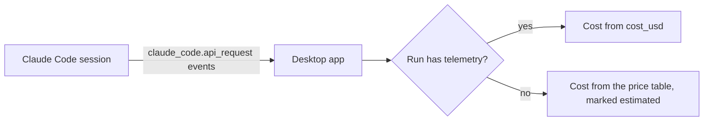
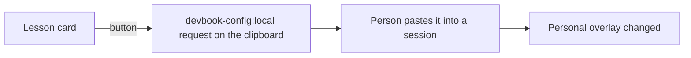

# Sessions

```meta
type: features
```

> Features and sub-features this bounded context supports, described in
> business/ubiquitous language rather than implementation terms.

## Session inventory

```meta
type: feature
related: [.devbook/domain/sessions/domain.md#session-log]
```

Answer "what have my agents been doing here" as one list: every session the
environment has a record of, most recently active first, whichever agent ran it.

The list opens from **Sessions** in the header's work in progress group. It sits
between [Goals](../progress/features.md#the-goals-view) and **Pull requests**, the
open pull requests the sessions shipped. Each of the two lists takes the whole screen
while it is open. Escape, its close button or a second press of its option returns to
the view that was showing before. Goals, first in the group, is a view instead.

One list rather than one per agent, because the question is about the work and not
about the vendor. A person who has both agents installed does not think in two
inventories.

### Live and past sessions together

```meta
type: sub-feature
related: [.devbook/domain/sessions/features.md#open-on-the-live-sessions]
tests: unit:dotnet:Backlog.Modules.Sessions.UnitTests.SessionsPaneTests.An_empty_open_view_names_all_as_the_way_out
```

A session that is running now and a session that finished last week are rows in the
same list, told apart by their state rather than by which list they are in. Two lists
would force the reader to know which one to look in before knowing whether the
session had ended. That is usually the thing they are trying to find out.

The list **opens on part of itself**, and that is a smaller concession than splitting
it. One list narrowed by a control is still one list:

- the rows left out are one press away under the same heading;
- the count beside the title names both numbers whenever any rows are left out;
- the empty state the narrowing can produce says what it kept, and how many sessions
  are on the other side.

A reader looking for a session has one place to look and one control to move.

### Open on the live sessions

```meta
type: sub-feature
related: [.devbook/domain/sessions/domain.md#session-view, .devbook/domain/sessions/features.md#sessions-from-another-machine, .devbook/domain/sessions/domain.md#session-grouping]
tests: [unit:dotnet:Backlog.Modules.Sessions.UnitTests.SessionsPaneTests.The_show_strip_offers_open_between_live_and_all_with_its_own_tally, unit:dotnet:Backlog.Modules.Sessions.UnitTests.SessionsPaneTests.An_open_finished_row_reads_idle_in_open_and_finished_everywhere_else, unit:dotnet:Backlog.Modules.Sessions.UnitTests.SessionsPaneTests.Scheduled_runs_sit_in_one_folded_section_at_the_end_of_open, unit:dotnet:Backlog.Modules.Sessions.UnitTests.SessionsPaneTests.The_panel_never_shows_a_folded_row, unit:dotnet:Backlog.Modules.Sessions.UnitTests.SessionsPaneTests.With_only_scheduled_rows_folded_away_there_is_no_panel]
```

The list opens on the sessions that are still going. A `Live` / `Open` / `All` choice sits
first in the row of controls above it, before the grouping, because it decides which
rows exist before the grouping decides where they sit. "What is going on right now" is
the question somebody opens this for. Several hundred finished records answer a
different one.

Live means running **or** stalled. Stalled is computed from silence rather than
declared by the agent, because nothing writes "I have stopped". So a stalled session is
one nobody can show has ended. A default that dropped it would hide the row most worth
looking at: the one that may be sitting there waiting on the reader.

**Open lists what the Claude desktop app still holds in its sidebar.** It keeps the
sessions the desktop app has not archived, whether or not a process runs for them. The
desktop app ends idle processes, so most of these read Finished, which is why Live
misses them. Open draws a quiet **Idle** badge where the Finished chip would stand. Its
title says what it means: "Open in the Claude desktop app with no process running;
reads Finished". The desktop app's scheduled routine runs sit in one folded
**Scheduled** section at the end of the list.

Open reads only this PC's desktop app. A session from another machine, a CLI-only
session, and a running session the desktop app keeps no record of, such as a side
session, are never in it. The desktop app's store is a private format this product
conforms to ([dependencies](dependencies.md)). Each row keeps the title the transcript
gives it, not the title the desktop app shows.

The choice is not remembered. Every open starts on `Live`, the way Group by starts at
When. A reader should not have to remember having already answered "what is going on
right now". A view silently restored from last week is how a reader concludes the
product has lost their sessions.

**The default is only as good as the evidence under it, and for one agent that is
thin.** Claude leaves a record per running session, so its live rows are evidence.
Copilot leaves no liveness marker at all. Its sessions read as running while their
record is fresh, and as finished once it has been quiet for longer than the
`Stale Threshold`; they never read as stalled. So a Copilot session that is running but
has said nothing for half an hour falls out of this view. That is a limit of what
Copilot writes down, not a rule this product wanted. It is why the empty state names
the way back to `All` instead of leaving it to be discovered.

A session that arrived from another machine is thin in the same way, for a different
reason: a record carries no liveness marker, whichever agent wrote it. So it too falls
out of this view once it has been quiet long enough. See
[Sessions from another machine](#sessions-from-another-machine).

### Narrow to one machine

```meta
type: sub-feature
related: [.devbook/domain/sessions/domain.md#environment, .devbook/domain/sessions/features.md#group-by-environment]
```

A machine filter sits beside `Live` / `Open` / `All` and opens on "All machines". Choosing a
machine keeps only the rows that machine gathered. The count beside the title names
both numbers, such as "1 of 4 sessions", so the rows on the other machines are counted
rather than forgotten. It composes with the view: `Live` on one machine is the running
and stalled sessions there and nothing else. `Open` on another machine is empty, because
Open reads only this PC's desktop app, and its empty state says so.

A list rather than a row of buttons, because the options are however many machines
have reported, which is not this list's decision. An option is offered exactly when
there are rows behind it. Options are named and ordered the way Group by environment
names its sections, so the two cannot disagree. Like the view, it is not remembered:
every open starts on "All machines".

### Open on the session a task names

```meta
type: sub-feature
related: [.devbook/domain/sessions/features.md#open-on-the-live-sessions, .devbook/domain/sessions/features.md#narrow-to-one-machine]
```

A task that names a session opens the list on that session. Its row is marked, the
focus moves to it, and its runs show, because a task that names a session is usually
asking about the run it drove. When the view or the machine filter would hide the
row, both widen, to `All` and "All machines", rather than answer with a list the
session is missing from. They widen once: re-reading the list does not undo what the
reader narrowed since.

The shell's repository scope is left alone, because it is the shell's. A session
outside it is said out loud instead, and so is a session this machine has no record
of, rather than a list with no row marked.

### Only what the agent recorded

```meta
type: sub-feature
related: [.devbook/domain/sessions/domain.md#working-location]
```

Each session shows what its own agent wrote down and no more. The agents disagree
about one of the two fields. Copilot names the repository and the branch, and Claude
names the branch and never the repository. So a Claude row shows its branch, and an em
dash where its repository would be, visibly rather than blankly. A Copilot row shows
both.

The alternative was inferring the missing repository from the working folder. A
wrong repository attributed to a session renders exactly as convincingly as a right
one, which is what makes inference the more expensive option.

What a row may show in that cell instead is the **resolved repository**, marked as
resolved. The cell's title says in words that the agent recorded none, and that the
folder was placed inside a registered clone. This is not the inference above: it is
looked up against the clone directory the person registered
([Working Location](domain.md#working-location)), not read off the path. A recorded
repository always outranks it in the cell, and a session with neither still shows an
em dash.

The repository scope in the shell's header admits a session by either repository. So
a scoped list can hold the Claude sessions running in that repository's clone. Its
narrowing sentence names both terms. A Claude session missing from a scoped list is
then understood as one outside every registered clone, not as one that never ran.

### What a session cost and what it shipped

```meta
type: sub-feature
related: [.devbook/domain/sessions/features.md#the-work-a-run-is-linked-to, .devbook/domain/productivity/features.md#what-the-sessions-cost-and-shipped, .devbook/domain/sessions/features.md#the-detail-of-one-session]
```

A row also shows three things Claude writes into its transcript and the session record
keeps:

- **the pull requests the session linked itself to**, drawn exactly as a run's are:
  "PR #n", opening on GitHub;
- **its tokens**, output and input, with every model and the cache figures in the
  cell's title;
- **where it was run from**, a quiet badge beside the type, such as "desktop" or
  "cli".

A pull request the row's own run already draws is not drawn again: one piece of work
is one reference on screen. The tokens are the session's own spend, and the title
says the agents it spawned are not in them. Copilot records none of the three. A row
that could not say shows nothing or an em dash, never a zero, which would claim that
the session linked nothing or spent nothing.

### Sessions from another machine

```meta
type: sub-feature
related: [.devbook/domain/sessions/domain.md#session-log, .devbook/domain/sessions/features.md#group-by-environment, .devbook/arc42/08-crosscutting-concepts.md#session-record-sync, .devbook/arc42/adr/0005-azure-hosted-task-replica-for-multi-device-sync.md]
```

A session that ran on one of the person's machines can be read on another. The
record travels and the work stays where it happened. What arrives joins the same list
rather than a panel of its own. Somebody running agents on a desktop and a laptop has
one set of sessions on two boxes, not two inventories to check in turn.

It is off until the person switches it on. The one Sync switch that turns on pairing
and the tasks' sync also turns this on, and that switch starts off. A record of what
the assistants have been doing is the kind of thing a person agrees to let off a
machine, rather than finds out has left it. One switch is enough because the question
a person answers is whether this machine takes part in sync at all. The sanitization
boundary makes that one answer safe to give
([Session Record Sync](../../arc42/08-crosscutting-concepts.md#session-record-sync));
[what may travel](domain.invariants.md#invariant-only-the-published-fields-travel)
is an invariant of the log.
Until sync is on, the list holds everything read here and nothing else.

**A row from elsewhere says less than a row read here, and visibly so.** What
travelled is which agent, which machine, which repository and branch, when the session was alive, how much of it there was, its title, and the
usage limits that refused it. So such a row has no working folder to show. That is not
a gap waiting to be closed, because a folder names a disk the reading machine cannot
see. The row still carries the delivery runs filed under that folder, matched on the
worktree key its record carried. A record from a device older than the title field is
headed by its session id, an identifier that plainly reads as one.

**A session of this machine's outlives its transcript.** The assistant cleans its
transcripts away after a month by default. This machine keeps its own record of every
session it has read, with or without sync. So the session stays in the list after the
files are gone: titled, with its folder, dated, measured and with its refusals. While
the transcript is there the row is read from it, and the record is never shown beside
it. A row answered from the record says so under its folder, in the origin line's
quiet register: the transcript is gone, and what it shows is what the last reading
kept.

The pane amends the records of the sessions that moved each time it opens. **Update
records**, beside Refresh, amends every record the files still hold, under
[the rule every amendment keeps](domain.invariants.md#invariant-a-session-record-is-added-to-and-never-taken-from).
It says how many records it amended and started. With sync on, it
sends every record again so the other machines are amended too.

**And it reads as finished once it goes quiet, sooner than the truth may be.** A
record carries no liveness marker. So a session nobody has heard from for longer than
the `Stale Threshold` reads as over. That is the treatment Copilot's sessions already
get here, for the same reason and at the same cost. A session still running on the
other machine can therefore drop out of the live view between one exchange and the
next. Reading it as stalled would be the worse answer. Stalled says something is still
there and quiet, and a record cannot tell that from a session that ended a month ago.

### Re-read on request

```meta
type: sub-feature
```

The list is read when it is opened and again when the reader asks for it. Nothing
polls.

A surface that refreshed itself would be claiming to be live, and the evidence does
not support the claim. One of the two agents leaves no liveness marker at all, so a
self-moving list would move without meaning.

Records arriving from another machine do not change that. They arrive on a schedule of
their own, because a machine cannot be asked for its sessions at the moment somebody
looks. But they arrive into what this environment has a record of, which is what the
list reads. The reading is still the reader's. Nothing appears on screen until they
open the list or ask for it again, so what moves under them is never the rows they
are looking at.

## Session grouping

```meta
type: feature
related: [.devbook/domain/sessions/domain.md#session-grouping]
```

Carve the same list up by the things that separate sessions from each other in
practice, without removing any of them: when they ran, which repository they were in,
and which machine ran them. The list opens grouped by When, which puts the live
sessions on top and the rest under the day they were last active.

### Group by environment

```meta
type: sub-feature
related: [.devbook/domain/sessions/domain.md#environment, .devbook/domain/sessions/features.md#sessions-from-another-machine, .devbook/arc42/adr/0005-azure-hosted-task-replica-for-multi-device-sync.md]
```

A section per environment, named after it, with its own count, so "how many are
running on that box" is read rather than counted.

A reader whose machines exchange session records gets a section per machine that has
reported. Which section a row lands in is settled by the environment that gathered it,
never by the one showing it. So a session sits under the machine that ran it, wherever
it is being read.

A section for a machine the reader is not sitting at is as fresh as that machine's
last exchange and no fresher. That has a real cost. A session started since is not in
the section at all, so its count answers for what has arrived rather than for what is
happening over there. What the section does not do is lie about the sessions it has.
Their state is derived against the reader's own clock from the timestamps that
travelled. So a row ages honestly on this side instead of repeating the other
machine's opinion of it. That is why the staleness is named here once, not as a
caveat on every row.

### Group by agent

```meta
type: sub-feature
status: deprecated
```

A section per agent, so Claude's sessions and Copilot's could be read separately
without the two being separate lists. The session list does not offer it: every row
wears its agent's mark, and When, Repository and Machine are the three ways the list
is read. The grouping itself remains in the domain.

### Grouping never hides a session

```meta
type: sub-feature
related: [.devbook/domain/sessions/features.md#open-on-the-live-sessions]
```

The total is the same whichever grouping is chosen. The surface keeps that total on
screen beside the title, above the controls that act on the list. So a grouping can be
trusted not to be a filter in disguise.

That count carries the guarantee. It answers to the filters and never to the grouping:
it does not move while `Group by` moves the same rows around. When the filters leave
some rows out, the count names both numbers, kept and total. The total is then still
there to be checked against, with the reader's own subtraction stated beside it rather
than folded into it. One number where two are owed would let the controls that remove
rows (Show, Machine, and With delivery runs) borrow the innocence of the one that
does not.

## Honest partial answers

```meta
type: feature
related: [.devbook/domain/sessions/domain.md#session-catalog]
```

Say what could not be read and what was left out, rather than presenting whatever
arrived as the whole picture.

### Name the source that could not be read

```meta
type: sub-feature
related: [.devbook/domain/sessions/requirements.md#name-the-source-that-could-not-be-read]
```

When one agent's records are there but cannot be read, the other agent's sessions are
still shown and the unreadable one is named. A source is unreadable when this user may
not read it, or when reading it fails.

An agent that was never installed is not unreadable. A machine with only one agent
installed is the ordinary case, so the absent agent is an empty source and is not
named. Naming it would put a permanent warning on every machine that has never run
that agent.

"No Copilot sessions" and "Copilot could not be read" are different facts, and only
one of them is worth investigating.

### Say how much was left out

```meta
type: sub-feature
related: [.devbook/domain/sessions/domain.md#session-limit, .devbook/domain/sessions/domain.md#session-catalog]
tests: [unit:dotnet:Backlog.Modules.Sessions.UnitTests.SessionsPaneTests.A_capped_subtitle_names_the_older_open_sessions_apart, unit:dotnet:Backlog.Modules.Sessions.UnitTests.SessionsPaneTests.A_capped_subtitle_with_no_older_open_session_reads_as_before]
```

An environment can hold hundreds of session records. Reading all of them costs real
time, and showing all of them buries the handful that are running. A reading for a
list therefore describes the most recent sessions per agent, up to the
[Session Limit](domain.md#session-limit), and when it does, it states how many exist.

The sessions still open in the Claude desktop app are listed whatever their age, and the
subtitle names the older ones apart. It reads "The N most recent of D sessions this PC
has a record of, plus K older ones still open in Claude". Counted among "the most
recent", a months-old open session would make that number untrue.

A reading for a count takes the other shape: everything since a horizon, with no
limit. A count over the most recent hundred per agent is the limit wearing a total's
clothes: every busy machine reads "200". So a consumer that counts asks since a
horizon and gets every session inside it. Every source keeps records at least as far
back as the longest horizon a consumer can ask for
([Session History](domain.md#session-history)). A source that cannot reach the
horizon it was asked still says so.

## Delivery runs beside their sessions

```meta
type: feature
depends-on: [.devbook/domain/sessions/features.md#session-inventory]
related: [.devbook/domain/sessions/domain.md#delivery-run, .devbook/domain/sessions/domain.md#run-attachment]
```

Show the orchestrated delivery runs an environment's dashboards recorded in the same
list as the sessions: which skill ran, what it was called, how it ended, and how much
it cost. A run is a piece of work a session was doing, and a reader asking "what has
been going on here" wants both answers in one place.

**One list, whichever side arrived first.** A session record and a run file describe
the same piece of work from two sides, and either can be the one this environment
still holds. The run's session may have aged out of the reading, or the run may belong
to a session read on another machine. So the row is the unit of the list, not the
session. A row is a session with the runs it drove, or a run standing on its own, and
the reader never has to know which table to look in.

A dashboard keeps a run's file outside the repository, keyed by the worktree it ran
in. Many run files do not say which session drove them. For those, this context adds
the matching: the same worktree key derived from a session's folder, and the window
the two were open together. [Run Attachment](domain.md#run-attachment) has the full
rule.

A run does not have to come from a dashboard. A session can report to this product
directly, and then the run is recorded here as it happens rather than found
afterwards. It has the same shape, sits in the same list, and is read on the same
terms. See [Record a run as it happens](#record-a-run-as-it-happens).

### Under the session that drove it

```meta
type: sub-feature
related: [.devbook/domain/sessions/domain.md#run-attachment, .devbook/domain/sessions/features.md#how-each-stage-of-a-run-ran, .devbook/domain/sessions/features.md#each-stage-against-its-usual-cost]
```

A run attached to a listed session is shown on that session's run card, in the detail
panel the row opens. The card reads top to bottom in the order a reader asks:

1. **The header**: "Delivery run", the flow it ran in, the work it is linked to, and
   its outcome at the right.
2. **The insight**: once the run has finished, a callout on its cost against the usual
   run of its flow ([Each stage against its usual cost](#each-stage-against-its-usual-cost)).
3. **The figures**, as tiles: stages done, the cost, the context peak, and the tool
   calls. A figure the run does not carry is left out, never shown as zero. Under them,
   quietly, the run's share of the week.
4. **The stages**: the legend, then one row per stage
   ([How each stage of a run ran](#how-each-stage-of-a-run-ran)).
5. **A footnote** saying what Configured means and what "vs typical" is compared with:
   the stage's median over the last 30 runs of the run's own flow.
6. **Run details**, behind a closed fold: the run's own title and id, the surfaces that
   reported it, its change kind and schedule, its sync verdicts, the context gauge, the
   token buckets, and the tool activity by category and by MCP server.

The stages are a list. Each row says where its stage stands in a word beside its dot,
so the run's progress reads without a diagram and in the same place as how each stage
ran.

A session can drive more than one run. The latest is drawn whole; each earlier one folds
to its header, which opens it. The run that matters now is open, and the others are one
line each rather than a card each.

The run details sit behind a fold because a run holds ten stages, six token buckets per
stage and tens of thousands of tool calls. A card that showed them all would be a report
with a heading on it.

### One line for a run two surfaces reported

```meta
type: sub-feature
related: [.devbook/domain/sessions/domain.md#delivery-run]
```

A flow reports its run to every surface it is bound to, and each surface files it as
a run of its own. The list shows such a run as one line under its session, because it
is one piece of work. When two files are one run, and which file is the record, is the
[Delivery Run](domain.md#delivery-run)'s rule. In short, the two must name the same
skill, come from different dashboards, start within five minutes of each other, and
agree on the session.

The line shows the record of the preferred surface: `delivery-surface-dashboard`, then
`orch-dashboard`, then `backlog`. Its run details name the surfaces that reported the
run, so a reader who sees one run where a dashboard shows two knows why.

### The work a run is linked to

```meta
type: sub-feature
related: [.devbook/domain/sessions/domain.md#delivery-run-reference]
```

A run names what it was for and what it produced, and both are shown in its card's
header, between its flow and its outcome. The tracker issue it was working and the pull
requests it opened each show as a reference of the kind this product draws for work that
lives elsewhere, and each opens where it lives.

The Backlog entry it was started from is not a reference beside them. **The run's own
status is how a reader reaches it**, because the entry is where this product tracks the
work, and the status is the run's answer about that work. Pressing the status hands the
entry back to whatever holds the task list, which shows and selects it. Where the
prompt names no entry and no entry linked the session, the status stays a plain word.

The run's own title is not shown in the header at all. A dashboard names a run after
the work it was doing, so beside a reference to that work the title is the same sentence
twice. It stays in the run details for a reader who wants the run's own words.

A run file records its references in three places, and one item named twice is one
reference:

- its own tracker field;
- the links its stages kept;
- the entry in the prompt it was started with.

The prompt names its entry in one of two ways. The marker the import plan writes names
it by plan item. The line the app puts on every entry it copies names it by stored id.
That reference is called by the title written under the line, because a reader does
not know their task by an id. An imported entry copied out of the app carries both
markers for one entry, so they stay one reference.

**A run naming no entry of its own shows the entry its session was linked to.** That
link is the one a task records through the Backlog MCP server. The application holding
the task list answers which entry it is, since the link lives on the task, not in the
run. The run's own entry always takes precedence. The prompt is what the run was
actually started from, so the link is a fallback, never a second opinion.

No state travels with any of them. This environment has not asked the tracker how the
item is doing, and saying otherwise would be inventing a reading.

### A row of its own in the same list

```meta
type: sub-feature
related: [.devbook/domain/sessions/features.md#say-how-much-was-left-out]
```

A run no listed session ran in is a row of the same list. It is named after its
worktree, dated by the run, and placed on the machine its file was read on. A line says
that no session record backs it, and which dashboard does. It is not dropped, dressed
as a session, or put in a table of its own.

It answers every control the sessions answer. It is grouped by When, Repository or
Machine beside them, and narrowed by the machine filter. It is out of the live view,
because with no liveness evidence a row is Finished. A session still running would be
in the reading, and the run would be on its row.

### A schedule's runs as one row

```meta
type: sub-feature
related: [.devbook/domain/sessions/domain.md#session-row, .devbook/domain/sessions/features.md#a-row-of-its-own-in-the-same-list]
```

The runs a schedule fired, with no session in the list behind them, are one row per
schedule and repository. The row is titled by the schedule, with every run a line
under it, newest first. Every scheduled run cuts a worktree of its own. A row per run
would therefore add a line a week for a weekly sweep, each named after a folder nobody
opens again. One row reads as the schedule's history instead.

Each run carries a *scheduled* chip naming the schedule. Its run details name the
schedule and repository. For a devbook sync sweep, they also count the units it
checked, by verdict. A scheduled run whose session the list does hold sits on that session's
row like any other run, still chipped.

### Only the rows with a run

```meta
type: sub-feature
related: [.devbook/domain/sessions/features.md#open-on-the-live-sessions]
```

One toggle narrows the list to the rows that carry a delivery run: a session that
drove one, or a run standing on its own. It is for the reader who came for the work
rather than for the sessions. It is a filter like the live view. The count says what
it hid, it composes with the view and the machine filter, and it is off again on every
open.

### Only what the dashboard recorded

```meta
type: sub-feature
related: [.devbook/domain/sessions/features.md#name-the-source-that-could-not-be-read, .devbook/domain/sessions/requirements.md#only-what-the-dashboard-recorded]
```

The list shows only what a run file recorded:

- A status word is shown as the dashboard wrote it, made readable but never mapped onto
  a smaller vocabulary.
- A figure the file does not carry is left out rather than shown as zero.
- A stage whose name the writer lost is numbered, rather than named after the writer's
  missing value.
- A run file cut off mid-write costs that run and nothing else.
- A dashboard folder that cannot be read is named beside the agents that cannot be, in
  the same sentence.

## Record a run as it happens

```meta
type: feature
depends-on: [.devbook/domain/sessions/features.md#delivery-runs-beside-their-sessions]
related: [.devbook/domain/sessions/domain.md#delivery-run-recording, .devbook/arc42/adr/0012-backlog-is-an-mcp-server-inside-the-desktop-app.md]
```

Let a session report its delivery run to this product while it runs. The pane then
shows the work in progress, instead of a folder somebody else's tool wrote and this
product found later. A run that lands here looks the same as one imported from a
dashboard, with the same row, figures and stages, because it is the same shape. This
product wrote it rather than read it from another.

Without this, every run in the list is somebody else's record. The list could say what
had happened, never what was happening, and a session with no dashboard installed left
no run at all. The difference a reader notices is that a row appears when the work
starts, not when the reader next refreshes something that had already finished.

**Asking to see the runs brings the pane forward, and answers with the application.** A
session that reports here can ask for the surface. What it gets back is what the window
did: it showed the pane, or did not because the area is switched off, or had nothing to
show because no window is open. Never an address. This product is the application the
session is already talking to, and a link would open a second window onto the thing it
is holding.

### Picking a run back up

```meta
type: sub-feature
related: [.devbook/domain/sessions/domain.md#delivery-run-recording]
```

A session that resumes work already under way continues the run it left, rather than
starting a second one beside it. It is told that is what happened, so it can carry on
from the first stage that is not done. Two rows for one piece of work would count the
same work twice, with its stages split between them. A reader has no way to tell that
from two genuine runs.

### What started a run and what it found

```meta
type: sub-feature
related: [.devbook/domain/sessions/domain.md#delivery-run-recording, .devbook/domain/devbook/features.md#sync-verdicts-beside-a-chapter]
```

A run says what started it: a person, or a named schedule, in a repository it names. A
devbook sync sweep closes its run with the verdict it reached on every sync unit and
chapter it checked. Both are kept on the run as sent.

The verdicts are also filed against the chapters they are about, the latest per
chapter. So a reader opening a chapter in the Devbook pane sees what the last sweep
said about it without finding the run. A run that names no repository keeps its
verdicts on itself alone, because a verdict that cannot say which repository it is
about matches no chapter.

### Scenario evidence from a verify stage

```meta
type: sub-feature
related: [.devbook/domain/sessions/domain.md#delivery-run-recording, .devbook/domain/tasks/features.md#acceptance-from-scenario-parts]
tests: [unit:dotnet:Backlog.Infrastructure.Mcp.UnitTests.SurfaceToolsTests.Update_stage_passes_the_verify_evidence_through_per_part, unit:dotnet:Backlog.Infrastructure.Sessions.UnitTests.DeliverySurfaceLifecycleTests.A_verify_stage_keeps_its_scenario_evidence_per_part, unit:dotnet:Backlog.Infrastructure.Sessions.UnitTests.DeliveryRunReaderTests.A_stage_s_scenario_evidence_is_read_per_part, unit:dotnet:Backlog.Desktop.UI.UnitTests.SessionsPaneRunTests.A_verify_stage_shows_its_scenario_evidence_per_part, unit:dotnet:Backlog.Desktop.UI.UnitTests.SessionsPaneRunTests.A_run_with_no_evidence_draws_no_evidence_list, unit:dotnet:Backlog.Infrastructure.Sessions.UnitTests.DeliveryRunReaderTests.A_stage_s_scenarios_are_read_with_their_screenshots, unit:dotnet:Backlog.Infrastructure.Sessions.UnitTests.DeliveryRunReaderTests.A_stage_s_links_are_read_as_recorded, unit:dotnet:Backlog.Infrastructure.Sessions.UnitTests.DeliveryRunReaderTests.A_stage_link_that_is_not_http_https_or_file_is_left_out, unit:dotnet:Backlog.Desktop.UI.UnitTests.DeliveryRunStagesTests.A_stage_s_scenarios_list_their_screenshots_in_its_panel, unit:dotnet:Backlog.Desktop.UI.UnitTests.DeliveryRunStagesTests.A_stage_s_links_are_drawn_in_its_panel, e2e:dotnet:Backlog.EndToEndTests.ScenarioEvidenceTests.A_verify_stage_shows_its_scenario_evidence_and_screenshots]
```

A run's verify stage can say which parts of which scenario pages it ran. It reports
each part as the page's name, the part, the part's outcome and when the run ran,
read from the run the page committed. The stage keeps what it was last sent, and a
later report about the same stage without evidence leaves it in place.

The run shows this evidence inside the stage that reported it. Closed, the stage's
row says how many of its parts passed, as "1 of 2 passing". Opened, the stage's panel
lists them under "Scenario evidence", one row per part with the part's dot. A part
there opens nothing: the run only says what the stage ran. A run is evidence and not
a task, so it never says proved. A stage that reported no evidence shows nothing for
it, and neither does a run.

A verify stage also reports the scenarios it exercised, each with its status, its
notes and the screenshots it took. For a scenario page those are the page's label
screenshots, and a failed part adds the screenshot taken where it failed, named
`fail.<part>.png`. The stage's panel lists them under "Screenshots": each scenario
with its name and status, then each screenshot by its file name. The file's full
path, as the stage sent it, is its tooltip. A failure screenshot is marked as one in
words, so its meaning never rests on colour.

A stage's links show in its panel too, under "Links". Personal Validation sends them
for the application it started and for each review target. Each link shows its label
and opens its address, and its description is the tooltip. A link without a label
shows its address instead. Only a web or file address is shown. A run is written by an
agent, so a link to anything else, such as a script, is left out rather than offered.

The scope and implement stages report no evidence of either kind. Their output is the
text they wrote into the run folder, and the panel draws nothing extra for them.

### What a run cost, reported by the session itself

```meta
type: sub-feature
related: [.devbook/domain/sessions/domain.md#delivery-run-telemetry, .devbook/domain/sessions/features.md#only-what-the-dashboard-recorded, .devbook/domain/sessions/features.md#the-cost-of-a-run-and-its-stages, .devbook/domain/sessions/requirements.md#what-a-run-cost-reported-by-the-session-itself]
```

A run recorded here shows what it cost the way a dashboard's run does:

- the tool calls it made, by kind and by MCP server;
- the agents it delegated to;
- the tokens it spent, in total, delegated, and per stage;
- how full its context window got.

The session reports these itself, from the moments its own tools run. The run cannot
claim them: a tool call arriving here is a call, not the session that made it. So the
figures come from the session's side or not at all.

A session reports only to a run it is driving. One that has no run under way reports
nothing. A run started later in it does not count the conversation that came before
it, and a run another session is driving is left alone. A session may not report: the
plugin may not be installed, or the host may not be Claude Code. Its run is then
without these figures, and they are left out rather than shown as zero, which is the
rule this area already applies to a dashboard's own gaps.

[The cost of a run and its stages](#the-cost-of-a-run-and-its-stages) extends these
figures with what the run and each stage cost in money.

## The session list and its detail

```meta
type: feature
depends-on: [.devbook/domain/sessions/features.md#session-inventory]
related: [.devbook/domain/sessions/domain.md#session-row, .devbook/domain/sessions/features.md#session-grouping, .devbook/domain/sessions/features.md#delivery-runs-beside-their-sessions, .devbook/design/effort-and-mode-chips.md#effort-chips]
```

The session list has a filter bar above it, rows that say how each session ran, and a
detail panel beside it for the one row the reader picked. The list still answers "what
have my agents been doing here" at a glance. The detail panel answers "what exactly
happened in this one" without the row growing into a report.

This extends [Session inventory](#session-inventory) and
[Delivery runs beside their sessions](#delivery-runs-beside-their-sessions). Every rule
those chapters set still holds: one list, nothing hidden by a grouping, and nothing
shown that the agent or the dashboard did not record.

### A filter bar over the list

```meta
type: sub-feature
related: [.devbook/domain/sessions/features.md#open-on-the-live-sessions, .devbook/domain/sessions/features.md#narrow-to-one-machine, .devbook/domain/sessions/features.md#only-the-rows-with-a-run]
tests: unit:dotnet:Backlog.Modules.Sessions.UnitTests.SessionsPaneTests.The_show_strip_offers_open_between_live_and_all_with_its_own_tally
```

The controls that narrow the list sit together in one filter bar above it. From left to
right the bar shows Show (Live, Open or All), With delivery runs, and Machine. Group by sits
beside them, and Update records and Refresh at the end. One bar, because a reader who
wonders why a session is missing should find every reason in one place. Each filter
only removes rows, so the order on screen does not change what the list shows. The
order the surface applies them in is the [Session View](domain.md#session-view)'s.

Live and Open each carry how many rows they would show under the other filters, so
pressing one is never a guess. Every filter comes back to its first option on every opening, and Group
by comes back to When.

The count beside the title keeps its promise from
[Grouping never hides a session](#grouping-never-hides-a-session): it names both numbers
whenever the bar leaves rows out. The heading reads "Running now" while Show is on Live,
and "Open in Claude" while it is on Open.

### Grouped rows that show how each session ran

```meta
type: sub-feature
related: [.devbook/domain/sessions/features.md#session-grouping, .devbook/domain/sessions/features.md#how-each-stage-of-a-run-ran, .devbook/design/effort-and-mode-chips.md#effort-chips]
```

The list stays grouped the way the reader chose. Each row also shows the model the
session ran on, the effort it ran at, and the stage strip of the run it drove. The stage
strip is one mark per stage, so a reader sees how far the run got without opening it.

Model and effort sit on the row because they are the two choices that most change what a
session costs and how well it does. A reader comparing two sessions should not have to
open both to learn that one ran on a smaller model. A session whose agent recorded no
effort shows none, rather than a default that would claim a choice nobody made.

The list is grouped by When, Repository or Machine (see
[Session Grouping](domain.md#session-grouping)), and each row reads in three lines:

- the agent's mark, the session's title and its state chip;
- the repository with its [identity edge](../../design/color-scheme.md#the-identity-edge),
  the machine, when it was last active, how long it went on, the model with its effort
  chip, and its output tokens;
- the stage strip of the run it last drove, with one line saying where that run
  stands. That is every stage done, the stage it failed or was parked at, or the stage
  it is on and how far along it is.

The row is one control: pressing it shows the session in the detail panel. The pull
requests and the task it led to are in the panel rather than on the row, because a
link inside a control is markup no browser agrees on.

### The detail of one session

```meta
type: sub-feature
related: [.devbook/domain/sessions/features.md#what-a-session-cost-and-what-it-shipped, .devbook/domain/sessions/features.md#the-work-a-run-is-linked-to, .devbook/domain/sessions/features.md#the-detail-panel-of-a-pull-request]
```

Picking a row opens a detail panel beside the list. It holds three things, in this order:

- the session's facts, with its model and effort among them;
- the run card for the delivery run the session drove;
- a card for each pull request and each task the session or its run is linked to.

A panel beside the list, because the reader is usually moving down the rows. A panel
keeps their place, where a page of its own would lose it. The pull request card and the
task card are the same cards the pull requests pane and the task list draw, so one piece
of work looks the same wherever it appears.

The panel shows the row the reader pressed, and until they press one, the first row the
list draws. A filter that hides the pressed row moves the panel to the first row drawn,
because a panel about a session the list does not show would contradict the list. At a
narrow width the panel drops under the list.

- **The facts**: repository, machine, model, effort, started, duration, output, and
  branch. A row whose folder is this machine's also shows the working folder. A model
  or an effort nobody recorded reads "not recorded".
- **Where the record came from**, in a quiet note under the title:
  - a replicated record names the machine that recorded it, and says its folder and
    transcript stayed there;
  - a row the runs alone account for says which dashboard recorded it and under which
    key, or, for a schedule's row, how many runs it holds;
  - a row answered from this machine's own record says the transcript is gone;
  - a Copilot row says its state is read from silence, because Copilot leaves no
    liveness marker.
- **The run card**: every run on the row, latest first. The latest is drawn whole —
  its header, the insight callout, the figure tiles, the legend and the stages, and the
  footnote, with the run details folded under it — and each earlier run folds to its
  header. [Under the session that drove it](#under-the-session-that-drove-it) has the
  order and why. A session with no run says so in its place.
- **What it produced**: a pull request card for each pull request, and the task card
  for the Backlog entry it was worked for. Each pull request card wears the readiness
  verdict of [One verdict per pull request](#one-verdict-per-pull-request) as read for
  it. A pull request whose
  verdict could not be read wears no chip rather than a guess.

## How each stage of a run ran

```meta
type: feature
depends-on: [.devbook/domain/sessions/features.md#delivery-runs-beside-their-sessions]
related: [.devbook/domain/sessions/features.md#under-the-session-that-drove-it, .devbook/domain/sessions/domain.md#delivery-run, .devbook/domain/sessions/domain.md#stage-resolution, .devbook/design/effort-and-mode-chips.md#mode-chips, .devbook/design/effort-and-mode-chips.md#effort-chips]
```

Each stage of a delivery run says how it ran, beside how the repository said it should
run. A flow's configuration names an agent, a model and an effort per phase. A reader
needs to know whether the run actually followed it, because a cheap or a poor run is
usually explained by a stage that ran differently from its configuration.

This deepens the run card described in
[Under the session that drove it](#under-the-session-that-drove-it). The stages are
listed on the card under the figure tiles and the legend, one row per stage on one grid:
a status dot, the stage's name with its rounds where it took more than one, the mode
chip, the model with its effort chip and mark, the time it took or the word for where it
stands ("Failed", "Not yet"), its cost, its cost against its usual, and a chevron. The
dot never carries the state alone: the word or the time beside it does. What
each value means is the [Stage Resolution](domain.md#stage-resolution) of the domain.
It is the same reading the delivery engine's own run view draws its pane with, so the
two never say different things about one run.

### The mode a stage ran in

```meta
type: sub-feature
related: [.devbook/design/effort-and-mode-chips.md#mode-chips]
```

| Mode | What it means |
| --- | --- |
| inline | The session driving the run did the stage itself. |
| delegate | The session handed the stage to a sub-agent and waited for its answer. |
| fork | The session started the stage in a separate session that runs on its own. |
| gate | The stage waited for a person to decide. |

What a stage's latest pass found sits on its row after its name: Implement's and
Review's round as "· 2 rounds", then the blockers Review left open and the defects Verify
found, such as "no blockers". A blocker left open or a defect found is drawn as an error;
a stage that reported none of the three shows nothing, never a zero.

Every stage shows its mode. A reader needs it to read the stage's figures: an inline stage
shares the driving session's context and cost, while a delegated stage spends its own.
How the mode is read, and when it is marked as inferred, is the
[Stage Resolution](domain.md#stage-resolution)'s rule.

### What ran beside what was configured

```meta
type: sub-feature
related: [.devbook/domain/sessions/features.md#only-what-the-dashboard-recorded, .devbook/design/effort-and-mode-chips.md#stage-marks]
```

Each stage shows the agent, model and effort that ran, next to the ones its configuration
named. A ≠ mark says the stage ran differently from its configuration. A ? mark says a
value on the stage was inferred rather than read from the run's own record. When both
apply, ≠ is the one shown, and the open stage states the difference and the inference in
words. The ≠ mark's tooltip lists every difference, for example "model Sonnet → Opus 5.5".

The ≠ mark exists because a difference is the finding a reader is looking for. Without
it, they would have to compare two columns by eye on every stage. The ? mark exists
because an inferred value reads as convincingly as a recorded one. Marking it keeps the
rule this area already holds: say what was recorded, and say so when something was not.

What a stage is compared on is the [Stage Resolution](domain.md#stage-resolution)'s
rule. The model is compared by family, because a configuration names an alias such as
`opus` and the run records the id it resolved to.

For example, take a run whose [phase map](domain.md#phase-map) configures Implement on
`sonnet` at `high` effort. Its Implement stage recorded running on `claude-opus-5-5` at
`medium`. Implement then shows ≠ with the tooltip "Not as configured: model Sonnet →
Opus 5.5 · effort high → medium". In a run whose context holds no phase map, a stage a
sub-agent worked in shows as delegate with the ? mark. Its panel says the run records no
resolved phases, so mode and agent are inferred.

### The stage panel

```meta
type: sub-feature
```

A stage expands into a panel, and only one panel is open at a time: opening a stage
closes the one that was open. The panel is closed by default, for the reason the run
details are: a stage can hold hundreds of tool calls, and a list that showed them all
would bury the stage rows.

The panel says:

- **Ran**: the mode, the agent or the owner session, the model and the effort, and the
  stage's output tokens and tool calls where the run counted them. A stage nobody has
  reported on reads "Not run yet".
- **Found**: what the latest pass found, and, on Implement, Review and Verify, what the
  run's [quality facts](domain.md#delivery-run) say across every pass: the review
  rounds, the blockers left open over the rounds listed, the defects Verify found.
  Left out where neither says anything.
- **Configured**: the agent, model and effort the run resolved, and where that came
  from: the team default, or the team default with an overlay merged over it.
- **Skill** and **MCP servers**: what the stage followed and was given, or "not recorded".
- **Around it**: the skills run before and after the stage.

Under those facts:

- **Why ≠ or ?**: the difference or the inference in words, as a callout wearing the
  stage's mark. A difference wears the warning edge.
- **Sub-agents**: every sub-agent call the stage made, as a table with the columns
  Sub-agent run, Model, Time, Tokens, Tool calls and Result. A figure the run did not
  record reads "—". What a call cost sits under its tokens. A call under the gate is
  marked as a [revise round](domain.md#revise-round), with the round it worked where the
  run lists one, and every other call names its round. A delegated stage whose calls the
  run did not record says so rather than claiming none ran.
- **Scenario evidence**, where the stage reported any.

## The cost of a run and its stages

```meta
type: feature
depends-on: [.devbook/domain/sessions/features.md#how-each-stage-of-a-run-ran]
related: [.devbook/domain/sessions/features.md#what-a-run-cost-reported-by-the-session-itself, .devbook/domain/sessions/domain.md#delivery-run-telemetry, .devbook/domain/productivity/features.md#what-the-sessions-cost-and-shipped]
tests: [unit:dotnet:Backlog.Infrastructure.Sessions.UnitTests.DeliveryRunCostsTests, unit:dotnet:Backlog.Infrastructure.Sessions.UnitTests.DeliveryRunBaselinesTests, unit:dotnet:Backlog.Infrastructure.Sessions.UnitTests.WeeklyUsageTests, unit:dotnet:Backlog.Desktop.UI.UnitTests.ClaudeCodeOtlpLogsTests, unit:dotnet:Backlog.Desktop.UI.UnitTests.ModelPriceSettingsTests, unit:dotnet:Backlog.Desktop.UI.UnitTests.SessionsPaneDetailTests]
```

A run and each of its stages show what they cost in money, and whether that was usual. A
token count tells a reader how much was said. It does not tell them whether a stage was
expensive, and that is the question a person tuning a flow is asking.

This extends
[What a run cost, reported by the session itself](#what-a-run-cost-reported-by-the-session-itself),
which counts tool calls and tokens. That chapter's rule still holds: a figure nobody
reported is left out, never shown as zero.

### Cost as Claude Code reports it

```meta
type: sub-feature
related: [.devbook/domain/sessions/domain.md#delivery-run-telemetry, .devbook/domain/sessions/domain.md#claude-api-request-log, .devbook/domain/sessions/domain.md#cost-attribution, .devbook/arc42/adr/0024-claude-code-telemetry-arrives-on-the-mcp-listener.md]
tests: [unit:dotnet:Backlog.Desktop.UI.UnitTests.ClaudeCodeOtlpLogsTests, unit:dotnet:Backlog.Infrastructure.Sessions.UnitTests.DeliveryRunCostsTests]
```



The cost of a run comes from the `claude_code.api_request` events Claude Code sends
through OpenTelemetry, which the desktop app receives. Each event carries `cost_usd`. That
figure is Claude Code's own estimate of what the request cost, and the product shows it as
Claude Code's rather than as an invoice.

Claude Code's own figure is preferred because Claude Code knows the price it applied to
each request. A price the product worked out afterwards would only be a second guess at
the same number.

The desktop app takes Claude Code's OpenTelemetry logs at
`/v1/logs` on the port its MCP server listens on. It keeps each
`claude_code.api_request` event once, in its local database, as the
[Claude API Request Log](domain.md#claude-api-request-log). Settings has a **Claude
Code** page with the endpoint and the `settings.json` block to paste into Claude Code.

The cost is shown in three places:

- The session's detail panel has a **Cost** fact: the sum of every request the session
  reported.
- Each stage row on a run card shows the stage's cost, and the stage panel's **Ran**
  line repeats it.
- Each sub-agent call in the panel shows what that call cost.

Which requests belong to which stage and which call is the
[Cost Attribution](domain.md#cost-attribution) of the domain. With no figure from either
source, nothing is shown: there is no cost fact on the panel and no cost on the row,
never a zero.

A session sends these events only when its Claude Code settings say to. The person
merges that page's block into the `env` of their user-level `~/.claude/settings.json`.
The block turns telemetry on and sets the OTLP logs exporter, the logs protocol, the
endpoint, the bearer token as a header, and `OTEL_LOG_TOOL_DETAILS=1` so each request
names the sub-agent and the skill it ran under. Without that key a stage whose
sub-agents ran is estimated, because its requests cannot be told to its workers. They never turn on the prompt or
response events, which would only send what the session said. A new session, started
after the change, is the first to report. The exact keys, and the check that the rows
arrived, are in `.claude/skills/run-backlog/SKILL.md`, under Claude Code telemetry.

### A price table for runs without telemetry

```meta
type: sub-feature
related: [.devbook/domain/sessions/domain.md#model-price-table, .devbook/domain/sessions/domain.md#cost-attribution]
tests: [unit:dotnet:Backlog.Desktop.UI.UnitTests.ModelPriceSettingsTests, unit:dotnet:Backlog.Infrastructure.Sessions.UnitTests.DeliveryRunCostsTests]
```

A price table in Settings gives a price per model. It covers the runs that sent no
telemetry, such as runs from before the desktop app received it or from a session that
does not send it. The product works out those runs' cost from their tokens, and marks
that cost as estimated.

The table is the **Model prices** page in Settings, beside the Claude Code page. Each row
names a model and gives four rates in US dollars per million tokens: input, output, cache
read and cache write. The table is empty until the person fills it in. The product ships
no prices, because a list it shipped would be wrong the day a price changed. A row is
saved as soon as it names a model. A rate is written with a point, such as 0.30. A rate
that does not read that way, such as one with a comma, is refused and nothing is saved.
So is a second row for the same model. A rate left empty is unknown, never free, so a
stage that spent tokens of that kind is not priced at all. The page's headline counts
the prices saved, as in `2 model prices price the runs Claude Code reported no cost for.`
A row still being typed, or a refused rate, does not move it.

An estimated figure carries the words "estimated from tokens" on the session's detail
and on each sub-agent call. A stage row, which has less room, marks it "est." with those
words as its title. A model with no row in the table prices nothing, and a run on it
shows no cost.

The mark matters because the two figures are not equally sure. A price the person typed
in may be out of date. A reader comparing two runs must be able to tell a reported cost
from one this product worked out.

### Each stage against its usual cost

```meta
type: sub-feature
related: [.devbook/domain/sessions/features.md#delivery-economics, .devbook/domain/sessions/domain.md#cost-baseline]
tests: [unit:dotnet:Backlog.Infrastructure.Sessions.UnitTests.DeliveryRunBaselinesTests, unit:dotnet:Backlog.Desktop.UI.UnitTests.SessionsPaneDetailTests.A_finished_run_reads_its_cost_against_the_usual_run_of_its_flow, unit:dotnet:Backlog.Desktop.UI.UnitTests.SessionsPaneDetailTests.A_finished_runs_insight_line_opens_delivery_economics_on_its_flow]
```

Each stage row on a run card shows its cost, its share of the run's cost, and its ratio
to that stage's median cost over the last 30 finished runs of the same flow. The ratio
wears the bands of the [Cost Baseline](domain.md#cost-baseline): green when lower than
usual, "typical" near the median, highlighted when higher, and otherwise the plain
ratio, such as "1.2×". The ratio's tooltip names the median and how many runs it was
taken over. When a stage has no ratio is the baseline's rule too.

The run's own figures are tiles under its header: stages done, the cost, the context
peak and the tool calls. An estimated cost is labelled "Est. cost". The context peak is
the peak in tokens, with its share of the limit under it where the limit is known. The
output tokens are in the run details, with every other token count.

An insight callout sits directly under the header once the run has finished and five
earlier runs of its flow were priced. Its headline is the run's ratio to the flow's
median, such as "2.0× the usual flow-code run". Under it, the why names the stage that
explains most of the difference, and if that stage was entered again, how many times:
"Implement explains most of it: $5.00 over its usual, entered again once". Where that
stage is Implement or Review, the why also names the run's review rounds, as in ", over 3
review rounds". A typical run reads "About the usual flow-code run (1.0× its median)" and
names no stage. A run from 1.5× its usual wears the warning edge. A run still active,
blocked or parked has no callout.

The comparison is per flow and per stage because a review stage and an implement stage
cost very different amounts. A run-wide average would flag every long run and explain
none of them. How the earlier runs are chosen and matched is the
[Cost Baseline](domain.md#cost-baseline)'s rule.

The callout ends on "Compare configurations for this flow", which opens
[Delivery economics](#delivery-economics) on the run's flow.

### Share of the week and the weekly limit

```meta
type: sub-feature
related: [.devbook/domain/sessions/domain.md#session-log, .devbook/domain/sessions/domain.md#weekly-usage, .devbook/domain/sessions/domain.md#cost-attribution, .devbook/domain/sessions/requirements.md#share-of-the-week-and-the-weekly-limit]
tests: [unit:dotnet:Backlog.Infrastructure.Sessions.UnitTests.WeeklyUsageTests, unit:dotnet:Backlog.Desktop.UI.UnitTests.SessionsPaneDetailTests.The_panel_and_the_run_show_their_share_of_the_week, unit:dotnet:Backlog.Desktop.UI.UnitTests.SessionsPaneDetailTests.After_a_weekly_refusal_the_share_carries_an_estimate_of_the_limit]
```

Each run and each session shows its share of the week's usage. The share is the cost
Claude Code reported for it inside the week, over the cost reported for every session
that week. The session's share is a fact on the session detail, and each run's is a line
under the run. The week ends at the reset time the latest all-models weekly-limit
refusal carried, rolled forward a week at a time once that reset has passed. With no
all-models refusal recorded, the latest Fable refusal's reset time places the week
instead. With neither recorded, the week is the last seven days.

Only refusals from the last 28 days count, for the week and for the limits below. An
older refusal is forgotten: it neither places the week nor sizes a limit, so after four
weeks without one the week is the last seven days again and no percentage is shown.

Once a weekly-limit hit has been recorded, each run also shows an estimated percentage
of the weekly limit. The weekly limit for Fable is kept separate, because Claude counts
Fable against a limit of its own. Its percentage counts the Fable requests only and is a
line of its own. [Weekly Usage](domain.md#weekly-usage) has the full rule.

The percentage is always labelled an estimate. Nothing the product reads states the size
of the weekly limit. The product can only learn it from the moment a session was refused
for reaching it, and the usage recorded up to then. A percentage without that hit would
be a guess dressed as a measurement, so none is shown until one is recorded.

## Delivery economics

```meta
type: feature
depends-on: [.devbook/domain/sessions/features.md#the-cost-of-a-run-and-its-stages]
related: [.devbook/domain/sessions/features.md#how-each-stage-of-a-run-ran, .devbook/domain/sessions/domain.md#delivery-run, .devbook/design/effort-and-mode-chips.md#effort-chips, .devbook/design/effort-and-mode-chips.md#mode-chips]
tests: [unit:dotnet:Backlog.Infrastructure.Sessions.UnitTests.DeliveryEconomicsTests, unit:dotnet:Backlog.Desktop.UI.UnitTests.DeliveryEconomicsPageTests]
```

A page under Sessions compares how the flows' configurations perform, so a person can
decide which agent, model, effort and mode to give each phase. One run tells a reader
what happened once. Deciding a configuration needs many runs side by side, which is what
this page holds.

The page reads one flow at a time, chosen from a list of the flows with a finished run
in the window, most runs first. The window is the last 30 or the last 90 days. A run
counts once it has finished, and it is placed by when it started.

### Where the page is reached from

```meta
type: sub-feature
related: [.devbook/domain/sessions/features.md#each-stage-against-its-usual-cost]
```

The page has a button in the Sessions header. A run's insight callout also opens it,
through its "Compare configurations for this flow" link, filtered to that run's flow. The second way in exists because the insight raises the
question, "is this stage always this expensive?", and the page is where it is answered.
A Sessions breadcrumb at the top of the page leads back to the list, and the focus
returns to whichever way in was used.

### The flow at a glance

```meta
type: sub-feature
```

Four tiles sit above the table:

| Tile | What it says |
| --- | --- |
| Median run | The median whole-run cost, with the 90th percentile beneath it and how many runs were only partly priced. |
| Implement + Review | What Implement and Review cost over all the runs, as a share of what every stage the runs finished cost. |
| Two or more review rounds | How many of the runs that reported their rounds took two or more, and their median whole-run cost against the one-round runs', as a ratio. |
| Escaped review | The defects Verify found that review had passed, summed over the runs whose Verify reported a count, and how many runs that is. |

The share is taken over spend, not over medians, so a dear run weighs as much as it
cost. The round ratio compares fully priced runs only: a total over part of a run reads
as a cheap run. A tile with nothing to stand on says why instead of showing a zero.

### Configurations compared per phase

```meta
type: sub-feature
```

The table has one row per phase of the flow, in the order the latest run runs them. A
row shows:

- the configuration now, as the latest run configured it;
- how many runs priced the phase;
- the median phase cost;
- the phase's share of the run;
- the phase's [quality measure](#the-quality-measure-per-phase);
- the phase's [verdict](#the-verdict-per-phase).

The share is the phase's median over the sum of the medians of the phases the latest run
carries, so the shares add up to the whole. A phase only older runs carried keeps its
median and has no share.

Selecting a phase opens its configurations as recorded: the model, the effort, the agent
that ran it and, where the runs differ on it, the mode. Each one shows its runs, its
median phase cost, its quality measure over its own runs, and its median whole-run cost.
Whole-run cost sits beside phase cost because a cheaper phase can make the run dearer. A
smaller model in implement can save money there and then cost more in extra review
rounds. Comparing the phase alone would recommend exactly that mistake.

### The quality measure per phase

```meta
type: sub-feature
related: [.devbook/domain/sessions/domain.md#delivery-run]
```

Each phase that reviews or checks the work, or that the work goes back to, is read on one
measure. Every other phase has none.

| Phase | Quality measure | Read from |
| --- | --- | --- |
| Scope | Share of runs scoped again after Implement started | Scope marked done more than once, over the runs whose Implement started |
| Implement | Mean review rounds | The most rounds a slice took, from the run's quality facts, else the highest round its Implement or Review reported |
| Review | Blockers per round, and the defects that escaped to Verify | The blockers per round the quality facts list, else Review's latest round; the defects Verify found |
| Build & Test | Share green first time | Build & Test marked done once |
| Verify | Share of runs with a defect found | The escaped defects the quality facts filed under Verify, else Verify's latest pass, over the runs that reported either |

A phase is matched by its name in any casing, so "Build and Test" is Build & Test. The
measure is a mean over the runs that reported what it is read from. A run that reported
nothing reads as "not reported", never as zero, and still counts toward cost. The page
says how many runs the quality measure stands on.

### What the delivery phases report

```meta
type: sub-feature
```

The round, the blockers and the defects come from what the delivery phases report on a
stage (see [Delivery Run](domain.md#delivery-run)). Only the phase that reviews or verifies
the work knows them, so this product records what is reported and works out none of the
three itself. Each stage count describes the stage's latest pass, so where the run
carries its cumulative quality facts those are read first, and the stage counts are the
fallback for a run without them.

### The verdict per phase

```meta
type: sub-feature
```

The table's last column gives each phase a verdict, the first of these rules that holds:

| Verdict | When |
| --- | --- |
| Nothing to tune | The phase is under 2% of the run's cost. |
| Not compared | One configuration only has run the phase. Its panel suggests trying a cheaper model or effort through the personal overlay. |
| Worth it | The dearer configuration lowers the median run cost. |
| Try cheaper | The cheaper configuration lowers the run cost and is within 10% of the dearer one on the quality measure. |
| No call yet | Anything else: too few runs for a lesson, the whole-run difference unknown or nil, or the cheaper configuration's quality short of the dearer one's or not reported. |

The two configurations compared are the lesson card's. Within 10% is measured in the
measure's worse direction, against a tenth of the dearer value or of 1, whichever is
larger: ten points for a share, a tenth of the rounds or blockers for a count. Build &
Test reads higher as better and every other measure lower. A phase with no quality
measure has nothing to fall short on. A measure nobody reported on one side is unknown,
never assumed level, so it gives no call rather than Try cheaper. The verdict's reason
is the badge's tooltip.

No call yet is a verdict of its own by decision, not a blank left where a verdict
failed. Worth it and Try cheaper each tell the person to act, so either needs the
evidence to stand on. Every phase that lacks it says so in the same column, with the
reason, rather than leaving the reader to guess whether the page looked at all.

### Lesson cards

```meta
type: sub-feature
```



The page draws its findings as lesson cards. The selected phase's panel shows one once
two configurations of the phase each priced at least five runs of it at different
medians. The card compares the cheaper configuration with the dearer one, on phase cost
and whole-run cost, for example "Sonnet at high effort runs Implement for $2.00 less than
Opus (medians), and whole runs cost $2.00 less". Where the cheaper phase makes whole runs
dearer, the card says the cheaper phase raises the run's cost. The card sets the phase's
quality measure for the two configurations side by side, and states the number of runs
each side is drawn from.

Five priced runs a side is a decision, and the same five the
[Cost Baseline](domain.md#cost-baseline) asks before it calls a cost usual. Fewer than
that, and one runaway run decides the median. Below it the page draws no card, and the
phase is never Worth it or Try cheaper, whatever the two medians say.

A confidence line reads the smaller of the two sample sizes:

| Runs on the smaller side | Confidence line |
| --- | --- |
| Under 10 | Not enough to call |
| 10 to 20 | Keep both running |
| More than 20 | Fairly confident |

The card's button copies a request for the `devbook-config:local` skill, which changes
the person's own overlay of the repository's configuration: it sets that phase's model
and effort, and its agent and mode where the configurations differ on them. The request points to
the dearer configuration where its whole runs cost less, and to the cheaper one
otherwise, and carries the figures, the quality measures and the confidence line it
stands on. A card that points to the configuration now copies nothing; where that is the
cheaper one, it says to keep it.

The sample size and the confidence line are on every card because a lesson from three
runs reads as confidently as one from forty. Only the number tells them apart. The app never writes the overlay
itself, for two reasons. The overlay belongs to the person and to the skill that keeps it.
A change to how a flow runs should also be a step the person takes on purpose, in a
session where they can see it happen.

## Pull request readiness

```meta
type: feature
related: [.devbook/domain/sessions/features.md#the-detail-of-one-session, .devbook/domain/sessions/features.md#the-work-a-run-is-linked-to, .devbook/arc42/adr/0020-external-items-arrive-as-linked-tasks.md, .devbook/domain/repository-management/requirements.md#archiving-a-repository, .devbook/domain/progress/features.md#pull-request-status]
tests: [unit:dotnet:Backlog.Desktop.UI.UnitTests.PullRequestsPaneTests, unit:dotnet:Backlog.Desktop.UI.UnitTests.PullRequestVerdictTests, unit:dotnet:Backlog.Infrastructure.GitHub.UnitTests.GitHubClientHeadChecksTests, unit:dotnet:Backlog.Infrastructure.GitHub.UnitTests.GitHubIntegrationPullRequestListTests]
```

The pull requests pane is the Sessions context's second surface. Sessions and delivery
runs produce pull requests, so the pane is where a reader follows that work to the point
where it merges.

The pane has two views, Open and Recently merged. A Mine / Everyone's choice narrows the
rows. Mine is the reader's own pull requests and those related to one of their tasks.
Refresh re-reads the list. A repository's label filter, set in Settings, lets through
only the pull requests carrying one of its labels. A pinned pull request ignores every
filter. It sits in a Pinned group at the top of the list until it is unpinned, even after
it merges or closes.

The pane is a triage list beside a detail panel. Lane tiles say how many pull requests
need what, the list below them is grouped by lane, and the pull request the reader picks
is laid out in full beside the list. Where the pane is narrow, the panel moves under the
list. Each row says one thing: the verdict on whether it is ready, and if not, what it is
waiting on. A reader scanning twenty pull requests should not have to open each to learn
which one needs them.

A row shows:

- the repository's [identity edge](../../design/color-scheme.md#the-identity-edge);
- the number, the verdict chip and the title;
- the head branch, and how long ago it was updated;
- its [pull request status](../progress/features.md#pull-request-status) marks: checks
  as passed over total once any ran, and the approvals it has.

A pull request stacked on another is indented and says which one it waits on, so the
reader merges that one first. A pinned one keeps both in the Pinned group, so a pin never
hides what has to merge first.

The pane has no storybook page. The storybook references only `Backlog.UI.Components`,
and the pane lives in `Backlog.Desktop.UI`, which the storybook cannot render. Its states
are proved by the bUnit tests named above instead.

### Lanes that filter the list

```meta
type: sub-feature
related: [.devbook/domain/sessions/features.md#one-verdict-per-pull-request]
tests: [unit:dotnet:Backlog.Desktop.UI.UnitTests.PullRequestsPaneTests]
```

Four lane tiles sit under the header: Needs you, Ready to merge, Waiting and Drafts. Each
tile shows how many pull requests are in its lane. A line under the count says what put
them there, such as "conflicts · failing checks". Pressing a tile narrows the list to that
lane, and pressing it again lets the lane go. One lane is pressed at a time.

The counts are taken over the rows the other filters leave, so a tile never promises a
pull request the list will not show. A pinned pull request still shows under a pressed
lane, for the reason it ignores every other filter. Recently merged has no tiles, because
a merged pull request is in no lane.

The Mine / Everyone's choice stays, because it answers a different question. Mine says
whose pull requests to look at; a lane says which of them to look at first. The two
combine: Mine and Needs you is the reader's own work that is waiting on them.

### One verdict per pull request

```meta
type: sub-feature
tests: [unit:dotnet:Backlog.Desktop.UI.UnitTests.PullRequestVerdictTests, unit:dotnet:Backlog.Desktop.UI.UnitTests.PullRequestsPaneTests, unit:dotnet:Backlog.Desktop.UI.UnitTests.SessionPullRequestStatusesTests]
```

Each pull request that is still open gets exactly one readiness verdict. Where several
apply, the first in this table wins:

| Precedence | Verdict | Lane | Tone | Act | Second act |
| --- | --- | --- | --- | --- | --- |
| 1 | Conflicts | Needs you | fault | Open on GitHub | — |
| 2 | Failing checks | Needs you | fault | Re-run failed, when a failed check is a GitHub Actions run; else Open on GitHub | Open on GitHub, after Re-run failed |
| 3 | Changes requested | Needs you | fault | Open review on GitHub | — |
| 4 | Behind | Needs you | alert | Update branch | Merge when ready |
| 5 | Draft | Drafts | quiet | Ready for review | — |
| 6 | Checks running | Waiting | live | Merge when ready | — |
| 7 | Review required | Waiting | live | Merge when ready | — |
| 8 | Ready | Ready to merge | settled | Merge | Update branch, when the branch is behind a base that does not require it |

One verdict rather than a row of badges, because a reader acts on one thing at a time. The
order puts first what blocks the most. A conflict has to be resolved before checks or
review mean anything, and a failing check before a review is worth asking for. Behind is
in Needs you because it waits on nobody else: the reader brings the branch up to date
with the act the banner offers, and it can merge. The tones are the badge tone scale of
`.devbook/design/color-scheme.md`, so the verdict chip reads like every other badge.

Each verdict carries a label for its chip, a headline and a one-sentence reason for the
banner, and the acts above. A few rules sit beside the table:

- A failed check decides even while others still run. A reviewer who asked for changes
  counts even where the repository asks for no review.
- Ready offers Merge when ready instead of Merge when GitHub still reports the pull
  request not mergeable, because a merge now would be refused.
- A stacked pull request's reason names the pull request it waits on. It is offered no
  merge act, because merged now it would land on its parent's branch rather than where
  the stack is going. Its other acts stay.
- Behind is GitHub's own `BEHIND` state, which GitHub sets only where the repository
  requires an up-to-date branch. A pull request behind a base that does not require it is
  still Ready, but its reason says how many commits behind it is and that the repository
  does not require it, so it never contradicts the up to date line of the detail panel.
  Update branch is then offered as Ready's second act.
- Whether Re-run failed is offered is read off the pull request's own checks, never
  told to the verdict by whoever asks for it.
- The session list's pull request card gives the same verdict as the pane, stack
  included: it places an open pull request among its repository's open pull requests and
  names the one it waits on.
- A merged pull request reads as Merged, in the settled tone, with no act. A pull request
  closed without merging has no verdict, since there is nothing left to get ready.

### The detail panel of a pull request

```meta
type: sub-feature
related: [.devbook/domain/sessions/features.md#the-detail-of-one-session]
tests: [unit:dotnet:Backlog.Desktop.UI.UnitTests.PullRequestsPaneTests, unit:dotnet:Backlog.Infrastructure.GitHub.UnitTests.GitHubClientHeadChecksTests]
```

Picking a pull request opens a detail panel. The first row the list shows is picked until
the reader picks another, and a pick the filters hide falls back to the first row shown.
From the top, the panel holds:

- the pull request's repository, number, author, title and branches, a link to it on
  GitHub, and its pin;
- a banner with the verdict and the act that fits it, such as Update branch for Behind,
  with the verdict's second act beside it where it has one;
- a merge-readiness list of four lines: checks, review, up to date, and mergeable;
- the checks, failures first, then the ones still running; six are shown and the rest
  are counted;
- the stack the pull request is part of, bottom first;
- the task card and the session card for the work behind it.

The banner leads with one act because the verdict already names the one thing in the way.
GitHub may already hold an auto-merge that the verdict's acts do not touch. The banner
then also offers to cancel it, because that undoes a request rather than making one. The
mergeable line says only whether the pull request has conflicts. It does not count the
conflicted files, because GitHub reports no such count, and a number this product made
up would be wrong in a way nobody could check. The failures come first so the reader sees
the reason before the long list of passing checks.

The list already reads what the panel needs. Each check on the head commit is a check run
or a commit status. It comes with its name, whether it passed, failed or is still running,
and, for a check run that finished, how long it took. The first fifty are listed and the
counts cover the rest. Where the counts report a failed check past those fifty, every
check of the head commit is paged in, so no failed run is missing. Each open pull request from the same repository also carries how
many commits its base has that its branch does not. GitHub cannot compare a fork's branch
from the base repository, so a pull request from a fork has no such count.

### Re-run failed

```meta
type: sub-feature
tests: [unit:dotnet:Backlog.Infrastructure.GitHub.UnitTests.GitHubClientHeadChecksTests, unit:dotnet:Backlog.Infrastructure.GitHub.UnitTests.GitHubIntegrationPullRequestListTests, unit:dotnet:Backlog.Desktop.UI.UnitTests.PullRequestVerdictTests]
```

Re-run failed is offered when a failed check is a GitHub Actions run. It starts the failed
jobs of that run again, and the jobs that depend on them. It covers the most common way a
check goes red without anyone's code being wrong: a runner that flaked.

Where several checks failed, each workflow run behind them is asked once, however many of
its jobs failed. That covers a failed run past the first fifty checks too, because the
list pages those in when the counts say one failed there. Every run is asked even when GitHub refuses one, because the runs are
independent. The refusal then says how many of the others did start again. Afterwards the
pane reads that one repository again, as it does after every other act, so the row shows
the checks running instead of failed.

It is offered only for GitHub Actions because that is the only kind of check this product
can ask GitHub to run again. A check from another service has to be re-run there. The act
sits in the detail panel's banner, as the act of the Failing checks verdict.

There is no act that hands a pull request off to an agent. Starting a session is something
a person does in their agent, with the context they choose. A button here would start work
on the reader's behalf that the pane could neither show nor stop.

## Session activity enrichment

```meta
type: feature
status: proposed
depends-on: [.devbook/domain/sessions/features.md#session-inventory]
related: [.devbook/domain/sessions/domain.md#session-activity-publishing, .devbook/domain/sessions/domain.md#session-activity-enrichment]
```

Layer externally reported session activity onto the same session list. A reader can then
see what a session has been doing, without replacing the locally read record that says
the session existed.

The extra layer is optional by design. A session with no Collections MCP reporting is
still read, grouped, and counted as it is without the layer. A session with reporting
adds timeline and correlation detail to that same row.

### Optional Collections MCP reporting

```meta
type: sub-feature
status: proposed
related: [.devbook/domain/sessions/domain.md#session-activity-publishing, .devbook/domain/sessions/domain.md#collections-mcp]
```

When a session has the Collections MCP configured, it reports start, meaningful
activity, and finish updates to that MCP. When it does not, nothing about the session
surface breaks or changes shape.

Detecting the capability is ordinary product behavior. Missing configuration reads as
`disabled`, not as an error that needs a banner.

### Latest meaningful activity

```meta
type: sub-feature
status: proposed
related: [.devbook/domain/sessions/domain.md#session-enrichment-summary, .devbook/domain/sessions/domain.md#session-activity-entry]
```

Show the latest human-readable activity summary, when it arrived, and any safe
correlation facts that help a person place the session, for example the orchestration
run or issue it was working against.

Meaningful rather than exhaustive. The point is to answer "what is this session doing"
without turning the session list into a transcript or a tool log.

### Reporting degrades honestly

```meta
type: sub-feature
status: proposed
related: [.devbook/domain/sessions/domain.md#reporting-capability]
```

When reporting is configured but the Collections MCP cannot be reached, the session
still appears and the reporting path reads as degraded.

That answer is more honest than either hiding the reporting layer or pretending no
external activity exists. A broken path is a fact worth surfacing, and it is separate
from the session's own `Session State`.

## In progress, by task

```meta
type: feature
status: deprecated
related: [.devbook/domain/progress/features.md#the-goals-view, .devbook/arc42/adr/0035-goals-and-impediments-replace-sprints.md, .devbook/domain/sessions/features.md#open-on-the-session-a-task-names, .devbook/domain/repository-management/requirements.md#archiving-a-repository]
tests: [unit:dotnet:Backlog.Desktop.UI.UnitTests.HomeWorkspaceSurfaceTests.Goals_leads_the_work_in_progress_group, unit:dotnet:Backlog.Desktop.UI.UnitTests.HomeWorkspaceSurfaceTests.A_stored_in_progress_view_reopens_on_goals]
```

The In progress view is gone. It became
[the Goals view](../progress/features.md#the-goals-view), which Progress owns, and
local [ADR 0035](../../arc42/adr/0035-goals-and-impediments-replace-sprints.md)
decides it. Its board by task went with the `goals` flag that kept it for a person who
had goals off: no view lists every task in progress with its sessions and pull
requests, puts the quiet sessions and the failing pull requests first under **Needs
you**, or lists the work no task links under **Not linked to a task**. Its two
toggles, "Needs you first" and "Include finished today", went with it, and the shell
no longer keeps them. A shell remembered on In progress reopens on Goals.

What the view answered lives elsewhere. Goal progress, the stand-up and the work no
goal holds are the Goals view's. A session that has gone quiet is the session list's,
and a pull request that needs attention is the pull requests list's. What stays is a
task's side panel: linking, unlinking and the reads of a linked pull request.

### Unlink what was linked

```meta
type: sub-feature
tests: [unit:dotnet:Backlog.Desktop.UI.UnitTests.LinkedWorkSectionTests.Unlink_in_the_side_panel_takes_a_pull_request_off_its_entry, unit:dotnet:Backlog.Modules.Tasks.UnitTests.UnlinkTaskFromIssueTests.Unlinking_removes_only_the_named_link, unit:dotnet:Backlog.Modules.Tasks.UnitTests.UnlinkTaskFromIssueTests.Unlinking_ignores_case_and_keeps_the_entry_repositories]
```

Every linked session and pull request in a task's side panel has an "Unlink" beside
it. Unlinking takes the link off the entry through the entries module's own unlink,
the counterpart of the write linking makes, under the repository it was recorded with.
The entry's repositories stay. A session still live, or a pull request of the reader's
still open, is offered again by "Link a session or pull request…". The focus moves to
the section's heading, since the card that held it is gone.

### What a linked pull request is read for

```meta
type: sub-feature
tests: [unit:dotnet:Backlog.Desktop.UI.UnitTests.WorkInProgressReaderTests.A_linked_pull_request_the_open_read_did_not_list_is_read_by_number_with_its_state_merge_date_and_author, unit:dotnet:Backlog.Desktop.UI.UnitTests.WorkInProgressReaderTests.A_merged_linked_pull_request_is_read_once_and_a_closed_or_open_one_again_on_the_next_read, unit:dotnet:Backlog.Desktop.UI.UnitTests.WorkInProgressReaderTests.A_linked_number_github_cannot_find_is_not_asked_about_again, unit:dotnet:Backlog.Desktop.UI.UnitTests.WorkInProgressReaderTests.A_read_still_fresh_and_the_side_panels_sessions_read_ask_github_for_nothing_by_number, unit:dotnet:Backlog.Desktop.UI.UnitTests.WorkInProgressReaderTests.The_open_read_lands_without_waiting_for_the_read_by_number, unit:dotnet:Backlog.Desktop.UI.UnitTests.WorkInProgressReaderTests.The_projection_carries_the_read_state_and_author_and_the_card_draws_what_it_drew, unit:dotnet:Backlog.Infrastructure.GitHub.UnitTests.GitHubIntegrationPullRequestListTests.Linked_pull_requests_are_read_with_their_state_merge_date_and_author, unit:dotnet:Backlog.Infrastructure.GitHub.UnitTests.GitHubIntegrationPullRequestListTests.Many_linked_pull_requests_are_read_in_slim_batches]
```

Every pull request a task links is known by its own state — open, draft, merged or
closed — by who opened it, and by when it merged. The open read answers for one still
open in a configured repository. The rest are read by number, once the open read has
landed, so the open cards never wait on them. That read asks only for what a link
records, in batches of fifty, and never for checks or branches.

A merged pull request is read once and kept while the app runs. A closed or open one is
read again with the next read of the open list, at most once a minute, because GitHub
can reopen a closed one. A number GitHub cannot find is not asked about again. The side
panel reads none of them on its own.

The cards draw what they drew before. A link carries the state, the author and the merge
date for a reader that counts what merged and whose it was; no card shows them yet.

### From a task's side panel

```meta
type: sub-feature
tests: [unit:dotnet:Backlog.Desktop.UI.UnitTests.LinkedWorkSectionTests.The_side_panel_section_links_a_session_or_pull_request_to_its_entry, unit:dotnet:Backlog.Desktop.UI.UnitTests.LinkedWorkSectionTests.Linking_what_the_entry_already_holds_writes_nothing, unit:dotnet:Backlog.Desktop.UI.UnitTests.LinkedWorkSectionTests.A_feature_that_is_off_draws_no_column_in_the_side_panel, unit:dotnet:Backlog.Desktop.UI.UnitTests.HomeWorkspaceSurfaceTests.A_tasks_side_panel_carries_its_sessions_and_pull_requests, unit:dotnet:Backlog.Desktop.UI.UnitTests.LinkPullRequestByReferenceTests.A_pull_request_typed_by_number_is_linked_whatever_its_state, unit:dotnet:Backlog.Desktop.UI.UnitTests.LinkPullRequestByReferenceTests.A_merged_pull_request_linked_by_its_link_is_kept_by_the_reader, unit:dotnet:Backlog.Desktop.UI.UnitTests.LinkPullRequestByReferenceTests.A_pull_request_in_a_repository_not_registered_is_refused_under_the_field, unit:dotnet:Backlog.Desktop.UI.UnitTests.LinkPullRequestByReferenceTests.A_number_GitHub_does_not_know_is_refused_and_nothing_is_recorded, unit:dotnet:Backlog.Desktop.UI.UnitTests.LinkPullRequestByReferenceTests.A_bare_number_on_a_task_with_no_registered_repository_asks_for_the_link, unit:dotnet:Backlog.Desktop.UI.UnitTests.LinkPullRequestByReferenceTests.A_bare_number_on_a_task_with_two_repositories_asks_for_the_link, unit:dotnet:Backlog.Desktop.UI.UnitTests.LinkPullRequestByReferenceTests.A_listed_pull_request_that_merged_before_it_was_chosen_is_still_linked, unit:dotnet:Backlog.Desktop.UI.UnitTests.PullRequestsPaneTests.A_merged_or_closed_pull_request_opened_from_a_task_is_listed_and_scrolled_to]
```

A task's side panel carries the sessions and pull requests linked to it as cards,
under "Sessions and pull requests", with "Link a session or pull request…". The
section shows while the session list or the pull requests list is on. With one of the
two off, the heading and the link action name only the kind left. It is the only place
on the desktop that draws a task's linked work by task.

The link action offers the live sessions and the reader's own open pull requests that
no task links yet. Linking records the session or the pull request on the entry with
the same write the `link_session` and `link_change` tools make, so a link made by hand
and one an agent made are one kind of record. A link the entry already holds is not
written twice.

The link action also takes a pull request by its number or its link, whatever its
state: open, draft, merged or closed. Work that merged before its task was linked is
linked this way, and the task is then [done](../progress/domain.md#done) by it in the
goal that counts it. A bare number is the task's own repository's, and a task with two
has to be given the link; a link or `owner/name#123` names one, and it must be
registered in Settings. The pull request is read by number before anything is
recorded, so one GitHub does not know is refused under the field and nothing is
written. A merged one is kept from that read for as long as the app runs. A pull
request the list offered as open that merged before it was chosen is linked too, not
refused as no longer open.

A session or a pull request opens the session list or the pull requests list on that
item. A pull request that has merged or closed is not on the pull requests list's open
read. So it is read by number and drawn in the open list beside the pins, saying
Merged or Closed, and the list scrolls its row into view.

## Turn the area off

```meta
type: feature
feature-flag: .devbook/domain/sessions/context.md#sessions-area
tests: [unit:dotnet:Backlog.Desktop.UI.UnitTests.HomeWorkspaceSurfaceTests.With_the_sessions_feature_off_there_is_no_segment_and_no_list, unit:dotnet:Backlog.Desktop.UI.UnitTests.HomeWorkspaceSurfaceTests.A_remembered_sessions_surface_falls_back_to_the_workspace_when_its_feature_is_off, unit:dotnet:Backlog.Desktop.UI.UnitTests.HomeWorkspaceSurfaceTests.Opening_a_session_from_a_task_with_sessions_switched_off_says_so_and_stays, unit:dotnet:Backlog.HostComposition.UnitTests.McpEndpointGateTests.The_delivery_surface_is_absent_while_its_feature_is_off, unit:dotnet:Backlog.Infrastructure.FileSystem.UnitTests.AgentActivityHoursWorkedSourceTests.With_the_sessions_area_switched_off_the_hours_are_not_read, unit:dotnet:Backlog.Infrastructure.FileSystem.UnitTests.RoadmapActualHoursTests.With_the_sessions_area_switched_off_the_hours_are_not_read]
```

The whole area can be switched off. Then there is no way in and nothing to find: not a
disabled control, and not an empty surface. Nothing else reads the sessions either; the
[Sessions area](context.md#sessions-area) switch lists what leaves with it.

One switch for the area rather than one per column or per grouping, because "should
this product show me sessions at all" is a single question.

## Start a session from an entry

```meta
type: feature
status: draft
feature-flag: .devbook/domain/sessions/context.md#session-requests
related: [.devbook/arc42/adr/0037-backlog-queues-session-requests-and-a-manager-session-dispatches-them.md, .devbook/domain/sessions/domain.md#session-request-queue, .devbook/domain/sessions/requirements.md#start-a-session-from-an-entry, .devbook/domain/tasks/features.md#copy-as-a-runnable-paste]
```

A person presses Start session on a prompt entry, or Start plan session on a plan's
roadmap item, and a coding session starts in that repository's clone folder, running
that entry or that plan. Until now they copied the entry, opened a session in the right
folder and pasted it.

The press creates a [Session Request](domain.md#session-request). A dispatcher, first
the Manager session in Claude Desktop, picks it up, starts the session with a fixed
one-line brief, and says which session it started. The session then links itself to
the entry, as a pasted one does. The entry shows the request as waiting until then,
with a Cancel action.

Nothing the entry says reaches the brief. The session reads the entry by its id
through `run-plan-item`, which first checks it is still outstanding, so a request
answered twice, or late, does no harm.

Not built yet: local
[ADR 0037](../../arc42/adr/0037-backlog-queues-session-requests-and-a-manager-session-dispatches-them.md)
decides it, and it sits behind the `session-requests` flag, off by default.
