# Sessions

```meta
type: model
related: [.devbook/domain/sessions/domain.md]
```

> Structural view of the domain model for this bounded context: aggregates,
> entities, value objects, and their relationships. Keep this in sync with
> `domain.md`, which describes responsibilities in prose; the rules are in
> `domain.invariants.md`. This file focuses on structure and relationships. A
> lifecycle opens the chapter of what moves, such as
> [Liveness Assessment](domain.md#liveness-assessment).

## Model diagram

```mermaid
classDiagram
    class SessionLog {
        <<aggregate root>>
        +Environment environment
        +SessionCatalog read()
    }
    class AgentSession {
        <<entity>>
        +SessionIdentity identity
        +Environment environment
        +string title
        +SessionState state
        +bool? archived
        +string scheduled_task
    }
    class SessionIdentity {
        <<value object>>
        +Agent agent
        +string session_id
    }
    class WorkingLocation {
        <<value object>>
        +string working_folder
        +string repository
        +string resolved_repository
        +string branch
    }
    class ActivityWindow {
        <<value object>>
        +DateTimeOffset started_at
        +DateTimeOffset last_activity_at
    }
    class SessionActivityStream {
        <<value object>>
        +SessionIdentity session
        +SessionActivityEntry[] entries
    }
    class SessionActivityEntry {
        <<value object>>
        +string event_id
        +long sequence
        +string type
        +DateTimeOffset occurred_at
        +string summary
    }
    class SessionEnrichmentSummary {
        <<value object>>
        +DateTimeOffset last_external_activity_at
        +string latest_summary
    }
    class SessionCatalog {
        <<value object>>
        +int discovered
        +string[] unreadable
        +int open_beyond_cap
    }
    class DeliveryRun {
        <<entity>>
        +string run_id
        +string dashboard
        +string[] surfaces
        +string worktree
        +string skill_id
        +string title
        +string status
        +DeliveryRunStage[] stages
        +string[] session_ids
    }
    class DeliveryRunReference {
        <<value object>>
        +ReferenceKind kind
        +string label
        +string title
        +string url
        +string repository
        +string plan
        +Guid entry_id
    }
    class DeliveryRunStage {
        <<value object>>
        +string name
        +string status
        +long duration_ms
        +int done_count
        +int round
        +int blockers
        +int defects_found
    }
    class DeliveryRunCatalog {
        <<value object>>
        +string[] unreadable
    }
    class SessionRow {
        <<value object>>
        +string key
        +string title
        +string environment_id
        +SessionState state
    }
    class Agent {
        <<enumeration>>
        claude
        copilot
    }
    class SessionState {
        <<enumeration>>
        running
        stalled
        finished
    }
    class ReportingCapability {
        <<enumeration>>
        enabled
        disabled
        degraded
    }
    class LivenessAssessment {
        <<domain service>>
        +SessionState assess(ActivityWindow, now)
    }
    class SessionView {
        <<domain service>>
        +AgentSession[] show(AgentSession[], which)
        +bool isLive(AgentSession)
        +bool isOpen(AgentSession)
    }
    class SessionGrouping {
        <<domain service>>
        +SessionGroup[] group(AgentSession[], by)
    }
    class RunAttachment {
        <<domain service>>
        +SessionRow[] rows(AgentSession[], DeliveryRun[])
    }
    class SessionActivityPublishing {
        <<domain service>>
        +publish(AgentSession, milestone)
    }
    class SessionActivityEnrichment {
        <<domain service>>
        +SessionEnrichmentSummary merge(AgentSession, SessionActivityStream)
    }
    class SessionGroup {
        <<value object>>
        +string name
    }

    SessionLog "1" *-- "0..*" AgentSession : holds
    SessionLog "1" *-- "0..*" DeliveryRun : records
    SessionLog "1" --> "1" SessionCatalog : answers with
    SessionCatalog "1" --> "many" AgentSession : describes
    AgentSession "1" *-- "1" SessionIdentity : identified by
    AgentSession "1" *-- "1" WorkingLocation : worked in
    AgentSession "1" *-- "1" ActivityWindow : ran during
    AgentSession --> SessionState : reads as
    AgentSession "1" *-- "0..1" SessionActivityStream : enriched by
    AgentSession "1" *-- "0..1" SessionEnrichmentSummary : summarized as
    SessionIdentity --> Agent : issued by
    SessionActivityStream "1" *-- "0..*" SessionActivityEntry : orders
    SessionEnrichmentSummary --> ReportingCapability : reports
    LivenessAssessment ..> ActivityWindow : reads
    LivenessAssessment ..> SessionState : yields
    SessionView ..> AgentSession : reads
    SessionView ..> SessionState : asks
    SessionGrouping ..> AgentSession : reads
    SessionGrouping ..> SessionGroup : yields
    SessionActivityPublishing ..> AgentSession : observes
    SessionActivityPublishing ..> SessionActivityEntry : emits
    SessionActivityEnrichment ..> SessionActivityStream : reads
    SessionActivityEnrichment ..> SessionEnrichmentSummary : yields
    SessionGroup "1" --> "many" AgentSession : contains
    DeliveryRunCatalog "1" --> "many" DeliveryRun : describes
    DeliveryRun "1" *-- "0..*" DeliveryRunStage : tracked as
    DeliveryRun "1" *-- "0..*" DeliveryRunReference : linked to
    SessionRow "1" --> "0..1" AgentSession : shows
    SessionRow "1" --> "many" DeliveryRun : shows
    RunAttachment ..> DeliveryRun : reads
    RunAttachment ..> WorkingLocation : keys by
    RunAttachment ..> ActivityWindow : overlaps
    RunAttachment ..> SessionRow : yields
```



## Relationship notes

- **`Session Log` is scoped to one `Environment`, not to a fleet.** Only the environment
  can read its own agents' records, so a log spanning several
  would assert facts nobody gathered. A multi-environment view composes
  several logs, so "group by environment" is a derivation on the diagram's
  right-hand side, not a containment edge on its left.

- **`Agent Session` is an entity, not a value object**, though nothing in this
  context ever changes one. It has identity, `Session Identity`. Two readings of the
  same session are the same session with a later `Activity Window`. Value equality would make a session that had moved on a
  different session.

- **`Session State` is an attribute of a reading, not stored on the session.** The
  dashed edges from `Liveness Assessment` show it: the service reads an
  `Activity Window` and a clock and yields a state. Nothing persists or transitions into it, so
  [Liveness Assessment](domain.md#liveness-assessment) draws the states as a reading,
  not as a machine with events on its edges.

- **`Session View` and `Session Grouping` are two operations, and only the view
  subtracts.** Grouping yields `SessionGroup`s holding every session it was handed.
  The view yields a list that may be shorter than the one it read, in the order it
  received it, so the diagram gives it no `SessionGroup` edge. [Session View](domain.md#session-view) says in what
  order the two compose.

- **`Session View` depends on `SessionState` for Live and on the desktop record's
  archived flag for Open, never on `ActivityWindow`.** By then,
  `Liveness Assessment` has already turned a window and a clock into a state, so the
  view's dashed edge stops at the state. Open reads `archived` on the session it
  already reads, and null there is never open. That is why
  "live" has one definition, and why changing view costs no
  reading: no clock sits on that edge.

- **`Session Catalog` points at the same `AgentSession` instances the log holds**, and
  also carries what could not be read and how many were discovered. It is the shape of
  an *answer*, not a second collection. `discovered` may exceed the number of sessions
  it describes, which is why it exists. `open_beyond_cap`
  counts the open sessions listed only because they are open.

- **`Session Activity Stream` is optional and subordinate to the local record.** A
  session without the stream is still complete, because local evidence
  proves it exists. The stream only enriches a known session with
  externally reported milestones.

- **`Session Identity` is a pair on purpose.** A session id is only unique within
  the agent that issued it, so the diagram never relates an
  `AgentSession` to a bare `session_id`. The `Agent` enum hangs off the identity, not the session.

- **`Session Activity Entry` separates identity from order.** `event_id` is what
  collapses duplicates; `sequence` is what lets late arrivals still read in the order
  the session meant. One without the other would duplicate or mis-order activity.

- **`Working Location`'s repository is a string, not a reference.** Repository
  Management owns repositories. This context holds the `owner/name` an agent happened
  to write down, and never resolves it. An association to that context's aggregate
  would make this model depend on a lookup it does not perform.

  The `resolved_repository` beside it is also a string. It is the
  one lookup this context does perform: which registered clone directory contains the
  working folder. It is asked of Repository Management through a one-method port, on
  the environment that read the session. It is a second attribute rather than a
  fallback value for the first, so the recorded string stays exactly what the agent
  wrote.

- **`Session Enrichment Summary` is derived and therefore replaceable.** The model keeps
  no durable second timeline row beside each session, only the latest
  answer a reader needs, derived from the stream when it exists.

- **`Reporting Capability` belongs to the reporting path, not to session liveness.** A
  session can be `running` and `degraded` at the same time. One term says what the
  local record proves about the session, the other what the external reporting path is
  doing.

- **`Delivery Run` is not owned by `Agent Session`, and the diagram has no edge saying
  it is.** A run may name the sessions that drove it in `session_ids`, and many runs
  name none. `Run Attachment` produces the `Session Row` that puts a run and
  a session together. It matches by identity where the run names one, else from the worktree key
  and the two windows. A run the reading cannot place is a row of its own. A
  containment edge would promise a fact the evidence does not always carry. That is
  also why the row, and not the session, is the unit the list shows.

- **No aggregate here references a Machine.** `Environment` is this context's own
  term. Where an environment and a registered Machine name the same box, that is a
  correspondence to be resolved by a lookup, not a shared identity; see
  `dependencies.md`.
