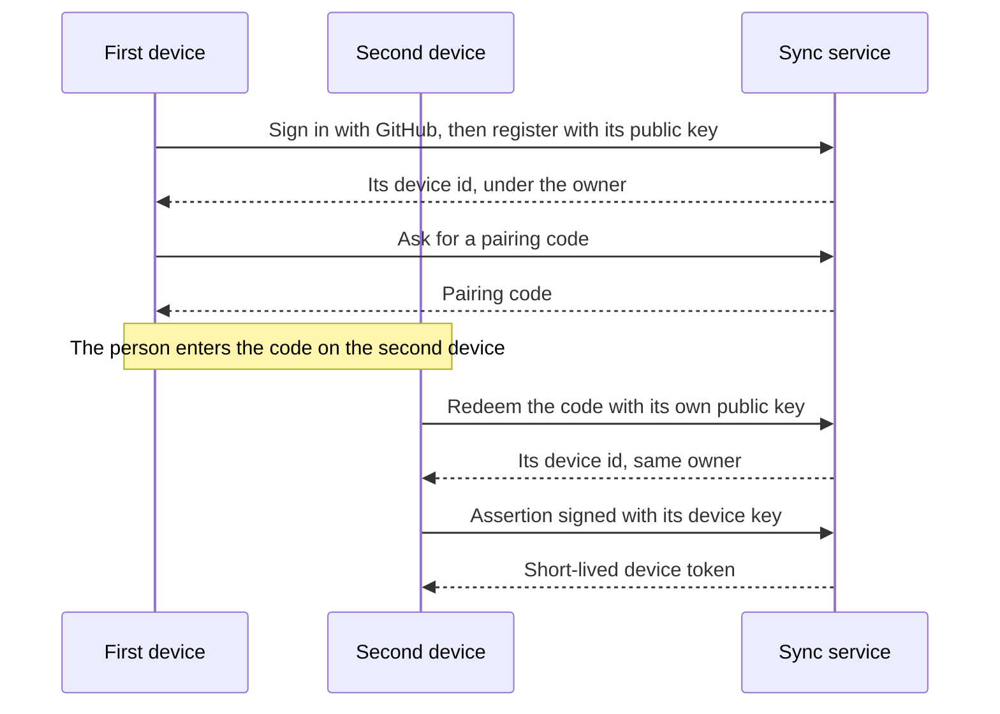
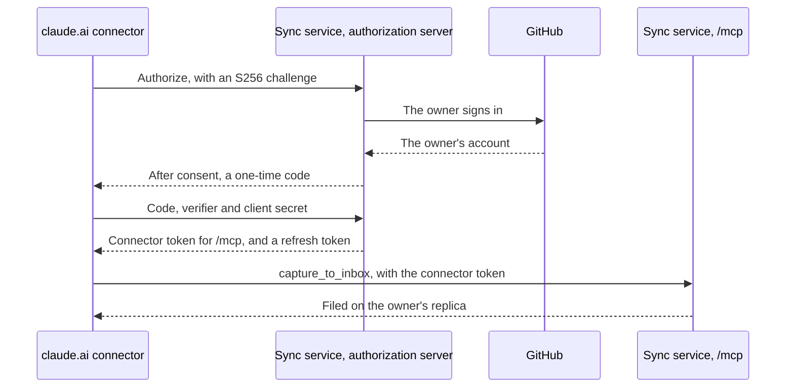

# Features

```meta
type: features
```

## Pairing a device

```meta
type: feature
feature-flag: .devbook/domain/sync/context.md#taking-part-in-sync
related: [.devbook/arc42/adr/guidelines/0012-authentication-external-identity-providers.md, .devbook/arc42/adr/0005-azure-hosted-task-replica-for-multi-device-sync.md, .devbook/arc42/adr/0058-agents-and-devices-authenticate-by-grant-and-key-the-owner-by-github-sign-in.md, .devbook/domain/sync/domain.md#device, .devbook/domain/sync/domain.md#pairing-code, .devbook/domain/sync/requirements.md#pairing-a-device, .devbook/domain/tasks/domain.md#device]
```



Join a second machine to the same backlog by entering a short pairing code shown
on the first, once. The first device enrols through the owner's GitHub sign-in, and
later devices pair by code. The Devices settings page shows the code and takes it on
the second machine. It lists every paired device, says who paired each, and offers
Revoke on the rows this desktop paired.

Each device makes a [Device key](domain.md#device-key) it cannot export and
hands the service only its public half, so neither device holds a secret the other,
or a copy of its folder, could use. A device with no key store, and one paired
before keys, holds a [Registration credential](domain.md#registration-credential)
instead, which is never stored anywhere in the clear. One that later has a key
moves onto it at its next token fetch
([A credential device moves onto its key once](requirements.md#requirement-a-credential-device-moves-onto-its-key-once)).
The [Owner](domain.md#owner), [Enrolment Ticket](domain.md#enrolment-ticket),
[Pairing Code](domain.md#pairing-code), [Device assertion](domain.md#device-assertion)
and [Device token](domain.md#device-token) give each step's rules.

Recovery is the owner's GitHub sign-in again: it registers the device afresh under
the same owner and revokes the owner's other devices.

A paired device reaches exactly one owner's data. The sync service enforces that by reading the owner out of the presented
token, and [every sync call is scoped to that owner](requirements.md#requirement-every-sync-call-is-scoped-to-the-tokens-owner).
The cloud store does not enforce it.

The desktop that showed the code learns of the redemption by reading the owner's
device list while the code is open. The service does not tell it. It then
asks its person "Pair *device name*?" in a notification only that desktop can
answer (`.devbook/domain/notifications/context.md`). Allow keeps the device. Refuse
revokes it once Windows Hello confirms, so it mints no further token. A Refuse not
confirmed within 2 minutes keeps the device and raises an alert.

## Syncing between devices

```meta
type: feature
feature-flag: .devbook/domain/sync/context.md#taking-part-in-sync
related: [.devbook/domain/sync/requirements.md#syncing-between-devices, .devbook/domain/tasks/features.md#multi-device-sync, .devbook/domain/sessions/features.md#sessions-from-another-machine, .devbook/arc42/08-crosscutting-concepts.md#task-sync, .devbook/arc42/08-crosscutting-concepts.md#session-record-sync]
depends-on: [.devbook/domain/sync/features.md#pairing-a-device]
```

Each paired device pushes what changed on it and pulls what changed elsewhere, in
the background. It carries four feeds:

- tasks and the kinds that ride with them;
- session records;
- Devbook remarks;
- the state of devbook subjects.

Each device keeps its own store as the
canonical copy. The replica between them is a courier, and working offline costs
only how soon the other devices find out.

What syncing means for each kind of document is its owner's to say. For tasks it
is [Multi-device sync](../tasks/features.md#multi-device-sync), and for session
records [Sessions from another machine](../sessions/features.md#sessions-from-another-machine).
Sync guarantees the same for all of them. A push never moves a document
backwards ([Change Precedence](domain.md#change-precedence)), and a device only
ever reads and writes its own owner's feeds.

The service and the apps are released apart, so a service can be newer than an
app still installed somewhere. Then that app stops syncing and asks the person to
update Backlog, and keeps everything it had waiting
([A device sends nothing to a newer sync service](requirements.md#requirement-a-device-sends-nothing-to-a-newer-sync-service)).

## Carrying captures to the Inbox

```meta
type: feature
feature-flag: .devbook/domain/sync/context.md#taking-part-in-sync
related: [.devbook/domain/sync/requirements.md#syncing-between-devices, .devbook/arc42/adr/0009-captures-are-a-document-kind-on-the-replica.md, .devbook/arc42/adr/0014-attachments-travel-through-a-blob-store-beside-the-replica.md, .devbook/domain/inbox/dependencies.md]
depends-on: [.devbook/domain/sync/features.md#pairing-a-device]
```

A capture made on the phone or in the IDE reaches the desktop's Inbox. It travels
as a `capture`-kind document on the task feed. Its attachments go up to the
blob store first, through the sync service, so a capture never names a file that
is not there. When the desktop routes or archives the item, it pushes a tombstone
for the capture, and the phone learns it was dealt with. Until then the phone may
reword a capture through `PUT /api/sync/inbox/{id}`, or withdraw it through the
acknowledgement route. The tombstone wins over any live copy, whichever side
sent it. There is no second sync path for any of it.

A capture made while the service is newer than the phone's app is neither lost nor
refused. It waits in the outbox until the app is updated or the service rolled
back ([A phone holds its outbox for a newer sync service](requirements.md#requirement-a-phone-holds-its-outbox-for-a-newer-sync-service)).

## Capturing from claude.ai

```meta
type: feature
related: [.devbook/arc42/adr/0058-agents-and-devices-authenticate-by-grant-and-key-the-owner-by-github-sign-in.md#8-a-remote-agent-reaches-backlog-through-oauth-21-on-the-sync-service, .devbook/domain/sync/requirements.md#capturing-from-claudeai, .devbook/domain/sync/domain.md#connector-client, .devbook/domain/sync/domain.md#connector-authorization, .devbook/domain/sync/domain.md#connector-refresh-token, .devbook/domain/sync/domain.md#connector-token]
depends-on: [.devbook/domain/sync/features.md#carrying-captures-to-the-inbox]
```



The Claude mobile app reaches the owner's Inbox through a claude.ai custom
connector. The sync service is both its OAuth 2.1 authorization server and the
`/mcp` resource server it calls, so the desktop listener stays on loopback and
nothing reaches the desktop but the replica.

The owner sets it up from the desktop's MCP server page: the Remote connector card
makes the [Connector Client](domain.md#connector-client)'s secret and shows it once,
with the client id and redirect to enter in claude.ai. Revoking it there cuts
claude.ai off at once. The connector starts with one scope, `inbox:capture`, and its
one tool files a capture the way the phone does
([Carrying captures to the Inbox](#carrying-captures-to-the-inbox)).

The authorization server's errors take OAuth's shape rather than Problem Details,
because a connector client reads them (local ADR 0058 §8).
