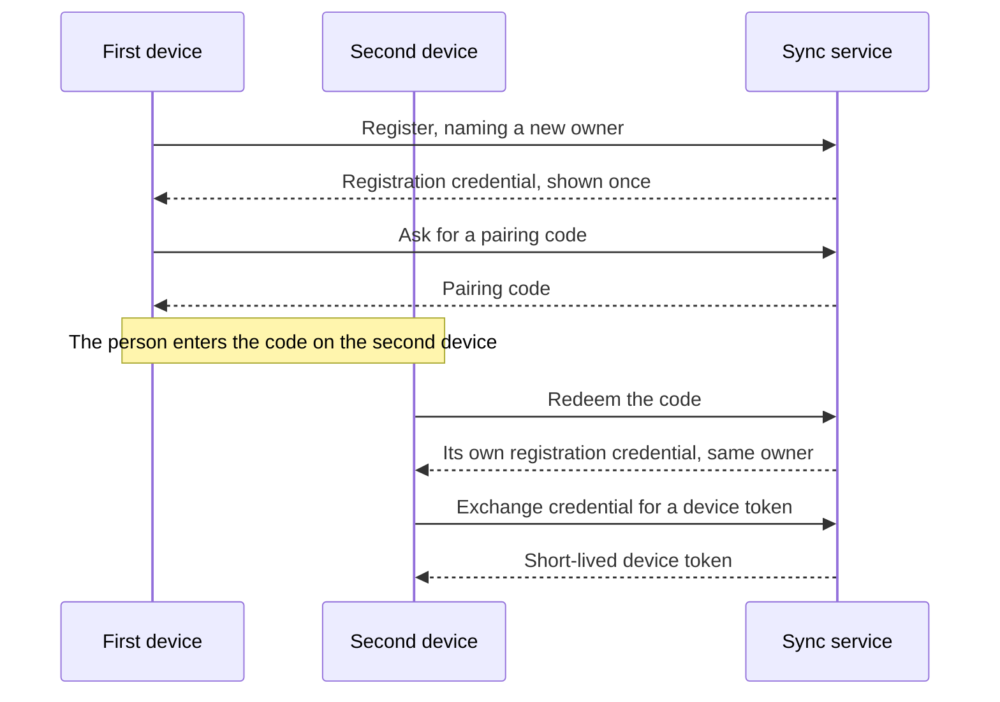

# Features

```meta
status: draft
type: features
```

> What Sync lets a person do: join their devices together, and keep what other
> contexts write the same on each of them.

## Pairing a device

```meta
status: draft
type: feature
feature-flag: .devbook/domain/sync/context.md#taking-part-in-sync
related: [.devbook/arc42/adr/guidelines/0012-authentication-external-identity-providers.md, .devbook/arc42/adr/0005-azure-hosted-task-replica-for-multi-device-sync.md, .devbook/domain/sync/domain.md#device, .devbook/domain/sync/domain.md#pairing-code, .devbook/domain/sync/requirements.md#pairing-a-device, .devbook/domain/tasks/domain.md#device]
```

Join a second machine to the same backlog by entering a short pairing code shown
on the first, once. There is no account and no sign-in: personal use requires no
login (`.devbook/arc42/02-constraints.md`), so devices are paired to each other rather
than to an identity. The Devices settings page shows the code, takes it on the
second machine, and counts the devices paired to this owner.



The [Owner](domain.md#owner), [Pairing Code](domain.md#pairing-code),
[Registration credential](domain.md#registration-credential) and
[Device token](domain.md#device-token) give each step's rules. A registration
credential is never stored anywhere in the clear. Neither device ever holds the
other's credential.

A paired device can therefore reach exactly one owner's data and no one else's.
The sync service enforces that boundary by reading the owner out of the presented
token, and [every sync call is scoped to that owner](requirements.md#requirement-every-sync-call-is-scoped-to-the-tokens-owner).
The cloud store does not enforce it on its own.

The desktop that showed the code learns of the redemption by reading the owner's
device list while the code is open, because the service does not tell it. It then
asks its person "Pair *device name*?" in a notification only that desktop can
answer (`.devbook/domain/notifications/context.md`). Allow keeps the device; Refuse
revokes it, so its credential mints no further token.

## Syncing between devices

```meta
status: draft
type: feature
feature-flag: .devbook/domain/sync/context.md#taking-part-in-sync
related: [.devbook/domain/sync/requirements.md#syncing-between-devices, .devbook/domain/tasks/features.md#multi-device-sync, .devbook/domain/sessions/features.md#sessions-from-another-machine, .devbook/arc42/08-crosscutting-concepts.md#task-sync, .devbook/arc42/08-crosscutting-concepts.md#session-record-sync]
depends-on: [.devbook/domain/sync/features.md#pairing-a-device]
```

Each paired device pushes what changed on it and pulls what changed elsewhere, in
the background. It carries four feeds: tasks and the kinds that ride with them,
session records, Devbook remarks, and the state of devbook subjects. Each device keeps its own store as the
canonical copy. The replica between them is a courier, and working offline costs
only how soon the other devices find out.

What syncing means for each kind of document is its owner's to say. For tasks it
is [Multi-device sync](../tasks/features.md#multi-device-sync), and for session
records [Sessions from another machine](../sessions/features.md#sessions-from-another-machine).
What Sync guarantees is the same for all of them: a push never moves a document
backwards ([Change Precedence](domain.md#change-precedence)), and a device only
ever reads and writes its own owner's feeds.

The service and the apps are released apart, so a service can be newer than an
app still installed somewhere. Then that app stops syncing and asks the person to
update Backlog, and keeps everything it had waiting
([A device sends nothing to a newer sync service](requirements.md#requirement-a-device-sends-nothing-to-a-newer-sync-service)).

## Carrying captures to the Inbox

```meta
status: draft
type: feature
feature-flag: .devbook/domain/sync/context.md#taking-part-in-sync
related: [.devbook/domain/sync/requirements.md#syncing-between-devices, .devbook/arc42/adr/0009-captures-are-a-document-kind-on-the-replica.md, .devbook/arc42/adr/0014-attachments-travel-through-a-blob-store-beside-the-replica.md, .devbook/domain/inbox/dependencies.md]
depends-on: [.devbook/domain/sync/features.md#pairing-a-device]
```

A capture made on the phone or in the IDE reaches the desktop's Inbox. It travels
as a `capture`-kind document on the task feed, and its attachments go up to the
blob store first, through the sync service, so a capture never names a file that
is not there. When the desktop routes or archives the item, it pushes a tombstone
for the capture, and the phone learns it was dealt with. There is no second sync
path for any of it.

A capture made while the service is newer than the phone's app is not lost and
not refused: it waits in the outbox until the app is updated or the service rolled
back ([A phone holds its outbox for a newer sync service](requirements.md#requirement-a-phone-holds-its-outbox-for-a-newer-sync-service)).
