# Model

```meta
type: model
status: draft
related: [.devbook/domain/sync/domain.md#device, .devbook/domain/sync/domain.md#pairing-code]
```

> Structural view of the Sync model: the two aggregates, the values they and the
> replicas share, and the replicated document records. What each type means is in
> [domain.md](domain.md); its rules are in
> [domain.invariants.md](domain.invariants.md).

## Model diagram

```mermaid
classDiagram
    class Device {
        +DeviceId Id
        +OwnerId OwnerId
        +string Name
        +string CredentialHash
        +DateTimeOffset RegisteredAt
    }

    class PairingCode {
        +string CodeHash
        +OwnerId OwnerId
        +DeviceId IssuedBy
        +DateTimeOffset ExpiresAt
        +bool Redeemed
        +HasExpired(now)
    }

    class OwnerId {
        +Guid Value
    }

    class DeviceId {
        +Guid Value
    }

    class OwnerScope {
        +OwnerId OwnerId
        +DeviceId DeviceId
    }

    class SyncCursor {
        +OwnerId Owner
        +string Continuation
    }

    class ReplicaCursor {
        <<TaskReplicaCursor, SessionReplicaCursor, AnnotationReplicaCursor, DevbookSubjectReplicaCursor>>
        +OwnerId Owner
        +string Continuation
    }

    class ChangePrecedence {
        <<domain service>>
        +Supersedes(inbound, stored) bool
    }

    class TaskChange {
        +Guid Id
        +DateTimeOffset UpdatedAt
        +DateTimeOffset? DeletedAt
        +TaskPayload Task
    }

    class AnnotationChange {
        +Guid Id
        +DateTimeOffset UpdatedAt
        +DateTimeOffset? DeletedAt
        +AnnotationPayload Annotation
    }

    class DevbookSubjectChange {
        +Guid Id
        +DateTimeOffset UpdatedAt
        +DevbookSubjectPayload Subject
    }

    class SessionRecord {
        +string SessionId
        +string AgentKind
    }

    Device --> OwnerId : belongs to
    Device --> DeviceId : identified by
    PairingCode --> OwnerId : joins a device to
    PairingCode --> DeviceId : issued by
    OwnerScope --> OwnerId
    OwnerScope --> DeviceId
    ReplicaCursor ..> SyncCursor : built only from
    ChangePrecedence ..> TaskChange : compares two
    ChangePrecedence ..> AnnotationChange : compares two
    ChangePrecedence ..> DevbookSubjectChange : compares two
    SessionRecord ..> DeviceId : keyed under, by Session Record Key
```



## Relationship notes

- **The two aggregates meet only at the owner.** A Pairing Code names the owner a
  redeeming device joins and the device that issued it. Redeeming it creates a new
  Device under that owner; the code keeps no reference to the device it made.
- **The documents are not Sync's types.** `TaskChange`, `SessionRecord`,
  `AnnotationChange` and `DevbookSubjectChange` are the published language in
  `Backlog.Modules.Sync.Abstractions`. Sync reads their envelope (id, `updatedAt`,
  `deletedAt` where the feed has tombstones, and a session record's machine, agent
  and session id) and stores the payload whole. What the payload means stays
  with Tasks, Sessions and Devbook.
- **Every replicated document carries an OwnerId** as its partition, and every
  replica read is given an [OwnerScope](domain.md#ownerscope) or a
  [Replica Cursor](domain.md#replica-cursor) naming one. Nothing reaches a replica
  without saying whose data it wants.
- **An attachment is a blob, not a document.** It is stored under
  `{ownerId}/{attachmentId}` beside the replica, and a capture document carries its
  metadata and never its bytes (local ADR 0014).
