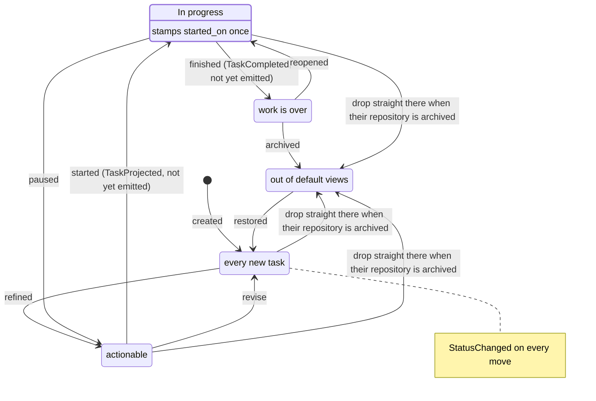
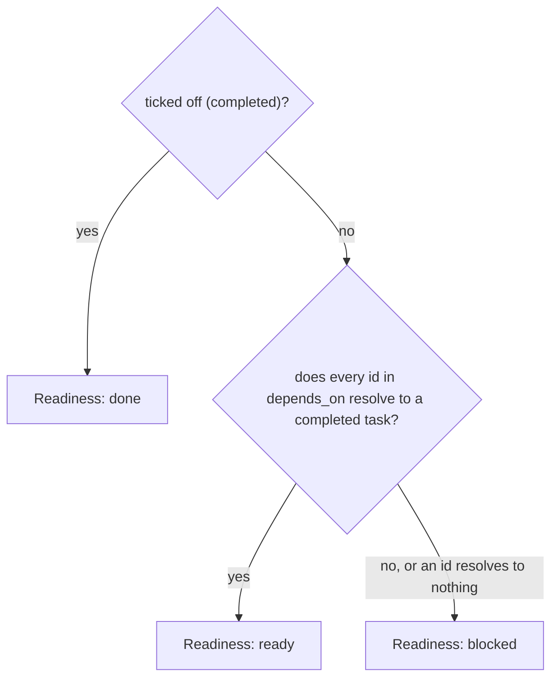
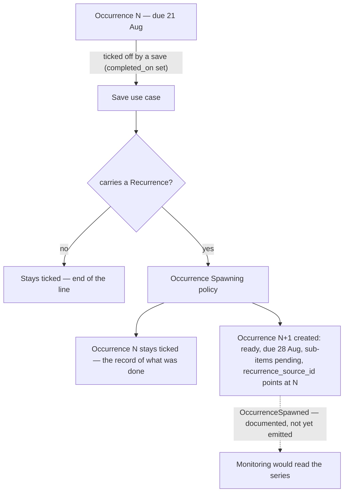

# Tasks

```meta
type: domain
```

> A chapter's `type` is `entity`, `value-object` or `enum` beneath its aggregate.

## Task

```meta
type: aggregate
related: [.devbook/domain/inbox/domain.md#inbox-item, .devbook/arc42/08-crosscutting-concepts.md#shared-data-types, .devbook/arc42/08-crosscutting-concepts.md#task-sync, .devbook/arc42/adr/0005-azure-hosted-task-replica-for-multi-device-sync.md, .devbook/domain/tasks/domain.invariants.md#task]
aliases: [TaskItem, task_id, BacklogEntry, backlog_entry_id, backlog_item_id]
```

**Task lifecycle**

Five recorded states. The tick, readiness and the start date sit beside the status;
they are not states.



- The edges from `Draft`, `Ready` and `InProgress` to `Archived` are
  [dropping an archived repository's open tasks](../repository-management/requirements.md#archiving-a-repository).
  `RefileRepositoryTasksCommand` sets each open task filed under that
  repository to `Archived` through `TaskItem.SetStatus`, outside the
  lifecycle's own transitions, as a person's `!archived` edit does. The task
  keeps its filing and nothing is deleted. `Done` and `Archived` tasks are left
  alone.

- The `Ready → InProgress` transition would emit `TaskProjected`, and `Done`
  would emit `TaskCompleted`. Both are documented, not yet emitted; see
  [Projection](domain.md#projection) for the policy and
  [its requirements](requirements.md#projection) for what it will do on each.
- [The first move into `InProgress` stamps Started](domain.invariants.md#invariant-the-first-move-into-progress-stamps-the-start),
  and pausing or reopening leaves the stamp where it is. A linked task's sync
  that only passes through `InProgress` on the way to `Done`
  [stamps no start](requirements.md#requirement-the-sync-walks-the-status-along-the-lifecycle).
- `Done` and `Archived` say the work is over. The tick that says the person has
  dealt with the task is [Completed](domain.md#completed), a separate fact and
  not a state in this diagram.
  [The list's checkbox also moves an open task to `done`](requirements.md#requirement-ticking-an-open-task-off-moves-it-to-done)
  in the same save. A finished task that still read "in progress" would be the
  list contradicting itself.
- Scheduling attributes do not appear in this diagram, and that is deliberate.
  A due date, a reminder, a repeat and a My Day stamp are facts about when work
  is wanted, not lifecycle states. An overdue task is still `ready`, and nothing
  has to move a task between states as a clock advances.

A refined, actionable item in the personal backlog and the consistency boundary
for all of its sub-items, projections, and usage history. It is the single source
of truth on the device that holds it. Even when it targets multiple repositories,
it is one logical item with one priority and one status. The rules it holds are in
[its invariants](domain.invariants.md#task).

A task that stands for an item in an outside system carries a [Source Ref](#source-ref)
and is a [Linked Task](#linked-task). The source then owns its title, status
and assignee (local ADR 0020).

The task also carries two attributes that place it in the person's own working
set rather than in any external system:

- `area`, its [Area](#area). What a blank area reads as is
  [an invariant of the task](domain.invariants.md#invariant-a-blank-area-is-unfiled).
- `order`, a manual rank used to hand-sequence tasks within the backlog. How the
  backlog lists the tasks nobody ranked is a requirement of
  [Manual ordering](requirements.md#requirement-unranked-tasks-fall-back-to-recency).

Both are freely re-settable and carry no lifecycle invariant of their own. Both
are aggregate state rather than a display preference, so both travel with the
task to the person's other machines. A sequence arranged by hand is an edit, and
an edit that did not travel would quietly revert on the other device.

Beyond that working-set placement the task carries five scheduling attributes.
All are optional, and none is load-bearing for the lifecycle.

- `due_on` is the task's [Due Date](#due-date).
- `remind_at` is its [Reminder](#reminder). Overdue is derived by comparison
  rather than stored. Delivery sits outside the aggregate: the task records that
  a reminder was wanted, not that one was sent.
- `recurrence` says the task repeats and is described by the `Recurrence` value
  object.
- `in_my_day_on` is the date behind [My Day](#my-day).
- `agenda_time` places the task in that day and is described by the
  [Agenda Time](#agenda-time) value object. It has no date of its own, so
  [a task outside My Day holds none](domain.invariants.md#invariant-a-task-outside-my-day-holds-no-agenda-time)
  and [a new My Day date drops it](domain.invariants.md#invariant-a-new-my-day-date-drops-the-agenda-time).

`completed_on` records that the task is [Completed](#completed); that term says
how the tick differs from `status`. The tick carries no invariant. The list's
checkbox writes two facts at once, because a person who ticks something off has
finished the work. That is the checkbox's choice, not a rule on the task. What it
does to the status is therefore a requirement of
[Archive and lifecycle](requirements.md#archive-and-lifecycle), and a
`completed:` token typed into the text moves no status. The phone's done and
undone are
[that same checkbox](requirements.md#requirement-a-tick-on-the-phone-is-the-desktops-tick).

`started_on` records that the task is [Started](#started).
[The first move into progress stamps it](domain.invariants.md#invariant-the-first-move-into-progress-stamps-the-start)
from the local date, whether the move is a lifecycle step or a status set from
the text. Nothing in this context reads it. It is recorded for the roadmap, which
draws a finished plan from its first task's start to its last task's tick.

It is written on the
metadata line as a `started:` token just before `completed:`. A token typed there
sets the date, and deleting it clears the date. A task still `in_progress` is
then stamped with today again on that save. Work that was already under way
before the stamp existed has none until its next transition into `in_progress`.

`depends_on` lists the task's [Dependencies](#dependency), held as plain
identifiers, the same rule `repo_ids` follows. Every `Task` is its own aggregate
root, so there is no object graph between them. [Readiness](#readiness) is read
from this list, and
[how it is derived](domain.invariants.md#invariant-readiness-is-derived-and-never-stored)
is an invariant. [Dependency](#dependency) says why an
unresolvable id still blocks and why no invariant prevents a cycle.

`planned_hours` lists the task's [Planned Hours](#planned-hours) in date order.
It is the task's own field and never text in it, so the text save neither writes
nor clears it. Each figure stays within
[the bounds a figure has](domain.invariants.md#invariant-a-planned-hours-figure-is-more-than-none-and-at-most-a-day),
and the task holds
[one figure a day](domain.invariants.md#invariant-a-task-holds-one-planned-hours-figure-a-day).
A recurring task's next occurrence starts with none, since the days belonged to
this one.

`attachment` names the one place on disk where the task's material lives, as an
[Attachment](#attachment). It carries no invariant and is never validated. Its
spelling on the metadata line is defined in
`.devbook/design/content-editing.md#scheduling-and-dependency-tokens`.

The task also carries one attribute that is not a fact about the work at all.
`view` once recorded which reading of the body a person last asked for: the
steps, or the Markdown block they are written in. The desktop now shows
the body as one Markdown editor and neither reads nor writes `view`. It is a retired display preference, kept because it is stored. Nothing in
the lifecycle or any invariant reads it, and a task that never
carried one has none.

It is written on the task's
metadata line, so [it survives a text save](requirements.md#requirement-a-view-token-on-the-line-survives-a-save),
and it travels to the person's other devices through the replica. Its spelling is in
`.devbook/design/content-editing.md#scheduling-and-dependency-tokens`.

A task spawned as the next occurrence of a repeating one carries
`recurrence_source_id`, naming the occurrence it followed. It is provenance, like `source_inbox_id`, and carries no invariant. A spawned task is
a separate aggregate, and the task it came from may since
have been archived or deleted.

A task created by importing a plan carries `import_plan_id` and
`import_item_id`, naming the plan and the item that produced it. Both are provenance with no invariant. Together they are
also the key a later import of the same plan uses to recognize the task an item
already produced. Re-importing an updated plan therefore brings a task under way
up to date instead of standing a second one beside it. Such an import
clears the plan's not-yet-started tasks by `import_plan_id` alone; see
[Re-importing an updated plan](features.md#re-importing-an-updated-plan).

`import_plan_id` is also added to the task's `tags`, so filing and filtering by plan
reuse the mechanism of filing against a
[roadmap tag](features.md#filing-a-task-against-a-roadmap-tag). It is that tag verbatim, with the plan sigil the
[Roadmap Tag](#roadmap-tag) term describes, and
[the plan id keeps its sigil](domain.invariants.md#invariant-a-plan-id-keeps-its-sigil).
A plan written under a general `#slug` before the sigil existed is a
different plan from one written under `+slug`
(`.devbook/arc42/adr/0013-imported-plan-is-a-roadmap-item-laid-out-by-import.md`).

A task filed as a
[follow-up after an entry](features.md#filing-a-follow-up-after-an-entry) carries
`source_notification_id`, naming the notification whose answer asked for it. It is
provenance with no invariant, and the key that keeps a second delivery of the same answer from filing
a second task. Such a task carries its plan's tag but no `import_plan_id`, so a
re-import of the plan leaves it alone.

The task also carries an optional `effort`, its [Effort](#effort), within
[the bounds the task enforces](domain.invariants.md#invariant-effort-is-never-negative).
Deriving the estimate is not built here. The value
can be registered and shown, whether a person or an AI agent set it. Roadmap Planning
totals it through
[Roadmap Item Gathering](../roadmap/domain.md#roadmap-item-gathering).

Two attributes exist so the same task can live on more than one of the person's
machines:

- `updated_at` is the moment the task last changed, in UTC.
  [Every edit restamps it](domain.invariants.md#invariant-every-edit-restamps-the-task),
  a change to `order` or `area` included, which is what makes those travel.
- `deleted_at` makes the task a [Tombstone](#tombstone).

Neither carries a lifecycle invariant, and the device writes both.

They are here rather than in the storage adapter because reconciliation is a
domain rule. When the same task is edited on two
machines, [the later edit wins whole](requirements.md#requirement-the-later-edit-wins-whole).
A deletion has the same
problem in sharper form, which is why it leaves a [Tombstone](#tombstone).

Devices reconcile with each other. The cloud
holds a replica that carries changes between them and is never the
authority; see
`.devbook/arc42/adr/0005-azure-hosted-task-replica-for-multi-device-sync.md`.

### Sub-Item

```meta
type: entity
aliases: [SubItem]
```

An ordered breakdown step owned by the task, with its own `title`,
`Sub-Item Status`, optional `notes` and `order`. It has identity within the
aggregate but no meaning outside it. Sub-items can be reordered, added, or removed
independently. They may project to task-list checkboxes inside the task's own
GitHub issue, but never as an issue of their own. `Projection
Ref` is owned by the task and a step has nowhere to record one, so a step
filed separately could be filed again undetected.

A step, in the product's language, is a sub-item. A step inherits its parent's deadline. A breakdown step
that needed its own priority would be a task. Type, priority, status vocabulary, tags and scheduling or
dependency attributes all stay on the task.

### Projection Ref

```meta
type: value-object
```

An immutable link to a downstream external artifact created from the task:
`repo_id`, `external_id`, and `target_type`. The target types in use are `issue`,
`pull-request` and `session`. A Copilot CLI task is an intended target, `cli-task`,
that nothing creates yet. Equality is by value. It points outward, where the
[Source Ref](#source-ref) points inward.

### Source Ref

```meta
type: value-object
aliases: [SourceRef, source_ref]
related: [.devbook/domain/tasks/domain.md#linked-task, .devbook/domain/tasks/domain.md#task-connector, .devbook/arc42/adr/0020-external-items-arrive-as-linked-tasks.md]
```

Where a [Linked Task](#linked-task) came from. Equality is by value. A task has at
most one, and a task without one is local work. It holds seven values:

- `connector_id`;
- `external_id`;
- `url`;
- `display_key`;
- `assignee`;
- `source_state`;
- `source_updated_at`.

`connector_id` is a string, not an enum, so a new
[Task Connector](#task-connector) needs no schema change. A device that does not
know the id still shows `display_key`. `external_id` is the source's stable id,
never a number that moves when the item is transferred. `assignee` and
`source_state` are the source's own values, kept for display and not the
task's status. No screen filters on the assignee ("Assigned to me" was
removed), though a sync still rewrites it.

Each sync rewrites the Source Ref. It is held in an additive `source_ref`
column (local ADR 0006) and travels in the replica payload. A
[Projection Ref](#projection-ref) points the other way: at an artifact created
from the task.

### Recurrence

```meta
type: value-object
aliases: [Repeat, repeat, recurrence, RepeatLabel, RecurrenceUnit, DayOfWeek]
```

How often a task repeats: an `interval`, a `Recurrence Unit`, and an optional
set of `Weekday`s the repeat is restricted to. "Every weekday" is interval 1,
unit week, weekdays Monday through Friday; "every other week" is interval 2,
unit week, with no weekday restriction. Equality is by value.

The value object describes the shape of the repeat only. When the next
occurrence falls is the `Occurrence Spawning` policy's calculation, anchored to `due_on`
rather than the completion date.

### Agenda Time

```meta
type: value-object
aliases: [agenda_time, AgendaTime, at, for]
related: [.devbook/domain/tasks/domain.md#my-day, .devbook/domain/tasks/features.md#my-day, .devbook/design/content-editing.md#scheduling-and-dependency-tokens]
```

Where a task sits in its My Day: a `start`, a local wall-clock time of day in
24-hour form, and a `duration` in whole minutes. The pair describes one block,
such as 10:45 for 45 minutes, which runs from 10:45 to 11:30. Equality is by
value.

The time carries no zone, like a [Reminder](#reminder): 10:45 means 10:45
on the reader's clock. A valid pair is an
[invariant of the task](domain.invariants.md#task):

- [a duration without a start is no agenda time](domain.invariants.md#invariant-a-duration-without-a-start-is-no-agenda-time);
- [a start alone is thirty minutes](domain.invariants.md#invariant-a-start-alone-is-thirty-minutes);
- [a duration is a positive whole number of minutes](domain.invariants.md#invariant-an-agenda-duration-is-a-positive-whole-number-of-minutes).

An agenda time has no date of its own. It borrows the date of
[My Day](#my-day), so it means something only while the task is in the reader's My Day. A task whose My Day date has passed keeps the value until the next change,
but nothing reads it. The [Task](#task) holds it on these terms:

- [a task outside My Day holds none](domain.invariants.md#invariant-a-task-outside-my-day-holds-no-agenda-time);
- [a new My Day date drops it](domain.invariants.md#invariant-a-new-my-day-date-drops-the-agenda-time);
- [a text save that moves My Day drops the slot carried along](domain.invariants.md#invariant-a-text-save-that-moves-my-day-drops-the-slot-carried-along).

The agenda time crosses the sync task feed as two plain values beside
`in_my_day_on`: the start as `HH:MM` and the duration in minutes. Both are absent
on a task with no slot, as in a document from a build that never sent them. The phone's `task_view` row reads them off the document.

Only the desktop sets an agenda time. The phone reads it for the Now and
Agenda groups and Focus, as [My Day](features.md#my-day) describes, and
clears one only by moving a task to tomorrow.

### Attachment

```meta
type: value-object
aliases: [attachment, files, attached folder, attached material]
```

Where a task's material is kept: a `path` naming a folder or an archive.
Equality is by value.

**One place and not a list.** "The files for this" is a
folder a person already keeps them in. A second place is not a second attachment: it is either the same folder further up
or a different task.

**A path and not a copy.** Task attachments are machine-local
(`.devbook/arc42/adr/0014-attachments-travel-through-a-blob-store-beside-the-replica.md`):
nothing is imported or stored beside the task, and the material stays
where its owner put it.

Whether the path resolves is the file system's answer, and differs by machine, so the value carries no invariant and is never
validated. A task written on the desktop is not invalid for
naming a drive the phone has never seen. Attaching claims where
material lives, not that the reader can reach it.

Two things are read off the path rather than stored:

- Its `name` is the last segment.
- The path's spelling decides whether it is an archive, not the disk. The
  value therefore stays comparable, and a renamed file cannot change what
  the task says.

A folder called `backup.zip` is an archive by this rule, which only decides which word to call it.

How much is in the place is deliberately not part of the value: a stored count
would stop being true when somebody added a file.

### Usage Event

```meta
type: value-object
```

An immutable audit record of a prompt copy/use: `timestamp` and `action`.
Equality is by value.

### AI Work Log

```meta
type: value-object
aliases: [AIWorkLog, AIWorkLogged]
```

An immutable record that an AI-assisted action contributed to the task. Equality
is by value. It holds:

- `timestamp`;
- `ai_tool`;
- `activity_kind`;
- optional `session_id`;
- optional `outcome_ref`.

### Task Type

```meta
type: enum
related: [.devbook/domain/tasks/domain.md#dependency]
aliases: [TaskType]
```

Classification of the task: `prompt`, `task`, `idea`, `test`. A follow-up is a
`Dependency` on the task it comes after rather than a type of its own. One
[filed from a gate answer](features.md#filing-a-follow-up-after-an-entry) is a
`prompt`.

### Task Status

```meta
type: enum
aliases: [TaskStatus]
```

Lifecycle state: `draft`, `ready`, `in_progress`, `done`, `archived`.

### Priority

```meta
type: enum
```

Ranking of the task: `low`, `medium`, `high`, `critical`.

### Sub-Item Status

```meta
type: enum
```

Completion state of a sub-item: `pending`, `done`.

### Recurrence Unit

```meta
type: enum
```

The period a repeat is counted in: `day`, `week`, `month`, `year`.

### Weekday

```meta
type: enum
```

A day of the week, `monday` through `sunday`. Used only to restrict a weekly
`Recurrence`.

### Readiness

```meta
type: enum
aliases: [TaskReadiness, ready, blocked]
```

**Readiness derivation**



- Completing one task unblocks its dependents with nothing to recalculate, because
  [readiness is derived](domain.invariants.md#invariant-readiness-is-derived-and-never-stored).
- The first question is the [tick](domain.md#completed), not `Task Status`; see
  [A ticked task reads done](domain.invariants.md#invariant-a-ticked-task-reads-done).
- [An id that resolves to no visible task leaves the task blocked](domain.invariants.md#invariant-a-dependency-naming-no-task-still-blocks),
  and [a dependency loop leaves every member blocked](domain.invariants.md#invariant-every-task-in-a-dependency-loop-reads-blocked).
  [Dependency](domain.md#dependency) says why.

Where a task stands once the tasks it waits on are counted:
`done`, `ready`, `blocked`. It is read from `depends_on`.

There are three values because "not done" covers both the task that can
be picked up now and the one that cannot. Telling them apart is the whole
reason to write a dependency down.

Readiness is orthogonal to `Task Status`: status is the recorded lifecycle state,
readiness a conclusion about whether the task can be started. Readiness's
`done` is the [tick](#completed), not the status of the same name.

## Projection

```meta
type: domain-service
related: [.devbook/domain/monitoring/domain.md#progress-signal, .devbook/arc42/06-runtime-view.md#task-to-github-issue, .devbook/domain/tasks/requirements.md#projection]
aliases: [ProjectionRef]
```

Creates and closes downstream artifacts for a multi-repo task, recording each as
a `Projection Ref`. It is a service because it coordinates the task with external
systems (GitHub, Copilot CLI) across several artifacts rather than
a single aggregate mutation.

What ships is a push the person asks for. A task is pushed to its target
repository as one GitHub issue, and the issue's reference is kept on the task; see
[Issue projection and state read-back](features.md#issue-projection-and-state-read-back).

The intended design is an event-triggered policy, or process manager, that
reacts to `TaskProjected` and
`TaskCompleted`; its promises are in
[the Projection requirements](requirements.md#projection). Neither event is
emitted yet; see [Occurrence Spawning](#occurrence-spawning) for why this context
publishes none.

A `Projection Ref` recorded by hand, such as a session or pull request linked to
a task, records the work whatever its state. A pull request that merged or
closed before its task was linked is linked like an open one, from a repository
registered in Settings; see
[From a task's side panel](../sessions/features.md#from-a-tasks-side-panel). A link
can be taken off again, and the task holds what unlinking does:

- [it removes every reference to the named artifact](domain.invariants.md#invariant-unlinking-removes-every-reference-to-the-named-artifact);
- [it leaves the task's repositories as they are](domain.invariants.md#invariant-unlinking-leaves-the-tasks-repositories-as-they-are);
- [it changes nothing for a reference the task does not hold](domain.invariants.md#invariant-unlinking-what-the-task-does-not-hold-changes-nothing).

## Occurrence Spawning

```meta
type: domain-service
related: [.devbook/domain/tasks/domain.md#task, .devbook/domain/tasks/domain.md#taskcompleted, .devbook/domain/tasks/domain.md#occurrencespawned, .devbook/domain/tasks/requirements.md#recurring-tasks]
```

**Recurring task occurrences**



- Completion is the [tick](domain.md#completed), the save that sets
  `completed_on` from unset, not the status reaching `done`:
  [the tick spawns the next occurrence](requirements.md#requirement-the-tick-spawns-the-next-occurrence).
- The finished occurrence stays in place and the next is a separate aggregate.
  The link between them, `recurrence_source_id`, is provenance, not ownership.
- The spawn is a synchronous step inside the save (solid arrow). The dashed arrow is the event that would tell Monitoring.
  This context documents it but does not yet emit it, so a consumer
  reads a series by following `recurrence_source_id`.
- The next due date comes from the completed occurrence's `due_on`, not
  from when it was finished, so lateness does not drift a schedule.

Creates the next occurrence of a repeating task. When a save ticks off a task
that carries a `Recurrence`, it creates a new `Task` whose `due_on` is the next date that recurrence
produces. Its promises are in
[the Recurring tasks requirements](requirements.md#recurring-tasks).

It is a service because producing the next occurrence creates a second
aggregate instance, which an aggregate cannot do to itself.

Invocation semantics: called synchronously by the use case that completes the
task. It is deliberately not an event-triggered policy, unlike the intended
`Projection`. This context publishes no domain events yet.

Guideline ADR 0006
([Lightweight CQRS, no mediator](../../arc42/adr/guidelines/0006-cqrs-for-api-projects.md))
rejected putting a mediator behind its handlers, so `OccurrenceSpawned` below
is documented rather than emitted until there is machinery to carry it. The spawn does not wait on
that machinery; an event would only tell a consumer.

The new occurrence carries over what the repeat is of:

- `title`, `content_md`, `type`, `priority`, `area`, `tags` and `repo_ids`;
- `depends_on`, its Devbook references, and its `order`;
- the `Recurrence` itself;
- each sub-item's title and notes, in order.

It adds `recurrence_source_id`, pointing back at the task it came from.

Everything about the occurrence rather than the repeat starts fresh:

- the status is `ready`, and every sub-item is `pending`;
- `due_on` is advanced as above, and stays empty when the completed occurrence
  had none;
- projections, usage history, `remind_at`, `in_my_day_on` with its agenda time,
  `planned_hours`, `started_on`, `completed_on`, `blocked_since`, `effort` and
  `attachment` are all empty.

That the next occurrence
[carries the repeat and starts the occurrence fresh](requirements.md#requirement-the-next-occurrence-carries-the-repeat-and-starts-the-occurrence-fresh)
is a requirement. A repeating task accumulates one completed task per occurrence, the
cost of keeping the record. [Archive and lifecycle](features.md#archive-and-lifecycle) bounds it:
completed occurrences archive out of default views.

Two use cases run it. The desktop's own save runs it when the save ticks the
task off. The replica merge runs it when a pulled copy ticks off a
task the desktop held unticked. That is how a tick made on the phone or on
another desktop gets its successor.
[A task that arrives ticked spawns nothing](requirements.md#requirement-a-task-that-arrives-ticked-spawns-nothing),
as a task created ticked spawns nothing: it records something done.

[An occurrence has at most one successor](requirements.md#requirement-an-occurrence-has-at-most-one-successor).
The successor's id is derived from the id of the occurrence it follows, so every
desktop spawns the same task and the replica keeps one copy.
Nothing is created when a task with that id already exists,
live or deleted. Deleting the successor is how the person stops that repeat, so
[a deleted successor is not spawned again](requirements.md#requirement-a-deleted-successor-is-not-spawned-again).
A successor spawned before its id was derived carries a random id. An
occurrence ticked before that change can therefore still gain a second successor
if it is unticked and ticked again.

[Unticking leaves the successor in place](requirements.md#requirement-unticking-leaves-the-successor-in-place):
unticking clears `completed_on` and nothing else, and the successor is
a separate task.

## StatusChanged

```meta
type: domain-event
related: [.devbook/domain/tasks/domain.md#task]
```

Published when a `Task` changes `Task Status`.

### Payload

- `task_id` - task identifier.
- `previous_status` - prior `Task Status`.
- `new_status` - new `Task Status`.
- `changed_at` - time of the transition.
- `repo_ids` - targeted repositories for correlation.

### Consumers

- Monitoring & Dashboard, which turns work-state changes into progress signals.

### Published language rules

- The event reflects the durable work-state transition; consumers do not infer
  additional semantics from projection side effects.

## TaskProjected

```meta
type: domain-event
related: [.devbook/domain/tasks/domain.md#projection]
```

Published when a `Task` begins external execution and the Projection
policy creates one downstream artifact per targeted repository.

### Payload

- `task_id` - task identifier.
- `repo_id` - repository receiving a projection.
- `projection_target` - the [Projection Ref](#projection-ref)'s target type:
  `issue` or `cli-task`.
- `external_id` - created downstream artifact identifier.
- `projected_at` - time the projection was created.

### Consumers

- Monitoring & Dashboard, which correlates planned work with external execution.

### Published language rules

- One event instance is emitted per projection target so consumers can reason
  about multi-repo fan-out without inspecting `Projection Ref` internals.

## TaskCompleted

```meta
type: domain-event
related: [.devbook/domain/tasks/domain.md#projection]
```

Published when a completed `Task` closes its downstream projections.

### Payload

- `task_id` - task identifier.
- `repo_ids` - repositories whose projections are being closed.
- `closed_projection_ids` - downstream artifact identifiers that were closed.
- `completed_at` - time the projections were closed.

### Consumers

- Monitoring & Dashboard, which reconciles work completion against external systems.

### Published language rules

- Completion is owned by Tasks; external systems consume the closing
  signal but do not redefine what completion means.

## OccurrenceSpawned

```meta
type: domain-event
related: [.devbook/domain/tasks/domain.md#occurrence-spawning]
```

Published when a completed repeating `Task` produces its successor.

### Payload

- `source_task_id` - the completed task the occurrence came from.
- `task_id` - the newly created task.
- `due_on` - calendar date the new occurrence is due.
- `spawned_at` - time the occurrence was created.

### Consumers

- Monitoring & Dashboard, which needs the two tasks linked to read a repeating
  series as a series rather than as unrelated items.

### Published language rules

- The successor is a separate `Task` with its own lifecycle. The link is
  provenance, not ownership, and consumers must not treat a series as one work
  item.
- One event instance is emitted per spawned occurrence.

## AIWorkLogged

```meta
type: domain-event
related: [.devbook/domain/tasks/domain.md#task]
```

Published when a Task records that an AI-assisted action contributed to
the work item.

### Payload

- `task_id` - task identifier.
- `ai_tool` - tool or channel used, such as Copilot CLI, GitHub Copilot App, IDE
  chat, or another AI assistant.
- `activity_kind` - planning, coding, review, summarization, research, or other
  user-facing category.
- `session_id` - optional source session identifier when one exists.
- `outcome_ref` - optional reference to a pull request, commit, issue, note, or
  generated artifact.
- `logged_at` - time the activity was recorded.

### Consumers

- Productivity, which turns AI-assisted activity into personal productivity
  metrics and trends.

### Published language rules

- The event records contribution evidence only; it does not claim productivity
  value by itself.
- Consumers conform to the published fields and do not inspect Task
  internals to infer additional activity.

## Shared Enums

```meta
type: shared-enums
```

> Enums used by more than one aggregate in this bounded context.

Tasks has one aggregate, so its enums sit under Task. This chapter is reserved for cross-aggregate enums.

## Ubiquitous Language

```meta
type: ubiquitous-language
```

### Entry Kind

```meta
type: term
aliases: [EntryKind]
related: [.devbook/domain/tasks/domain.md#task-type, .devbook/domain/tasks/features.md#import, .devbook/arc42/adr/0013-imported-plan-is-a-roadmap-item-laid-out-by-import.md, .devbook/domain/tasks/requirements.md#import]
```

Which thing a piece of entry text describes: a task, or a roadmap item. It is
read off the same bare type word as `Task Type` and held beside it:

- `prompt`, `task`, `idea` and `test` are the task kind and carry a
  `Task Type`.
- `plan` is the plan kind and carries none, because the stored task enum
  has no row for it.

Import is the path for the plan kind.
[The text save refuses a plan entry](requirements.md#requirement-the-text-save-refuses-a-plan-entry)
and routing from the Inbox leaves one out, rather than storing a task whose type
word the model cannot hold.

### Completed

```meta
type: term
aliases: [completed_on, tick, ticked off, checkbox]
related: [.devbook/domain/tasks/domain.md#task, .devbook/domain/tasks/domain.md#task-status, .devbook/domain/tasks/requirements.md#archive-and-lifecycle]
```

A task the person has ticked off their list, recorded as `completed_on`, the
day it happened. It is independent of `Task Status`, and the
[Archive and lifecycle requirements](requirements.md#archive-and-lifecycle)
keep the two apart:

- [ticking a finished task keeps its status](requirements.md#requirement-ticking-a-finished-task-keeps-its-status);
- [reaching done through the status picker does not tick](requirements.md#requirement-reaching-done-through-the-status-picker-does-not-tick);
- [unticking clears only the tick](requirements.md#requirement-unticking-clears-only-the-tick).

`done` and `archived` say the work is over; the tick says the person has dealt
with the task. Finished work can therefore sit on the open list until they have
looked at it. "Finished" anywhere in this context means this tick: the
Completed section, tag counts, dependency readiness and a repeat's next
occurrence all read it.

### Started

```meta
type: term
aliases: [started_on, started]
related: [.devbook/domain/tasks/domain.md#task, .devbook/domain/tasks/domain.md#task-status, .devbook/domain/tasks/domain.md#completed]
```

The day work on a task began, recorded as `started_on`.
[The task stamps it the first time it moves to `in_progress`](domain.invariants.md#invariant-the-first-move-into-progress-stamps-the-start).
It is not a status: a task that is paused back to `ready` or reopened from `done`
keeps the day it was first started. With `Completed` it bounds how long the work
took.

### Area

```meta
type: term
aliases: [area]
related: [.devbook/domain/tasks/domain.md#task]
```

A self-chosen grouping the person files a task under, in whatever vocabulary they
actually use, such as "repos", "projects" or "inbox". It is deliberately a
free-form string rather than an enum: the taxonomy belongs to the person, not the
product. A task with no area is unfiled.

### Waiting For

```meta
type: term
aliases: [waiting_for, waiting, followup, follow-up date]
related: [.devbook/domain/tasks/domain.md#area, .devbook/domain/tasks/domain.md#reminder, .devbook/domain/progress/domain.md#impediment, .devbook/domain/inbox/features.md#route-to-tasks, .devbook/design/content-editing.md#scheduling-and-dependency-tokens, .devbook/arc42/adr/0054-clarify-outcomes-follow-gtd-and-each-item-has-one-home.md]
```

Who a task waits on, and when to chase them. It is free text naming a person or
a party, plus an optional follow-up date. Entry text writes it on the metadata
line as `waiting:<who>` and `followup:<YYYY-MM-DD>`. A follow-up date that has
passed reads overdue, as a [Reminder](#reminder) does. A waiting task is out of
the person's next actions until the waiting-for is cleared, which returns it.

It is not an [Impediment](../progress/domain.md#impediment): an Impediment
holds back a goal and has its own lifecycle in Progress, and a waiting-for
creates none. The Inbox's **Waiting for** decision makes a task with one.
Decided in local ADR 0054 and not yet built.

### Context

```meta
type: term
aliases: [context tag]
related: [.devbook/domain/tasks/domain.md#area, .devbook/design/content-editing.md#structured-metadata-sigils, .devbook/arc42/adr/0054-clarify-outcomes-follow-gtd-and-each-item-has-one-home.md]
```

Where or with what a task can be done, in GTD's sense: at the computer, on the
phone, out on errands. A context is a tag whose name starts with `@`, written in
the body as `#@pc` or `#@calls`. It is a convention on tags, not a field, and a
person who uses no contexts sees nothing of it. It is not an [Area](#area),
which files the task, nor the `@` sigil of the metadata line. Decided in local
ADR 0054; the tag grammar does not take `#@` yet.

### Due Date

```meta
type: term
aliases: [due_on, due, Due]
related: [.devbook/domain/tasks/domain.md#task]
```

The calendar day a task is committed to. It is a date, carrying no time and no
timezone, so it means the same day wherever the device is. It is distinct from a
`Reminder`, which is a moment, and from `My Day`, which is a choice about today.
How the date is worded on screen belongs to the channel showing it.

### Planned Hours

```meta
type: term
aliases: [planned_hours, hours block, Planned hours]
related: [.devbook/domain/tasks/domain.md#task, .devbook/domain/tasks/domain.md#due-date, .devbook/domain/tasks/domain.md#effort]
```

Hours the person has set aside for a task on a given day: a date and a number of
hours, never a start or an end time. A task may hold several days. The
[range of a figure](domain.invariants.md#invariant-a-planned-hours-figure-is-more-than-none-and-at-most-a-day),
its [quarter-hour step](domain.invariants.md#invariant-a-planned-hours-figure-is-kept-in-quarters-of-an-hour)
and [one figure a day](domain.invariants.md#invariant-a-task-holds-one-planned-hours-figure-a-day)
are invariants of the task. They are kept on the task beside its text rather than in it,
as its Devbook references are, so editing the text never changes them. They plan
the person's own days and are not an estimate: unlike [Effort](#effort), nothing
the roadmap places or paces reads them.

### Reminder

```meta
type: term
aliases: [remind_at, remind, Reminder]
related: [.devbook/domain/tasks/domain.md#task]
```

A local date and time the person asked to be reminded of a task at, held as
wall-clock intent: 09:00 means 09:00 wherever they are when it arrives. It is a
request recorded on the task rather than a promise about delivery. A reminder
whose time has passed reads as overdue until it is cleared.

### My Day

```meta
type: term
aliases: [in_my_day_on, myday, InMyDay]
related: [.devbook/domain/tasks/features.md#my-day, .devbook/domain/tasks/domain.md#agenda-time, .devbook/domain/tasks/context.md#clear-my-day-overnight, .devbook/arc42/adr/0032-my-day-preferences-ride-the-task-feed.md]
```

The set of tasks a person picked to work on today. It is held as the date a task
was picked for, not as a flag. Membership is derived when My Day is read, from that
date, the reader's current local date and the person's
[Clear My Day overnight](context.md#clear-my-day-overnight) setting. Nothing
rewrites the date when a day passes.

With the setting on, a task is in My Day only while its date is today, so
yesterday's list expires without a timer. With it off, an unfinished task with
an earlier date stays in My Day as a **carried task** until it is ticked off or
taken out. A task with a later date is never in today's My Day.

It is deliberately not a deadline: `My Day` is this morning's choice, a `Due Date` is
a commitment. A task in My Day may also carry an [Agenda Time](#agenda-time),
which places it at a time within the day it was picked for. A carried task's
slot is therefore not shown. Moving a task to tomorrow sets the
date to the next day, which
[drops its agenda time](domain.invariants.md#invariant-a-new-my-day-date-drops-the-agenda-time).

### Dependency

```meta
type: term
aliases: [depends_on, DependsOn, after, predecessor]
related: [.devbook/domain/tasks/domain.md#task]
```

A task this task waits on, named by id. A task may have several, because needing
two things finished before starting is ordinary. It is written `after:<id>` in
the metadata line.

It is a weak reference across an aggregate boundary, and
[an id resolving to nothing still blocks](domain.invariants.md#invariant-a-dependency-naming-no-task-still-blocks).
Treating it as satisfied would let a chain claim to be ready when the step it
waits on is merely missing from view. That is the one failure that looks exactly
like success.

Dependency cycles are surfaced rather than prevented: nothing refuses one, and
[every member of a loop reads blocked](domain.invariants.md#invariant-every-task-in-a-dependency-loop-reads-blocked).
A cycle spans aggregate boundaries, so no single task can enforce its absence
transactionally. Only the person who wrote the edges can say which one is
wrong.

### Occurrence

```meta
type: term
aliases: [recurrence_source_id, OccurrenceSpawned]
related: [.devbook/domain/tasks/domain.md#occurrence-spawning]
```

One instance of a recurring task. Ticking an occurrence off leaves it completed
and spawns the next as a separate task, linked back by
`recurrence_source_id`. A series is therefore a chain of tasks rather than one
task that moves, so the record of each completion survives.

### Effort

```meta
type: term
aliases: [effort, story points, story-point estimate]
related: [.devbook/domain/tasks/domain.md#task, .devbook/domain/roadmap/domain.md#effort]
```

The size of a Task in **story points**: an optional integer. Absent means "not
estimated", and `0` is a real zero-point estimate. The range the task accepts is
[an invariant of the task](domain.invariants.md#invariant-effort-is-never-negative).

It sizes the work, not the time spent on it. It is an estimate however it was
arrived at, whether set by hand or derived by an AI agent from the task's
content. It is always revisable and never a measurement. It is registered and
owned here; Roadmap Planning reads and totals it but never sets it.

### Roadmap Tag

```meta
type: term
aliases: [roadmap tag]
related: [.devbook/domain/roadmap/domain.md#roadmap-tag, .devbook/domain/tasks/features.md#filing-a-task-against-a-roadmap-tag]
```

A [Roadmap Item](../roadmap/domain.md#roadmap-item)'s tag, borrowed here as
vocabulary. This context does not define the tag. It offers every roadmap tag in
the task's tag picker, so a task can be filed against planned work using the
plan's own slug. Matching on that slug is what lets the roadmap gather the task
back.

On the task the slug wears a plan sigil, as in `+release-q4`. The sigil sets it
apart from a `#` general tag and an `@` person. The roadmap item holds the bare
slug, and matches a task's tag with or without the sigil. A task's `tags` stay
free-form strings; a roadmap tag is one a person may pick from the shared
vocabulary rather than invent. The canonical concept lives in
[Roadmap Planning](../roadmap/domain.md#roadmap-tag).

### Roadmap

```meta
type: term
aliases: [Roadmap planning, Roadmap view]
related: [.devbook/domain/roadmap/domain.md#roadmap-plan, .devbook/domain/tasks/features.md#roadmap-planning]
```

**Not a Tasks term.** The canonical concept is the
[Roadmap Plan](../roadmap/domain.md#roadmap-plan) in Roadmap Planning, which
owns a stored plan rather than presenting a view over tasks.

What holds inside this context is narrower: a
Task's status and execution priority are **not** owned by the roadmap.
A plan may name a task by id and read its progress; it never writes to it.

### Device

```meta
type: term
aliases: [machine, PC]
related: [.devbook/domain/tasks/features.md#multi-device-sync, .devbook/domain/sync/features.md#pairing-a-device, .devbook/domain/sync/domain.md#owner, .devbook/domain/sync/domain.md#device, .devbook/arc42/adr/0005-azure-hosted-task-replica-for-multi-device-sync.md]
```

One machine holding the person's backlog. A device is not a user and not an
account. The product requires no login for personal use, so the device is the
thing that is known and authorized.

Each device holds its own canonical copy of every task. Two devices are peers:
neither is the master, and the cloud replica between them is a courier rather
than an authority. **Paired** describes two devices that share one
[Owner](../sync/domain.md#owner). Pairing, and the credentials a device syncs
with, are the [Sync](../sync/context.md) context's: see
[Pairing a device](../sync/features.md#pairing-a-device).

### Tombstone

```meta
type: term
related: [.devbook/domain/tasks/domain.md#task, .devbook/domain/tasks/features.md#multi-device-sync, .devbook/domain/tasks/features.md#restoring-deleted-tasks, .devbook/arc42/adr/0020-external-items-arrive-as-linked-tasks.md]
```

A deleted task that is kept rather than removed, marked by its `deleted_at`.
[A sync never makes a Linked Task deleted on its own again](requirements.md#requirement-a-deleted-linked-task-is-never-made-again),
so deleting one task is how a person says they do not want it back.

Deleting the tasks a disconnected [Connected Target](#connected-target) left
behind does not say that. Each of those tombstones is marked as deleted with
its source, and
[a sync of the target connected again restores it](requirements.md#requirement-reconnecting-a-target-restores-the-tasks-deleted-with-it).
A restored task is live again and stamped later than its tombstone, so the
restore reaches the other devices the way the deletion did.

It exists because deletion has to travel. A task that is simply absent from one
device is indistinguishable from one that device has never seen. An outright
removal therefore looks like a task that has not arrived yet, and the next
reconciliation would undo the deletion. A tombstoned task is gone to every read;
it survives only far enough for the other devices to learn that it went.

### Linked Task

```meta
type: term
aliases: [linked tasks, external task, synced task]
related: [.devbook/domain/tasks/domain.md#source-ref, .devbook/domain/tasks/domain.md#task-connector, .devbook/domain/tasks/features.md#linked-tasks, .devbook/arc42/adr/0020-external-items-arrive-as-linked-tasks.md, .devbook/domain/tasks/requirements.md#linked-tasks]
```

A [Task](#task) that carries a [Source Ref](#source-ref): it stands for an open
item in a GitHub repository or a spec-manager product the person connected. It
arrives directly, with no Inbox step, whoever the item is assigned to.

The source speaks for three of its fields: the title, the status and the
assignee. Each sync applies what it says on the terms the
[Linked tasks requirements](requirements.md#linked-tasks) set.
[The assignee follows the source](requirements.md#requirement-the-assignee-follows-the-source),
and [the title follows it until the person renames the task](requirements.md#requirement-the-title-follows-the-source-until-the-person-renames-it).
[The status follows the source's state moves](requirements.md#requirement-the-status-follows-the-sources-state-moves)
through the item's [Source State](#source-state), read through its
[Connected Target](#connected-target)'s status map. A task the person finished
[stays done](requirements.md#requirement-a-task-finished-here-stays-done), and
the mismatch is flagged. Backlog owns every other field, and
[what arrives with an item is copied once](requirements.md#requirement-what-arrives-with-an-item-is-copied-once).

Its id is derived from the connector id and the item's external id, so
[two devices make one task for one item](requirements.md#requirement-two-devices-make-one-task-for-one-item).
[An item that leaves the source archives its task](requirements.md#requirement-an-item-that-leaves-the-source-archives-its-task)
with a flag rather than deleting it.

"Linked" means linked to a source. A Roadmap Item that names a task by
`task_id` names it; that task is not a linked task for that reason.

### Task Connector

```meta
type: term
aliases: [ITaskConnector, connector, GitHubConnector, SpecManagerConnector]
related: [.devbook/domain/tasks/domain.md#linked-task, .devbook/domain/tasks/domain.md#connected-target, .devbook/arc42/adr/0020-external-items-arrive-as-linked-tasks.md]
```

One outside system seen through the one contract Tasks knows,
`ITaskConnector`. A connector:

- describes itself with an id, a name, an icon and a colour token;
- fetches the items of a [Connected Target](#connected-target) and names each one
  by a display key;
- reports for each item its [Source State](#source-state) and whether it is
  blocked, and why;
- reports what the system can do;
- names the account that is signed in, when a person signs in to it;
- lists the statuses a target uses, each with its Source State, so a person can
  map them, or lists none when it has nothing to map;
- offers its targets by name to pick from, when it can list them, and the person
  types any other target in.

A fetch that fails for a reason the connector recognises fails with a sentence
the person can act on. Any other failure reads as the source not being reached.
The reasons it recognises are:

- a target that is not there;
- an account that may not read it;
- a source Backlog's settings do not name;
- nobody signed in.

A connector declares what it can do, but only three things change anything yet:

- completing an item at the source;
- marking a target as a code repository;
- asking the person questions about its items.

Effort,
dependencies, setting a status and commenting are declared but drive nothing.
A connector a person signs in to may also say what it asks of them beside the
sign-in, such as signing in again to send answers that wait.

GitHub and spec-manager are the first two. This context never names a
connector, so the source badge and the Source filter are drawn from the
descriptors.

### Connected Target

```meta
type: term
aliases: [connected repository, connected product, target]
related: [.devbook/domain/tasks/domain.md#task-connector, .devbook/domain/tasks/domain.md#source-state, .devbook/domain/tasks/domain.md#tombstone, .devbook/domain/tasks/requirements.md#linked-tasks, .devbook/arc42/adr/0020-external-items-arrive-as-linked-tasks.md]
```

One GitHub repository or one spec-manager product a person has connected. It
holds the connector id, whether it is enabled, and these settings:

- how old an untouched item may be before the first sync skips it, or no
  limit;
- whether the title follows the source, on by default;
- the sync interval, fifteen minutes by default;
- whether finishing a task here completes its item at the source, off by
  default and offered only when the connector can complete items;
- whether only the questions assigned to the person reach them, rather than
  those and the unassigned ones they may answer, off by default and offered
  only when the connector asks questions;
- the repository its tasks are filed under, or none to leave it to the
  connector;
- its status map, from the source's own status names to task statuses, empty
  until the person maps a status.

It also records how far its sync has got: when the last successful sync
started, the cut-off the first sync fixed for untouched items, and why and
when the last sync failed. A failure leaves the last success in place, so the
next sync still asks from there, and the next success clears it.

It never holds credentials. Disconnecting a target keeps its tasks. The person
can later delete the tasks a disconnected target left behind, which makes each
one a [Tombstone](#tombstone) marked as deleted with its source. Connecting the
target again brings those tasks back with its next sync. A connected target
with deleted tasks can also
[restore every one of them](requirements.md#requirement-restore-deleted-tasks-restores-every-deleted-task-of-the-target),
the ones deleted one by one included.

### Source State

```meta
type: term
aliases: [normalised state, SourceState]
related: [.devbook/domain/tasks/domain.md#task-status, .devbook/domain/tasks/domain.md#connected-target, .devbook/domain/tasks/domain.md#task, .devbook/domain/tasks/requirements.md#linked-tasks, .devbook/arc42/adr/0020-external-items-arrive-as-linked-tasks.md]
```

An item's state at its source, normalised by its connector to one of four
values. A fixed map turns it into a [Task Status](#task-status) for every
connector:

| Source State | Task Status |
|---|---|
| `Open` | `ready` |
| `Active` | `in_progress` |
| `Done` | `done` |
| `Dropped` | `archived` |

[The sync reaches that status along the lifecycle's own edges](requirements.md#requirement-the-sync-walks-the-status-along-the-lifecycle),
so a closed issue walks its task through `in_progress` to `done`. The source's own status name is
kept beside it, for display and for the status map.

A [Connected Target](#connected-target)'s status map overrides the fixed map per
source status name. The map is the person's, and Tasks applies it, so a
connector only normalises. It exists because normalising can lose a difference
the person needs: a spec-manager product with no status flagged as work
normalises every status after its first to `Active`. What the map changes, and
what it never touches, are the
[Linked tasks requirements](requirements.md#linked-tasks).
