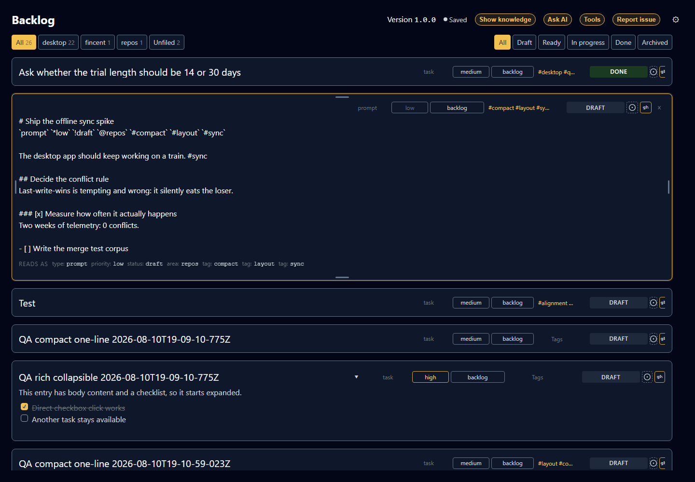
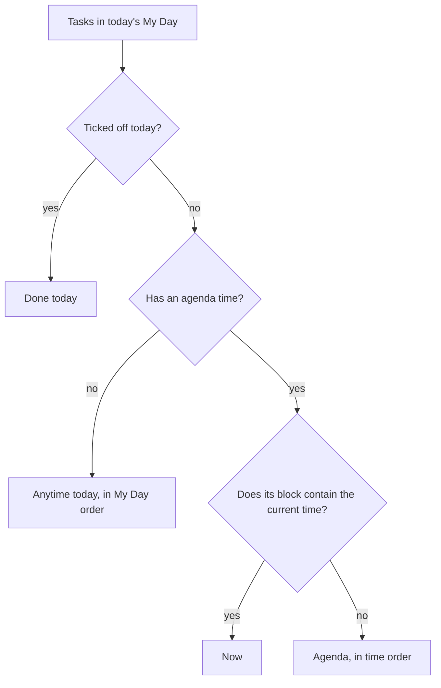

# Tasks

```meta
type: features
status: draft
```

> Features and sub-features this bounded context supports, described in
> business/ubiquitous language rather than implementation terms.

## Task creation

```meta
type: feature
status: draft
feature-flag: .devbook/domain/tasks/context.md#task-backlog
related: [.devbook/domain/inbox/features.md#routing]
```

Create tasks manually or from triaged inbox items, capturing title, body, type
(prompt, task, idea, test), tags, and project/repo link. New tasks default
to `draft`.

## Refinement and prioritization

```meta
type: feature
status: draft
depends-on: [.devbook/domain/tasks/features.md#task-creation]
```

Edit and enrich tasks over time: set priority and status, add context links,
and flag oversized items with suggested splits. On the desktop a person edits the
task's Markdown content directly. They can also adjust type, priority,
repository, status, and metadata tags from the reading layout.

The task's repository picker lists **Brain** first, set off from the
repositories. Picking it clears the task's repository: Brain is the name the app
gives to filing a task against no repository (local ADR 0027).

Expanded tasks open into an inline Markdown editor for the full task body.
Compact tasks can stay on one line when they only need metadata-level
refinement.



### Filing a task against a roadmap tag

```meta
type: sub-feature
status: draft
related: [.devbook/domain/roadmap/domain.md#roadmap-tag, .devbook/domain/tasks/features.md#search-filter-and-organize]
```

Choose a task's tags from a picker that offers every
[Roadmap Item](../roadmap/domain.md#roadmap-item) tag alongside the tags already
in use. A person files a task against planned work by picking the plan's own
vocabulary rather than retyping it. The tag then matches exactly, which is what
lets the roadmap gather the task back under that tag later.

The picker offers **every** roadmap tag, including ones no task has used yet, so
a task can be filed against planned work before anything else has been. That is
the point of borrowing the vocabulary rather than inventing a parallel one. The
tag a person picks here is the same slug the roadmap item holds. It keeps
matching because the roadmap tag does not change when the item's title is
renamed. Tags remain free-form strings on the task, and nothing forces a tag to
come from the roadmap. The ones that do come from it line up on both sides on
purpose.

The picker offers each roadmap tag wearing its plan sigil, `+release-q4`, so a
reader can tell at a glance which tags file the task against planned work. The
[Roadmap Tag](domain.md#roadmap-tag) term says how the sigil reads and how the
roadmap matches it.

### Sub-items and steps

```meta
type: sub-feature
status: draft
related: [.devbook/domain/tasks/requirements.md#sub-items-and-steps]
```

Break a task into ordered sub-items with a title, a status (pending or done),
and notes. A person toggles a sub-item between open and done from the rendered
task, and can reorder, add and remove sub-items independently. The parent shows
its progress, such as 3/5 done. Sub-items can project to GitHub issue task lists.

A step is a [Sub-Item](domain.md#sub-item); that chapter says what a step
carries and what stays on the task.

### Attached material

```meta
type: sub-feature
status: draft
related: [.devbook/domain/tasks/domain.md#attachment]
```

Point a task at the folder or archive where its material is kept, such as the
review pack, the screenshots, or the exported data. Take the pointer off again
when it is no longer needed. The task says which place and what it is called,
and whether that place is a folder or an archive.

The [Attachment](domain.md#attachment) chapter owns the rules: one place per
task rather than a list, and a pointer rather than a copy. Task attachments are
machine-local (local ADR 0014), so a path is meaningful on the machine that wrote
it. A task read somewhere else may name a place that is not there, and the task
is no less valid for it. How much is in the place is not recorded, only where it
is.

### Acceptance from scenario parts

```meta
type: sub-feature
status: draft
related: [.devbook/domain/devbook/features.md#rendered-devbook-documents, .devbook/domain/sessions/features.md#scenario-evidence-from-a-verify-stage]
tests: [unit:dotnet:Backlog.UI.Components.UnitTests.ScenarioPartChecklistTests, unit:dotnet:Backlog.Desktop.UI.UnitTests.EntryDevbookReferencesTests.Scenario_parts_are_an_acceptance_checklist_with_how_many_pass, unit:dotnet:Backlog.Desktop.UI.UnitTests.EntryDevbookReferencesTests.A_failed_part_names_the_step_its_run_stopped_on, unit:dotnet:Backlog.Infrastructure.Devbook.UnitTests.DevbookReferenceResolverTests.A_failed_part_carries_the_step_its_run_stopped_on, unit:dotnet:Backlog.Infrastructure.Mcp.UnitTests.DevbookReferenceToolsTests.Listing_answers_every_part_state_and_the_failed_step, e2e:dotnet:Backlog.EndToEndTests.ScenarioEvidenceTests.A_task_referencing_the_parts_shows_the_acceptance_checklist]
```

A task can point at the parts of a journey that prove it. A journey is one
end-to-end walk, a `##` chapter of a context's scenarios file in the repository's
devbook, and each of its `###` parts is an outcome the journey reaches. The task
points at a part as `<scenarios file>#<part>`, the way it points at any chapter. It
can also point at a journey, or at the whole scenarios file, which stand for every
part they hold. A requirement stands for the parts its `Proved by:` lines name. A
part reached two ways counts once.

The open task lists these parts under its Devbook references as an acceptance
checklist headed "Acceptance · scenario parts". Each row shows the part's dot and the
part. A quieter line under it names the journey by its anchor, which also names the
run folder, and says when the journey last ran, as
"place-an-order · 14 Oct 2026 09:30". A part that never ran says "Never run" there
instead. A failed part whose run recorded the step it stopped on adds that step, as
"· step 2". The list says how many parts pass and whether that proves the task, as
"2 of 3 passing · not proved" or "3 of 3 passing · proved". A part reads as passed
only when its last run passed on the journey as it stands now. A part that passed
before the journey was edited is stale, because the run proved a different journey.
A stale part shows no step, because the step numbers an older text of the journey.

Pressing a part opens its scenarios file in the Devbook pane at that part. The part is
marked as the one asked for and scrolled into view, and it stays marked until the
reader picks another chapter or opens another reference. Pressing the same part again
scrolls to it again. A part the file no longer has opens the file and marks nothing.

When every part passes, the task says it is proved. Being proved is a signal and
nothing more: the task keeps its status until a person moves it. A green run is
evidence for deciding that the work is done, and the decision stays with the person.

A task's own text can show a scenario screenshot. An image written
`scenario:<scenarios file>#<label>` in the text a task opens with, or in a step's note, shows
the capture from the journey's last run with its source line, exactly as a chapter
shows it ([Rendered devbook documents](../devbook/features.md#rendered-devbook-documents)).
It is resolved against the repository the task's Devbook references open in. Any
other image in a task shows as it always has.

The same answer reaches a coding session. Listing a task's Devbook references gives
each part with its state and last run, the step a failed part stopped on, and a count
with whether the task is proved.

## Bulk editing

```meta
type: feature
status: draft
depends-on: [.devbook/domain/tasks/features.md#refinement-and-prioritization]
related: [.devbook/domain/tasks/features.md#search-filter-and-organize, .devbook/domain/tasks/features.md#my-day, .devbook/domain/tasks/features.md#recurring-tasks, .devbook/domain/tasks/features.md#multi-repo-targeting]
```

Select several tasks in the current view and set one field across all of them
at once, so a decision that applies to a batch is recorded once instead of
task by task. The selection is made in the list itself and carries a running
count of how many tasks it holds.

| Field | Set | Add | Withdraw | Clear |
|---|---|---|---|---|
| Repo | Yes, replacing whatever repos each task targeted | | | |
| Status, type, priority | Yes | | | |
| Tags | | The chosen tags, to every selected task | One named tag, from every selected task | |
| My Day, reminder, due date | Yes | | | Yes |

Tags are the one field a bulk change does not replace: each task's remaining tags
stay untouched. Status, type, and priority always hold a value, so they can only
be set.

A bulk change reaches only the field being set. Every other field on every
selected task keeps the value it had, and a task already holding the target
value is left alone and counted as unchanged rather than rewritten.

The outcome is reported as a count of the tasks that changed. A task that
cannot be saved is reported alongside that count rather than abandoning the
rest of the batch, so a batch that only partly succeeds says so.

Marking a batch done spawns a successor for each recurring task it holds, on
the same terms as completing those tasks one at a time.

A selected task that leaves the current view leaves the selection with it. That
happens when a filter changes, or when the change itself moves the task out.

The selection can also be deleted as a whole. The act is offered beside the
field changes, names how many tasks it will take, and applies as directly as
deleting one task does. The outcome is reported on the same terms as a field
change, so a task the store refuses is counted rather than the batch abandoned.
Deleting everything selected empties the selection.

## Effort registration

```meta
type: feature
status: draft
depends-on: [.devbook/domain/tasks/features.md#refinement-and-prioritization]
related: [.devbook/domain/tasks/domain.md#task, .devbook/domain/roadmap/features.md#gathering-work-under-an-item-and-totalling-its-effort]
```

Record a task's [Effort](domain.md#effort), so the size of the work is a fact
about the task rather than a guess made every time someone reads the plan it sits
under. A task with none is simply not estimated, and that is a normal state rather
than a gap to be nagged about. A re-estimate happens when the *understanding of
the size* changes, not when time passes.

An AI assistant may derive the estimate from the task's own content, and a person
can always set or correct it by hand. The deriving is not built yet. This feature
makes the value **registrable and visible**, which is what has to exist before
anything can total it. When a roadmap item gathers this task, the points
registered here are what it
[adds up](../roadmap/features.md#gathering-work-under-an-item-and-totalling-its-effort).
A task left unestimated is counted as unestimated there, never silently as zero.

## Open-work report

```meta
type: feature
status: draft
depends-on: [.devbook/domain/tasks/features.md#effort-registration]
related: [.devbook/domain/roadmap/features.md#gathering-work-under-an-item-and-totalling-its-effort, .devbook/domain/tasks/features.md#task-dependencies]
```

Say how much work is open, not only how it splits. The filter chips each count
a slice. The total sits at the end of the filter bar as one line: how many tasks
are open, the points they carry, and how many carry none. It counts what the
repository scope leaves in view, before any status, tag or other filter narrows
the list. Pressing a filter therefore changes what is shown and never the total.
Open means not ticked off. The points follow the
[effort total's rule](../roadmap/features.md#gathering-work-under-an-item-and-totalling-its-effort):
zero is an estimate, and the unestimated count is said beside the sum rather
than folded into it.

The line is also the way into a report of that same open work. The report has
these sections:

- The headline numbers, and what was ticked off in the last seven days, as tasks
  and as points under the same rule.
- Each plan's open tasks, points and progress, with the work filed under no plan
  as its own line.
- How the open work splits by status, priority, type and repository.
- What needs attention: the tasks overdue and due within the week, each named
  and opening from the report, and how many tasks are waiting and what they
  weigh.

Waiting work is totalled rather than listed, because each row in the pane
already names [what it waits on](#task-dependencies).

## Scheduling and recurrence

```meta
type: feature
status: proposed
depends-on: [.devbook/domain/tasks/features.md#refinement-and-prioritization]
related: [.devbook/domain/tasks/domain.md#task]
```

Say when a task is due, when to be reminded of it, and whether it comes back.
Three separate facts rather than one: a deadline, an alarm, and a shape. A
backlog that could only say "Friday" could not distinguish the task that is due
that day from the one that should interrupt you that morning.

All three are optional and none of them changes the task lifecycle. A task
with a due date in the past is overdue, which is read by comparison rather than
recorded as a status, so nothing has to sweep the backlog to keep status honest.

The scheduling fields are written on the task's metadata line as named tokens,
such as `due:2026-08-21`, `remind:2026-08-21T09:00` and `repeat:weekly`. They sit
alongside the sigil tokens for type, priority, status, area and tags. They are
named rather than sigil-prefixed because the punctuation namespace is nearly
exhausted. Five one-character marks for five date-shaped concepts would be
unreadable in a file people hand-edit.

### Due dates

```meta
type: sub-feature
status: proposed
```

Commit a task to a calendar day, its [Due Date](domain.md#due-date). How that
date is said on screen belongs to the channel showing it, not to the task. It may
read "Today", "Friday, 21 August", or a localized format.

### Reminders

```meta
type: sub-feature
status: proposed
```

Ask to be reminded of a task at a chosen local date and time, its
[Reminder](domain.md#reminder). One whose time has passed reads as overdue until
it is cleared or the task is completed. A reminder that came due while the app
was closed therefore surfaces rather than being silently missed.

### Recurring tasks

```meta
type: sub-feature
status: proposed
related: [.devbook/domain/tasks/domain.md#occurrence-spawning, .devbook/domain/tasks/features.md#archive-and-lifecycle, .devbook/domain/tasks/requirements.md#recurring-tasks]
```

Repeat a task on a schedule: every day, every week, every month, every year,
optionally restricted to particular weekdays so "every weekday" is expressible.
The repeat is anchored to the due date rather than to when the work actually
finished, so a task completed three days late still falls due on its original
weekday.

Ticking a recurring task off, which is what [Completed](domain.md#completed)
means, leaves it completed and creates the next occurrence as a new task. The
finished occurrence stays as the record of what was done rather than being
rolled forward and overwritten. A repeating task therefore accumulates one
completed task per occurrence, and archiving keeps those out of the default
views. [Occurrence Spawning](domain.md#occurrence-spawning) says what the new
occurrence carries over.

## My Day

```meta
type: feature
status: proposed
depends-on: [.devbook/domain/tasks/features.md#refinement-and-prioritization]
setting: .devbook/domain/tasks/context.md#clear-my-day-overnight
related: [.devbook/domain/tasks/features.md#scheduling-and-recurrence, .devbook/domain/tasks/domain.md#agenda-time, .devbook/domain/tasks/domain.md#my-day, .devbook/arc42/06-runtime-view.md#mobile-my-day-and-task-push, .devbook/design/content-editing.md#scheduling-and-dependency-tokens, .devbook/domain/tasks/requirements.md#my-day, .devbook/arc42/adr/0032-my-day-preferences-ride-the-task-feed.md]
```

Pick the tasks to work on today, separately from when they are due: a task
due next Friday can be in today's [My Day](domain.md#my-day), and a task due
today need not be.

My Day expires on its own unless the person turns
[Clear My Day overnight](context.md#clear-my-day-overnight) off. With it on,
the default, yesterday's list clears itself without a timer, a timezone rule or
an overnight sweep. A device that was switched off for a week comes back to an
empty My Day rather than a stale one.

With it off, an unfinished task picked on an earlier day stays in today's My Day
until the person ticks it off or takes it out. A task ticked off today stays,
ticked, until the day ends. One ticked off on an earlier day is gone, and a task
moved to tomorrow never shows today. The person sets the switch on the desktop,
and every paired device follows it, the phone included.

A task in today's My Day may also carry an [Agenda Time](domain.md#agenda-time):
a start time and a duration that place it in the day, such as 10:45 for 45
minutes. The agenda time is set and cleared on the desktop only. It means
nothing without a My Day date, and it is dropped when the task leaves My Day. A
task carried over from an earlier day shows no agenda time, because its slot
belonged to the day it was picked for.

On the desktop, the agenda time sits in the task's detail pane directly under
the My Day control, and only while the task is picked for today. A start is
picked in 15-minute steps and a duration from 15, 30, 45, 60, 90 or 120
minutes. A start picked alone means 30 minutes. Changing the start keeps the
duration, and changing the duration keeps the start. Clearing removes the agenda
time and leaves the task in My Day. A start or duration typed into the text off
those steps is kept and shown as it is. The task row shows the block from start
to end beside My Day, such as `10:45–11:30`.

On the phone, My Day is the Today tab, the first of the phone's three tabs
(Today, Inbox, Notes) and the screen the app opens on. Under the phone's own
date it says how many of the day's tasks are ticked off, as `3 of 8 done` with
a bar. It shows My Day for the phone's own date, never a due-date grouping, and splits that list into four groups:



**Now** holds the timed task whose block contains the current time. It shows as
a card at the top labelled `Now · until 11:30`. The card carries the task's first
open step, a bar of its steps, and the ways into Focus and the task's own page.
Between blocks the card shows the next timed task to start instead, labelled
`Next · 14:00`. With no timed task still to come there is no card.

- **Agenda** holds the other open timed tasks in time order, each showing its
  block as `10:45–11:30`.
- **Anytime today** holds the open tasks without an agenda time, in the order My
  Day keeps them.
- **Done today** holds the tasks ticked off today.

Every row ticks its task off or back on, and opens the task's own page.

The task's own page shows, from top to bottom:

- a way back to Today, and the title;
- chips for the task's area, its block as `Today · 10:45–11:30` when it has an
  agenda time today, and its effort as `3 points`;
- **Focus on this**, when the task has an agenda time today;
- the task's steps as a checklist headed by how many are done, as `2 of 5`;
- the task's own text, read-only;
- **Move to tomorrow** and **Mark done**, which both return to Today.

The steps, Move to tomorrow and Mark done change a task only while it is in
today's My Day and not yet ticked off. Any other task is shown with its steps
locked and without the two buttons or Focus.

**Focus** exists only for a task with an agenda time today that is not yet
ticked off. Opening Focus for any other task opens the task's own page instead.
Focus shows the task's area and when its block ends, as `Sync · until 11:30`,
and the title. A ring counts down to the end of the block every second, as
`28:40` left in this block. Once the block has ended it reads how far over it
is, as `Over by 03:12`. The countdown is the block itself, so there is no pause.

Below the ring sits the current step, the first one not ticked off, as
`Step 2 of 5 · now`, then the steps in order. **Step done — next** ticks off the
current step. When no step is left it becomes **Complete task**, which ticks off
the task and returns to Today. **Capture a thought** opens the capture sheet over
Focus. Saving the thought, cancelling, or tapping outside the sheet comes back to
Focus.

The phone reads everything about a task. It changes four things and nothing
else:

| On the phone | What it writes |
| --- | --- |
| Add a task | A new task picked for today, because adding it to Today is the decision My Day records. The Today screen adds through its capture button rather than a field of its own. |
| Mark a task done or undone | The task's tick, the way the desktop's checkbox writes it. See [Completed](domain.md#completed). |
| Tick or untick a step | The status of one [Sub-Item](domain.md#sub-item). |
| Move a task to tomorrow | `myday:` set to the phone's local date plus one day. |

The last three apply only to a task in today's My Day. Editing, scheduling, the
agenda time and the rest of a task's life stay on the desktop. How the phone
delivers each change is
`.devbook/arc42/06-runtime-view.md#mobile-my-day-and-task-push`.

## Task dependencies

```meta
type: feature
status: proposed
depends-on: [.devbook/domain/tasks/features.md#refinement-and-prioritization]
related: [.devbook/domain/tasks/domain.md#task, .devbook/domain/tasks/features.md#manual-ordering]
```

Record that a task waits on other tasks, so a set of prompts or tasks meant
to be worked in order says so instead of relying on the reader remembering.
A task can wait on several others: needing two things finished before it can
start is ordinary, and asking which of the two is the real predecessor has no
answer.

This is a different fact from manual ordering. Ordering is the sequence a person
arranged the backlog in; a dependency is a constraint that holds whatever order
the list happens to be shown in.

### Readiness and chain order

```meta
type: sub-feature
status: proposed
```

Read off what can actually be started, as each task's
[Readiness](domain.md#readiness). A blocked task says what it is waiting for
rather than only that it cannot proceed. Finishing one task unblocks its
dependents with nothing to recalculate or keep in sync.

Two questions get separate answers because they are separate questions: which
task to pick up first, and which tasks could be started now. In a straight chain
those are the same task. When finishing one step unblocks three, they are not. A
view that answered only the first would leave the other two to be noticed by
their waiting lines disappearing.

[A dependency naming a task that cannot be found still blocks](domain.invariants.md#invariant-a-dependency-naming-no-task-still-blocks),
and [dependency loops are named rather than broken](domain.invariants.md#invariant-every-task-in-a-dependency-loop-reads-blocked);
[Dependency](domain.md#dependency) says why.

### Marking a task blocked

```meta
type: sub-feature
status: draft
related: [.devbook/domain/progress/features.md#raising-an-impediment-from-a-blocked-task, .devbook/arc42/adr/0035-goals-and-impediments-replace-sprints.md]
```

Mark a task blocked by hand when something outside the backlog holds it up. This is
a different fact from Readiness, which reads blocked from `depends_on`. The mark is the
`blocked:` token on the task's metadata line, with the day it was set, and an agent
sets or clears it with the `set_blocked` tool. Removing the token unblocks the task.

Marking a task blocked
[raises a New impediment that holds it back](../progress/features.md#raising-an-impediment-from-a-blocked-task),
unless an open impediment already holds it back. Progress reacts to the mark. The task
stores no impediment id, and Tasks never calls Progress.

## Multi-repo targeting

```meta
type: feature
status: draft
depends-on: [.devbook/domain/tasks/features.md#task-creation]
related: [.devbook/domain/tasks/features.md#projection]
```

Let one logical task target multiple repositories (`repo_ids[]`) while remaining
a single source of truth: one item, one priority, one status. The person sees it
in one view across all contexts.

## Projection

```meta
type: feature
status: draft
depends-on: [.devbook/domain/tasks/features.md#multi-repo-targeting]
related: [.devbook/domain/monitoring/features.md#tasks-and-github-progress, .devbook/domain/tasks/requirements.md#projection]
```

Spawn and close downstream artifacts from a task, without duplicating the task.
What ships is the issue push below, made when the person asks. The
automatic create-and-close is the intended [Projection](domain.md#projection)
policy, and what it will promise is in
[its requirements](requirements.md#projection).

### Issue projection and state read-back

```meta
type: sub-feature
status: draft
feature-flag: .devbook/domain/tasks/context.md#github-integration
related: [.devbook/domain/repository-management/features.md#github-access-resolution, .devbook/domain/monitoring/features.md#tasks-and-github-progress]
```

Push a task to its target repository as an issue carrying the task's title,
body, and tags. The resulting issue reference is kept on the task, so the link
is part of the item rather than a note about it. The task can then be asked to
re-read that issue's current state, and the pull request that references it.
Downstream progress is then visible from the backlog.

The pull requests a task records are also checked in the background, so a
merge turns its link green without the person asking. The check reads each
repository once rather than each pull request in list order, and puts every
merged and closed answer on screen before the open pull requests are read one
by one for their checks and merge offer. A pull request still open, or one
that could not be read, is asked about again after two minutes.

A merged or closed state is remembered on this device, beside the other
activity caches (`IPullRequestStateMemory`), so the backlog still opens
instantly and offline and draws a finished link from the first frame. It is
never written to the task: the task keeps only the link, and losing the
memory costs one read per pull request. An open pull request's status is never
remembered, because a stale one would offer a merge GitHub no longer allows.

A prompt entry moves to Done when its pull request merges into the
repository's default branch or a `plan/` branch — once per entry and merge,
and only where its lifecycle allows the move. A task or test entry stays the
person's to tick.

## Linked tasks

```meta
type: feature
status: proposed
related: [.devbook/domain/tasks/domain.md#linked-task, .devbook/domain/tasks/domain.md#connected-target, .devbook/domain/tasks/requirements.md#linked-tasks, .devbook/arc42/adr/0020-external-items-arrive-as-linked-tasks.md, .devbook/domain/repository-management/requirements.md#archiving-a-repository]
```

Connect a GitHub repository or a spec-manager product, and every open item in it
appears on the Tasks list as a [Linked Task](domain.md#linked-task). The item
needs no triage and no copying. Each sync keeps the title, status and assignee
in step with the source on the terms
[its requirements](requirements.md#linked-tasks) set, and leaves the person's
own priority, My Day, area, sub-items and notes alone.

Every linked task shows a source badge on its row, in the editor header and in
My Day, and the badge opens the item at the source. The Tasks pane filters by
source. It has no filter on the assignee: "Assigned to me" was removed, though
each sync still keeps the assignee. A label written `+slug` at the source files the
task under that plan. It then appears on the roadmap's
[shelf](../roadmap/features.md#laying-out-a-plan-whose-tasks-arrived-first)
without a step in Backlog.

Settings → Connectors shows each [Connected Target](domain.md#connected-target)
with two settings that decide where its tasks land:

- **Repository** picks one of the repositories in the
  [Repository Registry](../repository-management/domain.md#repository-registry).
  The target's new tasks, and its tasks not yet filed under a repository, are
  filed under it. A spec-manager product's tasks can then sit under the
  repository the product is built in. Left empty, a GitHub repository files its
  tasks under itself.
- **Statuses** has one row for each status the source lists, in the source's
  order, each with a task status to pick. The empty choice keeps the status the
  fixed map gives and names it, such as "Default (In progress)". A
  spec-manager product lists its own statuses. A GitHub repository lists none,
  so it shows no rows.

A changed status applies to new tasks at once, and to an existing task when its
item next moves at the source.

The card also holds the target's other settings: how old an untouched item may
be before the first sync skips it, whether the title follows the source, the
sync interval, and "Complete at the source" for a connector that can complete
items. A connector that can list its targets offers them to pick by name, so a
spec-manager product is picked rather than typed.

### Syncing a target

```meta
type: sub-feature
status: proposed
related: [.devbook/domain/tasks/domain.md#connected-target, .devbook/arc42/adr/0020-external-items-arrive-as-linked-tasks.md]
```

The desktop syncs each enabled target on its own timer, every fifteen minutes
unless the target sets another interval. **Sync now** on the target's card in
Settings → Connectors runs one at once and says on the card how it went. The
Tasks pane has no sync button.

A sync that fails writes nothing, and the card shows why in a sentence the
person can act on, with when it happened. The next sync still asks for what
changed since the last one that succeeded, and its success clears the message.
Each successful sync writes one line to the log with how many items it fetched,
created, updated and archived.

A spec-manager product is read whole on every sync: the open backlog has no
"changed since" question, so only its archived items are asked for by date.

### Deleting the tasks of a disconnected source

```meta
type: sub-feature
status: proposed
related: [.devbook/domain/tasks/domain.md#connected-target, .devbook/domain/tasks/domain.md#tombstone, .devbook/domain/tasks/requirements.md#requirement-reconnecting-a-target-restores-the-tasks-deleted-with-it, .devbook/domain/tasks/requirements.md#requirement-a-deleted-linked-task-is-never-made-again, .devbook/arc42/adr/0020-external-items-arrive-as-linked-tasks.md]
```

Disconnecting a target keeps its tasks on the list as they are. Settings →
Connectors lists each source that left tasks behind under **Disconnected
sources**, with how many tasks it left. **Delete tasks** asks first and then
makes every one of them a [Tombstone](domain.md#tombstone), whatever its status.
Each tombstone is marked as deleted with its source.

The confirmation says that the items at the source stay untouched and that the
deletion reaches the other devices. It also says that connecting the target
again brings the tasks back, and how many other tasks will wait on a missing
one. A source connected again before the delete runs is refused, because its
tasks belong to the sync again.

When the target is connected again, its next sync restores each deleted task
whose item it fetches and brings it up to date from the source. A first sync
fetches open items only, so a task whose item has closed since stays deleted
until the person restores it. A task deleted on its own is never brought back
by the sync.

### Restoring deleted tasks

```meta
type: sub-feature
status: proposed
related: [.devbook/domain/tasks/domain.md#connected-target, .devbook/domain/tasks/domain.md#tombstone, .devbook/domain/tasks/requirements.md#requirement-restore-deleted-tasks-restores-every-deleted-task-of-the-target, .devbook/arc42/adr/0020-external-items-arrive-as-linked-tasks.md]
```

A connected target whose linked tasks include deleted ones shows **Restore
deleted tasks** on its card in Settings → Connectors. The confirmation names
how many tasks come back and says that the tasks deleted one by one are among
them. Confirming restores every deleted task of that target and no other, and
the restore reaches the other devices. The next sync brings each task up to
date with its source. A target disconnected before the person confirms is
refused, and nothing is restored.

### Promote to plan

```meta
type: sub-feature
status: deprecated
related: [.devbook/domain/roadmap/domain.md#roadmap-item, .devbook/arc42/adr/0020-external-items-arrive-as-linked-tasks.md]
```

Dropped and never built. It was to turn one linked task that stands for a body
of work into a Roadmap Item, with its steps taken from the issue's sub-issues,
its checklist or a generated plan. The owner decided against it, and the
target setting for what happened to the original task was removed. A linked
task reaches the roadmap only through its [plan label](../roadmap/domain.md#source-label),
and [a sync never creates a Roadmap Item](requirements.md#requirement-a-sync-never-creates-a-roadmap-item).

## Search, filter and organize

```meta
type: feature
status: draft
related: [.devbook/domain/devbook/features.md#bi-directional-linking, .devbook/arc42/adr/0022-the-shell-shows-one-main-view-picked-by-a-view-switch.md, .devbook/design/interaction-guidelines.md#shell-header, .devbook/arc42/adr/0027-the-brain-is-a-scope-beside-the-repositories.md, .devbook/domain/devbook/features.md#brain-scope, .devbook/domain/repository-management/requirements.md#archiving-a-repository]
tests: [unit:dotnet:Backlog.Desktop.UI.UnitTests.HomeWorkspaceSurfaceTests.The_board_view_lays_the_tasks_out_in_columns_under_the_filter_bar_and_is_remembered_with_its_columns, unit:dotnet:Backlog.Desktop.UI.UnitTests.HomeWorkspaceSurfaceTests.The_calendar_view_lays_the_tasks_out_on_a_month_under_the_filter_bar_and_is_remembered, unit:dotnet:Backlog.Desktop.UI.UnitTests.HomeWorkspaceSurfaceTests.The_view_is_remembered_and_a_fresh_shell_instance_reopens_on_it, unit:dotnet:Backlog.Desktop.UI.UnitTests.HomeRepositoryScopeTests.A_remembered_scope_comes_back_anchor_first_with_the_devbook_option_offered, unit:dotnet:Backlog.Desktop.UI.UnitTests.HomeRepositoryScopeTests.A_remembered_repository_no_longer_configured_is_dropped, unit:dotnet:Backlog.Desktop.UI.UnitTests.HomeRepositoryScopeTests.A_remembered_plural_scope_restored_onto_the_roadmap_collapses_to_the_anchor, unit:dotnet:Backlog.Desktop.UI.UnitTests.HomeRepositoryScopeTests.A_scope_change_is_remembered_and_every_repository_writes_no_key, unit:dotnet:Backlog.Desktop.UI.UnitTests.TagFilterTests.A_pressed_plan_can_be_copied_as_its_tag, unit:dotnet:Backlog.Desktop.UI.UnitTests.TagFilterTests.No_plan_and_general_tags_offer_no_plan_to_copy, unit:dotnet:Backlog.Desktop.UI.UnitTests.TagFilterTests.Pressing_a_plan_further_along_the_strip_leads_it_with_its_copy, unit:dotnet:Backlog.Desktop.UI.UnitTests.TagFilterTests.A_plan_press_hands_the_focus_back_to_the_moved_chip]
```

Find and narrow the backlog:

- Search across title, body, tags, and linked knowledge notes.
- Filter by [Area](domain.md#area), repo, type, status, priority, and recency.
- Read the tasks in grouped views, with Devbook content embedded inline.

The repository scope can hold several repositories at once while a screen that
can show several is in front of the reader. Those screens are the task views, In
progress, the Dashboard, the session list and the pull requests list. The scope
narrows back to one on the roadmap and on Tools, which read one repository or
none.

The scope leads with a permanent **Brain** chip, the
[Brain scope](../devbook/features.md#brain-scope): Brain is the scope of
everything filed against no repository.

- Pressed alone, it shows only the tasks with no repository, in every view that
  reads the scope.
- Ctrl adds it to the repositories already pressed, as it adds a repository.
- Nothing pressed still means every task.

The filter bar carries no separate chip for tasks with no repository; Brain is
the one way to narrow to them (local ADR 0027).

The repository scope is remembered on this device in the order it was chosen.
The app reopens on the same repositories with the first one chosen still first,
and with Brain in its place when it was pressed. The Devbook is then offered on
them straight away, with no chip to press. A repository that is no longer
configured is dropped when the scope comes back, and a scope with none left is
every repository. The scope is remembered as it stands after any narrowing, so a
scope narrowed back to one comes back as that one. Where an
[archived repository](../repository-management/domain.md#archived-repository)
appears in the scope, the Board and the pickers is set by
[its requirements](../repository-management/requirements.md#archiving-a-repository).

The filtered tasks can be read three ways, picked in the header's view switch:
**Tasks**, the list with the open task beside it; the
[Board](#board-view); and the [Calendar](#calendar-view). The three share one
filter bar, one open task and one selection. Switching between them therefore
never loses what the reader narrowed to or was looking at.

Among the filters is the [Task Type](domain.md#task-type): prompt, task, idea or
test, one at a time. The Board and the Calendar, including its tray of tasks with
no due date, narrow by type the way the list does. The filter bar belongs to
these three and to nothing else in the shell. The app reopens on the view last
chosen, and on Tasks when nothing was remembered. The Inbox and the Devbook open
beside any of them.

The tags on the filter bar sit in one strip, one row high, and the strip shows a
**More** toggle only while its tags overflow that row. A pressed
[plan](../roadmap/domain.md#roadmap-tag) leads the strip, whether the reader
pressed it on the bar or arrived with it pressed from the roadmap. The plan
carries a copy button fused to its chip, which copies the plan tag verbatim,
`+` and all, so the reader can paste the plan's name elsewhere. With the
[`session-requests`](../sessions/context.md#session-requests) flag on, the plan's
[queue icon](../sessions/features.md#start-a-session-from-an-entry) follows the
copy, and the waiting chip takes its place while a request is open. **No plan** and
the general tags offer no copy, and a plan offers none once it is let go. When
the reader presses a plan further along the strip, the plan moves to the front
with its copy, and the focus stays on the moved chip.

### Manual ordering

```meta
type: sub-feature
status: draft
related: [.devbook/domain/tasks/requirements.md#manual-ordering]
```

Hand-sequence tasks within the backlog by dragging them into a preferred
order, independent of recency or priority. Where a task nobody ranked lands is
[a requirement](requirements.md#requirement-unranked-tasks-fall-back-to-recency).

### Board view

```meta
type: sub-feature
status: draft
related: [.devbook/domain/tasks/flow.md#task-lifecycle, .devbook/domain/tasks/domain.md#effort, .devbook/domain/tasks/domain.md#roadmap-tag, .devbook/domain/repository-management/requirements.md#archiving-a-repository]
tests: [unit:dotnet:Backlog.Desktop.UI.UnitTests.TasksPaneBoardTests.Columns_by_plan_leave_out_finished_work_and_a_plan_with_nothing_left_has_no_column]
```

The same filtered tasks laid out as columns of cards, under the same filters
and beside the same open task. The columns can be:

- by status, the default: Draft, Ready, In progress and Done;
- by plan: one per [Roadmap Tag](domain.md#roadmap-tag) with work left in view,
  then the tasks in no plan. Only what is still to do is shown: a ticked-off or
  archived task is no card here, so a plan with nothing left draws no column,
  the way its tag chip leaves ticked-off tasks out of its count;
- by repository, with the tasks filed against no repository in a column titled
  **Brain**, the name the scope gives them;
- by [Priority](domain.md#priority).

Each column says how many tasks it holds, the [Effort](domain.md#effort) they
add up to, and how many of them nobody has estimated. A task under two plans is
in both plan columns. The choice of columns is remembered with the view.

While the columns are by status, the status filter steps aside, since every
status is a column. A task can then be dragged to another column. Only a move
the [task lifecycle](flow.md#task-lifecycle) allows is taken. While a task is
held, the columns it may go to are marked. The others say why not and what has
to happen first: a ready task, for example, has to be started before it can be
done.
Dropping it makes the same status change the task's own status picker makes.
Each status column ends in a way to write a new task straight into that status.
Opening a task from a card opens it as the list would. With the task open beside
it, the board scrolls sideways rather than squeezing its columns.

### Calendar view

```meta
type: sub-feature
status: draft
related: [.devbook/domain/tasks/domain.md#due-date, .devbook/domain/tasks/features.md#my-day, .devbook/domain/roadmap/features.md#laying-out-a-plan-whose-tasks-arrived-first, .devbook/design/interaction-guidelines.md#group-shape-says-cardinality]
tests: [unit:dotnet:Backlog.UI.Components.UnitTests.TaskCalendarTests, unit:dotnet:Backlog.Desktop.UI.UnitTests.HomeWorkspaceSurfaceTests.The_calendar_range_is_remembered_and_a_fresh_shell_reopens_on_it]
```

The same filtered tasks laid out on a month or on a week by their
[Due Date](domain.md#due-date), under the same filters and beside the same open
task. A **Month | Week** choice beside the month's name picks the range. One of
the two is always pressed, and the choice is remembered on this device. The month
runs Monday to Sunday in whole weeks, so its first and last rows reach into the
neighbouring months. Those days are dimmed, and weekends are shaded. Today is
marked and says how many tasks are in [My Day](#my-day).

Each day lists its tasks with where each one is in its lifecycle. An open task
past its due date stands out as overdue, and a finished one is struck through. On
the month, past two a day folds the rest behind a count that opens the whole day.
A recurring task shows on its due date only. The next occurrence is written when
this one is finished, so there is no series to place. The open tasks with no due
date wait beside the calendar. Dragging one onto a day gives it that due date,
and dragging a task to another day moves it. Opening a task from the calendar
opens it as the list would. Only the due date places a task here.

The week shows its seven days, Monday first, as tall columns. Each day there lists
every one of its tasks with nothing folded, and no day is dimmed. The reader
picked the week, so a day of the neighbouring month is part of it. The plans, the
[planned hours](#planned-hours) and the drags work there as they do on the month.
Previous and next step a week at a time and say so. The heading names the week's
days, such as "5 – 11 October 2026".

- Switching to the week opens on the week holding today when today is in the
  month shown, and on the month's first week otherwise.
- Switching back to the month shows the month holding the week's Thursday. A
  week across two months therefore lands in the month that holds most of its
  days.
- Only the range is remembered, never the date shown.

The roadmap's plans can be drawn over the month. A **Show plans** choice beside
the month's name turns them on; it is off until the reader turns it on, and
remembered on this device.

- Each planned item's window is a bar across the days it spans, cut at every
  week, under the day numbers and above the tasks.
- Plans that overlap in a week each take a row of their own. A bar carried on
  from the week before opens with "…".
- A bar says its title, its plan tag and how many of its points are finished out
  of the total.
- A bar wears its repository's colour, as on the roadmap, while repository
  colours are showing, and a neutral grey while they are not.
- A milestone is a diamond on its date.

Beside the tasks with no due date, **Plans without a window** lists the plans
waiting on the roadmap's
[shelf](../roadmap/features.md#laying-out-a-plan-whose-tasks-arrived-first).
Dropping one on a day starts its window there. The roadmap, never the Tasks view,
works out where it ends from its points and the pace, as it places any plan. The
drop is a pointer gesture. The keyboard ways to the same result are on the
roadmap: its shelf's **Plan it** places the plan from today, and its item editor
moves the window to any day. The plans are the roadmap's. The Calendar reads them
and starts a shelf plan, and changes nothing else about them.

### Planned hours

```meta
type: sub-feature
status: draft
related: [.devbook/domain/tasks/domain.md#planned-hours, .devbook/domain/tasks/features.md#calendar-view, .devbook/domain/roadmap/features.md, .devbook/design/interaction-guidelines.md#combobox]
tests: [unit:dotnet:Backlog.UI.Components.UnitTests.TaskCalendarHoursTests, unit:dotnet:Backlog.UI.Components.UnitTests.PlannedHoursEditorTests, unit:dotnet:Backlog.UI.Components.UnitTests.CalendarHoursTests]
```

The person can set [Planned Hours](domain.md#planned-hours) aside for a task on
a day of the [Calendar](#calendar-view). A day shows each task with hours on it
as a chip of its own with the figure, such as "Refactor sync · 3h", drawn apart
from the due-date chips. The day adds its hours up against the hours the person
works that day, read from the roadmap's working week and days off. A day holding
more than that is marked, and says by how much.

Hours are set in either of two ways:

- From a day's **Add hours…**, which asks for the task and the figure.
- By dragging a task onto a day with Shift held, from the month or from the
  tasks with no due date. This asks for the figure only and leaves the due date
  where it was.

Pressing a task's hours on a day changes or removes them. The open task's
**Planned hours** lists every day it has hours on, to change, remove or add one.
The hours follow the filters and the repository colours the way the task chips do.

The figure is typed, or taken from a short list of suggestions: half an hour, and
1, 2, 3, 4, 6 and 8 hours. A typed figure is rounded to the quarter hour. A figure
that is not a number, is none, or is more than a whole day is refused with a
sentence that says why.

In the open task's **Planned hours**, a refused figure on a day goes back to the
figure that stood. Taking a suggestion for a day there changes that day at once.
A typed figure is kept on Enter or when the field is left. On the line that adds
a day, a suggestion only fills in the figure, and **Add hours** adds the day and
the figure together.

When the day's hours editor closes, the keyboard focus goes back to what opened
it. That is the task's hours on the day, or the day's **Add hours…** when the
editor was opened from there or by a Shift drag. After the hours are removed, the
focus goes to **Add hours…**, since the hours it came from are gone.

The roadmap never reads planned hours. A plan's window and the pace it is placed
at come from points and the work finished, so setting hours aside moves no bar on
the roadmap or the Calendar.

## Prompt features

```meta
type: feature
status: draft
```

Copy a prompt's text to the clipboard in one click. Each copy or use is logged
in the task's usage history, and a person can reopen earlier prompts from that
log.

### Copy as a runnable paste

```meta
type: sub-feature
status: draft
related: [.devbook/domain/tasks/features.md#import, .devbook/domain/tasks/domain.md#task-type]
```

What the copy hands over is a prompt an AI session can run, not a title and
some prose. The copy leads with one line that invokes the
`backlog-tools:run-plan-item` skill on the [Task](domain.md#task), by the id
Backlog itself knows it by. The title and body follow as written.

The metadata line stays behind, because it is the app's bookkeeping and not part
of the brief. The plan a task was [imported](#import) under, the repositories it
targets and the tasks it [waits on](#task-dependencies) are Backlog's to answer
when the session asks by that id. A session that can ask checks whether the task
is still outstanding before doing anything. It tells Backlog when the work is
picked up and when it lands. A session that cannot ask reads a prompt with one
more line on top.

Every [type](domain.md#task-type) is copied this way, a `task` too. The copy says
which entry it is, and the session, not the copy, decides whether to run it.

### Start a session on a prompt

```meta
type: sub-feature
status: draft
feature-flag: .devbook/domain/sessions/context.md#session-requests
related: [.devbook/domain/sessions/features.md#start-a-session-from-an-entry, .devbook/domain/tasks/features.md#multi-repo-targeting]
```

Queue a coding session that runs a prompt, in its repository's clone folder, without
copying it anywhere. The queue icon sits beside the prompt's copy button, on its row and
in the open entry. Pressing it creates a session request in the Sessions context. The
entry shows that it is waiting for a session until the session links itself. The
[Sessions feature](../sessions/features.md#start-a-session-from-an-entry) says who is
offered it and what the waiting chip shows.

### Hand-off to Copilot CLI

```meta
type: sub-feature
status: draft
feature-flag: .devbook/domain/tasks/context.md#copilot-cli
related: [.devbook/domain/productivity/features.md#ai-activity-capture]
```

Hand a task to GitHub Copilot CLI as a task brief without retyping it. The
task's own Markdown is the brief: its title, metadata, body, and sub-items. The
hand-off is recorded in the task's usage history, so the task itself shows that
AI was put to work on it.

## Import

```meta
type: feature
status: proposed
depends-on: [.devbook/domain/tasks/features.md#task-creation, .devbook/domain/tasks/features.md#task-dependencies, .devbook/domain/tasks/features.md#multi-repo-targeting]
related: [.devbook/domain/tasks/features.md#prompt-features, .devbook/domain/tasks/features.md#sub-items-and-steps, .devbook/domain/tasks/features.md#filing-a-task-against-a-roadmap-tag, .devbook/domain/tasks/domain.md#task-type, .devbook/domain/tasks/domain.md#task-status, .devbook/domain/repository-management/features.md#repository-registration, .devbook/domain/inbox/domain.md#triage, .devbook/domain/tasks/requirements.md#import]
```

Bring in a plan that lists a sequence of work across one or more repositories,
in the order its entries depend on each other. Import turns the whole plan into
tasks in one step instead of typing each one in by hand. Most plans
are sequences of AI prompts to run, which is the case Import was written for. A
plan can be brought in as an uploaded file or pasted directly, whichever is
faster in the moment; both read the same plan. Import builds nothing that task
creation does not already offer. It is a faster way of filling the backlog, not
a second way of holding work.

Each entry in the plan becomes one [Task](domain.md#task) of the
[type](domain.md#task-type) the plan states for it. These are the same four types
[task creation](#task-creation) already offers. `prompt` is the common case,
because an AI prompt to run is what a plan mostly holds. An entry that states no
type becomes a plain `task`, the default a hand-typed task gets. One plan can
therefore mix kinds without announcing that it does: the prompts to run, the step
only a person can do, and the thing worth coming back to later. Import reads the
type off the entry rather than deciding for the plan that its entries are all of
a kind.

An entry may also state the [status](domain.md#task-status) it should arrive at.
Where the entry came from decides which status the task is born with:

| The entry | The task is born |
|---|---|
| Was drafted from an inbox item | `draft`, whatever status its text states |
| States a status | At that status, set directly rather than as a lifecycle step |
| States no status | `ready` |

A stated status is reachable whatever it is, the settled ones included. A plan
can therefore record a step finished before the plan was imported, or hold back
one still being shaped as `draft`.

`ready` is the one default Import sets differently from a hand-typed task. A
hand-typed task starts at `draft` because it is being shaped as it is typed. A
plan is work already agreed and written down to be picked up. If every entry
landed at `draft`, somebody would have to promote each one by hand before
[Readiness](domain.md#readiness) showed any of it.

An entry drafted from an inbox item carries that item as its `source_inbox_id`.
The item is the one a plan was drafted from (`sourceInboxId`). For a batch of
items routed together, it is the item the entry's `id:` maps to
(`sourceInboxIds`). A model wrote the entry about captured content, and nobody
has read it yet, so the provenance decides the status and not the text. This
governs birth only: a later version that restates the status of a task already
under way still moves it.

The entry's own instructions become that task's body. The order the plan
declares between entries becomes an ordinary
[task dependency](#task-dependencies) between the tasks import creates. It is
the same relationship a person would have typed by hand. Import resolves the
plan's own local entry references to the real task ids as the tasks are created.
"What's next" for an imported chain reads no differently than for any other: by
[Readiness](domain.md#readiness), grouped by [repository](#multi-repo-targeting).

The plan itself becomes one of the task's tags, filed the same way a task is
[filed against a roadmap tag](#filing-a-task-against-a-roadmap-tag). Everything
one plan brought in can then be found and filtered as a group without a separate
"which plan was this" lookup.

A plan also carries work around a prompt that is not the prompt itself:

- a setup or dependency step the repository needs before the prompt can run,
  such as installing a plugin;
- a reminder to update that repository's devbook;
- a task only a person can do.

None of these is a new kind of thing. They land as ordinary
[sub-items](#sub-items-and-steps) on the task they belong to, ordered ahead of
the entry they gate. Import adds no second vocabulary for what a sub-item
already says. A sub-item created by import is the same thing as one a person
typed by hand.

Every task import creates carries where it came from; see
[Task](domain.md#task). A batch of entries brought in together therefore stays
traceable back to the plan and the specific item that produced each one.

A document may also carry entries that are not tasks at all. An entry whose type
word is `plan` describes the plan itself as a piece of planned work: its title,
its tag, its repositories, what it waits on, and when it is due. Import hands it
to [Roadmap Planning](../roadmap/features.md#laying-out-imported-plans) after the
document's task entries have been written, rather than creating a task from it.

One document may hold `plan` entries and task entries together, or only one
kind. The task entries are created exactly as described above whichever company
they keep. A `plan` entry is the one kind of entry Import will act on that
nothing else in this context will. Pasted anywhere but Import, it is refused
rather than made into a task. The decision, and how the two kinds combine, is
`.devbook/arc42/adr/0013-imported-plan-is-a-roadmap-item-laid-out-by-import.md`.

Before anything is written, Import says what the document will produce: how many
roadmap items and how many tasks. A document of task entries alone can also be
laid out on the roadmap at once, but only when the person asks. It then gets one
item per plan tag its entries carry, titled from the tag and scoped to the
repositories those entries name. This is off by default, because a plan brought
in again for its tasks should not grow an item nobody wanted.

Each level of the document waits only on its own kind. A task entry's `after:`
naming a `plan` entry, or the other way round, is reported as unresolved rather
than kept. The result reports both halves apart, because they do not stand or
fall together. The tasks are written first. A roadmap that refuses its half,
such as a document whose plans wait on each other in a circle, leaves the tasks
written and says so.

### Repository resolution on import

```meta
type: sub-feature
status: proposed
related: [.devbook/domain/repository-management/features.md#repository-registration, .devbook/domain/repository-management/domain.md#repository-registry]
```

Resolve each entry's target repository by the name the plan's author wrote,
against the same [Repository Registry](../repository-management/domain.md#repository-registry)
[multi-repo targeting](#multi-repo-targeting) already resolves `repo_ids`
against. A name the registry already knows resolves to its `repo_id` as
usual. A name the registry has never seen is registered there on the spot,
before the task naming it is created. Import uses Repository Management's
[registration capability](../repository-management/features.md#repository-registration)
for this. A plan can therefore introduce a repository to the product just by
mentioning it, without a separate registration step first.

Import triggers registration; it does not perform it. The repository is
registered with whatever the plan states about it, at minimum its name. What a
registered repository holds and how registration behaves stay Repository
Management's decision. Import gains no authority over them beyond the ability to
ask.

The Import dialog also offers a "Target repository" field for the whole batch.
When it is filled in, it becomes the resolved repository for every entry that
names none of its own. An entry that carries its own `repo:` token keeps it.

### Re-importing an updated plan

```meta
type: sub-feature
status: proposed
related: [.devbook/domain/tasks/domain.md#task, .devbook/domain/tasks/domain.md#task-status]
```

Bring in a later version of a plan already imported once, and have it replace
that plan rather than add to it. What happens to each task the plan produced
depends on its status:

| The task's status | What the re-import does |
|---|---|
| `draft` or `ready`, so nobody has started it | Deletes it, then writes the new version's entry in its place |
| `in_progress` | Keeps it and brings it up to date from the new version |
| `done` or `archived` | Skips the whole entry, a restated status included |

The plan's id is what a task remembers about where it came from. A task carrying
the same tag that came from somewhere else was never part of the plan and is not
touched.

An `in_progress` task takes the new version's instructions, type, dependencies,
target repository, and setup, devbook and manual sub-items. Status is the one
field a later version moves only when it asks to. If the version restates it, the
task moves there. If the version leaves it out, the task keeps whatever progress
it has made since it was imported. A plan that says nothing about where an entry
stands is not asking for work already under way to be sent back to `draft`.

A `done` or `archived` task is left alone the same way finishing a recurring task
leaves that occurrence: as the settled record of what was done, which a later
change does not reopen.

Clearing is by plan rather than by what the new version happens to mention. A
not-yet-started task the plan has stopped describing therefore goes with the
version that described it; that is how a plan drops work nobody began. Each entry
keeps the same id across versions, which is what lets a task already under way or
finished be recognized as the same entry rather than stood beside. An entry id
the plan never carried is created, whichever version introduced it. A task
replaced this way is a new task, so a dependency on it written from outside the
plan stops resolving.

## AI assistance over the visible backlog

```meta
type: feature
status: draft
feature-flag: .devbook/domain/tasks/context.md#ai-assistant
related: [.devbook/domain/devbook/features.md#repository-devbook-areas, .devbook/domain/productivity/features.md#ai-productivity-tracking]
```

Ask questions about the work currently in view and get an answer grounded in it.
The question is answered from the tasks the active filters leave visible plus
the loaded backlog knowledge, not from the entire backlog, so the answer matches
what the person is actually looking at. Entries that were opened but never
edited are left out, and the assembled context is capped so a large backlog
degrades into a partial answer rather than a failure. AI assistance is an opt-in
capability and the product remains fully usable with it switched off.

## Archive and lifecycle

```meta
type: feature
status: draft
related: [.devbook/domain/tasks/flow.md, .devbook/domain/tasks/requirements.md#archive-and-lifecycle]
```

Move tasks between active and archived states; archived tasks are excluded
from default views but always accessible and restorable.

Reopening a `done` task returns it to `in_progress`, whatever status it held
before; the earlier status is deliberately not kept. Finishing the work is a
recorded fact rather than a step that rewinds, so reopening starts the work
again rather than restoring where it stood before. `flow.md` holds the
lifecycle this follows.

Ticking a task off records that it is [Completed](domain.md#completed), a
separate fact from either status; that term says how the two differ. What the
checkbox and the status picker do to the tick and the status is in
[this feature's requirements](requirements.md#archive-and-lifecycle).

A task that moves to in progress is [Started](domain.md#started), shown as
`started:` on its metadata line beside `completed:`. The roadmap reads the two
together to draw a finished plan where its work actually ran. The detail panel
shows the day as a read-only **Started** badge beside the effort, only on a task
that has one. The Board's In progress slot reads "Moves to In progress and
stamps Started" under "Drop to start". It says so only when the task has no
stamp yet, since an earlier one is kept.

## Refresh from shared storage

```meta
type: feature
status: deprecated
related: [.devbook/arc42/06-runtime-view.md#state-sync-and-webhook-forwarding, .devbook/domain/tasks/features.md#multi-device-sync, .devbook/arc42/adr/0005-azure-hosted-task-replica-for-multi-device-sync.md]
```

Deprecated, and removed from the product on 2026-09-16. Superseded by
[Multi-device sync](#multi-device-sync).

This automatically refreshed the backlog when another process or device modified
the shared backlog file, and could be switched off or slowed down in Settings →
Storage. Neither the setting nor the check exists any more.

It was an interim mechanism, and it did not work. It assumed two machines could
share one backlog through a shared folder. That held while a task was its own
Markdown file, and stopped holding when the store became a single binary
database. Pointing the workspace root at a file-sync product produced conflicted
copies of that database and silently reverted committed edits. Polling it more
often did not help: the corruption was in the sharing, not in the staleness.
The check also showed a synced change in the task list without reopening the
app; the sync itself does that now.

## Multi-device sync

```meta
type: feature
status: draft
related: [.devbook/domain/tasks/domain.md#task, .devbook/arc42/08-crosscutting-concepts.md#task-sync, .devbook/arc42/07-deployment-view.md#cloud-deployment-azure, .devbook/arc42/adr/0005-azure-hosted-task-replica-for-multi-device-sync.md, .devbook/domain/tasks/requirements.md#multi-device-sync, .devbook/domain/sync/features.md#syncing-between-devices]
depends-on: [.devbook/domain/tasks/features.md#task-creation]
```

Keep the same backlog on more than one of the person's machines, without either
machine giving up its own copy. Each device reads and writes its own store and
reconciles with the others through the sync service; the cloud carries a replica
of the tasks and never becomes the authority for them.

Working offline is the ordinary case, not a degraded one. Every task can be
created, edited, completed, and deleted with no connectivity. Connectivity only
lets the other machine find out sooner. When it does, the task list shows what
arrived without the app being reopened. The one exception is an entry being
edited: there the change waits until the editing is done rather than replacing
the text under the caret.

When the same task was edited in two places,
[the later edit wins whole](requirements.md#requirement-the-later-edit-wins-whole).
This is deliberate, and it does lose the other edit. Merging field by field would need a
domain rule for reconciling two different priorities or two different statuses,
and the domain has none. What the person sees is one task with one status.

Both halves are built. [Pairing a device](../sync/features.md#pairing-a-device),
in the [Sync](../sync/context.md) context, gives each device its identity, and
the sync service refuses any call that does not carry a valid token. The task change feed is pushed and pulled through the sync service, which
keeps devices, pairing codes and the task replica in Azure Cosmos DB. The
desktop's replica merge applies the later-edit-wins rule to each pulled copy.
How the feed moves is
[Task Sync](../../arc42/08-crosscutting-concepts.md#task-sync).

## Backup to a repository

```meta
type: feature
status: draft
related: [.devbook/domain/tasks/features.md#multi-device-sync, .devbook/domain/repository-management/features.md, .devbook/arc42/adr/0010-backup-is-the-database-committed-to-a-repository.md, .devbook/arc42/adr/0003-sqlite-is-the-canonical-local-task-store.md]
```

Keep a copy of the backlog somewhere other than the machine it lives on, by
committing it to a GitHub repository the person names. A backup is the whole
backlog as one file, the same file the app reads. It is committed at a fixed
place in that repository. Every earlier backup is therefore in the repository's
history, and the newest is always at the same address. A backup that would
commit exactly what the repository already holds is skipped rather than recorded
as a change.

Backups run on a schedule, every day at a set time or every week on a set day
and time. They also run on demand from **Back up now** on Settings → Storage &
backup. The page's headline answers whether the backlog is safe: *Backed up 3 h
ago — 7 daily copies kept.*, or *Not backed up yet.* It moves when a backup
completes while the page is open. The Backup card shows the same two figures,
**Last backup** and **Keeping n daily copies**, over a line that says whether the
last backup committed anything and when the next one is due. A daily copy is a
day on which this machine committed a new copy. Every commit stays in the
repository's history, so the count only grows. A scheduled backup missed while
the app was closed is taken shortly after the app next opens.

A backup is one-way. Nothing about it ever changes the backlog on the machine:
getting a backup back is a decision the person makes and carries out by hand,
never something the app does on its own. That is what keeps a backup from
becoming the shared-folder arrangement that
[Refresh from shared storage](#refresh-from-shared-storage) records the cost of.
It is also not [Multi-device sync](#multi-device-sync): a backup is a copy that
leaves and stays behind, while sync is a live copy that comes back.

## Roadmap planning

```meta
type: feature
status: deprecated
depends-on: [.devbook/domain/tasks/features.md#refinement-and-prioritization]
related: [.devbook/domain/roadmap/features.md, .devbook/domain/roadmap/domain.md#roadmap-plan, .devbook/domain/tasks/domain.md#task]
```

**Superseded.** Roadmap planning is a bounded context of its own — see
[Roadmap Planning](../roadmap/features.md). This chapter is kept, at this heading,
because other chapters reference it; it is not the model any more.

This chapter said that the roadmap groups *selected backlog tasks* by theme,
horizon, environment or repository, and derives its progress from those tasks.
The first half was too narrow. A plan has to hold work that has not been refined
into a task yet, which is most of what planning is. The plan is therefore stored
in its own right, and a planned item may *optionally* name the task that
executes it.

The second half survives: **Task remains the source of truth for a work item's
status and execution priority.** Roadmap Planning owns planning priority and
sequence. It never writes a task's status or priority, and it reads the progress
it shows for a linked item from the task rather than keeping it by hand.

What Tasks keeps from this feature is the
[refinement and prioritization](#refinement-and-prioritization) that makes
a task ready in the first place, and the
[Partnership link](../roadmap/dependencies.md) that lets a plan point at it.

### Roadmap views

```meta
type: sub-feature
status: deprecated
related: [.devbook/domain/roadmap/features.md#reading-and-rescheduling-on-a-timeline]
```

**Superseded** by
[reading and rescheduling on a timeline](../roadmap/features.md#reading-and-rescheduling-on-a-timeline)
and
[reading the plan by repository](../roadmap/features.md#reading-the-plan-by-repository)
in Roadmap Planning. Now/Next/Later is not how the plan is read — a horizon is a
grouping, and the plan is read against dates, in repository bands with the
person's own lanes inside them.