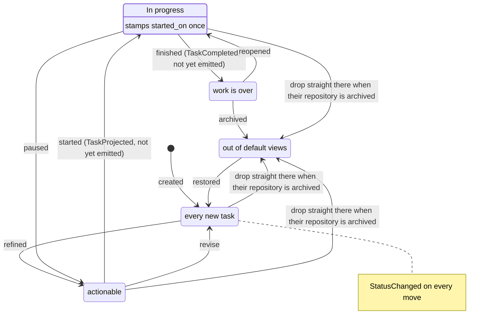
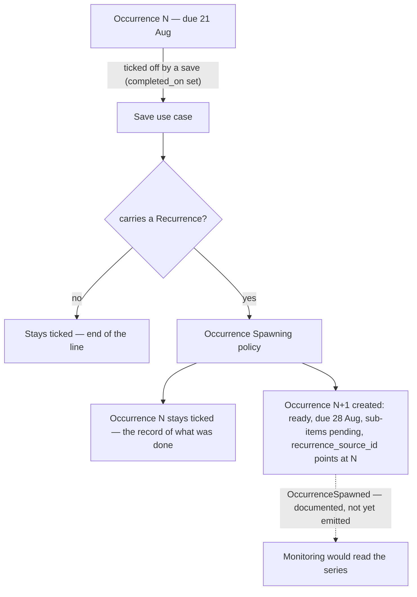
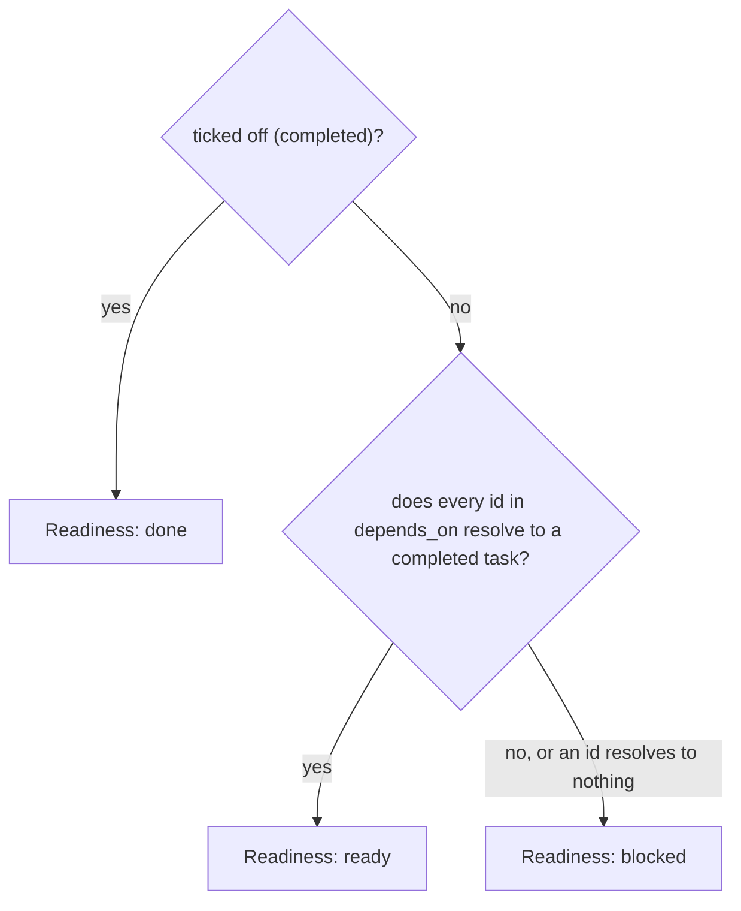

# Tasks

```meta
type: flow
status: draft
```

> Lifecycle and process flows for this bounded context: how the aggregate moves
> through its states over time. Complementary to `model.md` (structure) and
> `domain.md` (responsibilities/invariants).

## Task lifecycle

Five recorded states. Forward moves on top, the ways back underneath. The tick,
readiness and the start date sit beside the status — they are not states.



- The drop into `Archived` is
  [dropping an archived repository's open tasks](../repository-management/requirements.md#archiving-a-repository),
  outside the lifecycle's own moves, as a person's `!archived` edit is. The task
  keeps its filing and nothing is deleted; `Done` and `Archived` tasks are left
  alone.
- `TaskProjected` and `TaskCompleted` are documented, not yet emitted; see
  [Projection](domain.md#projection) for the policy and
  [its requirements](requirements.md#projection) for what it will do on each.

## Beside the status, not states

### The tick

`completed_on`

- Ticking an open task also moves it to Done.
- Reaching Done through the picker does not tick.
- Unticking clears only the tick.

[3 requirements →](requirements.md#requirement-ticking-an-open-task-off-moves-it-to-done)

### Readiness

*derived on read*

- `ready` — nothing it waits on is open.
- `blocked` — it waits on an open task, a missing one, or a loop.
- `done` — it is ticked: the tick, not the status.

[4 rules →](domain.invariants.md#readiness-and-dependencies)

### Time

`started_on` · `due_on`

- The first move into In progress stamps the start. Pausing or reopening
  keeps it, and a sync that only passes through In progress stamps none.
- Start and tick together bound how long the work took.
- An overdue task is still Ready. A due date, a reminder, a repeat and a My Day
  stamp say when work is wanted; nothing moves a task between states as the
  clock advances.

[Scheduling fields →](domain.md#due-date)

## Recurring task occurrences



- Completion is the [tick](domain.md#completed), the save that sets
  `completed_on` from unset, and not the status reaching `done`:
  [the tick spawns the next occurrence](requirements.md#requirement-the-tick-spawns-the-next-occurrence),
  whatever the task's status is by then.
- Completion does not roll one task forward. It leaves the finished occurrence
  in place and creates the next as a separate aggregate with its own lifecycle.
  The link between them, `recurrence_source_id`, is provenance, not ownership.
- The spawn is a synchronous step inside the save that completed the task, drawn
  with a solid arrow. The dashed arrow is the event that would tell Monitoring
  about it, which this context documents but does not yet emit. A consumer
  therefore reads a series today by following `recurrence_source_id` rather
  than by subscribing.
- A tick made on the phone reaches the desktop through the replica merge, which
  runs the same spawn when the pulled copy ticks off a task it held unticked.
  [An occurrence has at most one successor](requirements.md#requirement-an-occurrence-has-at-most-one-successor),
  because the successor's id is derived from the occurrence's.
- The next due date is calculated from the completed occurrence's `due_on`, not
  from the date it was actually finished, so lateness does not drift a schedule.
- [Occurrence Spawning](domain.md#occurrence-spawning) lists what the new
  occurrence carries over and what starts fresh.

## Readiness derivation



- Completing one task unblocks its dependents with nothing to recalculate or keep
  in sync, because
  [readiness is derived](domain.invariants.md#invariant-readiness-is-derived-and-never-stored).
- The first question is the [tick](domain.md#completed), not `Task Status`; see
  [Readiness](domain.md#readiness) and
  [A ticked task reads done](domain.invariants.md#invariant-a-ticked-task-reads-done).
- [An id that resolves to no visible task leaves the task blocked](domain.invariants.md#invariant-a-dependency-naming-no-task-still-blocks),
  and [a dependency loop leaves every member blocked](domain.invariants.md#invariant-every-task-in-a-dependency-loop-reads-blocked).
  [Dependency](domain.md#dependency) says why.
