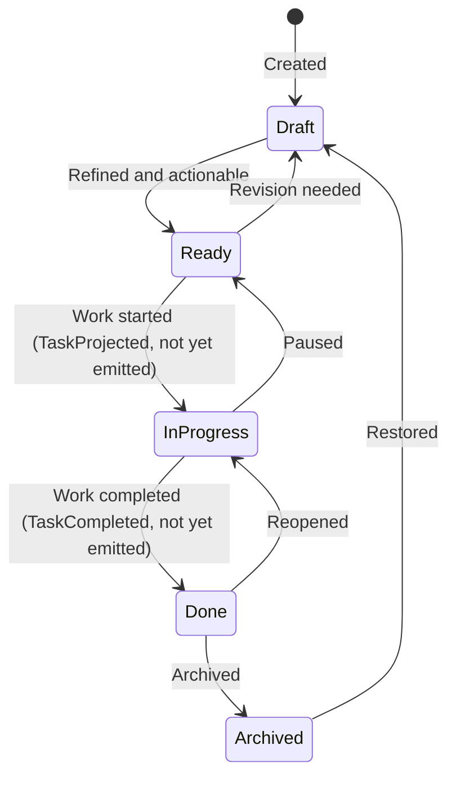
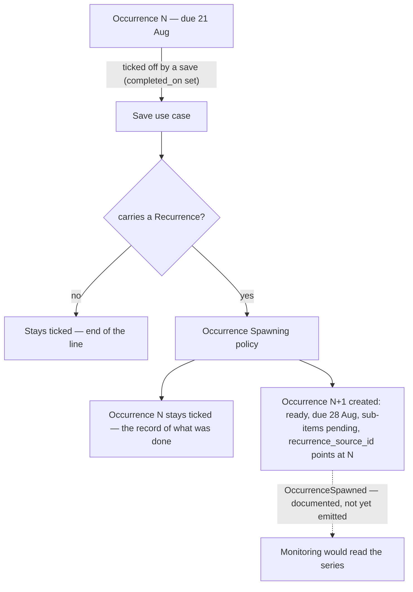
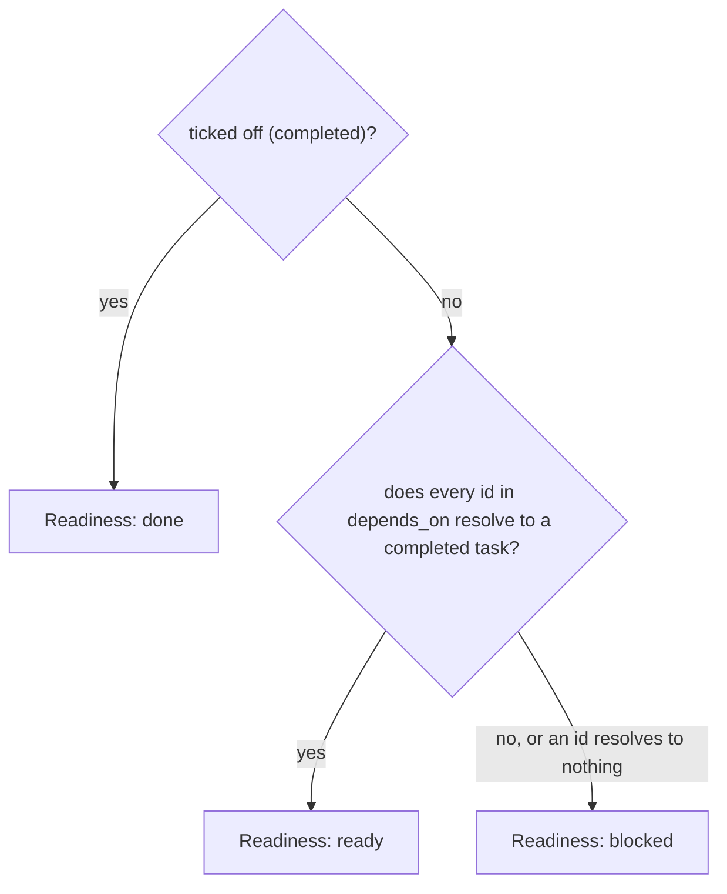

# Tasks

```meta
type: flow
status: draft
```

> Lifecycle and process flows for this bounded context: how the aggregate moves
> through its states over time. Complementary to `model.md` (structure) and
> `domain.md` (responsibilities/invariants).

## Task lifecycle



- The `Ready → InProgress` transition would emit `TaskProjected`, and `Done`
  would emit `TaskCompleted`. Both are documented, not yet emitted; see
  [Projection](domain.md#projection) for the policy and
  [its requirements](requirements.md#projection) for what it will do on each.
- The first entry into `InProgress`, by any route, stamps
  [Started](domain.md#started). Pausing or reopening leaves the stamp where it
  is.
- `Done` and `Archived` say the work is over. The tick that says the person has
  dealt with the task is [Completed](domain.md#completed), a separate fact and
  not a state in this diagram. The list's checkbox also moves a task not yet in
  an end state to `done` in the same save, as [Task](domain.md#task) describes.
  A finished task that still read "in progress" would be the list contradicting
  itself.
- Scheduling attributes do not appear in this diagram, and that is deliberate.
  A due date, a reminder, a repeat and a My Day stamp are facts about when work
  is wanted, not lifecycle states. An overdue task is still `ready`, and nothing
  has to move a task between states as a clock advances.

## Recurring task occurrences



- Completion is the [tick](domain.md#completed), the save that sets
  `completed_on` from unset, and not the status reaching `done`. The next
  occurrence is owed when the person ticks the task, whatever its status is by
  then.
- Completion does not roll one task forward. It leaves the finished occurrence
  in place and creates the next as a separate aggregate with its own lifecycle.
  The link between them, `recurrence_source_id`, is provenance, not ownership.
- The spawn is a synchronous step inside the save that completed the task, drawn
  with a solid arrow. The dashed arrow is the event that would tell Monitoring
  about it, which this context documents but does not yet emit. A consumer
  therefore reads a series today by following `recurrence_source_id` rather
  than by subscribing.
- A tick made on the phone reaches the desktop through the replica merge, which
  runs the same spawn when the pulled copy ticks off a task it held unticked.
  Each occurrence gets one successor, because the successor's id is derived
  from the occurrence's.
- The next due date is calculated from the completed occurrence's `due_on`, not
  from the date it was actually finished, so lateness does not drift a schedule.
- [Occurrence Spawning](domain.md#occurrence-spawning) lists what the new
  occurrence carries over and what starts fresh.

## Readiness derivation



- Completing one task unblocks its dependents with nothing to recalculate or keep
  in sync, because
  [readiness is derived](domain.invariants.md#invariant-readiness-is-derived-and-never-stored).
- The first question is the [tick](domain.md#completed), not `Task Status`; see
  [Readiness](domain.md#readiness) and
  [A ticked task reads done](domain.invariants.md#invariant-a-ticked-task-reads-done).
- An id that resolves to no visible task leaves the task blocked, and a
  dependency loop leaves every member blocked. [Dependency](domain.md#dependency)
  says why.
