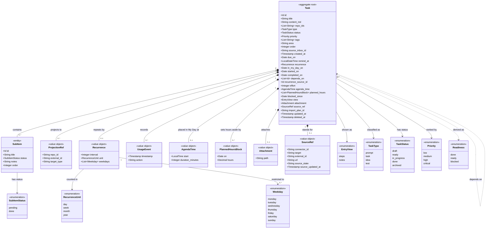

# Tasks

```meta
type: model
status: draft
```

> Structural view of the domain model for this bounded context: aggregates,
> entities, value objects, and their relationships. Keep this in sync with
> `domain.md` (which describes responsibilities/invariants in prose) — this
> file focuses on structure and relationships. `## Fields` groups the root's
> fields by purpose: one `###` per group, its first paragraph the question the
> group answers, then one bullet per field — `` `name` — what it means `` —
> ending in `Rules:` and links to the invariants that hold the field.

## Model diagram



## Fields

### Work state

Where is the work?

- `status` — The recorded lifecycle state. It moves only along [the Task lifecycle](flow.md#task-lifecycle). Rules: [starts in draft](domain.invariants.md#invariant-a-new-task-starts-in-draft), [follows the lifecycle](domain.invariants.md#invariant-status-changes-follow-the-lifecycle).
- `priority` — Execution priority. Planning priority is the roadmap's word, not this one.
- `started_on` — Stamped by the first move into progress; pausing keeps it. Rules: [the first move stamps the start](domain.invariants.md#invariant-the-first-move-into-progress-stamps-the-start).
- `completed_on` — The tick: the person has dealt with it. [Not a status](domain.md#completed).
- `blocked_since` — Someone said something outside the backlog is in the way, and since when. Not the derived blocked.
- `readiness` — Derived from `depends_on` on every read, never stored. Rules: [Readiness and dependencies](domain.invariants.md#readiness-and-dependencies).

### Scheduling

When is it wanted? All optional, none load-bearing.

- `due_on` — The day the task is committed to.
- `remind_at` — A wish to be reminded, not a promise it was sent.
- `in_my_day_on` — This morning's choice. Membership is derived when [My Day](domain.md#my-day) is read.
- `agenda_time` — A start and a duration inside My Day. It borrows My Day's date. Rules: [My Day and its agenda time](domain.invariants.md#my-day-and-its-agenda-time).
- `recurrence` — The shape of a repeat. The next date is calculated, never stored.
- `planned_hours` — Hours set aside per day. Not an estimate. Rules: [Planned hours](domain.invariants.md#planned-hours).
- `effort` — Sizes the work. Owned here; the roadmap only totals it. Rules: [never negative](domain.invariants.md#invariant-effort-is-never-negative).

### Identity and working set

What is it, and where did the person put it?

- `id` · `created_at` — The task's own identity, and when it was made.
- `title` · `content_md` — The entry text. Steps are written inside it.
- `type` — Prompt, task, idea or test.
- `area` · `order` · `tags` — The person's own grouping and rank. They travel with the task. Rules: [a blank area is unfiled](domain.invariants.md#invariant-a-blank-area-is-unfiled).
- `view` — A display choice stored on the task. Not domain state.
- `attachment` — The one place the task's material lives: a path, never a copy.

### Links and provenance

What does it point at, and where did it come from?

- `repo_ids` — Target repositories, resolved by Repository Management.
- `depends_on` — Tasks this one waits on. A missing one still blocks. Rules: [a missing task still blocks](domain.invariants.md#invariant-a-dependency-naming-no-task-still-blocks), [a loop reads blocked](domain.invariants.md#invariant-every-task-in-a-dependency-loop-reads-blocked).
- `source_inbox_id` — The inbox item it was triaged from.
- `recurrence_source_id` — The occurrence it followed. Provenance, not ownership.
- `import_plan_id` — The plan that produced it; also a `+tag`. Rules: [a plan id keeps its sigil](domain.invariants.md#invariant-a-plan-id-keeps-its-sigil).
- `source_ref` — Present only on a [Linked Task](domain.md#linked-task): the source owns its title and status.

### Across devices

Written by the device, never by hand.

- `updated_at` — Every edit restamps it, so the later edit wins whole. Rules: [every edit restamps the task](domain.invariants.md#invariant-every-edit-restamps-the-task).
- `deleted_at` — Makes it a tombstone, so the deletion can travel. Rules: [a restore is stamped after its tombstone](domain.invariants.md#invariant-a-restored-task-is-stamped-after-its-tombstone).

## Relationship notes

- `Task` is the aggregate root and the only consistency boundary.
  `SubItem` is an owned entity (identity within the aggregate only);
  `ProjectionRef`, `UsageEvent`, and `AIWorkLog` are immutable value objects.
- `repo_ids` is a plain list of repository identifiers, not object references, so
  Tasks stays decoupled from Repository Management. Projection records a
  `ProjectionRef` for a `repo_id` when the task is pushed to it.
- `area` and `order` are plain scalars on the root, not separate value objects.
  They place the task in the person's own working set, as a self-chosen grouping
  and a manual rank, rather than describing the task's business state. They
  therefore carry no relationships to other types.
- `due_on`, `remind_at` and `in_my_day_on` are plain scalars on the root for the
  same reason. They are three different kinds of fact rather than three
  spellings of one: a [Due Date](domain.md#due-date), a
  [Reminder](domain.md#reminder), and the date behind [My Day](domain.md#my-day).
  None of them is a `Timestamp`. `created_at` records when something happened and
  is an instant. These three record what a person intended and are read against
  a local calendar.
- `completed_on` is a fourth scalar of the same kind, recording
  [Completed](domain.md#completed), and deliberately not a `Task Status` value.
- `started_on` is a fifth, recording [Started](domain.md#started), stamped by
  the root. A date and not a `Timestamp` for the same reason as the tick: it is
  read against a local calendar.
- `Recurrence` is an owned value object rather than a scalar because a repeat has
  internal structure (`interval`, `unit`, and an optional `Weekday` set) and no
  identity of its own. It describes the shape of the repeat only; the date of the
  next occurrence is calculated by the `Occurrence Spawning` policy from `due_on`, and is
  never stored.
- `depends_on` is the one self-association on the diagram. It is drawn dashed
  because it is a weak id reference rather than an object graph. Every `Task` is
  its own aggregate root, so a dependency crosses an aggregate boundary and
  follows the `repo_ids` rule: plain identifiers, resolved by the reader rather
  than navigated. The association is not guaranteed to have a target; see
  [Dependency](domain.md#dependency).
- `Readiness` is attached with a dashed dependency, not an association, because
  it is derived; see
  [its invariant](domain.invariants.md#invariant-readiness-is-derived-and-never-stored).
  How it relates to `TaskStatus` is in [Readiness](domain.md#readiness).
- `recurrence_source_id` is a plain id in the same spirit as `source_inbox_id`:
  provenance pointing back at the task an occurrence was spawned from, not
  ownership. A spawned occurrence is a separate aggregate with its own lifecycle,
  which is why there is no containment relationship between a series and its
  members.
- `effort` is a plain scalar on the root, not a value object: the task's
  [Effort](domain.md#effort). It is neither a `Timestamp` nor a duration, and it
  carries no relationship to another type.
- `agenda_time`, `attachment` and `source_ref` are owned value objects with no
  identity of their own, each held at most once. `planned_hours` is a list of
  value objects, one per day. `view` is a presentation preference the entry's
  markdown carries, not domain state, and `blocked_since` is the stored
  *blocked*, distinct from the derived `Readiness`.
