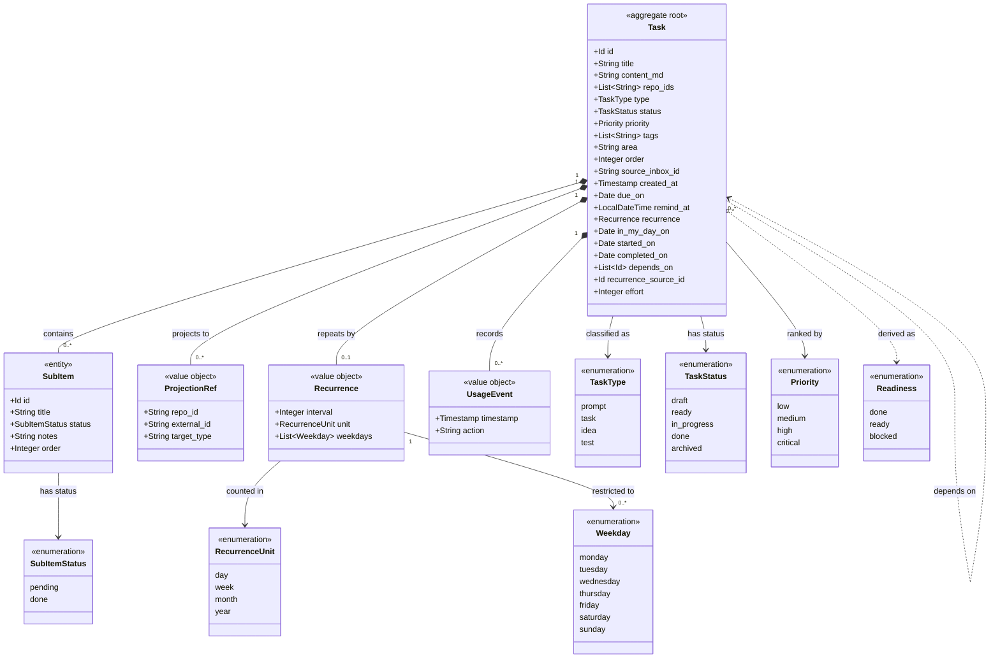

# Tasks

```meta
type: model
status: draft
```

> Structural view of the domain model for this bounded context: aggregates,
> entities, value objects, and their relationships. Keep this in sync with
> `domain.md` (which describes responsibilities/invariants in prose) — this
> file focuses on structure and relationships.

## Model diagram



## Relationship notes

- `Task` is the aggregate root and the only consistency boundary.
  `SubItem` is an owned entity (identity within the aggregate only);
  `ProjectionRef`, `UsageEvent`, and `AIWorkLog` are immutable value objects.
- `repo_ids` is a plain list of repository identifiers, not object references, so
  Tasks stays decoupled from Repository Management. Projection records a
  `ProjectionRef` for a `repo_id` when the task is pushed to it.
- `area` and `order` are plain scalars on the root, not separate value objects.
  They place the task in the person's own working set, as a self-chosen grouping
  and a manual rank, rather than describing the task's business state. They
  therefore carry no relationships to other types.
- `due_on`, `remind_at` and `in_my_day_on` are plain scalars on the root for the
  same reason. They are three different kinds of fact rather than three
  spellings of one: a [Due Date](domain.md#due-date), a
  [Reminder](domain.md#reminder), and the date behind [My Day](domain.md#my-day).
  None of them is a `Timestamp`. `created_at` records when something happened and
  is an instant. These three record what a person intended and are read against
  a local calendar.
- `completed_on` is a fourth scalar of the same kind, recording
  [Completed](domain.md#completed), and deliberately not a `Task Status` value.
- `started_on` is a fifth, recording [Started](domain.md#started), stamped by
  the root. A date and not a `Timestamp` for the same reason as the tick: it is
  read against a local calendar.
- `Recurrence` is an owned value object rather than a scalar because a repeat has
  internal structure (`interval`, `unit`, and an optional `Weekday` set) and no
  identity of its own. It describes the shape of the repeat only; the date of the
  next occurrence is calculated by the `Occurrence Spawning` policy from `due_on`, and is
  never stored.
- `depends_on` is the one self-association on the diagram. It is drawn dashed
  because it is a weak id reference rather than an object graph. Every `Task` is
  its own aggregate root, so a dependency crosses an aggregate boundary and
  follows the `repo_ids` rule: plain identifiers, resolved by the reader rather
  than navigated. The association is not guaranteed to have a target; see
  [Dependency](domain.md#dependency).
- `Readiness` is attached with a dashed dependency, not an association, because
  it is derived; see
  [its invariant](domain.invariants.md#invariant-readiness-is-derived-and-never-stored).
  How it relates to `TaskStatus` is in [Readiness](domain.md#readiness).
- `recurrence_source_id` is a plain id in the same spirit as `source_inbox_id`:
  provenance pointing back at the task an occurrence was spawned from, not
  ownership. A spawned occurrence is a separate aggregate with its own lifecycle,
  which is why there is no containment relationship between a series and its
  members.
- `effort` is a plain scalar on the root, not a value object: the task's
  [Effort](domain.md#effort). It is neither a `Timestamp` nor a duration, and it
  carries no relationship to another type.
