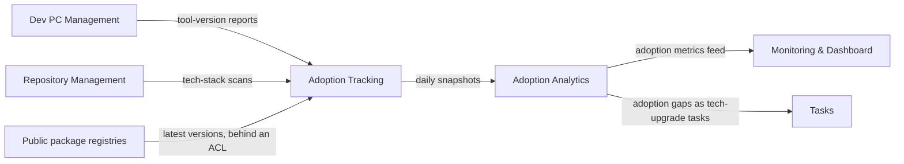

# Technology Stack

```meta
type: domain
```

> A chapter's `type` is `entity`, `value-object` or `enum` beneath its aggregate.

## Technology Registry

```meta
type: aggregate
related: [.devbook/domain/dev-pc-management/domain.md#machine-registry, .devbook/domain/repository-management/domain.md#repository-registry, .devbook/arc42/08-crosscutting-concepts.md#shared-data-types, .devbook/domain/technology-stack/domain.invariants.md#technology-registry]
aliases: [TechnologyRegistry]
```

The global singleton that owns all technology definitions, baseline profiles, deprecation notices and portfolio adoption analytics. Daily snapshots populate the analytics. The rules the registry holds are in
[its invariants](domain.invariants.md#technology-registry).

### Technology

```meta
type: entity
aliases: [technology_id]
related: [.devbook/domain/technology-stack/domain.invariants.md#technology-registry]
```

**Technology lifecycle**

```mermaid
stateDiagram-v2
    [*] --> Beta : Proposed and added to registry
    Beta --> Stable : Approved for portfolio use
    Stable --> Deprecated : New version; EOL date + migration set
    Deprecated --> Unsupported : EOL reached; exceptions flagged
    Unsupported --> [*]
    Stable --> Beta : Reverted to evaluation (edge case)
```



A single tool, framework, language, or runtime, identified by `technology_id`
(e.g. "dotnet", "nodejs", "react"). It holds:

- `category` and `status`;
- `min_version`, `recommended_version` and `latest_available_version`;
- an optional `eol_date` and `migration_guidance`;
- its owned breaking changes and daily adoption snapshots;
- ADR links and tags.

### Breaking Change

```meta
type: entity
```

A significant breaking change between versions of a `Technology`. It holds:

- `from_version`;
- `description`;
- `impact_level` (high/medium/low);
- `migration_effort` (easy/moderate/hard);
- step-by-step `migration_steps`.

### Deprecated Tech In Use

```meta
type: entity
```

A deprecated technology still active in the portfolio. It is tracked so phase-out
can be reported and enforced. It holds:

- `technology_id`;
- `usage_count` and `usage_pct`;
- `eol_date` and `last_updated`;
- its owned migration approvals.

### Migration Approval

```meta
type: entity
```

An approved exception to remain on deprecated technology. It holds:

- the machine/repo id;
- `deprecated_technology`;
- `target_migration_date`;
- `reason`;
- `approved_by` and `approved_at`.

### Technology Baseline

```meta
type: value-object
aliases: [TechnologyBaseline, TeamToolsBaseline, TechBaselines]
```

An approved set of versions for a context (Default, Frontend, Backend,
Microservices, dev-pc, repositories). Its versions
[name a known technology](domain.invariants.md#invariant-baseline-versions-name-a-known-technology)
and [meet its minimum](domain.invariants.md#invariant-baseline-versions-meet-the-minimum).
It holds:

- `baseline_name`;
- `technologies` (id → version);
- `last_updated` and `updated_by`;
- `description`.

### Version Constraint

```meta
type: value-object
```

A version alias with semantic meaning. It holds:

- `constraint_name` (lts, latest, stable, current);
- the concrete `version`;
- `description`;
- `effective_date`.

### Deprecation Notice

```meta
type: value-object
aliases: [DeprecationNotice]
```

A formal phase-out announcement. It holds:

- `technology_id`;
- `announcement_date` and `eol_date`;
- `replacement_technology`;
- `migration_guide_url`;
- `support_level` (active/maintenance-only/eol).

### Adoption Snapshot

```meta
type: value-object
```

A point-in-time adoption view for a technology. It holds `date`, `adoption_count`, `adoption_pct` and `version_distribution`. It computes `adoption_pct = adoption_count / total_portfolio_count * 100`.

### Version Usage Metric

```meta
type: value-object
```

Usage distribution of one technology. It holds:

- `date` and `technology_id`;
- `version_distribution`;
- `on_baseline_count` and `on_baseline_pct`.

### Adoption Trend

```meta
type: value-object
```

Adoption velocity for a technology/version. It holds `technology_id`, an optional `version`, `adoption_velocity` and `days_to_full_adoption`.

### Compatibility Matrix

```meta
type: value-object
```

Known compatibility between two technologies. It holds `technology_a`, `technology_b`, `version_mapping` (e.g. .NET 9 → ASP.NET Core 9) and `notes`.

### Adoption Analytics

```meta
type: value-object
```

Portfolio-wide rollup. It holds:

- daily `portfolio_adoption`;
- `adoption_trends`;
- `version_usage_metrics`;
- `compatibility_matrix`;
- `deprecated_in_use`.

### Tech Status

```meta
type: enum
aliases: [TechStatus]
```

Lifecycle of a technology: `stable`, `beta`, `deprecated`, `unsupported`.

### Tech Category

```meta
type: enum
```

Kind of technology: `language`, `runtime`, `framework`, `tool`, `ide`, `utility`.

## Adoption Tracking

```meta
type: domain-service
related: [.devbook/domain/monitoring/domain.md#progress-signal]
```

**Adoption tracking**



Collects daily adoption from Dev PC Management tool-version reports and
Repository Management tech-stack scans. From them it:

- computes portfolio coverage, version distribution and adoption velocity;
- measures [Technology Sprawl](#technology-sprawl);
- flags deprecated technology still in use.

It is a service because it aggregates data reported by other contexts into
portfolio analytics that no single `Technology` owns. Invocation semantics:
scheduled or triggered by an incoming report.

- Only the `Technology Registry` root writes the analytics ([flow](domain.md#adoption-tracking)).
- Technology Stack is not built, so none of these feeds exists in code.
  [dependencies.md](dependencies.md) names the intended contract for each.

## Deprecation Management

```meta
type: domain-service
```

Drives the deprecation lifecycle. It:

- issues `Deprecation Notice`s with end-of-life (EOL) dates and migration guidance;
- enforces minimum versions;
- tracks approved exceptions as `Migration Approval`s;
- at EOL, flags every machine and repository still on the technology as one that must migrate.

It is a service because it coordinates policy across many technologies,
baselines, and consumers. Invocation semantics: policy service
triggered by baseline changes, EOL thresholds, and approval decisions.

## Shared Enums

```meta
type: shared-enums
```

> Enums used by more than one aggregate in this bounded context.

Technology Stack has one aggregate, so `Tech Status` and `Tech Category` sit under it. This chapter is reserved for cross-aggregate enums.

## Ubiquitous Language

```meta
type: ubiquitous-language
```

> The terms this context owns that are not chapters above.

### Technology Sprawl

```meta
type: term
aliases: [sprawl]
related: [.devbook/domain/technology-stack/domain.md#adoption-tracking, .devbook/domain/technology-stack/domain.md#technology-baseline]
```

The spread of technologies and versions in use across the portfolio beyond what
the baselines approve. It counts overlapping technologies used for the same
purpose and several versions of one technology in use at once.
[Adoption Tracking](#adoption-tracking) measures it from the same reports it
uses for coverage.
