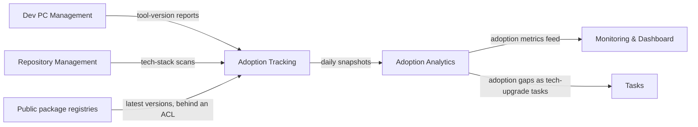

# Technology Stack

```meta
type: flow
status: draft
```

> Lifecycle and process flows for this bounded context: how a technology moves
> through its states, and how adoption data moves through the context.
> Complementary to `model.md` (structure) and `domain.md`
> (responsibilities/invariants).

## Technology lifecycle

```mermaid
stateDiagram-v2
    [*] --> Beta : Proposed and added to registry
    Beta --> Stable : Approved for portfolio use
    Stable --> Deprecated : New version; EOL date + migration set
    Deprecated --> Unsupported : EOL reached; exceptions flagged
    Unsupported --> [*]
    Stable --> Beta : Reverted to evaluation (edge case)
```



## Adoption tracking



- [Adoption Tracking](domain.md#adoption-tracking) runs on a schedule or on an
  incoming report. Only the `Technology Registry` root writes the analytics.
- Technology Stack is not built, so none of these feeds exists in code.
  [dependencies.md](dependencies.md) names the intended contract for each.
