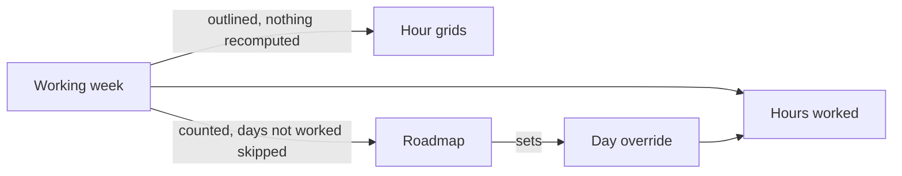

# Work

```meta
index: root
type: context
deployment: module
related: [.devbook/arc42/05-building-block-view.md#desktop-app, .devbook/arc42/adr/0073-the-bounded-contexts-are-redrawn.md#1-work, .devbook/arc42/adr/0072-the-tasks-pane-groups-by-plan-and-a-plan-is-queued-as-a-whole.md]
```

Work holds the person's work across projects and repositories: what there is to do,
and when and in which order it is meant to happen. It is a core context. Tasks and
Roadmap Planning merged into it under
[local ADR 0073 §1](../../arc42/adr/0073-the-bounded-contexts-are-redrawn.md#1-work);
its code is `Backlog.Modules.Work`, the task under `Backlog.Modules.Work.Tasks` and the
plan under `Backlog.Modules.Work.Plans`; its screens are still `Backlog.Modules.Tasks.UI`
and `Backlog.Modules.Roadmap.UI`.

Two aggregates, each the boundary of its own rules:

| Aggregate | Holds |
|---|---|
| [Task](domain.task.md#task) | One piece of work: a prompt, task, idea or test, with its status, execution priority, steps, schedule and effort. A triaged [Inbox Item](../inbox/domain.md#inbox-item) becomes a task, and a task projects to GitHub and the Copilot CLI. |
| [Plan](domain.plan.md#plan) | The forward plan: what is intended, when, in which order, and what waits on what, as [Roadmap Items](domain.plan.md#roadmap-item). An item may name the task that executes it, and holds work not yet refined into a task. |

Inside the boundary as well:

- capacity: the [pace](#story-points-a-week) a plan's length is drawn from when the
  plan states no due date, the [working week](#working-week) it is counted over, and
  the [day overrides](domain.md#day-override) on it;
- [My Day](domain.md#my-day), one rule over the tasks and the plans a person picked
  for today (local ADR 0072).

*Priority* is split on purpose: a task owns its execution priority, a plan its
planning priority and sequence, and
[neither writes or derives the other's value](domain.plan.invariants.md#invariant-planning-priority-never-touches-the-task).

The plan, the pace and the working week follow their owner across the devices they
have paired
([ADR 0018](../../arc42/adr/0018-roadmap-plan-and-pace-ride-the-task-feed.md),
[ADR 0019](../../arc42/adr/0019-roadmap-counts-the-working-week.md)).

Outside it:

| Concern | Owner |
|---|---|
| What arrives and how it is triaged | [Inbox](../inbox/domain.md#inbox-item) |
| The knowledge a task links to | [Brain](../brain/domain.md#knowledge-note) |
| The goals work is attached to, and what holds it back. Work knows no goals ([ADR 0028](../../arc42/adr/0028-progress-is-its-own-boundary-and-tasks-knows-no-sprints.md), [ADR 0035](../../arc42/adr/0035-goals-and-impediments-replace-sprints.md)) | [Goals](../goals/context.md) |
| The effort a devbook chapter registers, which a plan totals but never owns | [Devbook](../devbook/domain.md#shared-value-objects) |

The settings screen lists each feature flag below from the feature catalog in `AppFeatures.cs`. A person's choice is kept in `features.json` beside the app's other per-device choices.

## GitHub integration

```meta
type: feature-flag
key: github-integration
default: on
related: [".devbook/domain/work/features.md#issue-projection-and-state-read-back"]
```

- **On:** Offers GitHub access in settings, pushing an entry to an issue, and refreshing issue or pull request state.
- **Off:** The Tasks pane hides the actions that reach GitHub.
- **Default:** On, and marked `DEV`, the settings screen's mark for a feature still under construction (`AppFeatureStatus.Dev`; see [Feature Enablement](../../arc42/08-crosscutting-concepts.md#feature-enablement)).
- **Retired:** When the integration leaves `DEV`.
- **Key:** Not the adapter of the same name in `Backlog.Infrastructure.GitHub`.

## Copilot CLI

```meta
type: feature-flag
key: copilot-cli
default: on
related: [".devbook/domain/work/features.md#hand-off-to-copilot-cli"]
```

- **On:** Offers to start GitHub Copilot CLI from an entry, and from a devbook chapter in Devbook.
- **Default:** On, and marked `DEV`.
- **Retired:** When the hand-off leaves `DEV`.
- **Key:** In the shared kernel's `AppFeatureKeys` rather than in either context.
- **Why:** Two contexts read this one key.

## AI assistant

```meta
type: feature-flag
key: ai-assistant
default: on
related: [".devbook/domain/work/features.md#ai-assistance-over-the-visible-backlog"]
```

- **On:** Shows the assistant panel in the app chrome, which answers questions about the visible task content through Azure Foundry.
- **Default:** On, and marked `DEV`.
- **Retired:** When the assistant leaves `DEV`.

## Clear My Day overnight

```meta
type: setting
key: my-day-preferences.json
scope: user
default: on
related: [.devbook/domain/work/features.md#my-day, .devbook/domain/work/domain.md#my-day, .devbook/domain/work/requirements.md#my-day, .devbook/arc42/adr/0032-my-day-preferences-ride-the-task-feed.md]
```

Whether today's [My Day](domain.md#my-day) starts empty each morning. On, the
default, a task is in My Day only on the date it was picked for, so yesterday's
list clears itself. Off, an unfinished task picked on an earlier day stays in My
Day until the person ticks it off or takes it out. A task ticked off on an
earlier day leaves either way, and a task picked for a later day never shows
early. A plan put on My Day is read the same way, because My Day is one rule over
both (local ADR 0072).

The person sets it on the desktop, on the Tasks page of Settings. The phone has
no switch of its own and follows the desktop's choice. The choice syncs, so
every paired device lists the same My Day
([ADR 0032](../../arc42/adr/0032-my-day-preferences-ride-the-task-feed.md),
accepted). Flipping it never rewrites a task, because each device applies it
when it reads My Day. A device that never received a choice reads it as on.

## Story points a week

```meta
type: setting
key: planning-velocity.json
scope: user
default: 7
related: [.devbook/domain/work/features.md#placing-a-plan-in-time, .devbook/domain/work/features.md#syncing-the-plan-between-devices, .devbook/arc42/adr/0013-imported-plan-is-a-roadmap-item-laid-out-by-import.md#4-the-importer-places-the-window-velocity-is-the-readers, .devbook/arc42/adr/0018-roadmap-plan-and-pace-ride-the-task-feed.md, .devbook/arc42/adr/0019-roadmap-counts-the-working-week.md, .devbook/domain/work/context.md#working-week]
```

This setting is how many story points the reader gets through in a working week.
It is a positive decimal, held to four places. A week is the hours of the reader's
[working week](domain.md#working-week), 42.5 on the default week. A plan needs
its effort × those hours ÷ this pace, counted over the hours the reader works
(ADR 0019, proposed).

It is the divisor behind one thing only: an imported plan that states no due
date gets a **length from its effort**. Each of its repository
[parts](domain.md#part) is as long as the story points registered by the work
filed there, divided by that repository's figure, and
[never shorter than a day](requirements.md#requirement-a-plan-is-never-shorter-than-its-start-day).
A plan that does state a due date
[ends on it](requirements.md#requirement-a-due-date-ends-the-plan-whatever-its-effort),
and this figure is not consulted.

It is a **reading preference, not an estimate** (ADR 0013, ruling 4). The effort
stays the tasks' own, added and never invented; the placement adds only how fast
the reader says they work through it. A plan whose window is still sized by its
effort [keeps up with its work](features.md#placing-a-plan-in-time) at the pace in
use, so changing the pace re-lays those bars. A measured pace moves them too, at
the next load.

**Four paces.** The reader picks one of them:

| Pace | How it is counted | Stored |
|---|---|---|
| Typed | The figure the reader types | Yes |
| Measured over two weeks | Effort completed in the measuring period ÷ its working hours, per working week | No, counted afresh on every read |
| Measured over four weeks | The same, over four weeks | No |
| Measured over eight weeks | The same, over eight weeks | No |

A measured pace counts the effort of every backlog entry completed in the
measuring period.

A **measuring period** is whole calendar weeks, today included. Its hours include
the [day overrides](domain.md#day-override) in it, while a working week stays the
weekly pattern's total
([requirement](requirements.md#requirement-a-measured-pace-counts-the-hours-in-its-stretch)).
With no overrides it measures the points divided by its weeks (2, 4 or 8), and a
blocked day raises the figure. A period that finished nothing estimated measured
no pace and cannot be picked. Besides the typed pace, only the choice is stored.

**Kept per repository band**, because productivity differs from one project to
the next, with one **global** pace beside them (ADR 0013, ruling 4 as amended on
2026-09-26 and on 2026-10-07). Each part of a plan is placed at the pace in use
for its own repository:

| The part is filed under | Pace in use |
|---|---|
| A repository with its own pace | That repository's typed pace or chosen measured pace, counted over the entries filed under it |
| A repository nobody has set a pace for | The global typed pace and choice, measured over that repository's own entries |
| No repository, or a repository nobody configured | The global pace, measured over every finished entry once |
| Any of these, when the chosen measuring period has since gone empty | The typed pace of the same entry, and the roadmap says so |

A plan filed under several repositories draws a bar in each of their
[bands](domain.md#band), and its window ends on the latest of those bars
([Placing a plan in time](features.md#placing-a-plan-in-time)). An entry filed
under two repositories counts in full toward both. A repository keeps no pace of
its own until the reader sets one, so no bar moves on upgrading. The first change
gives it its own entry. The half not being changed, the typed pace or the choice,
is copied from what the repository read at that moment. Repositories are named by
their Settings alias, compared without regard to case.

Per value:

- **A pace that cannot be read**
  [reads as seven points a working week](requirements.md#requirement-a-pace-that-cannot-be-read-is-seven-points-a-week).
  On the default week that is about 1.4 points a worked day. A pace of zero gives
  no length, and a default nobody chose should place a plan rather than refuse.
- **A file from when the pace was a day** holds `storyPointsPerDay` and reads
  as seven times it; the next change writes `storyPointsPerWeek` in its place.
- **A typed pace the roadmap cannot store as typed**
  [is refused](requirements.md#requirement-a-typed-pace-the-roadmap-cannot-store-as-typed-is-refused).
  The file and the field hold four decimal places, so a finer pace would be
  written as zero and silently read back as the default. A parser that allowed
  group separators would read `2,5` as `25`. Every imported plan would be a
  tenth of its length with nothing on screen looking wrong.

Where the pace is changed and shown:

- Each pace is changed on the roadmap, beside the chart it sizes. The typed pace,
  **Mine**, is the one points field ("pt/wk"), in the chart's heading.
- Each band carries its pace under its name in the chart's sidebar, above its
  named lanes, in the same two rows whether it measured anything or not. Releasing
  its slider sets the band's own pace. A **Measured** button returns the band to
  its measured pace, and an info mark lists what was finished a week over the
  last two, four and eight weeks and the pace placing the band.
- A repository's own pace sits in its band. The global pace, the **default**,
  sits in the band for work under no repository, measured over all finished work.
  That band is always drawn with the chart, so the default can always be edited.
  Every repository band with no pace of its own shows it until edited.
- A measuring period that finished nothing says so in the info mark, and the next
  period that measured something places the band.
- A band that measured nothing in any period has no **Measured** button. A line
  under its slider says that Mine is used, and the slider runs from half the
  typed pace to double it.
- The pace is read per placement, not pinned at startup.

How the pace is stored and travels:

- The device stores it in `planning-velocity.json`: the typed pace, the chosen
  `source`, and an optional `repositories` object holding each repository's own
  pair. A file without a `source` reads as the typed pace. A file without
  `repositories` reads as it always did.
- The choice is one person's, so it follows that person. With sync on, the typed
  pace, the chosen source and every repository's own pace travel between their
  paired devices. A second machine then does not start again at seven
  ([ADR 0018](../../arc42/adr/0018-roadmap-plan-and-pace-ride-the-task-feed.md);
  see [Syncing the plan between devices](features.md#syncing-the-plan-between-devices)).
- The working week travels with the pace, as a `workingWeek` key in the same file
  and the same synced document
  ([ADR 0019](../../arc42/adr/0019-roadmap-counts-the-working-week.md)). The key
  holds the weekly pattern and an `overrides` list of `{date, worked}` pairs, one
  per [day override](domain.md#day-override). A file without the key reads the
  device's own [working week](context.md#working-week), or the
  default week, and writes the key on its next change. How the overrides travel
  is in [the requirements](requirements.md#carrying-the-pace-with-the-person).

## Working week

```meta
type: setting
key: working-hours.json
scope: user
default: Monday to Friday 09:00-17:30; Saturday and Sunday not worked
related: [.devbook/domain/insights/features.md#personal-productivity-dashboard, .devbook/domain/insights/features.md#hours-worked, .devbook/domain/insights/domain.md#office-hours, .devbook/domain/work/features.md#placing-a-plan-in-time, .devbook/domain/work/domain.md#working-week, .devbook/domain/work/domain.md#day-override, .devbook/domain/work/features.md#blocking-and-unblocking-a-day, .devbook/domain/work/features.md#setting-days-off-in-a-list, .devbook/arc42/adr/0019-roadmap-counts-the-working-week.md]
tests: [unit:dotnet:Backlog.Infrastructure.FileSystem.UnitTests.WorkingHoursSettingsStoreTests, unit:dotnet:Backlog.Desktop.UI.UnitTests.SettingsWorkingHoursTests, unit:dotnet:Backlog.Desktop.UI.UnitTests.InsightsPaneTests.The_grid_outlines_the_hours_of_the_working_week]
```



Which hours the reader meant to be working, as seven independent days. Each day is worked or not, with its own start and end. The setting holds seven days rather than one range plus a set of working days.

- **Why:** a single range cannot say that a reader starts at seven on Fridays.

It is capacity, so it belongs to Work with the pace and the day overrides; it moved
here from Insights under
[local ADR 0073 §1](../../arc42/adr/0073-the-bounded-contexts-are-redrawn.md#1-work).
[Insights](../insights/context.md) reads it for the dashboard and never writes it.

On the dashboard the working week is presentation only. The hour grids outline the hours the week claims, and nothing else changes: no figure is recomputed and no work is excluded. Agent-active time at eleven at night counts as much as time at eleven in the morning. A grid that quietly dropped out-of-hours work would answer a different question from the one its tile is named for. The outline lets the reader see the difference.

The roadmap does count it ([ADR 0019](../../arc42/adr/0019-roadmap-counts-the-working-week.md), proposed). A plan sized by its effort is counted over the hours this week claims and skips the days not worked. A pace's week is this week's total hours. Day and week columns show their working hours, and days not worked are shaded. See [Placing a plan in time](features.md#placing-a-plan-in-time).

This setting holds the weekly pattern only. A single date that differs from it, a holiday or a worked Saturday, is a [day override](domain.md#day-override). The person sets it on the roadmap, by pressing a day head ([Blocking and unblocking a day](features.md#blocking-and-unblocking-a-day)) or in the Days off dialog ([Setting days off in a list](features.md#setting-days-off-in-a-list)). A day override travels inside the same `workingWeek` key.

The dashboard's hour grids ignore the overrides. Its [Hours worked](../insights/features.md#hours-worked) part reads them, because it splits the person's actual hours by their [office hours](../insights/domain.md#office-hours), and a blocked date has none.

An hour is outlined when **any part** of it falls inside that day's hours, so a day ending at 17:30 outlines the 17:00 hour. There is no half-marked cell to draw, and leaving the hour out would claim that work at ten past five happened out of hours.

Per value:

- **A day marked not worked** outlines nothing and keeps its hours. Turning it back on restores them, not the defaults.
- **A day whose end is at or before its start** outlines nothing. The settings screen refuses such a range with a message naming the hours it will not take, so only editing the file by hand reaches this state. A grid that outlined every hour because two times were the wrong way round would be worse than one that outlined none.
- **No file, or one nobody can read,** is the default week. A day the file does not mention also comes from the default, rather than being read as a day off. Nothing stored means nobody said, and answering "not a working day" for the reader is the assumption this surface exists to avoid.

The person changes it on the settings screen, one day at a time. It is stored in its own file beside the app's other per-device choices. A section of the workspace pointer would be rewritten every time somebody moved Friday's finishing time. Times are written as `HH:mm`, as the reader spells them.

The Working week page's headline says the week in force in one sentence, read from the stored week, so a refused time never reaches it:

- The usual week reads `You work Mon–Fri, 09:00–17:30.`
- A run of three worked days or more reads as a range and the rest as a list, so `Mon, Tue, Thu, Fri` shows where the gap is.
- The hours are named only when every worked day shares them. Otherwise the sentence ends `each day at its own hours`.
- A week with no worked day says `You have no working days set.`

`scope: user` fits: the choice is one person's and follows them. With sync on, the week travels as a `workingWeek` key inside the roadmap's synced `planning-pace` document, newest change winning (ADR 0019). A change here writes `working-hours.json` and that key together. A week pulled from another device replaces this file, so `working-hours.json` stays the device's copy and the dashboard keeps reading it. A pace document without the key leaves the file alone, and the device's next change writes the key.
