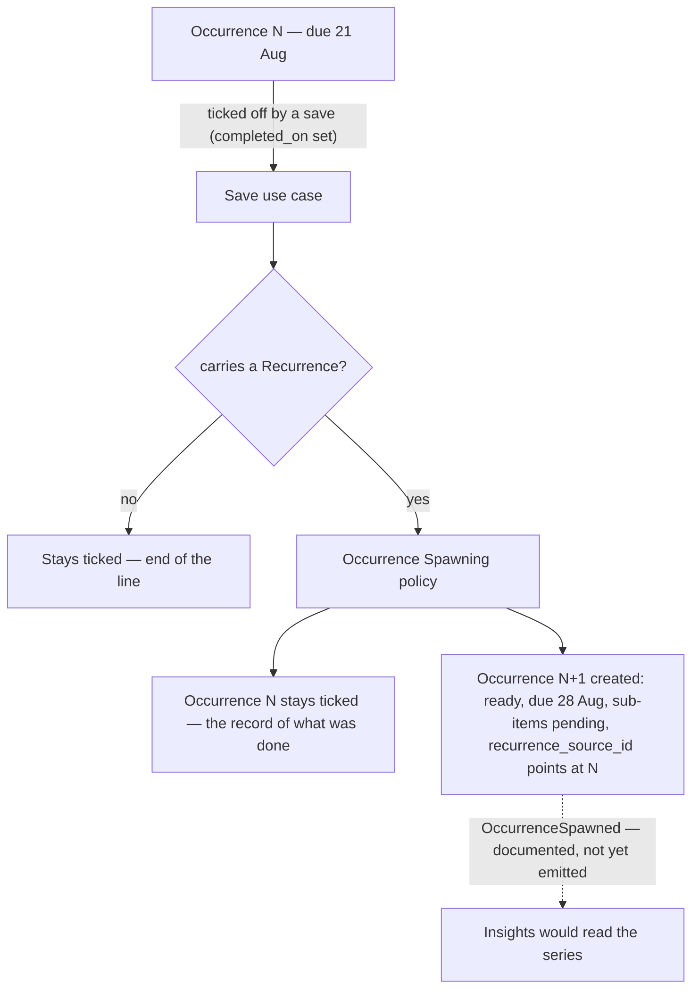

# Work

```meta
type: domain
```

> One chapter per Domain Service, Domain Event, or Shared Value Objects / Shared
> Enums grouping, then the Ubiquitous Language. The two aggregates have a page
> each: [Task](domain.task.md#task) and [Plan](domain.plan.md#plan), each with its
> invariants subpage. A chapter's `type` is `entity`, `value-object` or `enum`
> beneath its aggregate.

What Work owns and what it leaves to other contexts is in [context.md](context.md).
The plan is stored in its own right, not as a view over the
[tasks](domain.task.md#task), because it holds work not yet refined into a task. A
Roadmap Item may name the task that executes it. Every item names its repositories
from the [Repository Registry](../repositories/domain.md#repository-registry) by
alias, so a portfolio-wide plan reads as one [band](#band) per repository.

## Projection

```meta
type: domain-service
related: [.devbook/domain/insights/features.md#personal-productivity-dashboard, .devbook/arc42/06-runtime-view.md#task-to-github-issue, .devbook/domain/work/requirements.md#projection]
aliases: [ProjectionRef]
```

Creates and closes downstream artifacts for a multi-repo task, recording each as
a `Projection Ref`. It is a service because it coordinates the task with external
systems (GitHub, Copilot CLI) across several artifacts rather than
a single aggregate mutation.

What ships is a push the person asks for. A task is pushed to its target
repository as one GitHub issue, and the issue's reference is kept on the task; see
[Issue projection and state read-back](features.md#issue-projection-and-state-read-back).

The intended design is an event-triggered policy, or process manager, that
reacts to `TaskProjected` and
`TaskCompleted`; its promises are in
[the Projection requirements](requirements.md#projection). Neither event is
emitted yet; see [Occurrence Spawning](#occurrence-spawning) for why this context
publishes none.

A `Projection Ref` recorded by hand, such as a session or pull request linked to
a task, records the work whatever its state. A pull request that merged or
closed before its task was linked is linked like an open one, from a repository
registered in Settings; see
[From a task's side panel](../sessions/features.md#from-a-tasks-side-panel). A link
can be taken off again, and the task holds what unlinking does:

- [it removes every reference to the named artifact](domain.task.invariants.md#invariant-unlinking-removes-every-reference-to-the-named-artifact);
- [it leaves the task's repositories as they are](domain.task.invariants.md#invariant-unlinking-leaves-the-tasks-repositories-as-they-are);
- [it changes nothing for a reference the task does not hold](domain.task.invariants.md#invariant-unlinking-what-the-task-does-not-hold-changes-nothing).

## Occurrence Spawning

```meta
type: domain-service
related: [.devbook/domain/work/domain.task.md#task, .devbook/domain/work/domain.md#taskcompleted, .devbook/domain/work/domain.md#occurrencespawned, .devbook/domain/work/requirements.md#recurring-tasks]
```

**Recurring task occurrences**



- Completion is the [tick](domain.md#completed), the save that sets
  `completed_on` from unset, not the status reaching `done`:
  [the tick spawns the next occurrence](requirements.md#requirement-the-tick-spawns-the-next-occurrence).
- The finished occurrence stays in place and the next is a separate aggregate.
  The link between them, `recurrence_source_id`, is provenance, not ownership.
- The spawn is a synchronous step inside the save (solid arrow). The dashed arrow is the event that would tell Insights.
  This context documents it but does not yet emit it, so a consumer
  reads a series by following `recurrence_source_id`.
- The next due date comes from the completed occurrence's `due_on`, not
  from when it was finished, so lateness does not drift a schedule.

Creates the next occurrence of a repeating task. When a save ticks off a task
that carries a `Recurrence`, it creates a new `Task` whose `due_on` is the next date that recurrence
produces. Its promises are in
[the Recurring tasks requirements](requirements.md#recurring-tasks).

It is a service because producing the next occurrence creates a second
aggregate instance, which an aggregate cannot do to itself.

Invocation semantics: called synchronously by the use case that completes the
task. It is deliberately not an event-triggered policy, unlike the intended
`Projection`. This context publishes no domain events yet.

Guideline ADR 0006
([Lightweight CQRS, no mediator](../../arc42/adr/guidelines/0006-cqrs-for-api-projects.md))
rejected putting a mediator behind its handlers, so `OccurrenceSpawned` below
is documented rather than emitted until there is machinery to carry it. The spawn does not wait on
that machinery; an event would only tell a consumer.

The new occurrence carries over what the repeat is of:

- `title`, `content_md`, `type`, `priority`, `area`, `tags` and `repo_ids`;
- `depends_on`, its Devbook references, and its `order`;
- the `Recurrence` itself;
- each sub-item's title and notes, in order.

It adds `recurrence_source_id`, pointing back at the task it came from.

Everything about the occurrence rather than the repeat starts fresh:

- the status is `ready`, and every sub-item is `pending`;
- `due_on` is advanced as above, and stays empty when the completed occurrence
  had none;
- projections, usage history, `remind_at`, `in_my_day_on` with its agenda time,
  `planned_hours`, `started_on`, `completed_on`, `blocked_since`, `effort` and
  `attachment` are all empty.

That the next occurrence
[carries the repeat and starts the occurrence fresh](requirements.md#requirement-the-next-occurrence-carries-the-repeat-and-starts-the-occurrence-fresh)
is a requirement. A repeating task accumulates one completed task per occurrence, the
cost of keeping the record. [Archive and lifecycle](features.md#archive-and-lifecycle) bounds it:
completed occurrences archive out of default views.

Two use cases run it. The desktop's own save runs it when the save ticks the
task off. The replica merge runs it when a pulled copy ticks off a
task the desktop held unticked. That is how a tick made on the phone or on
another desktop gets its successor.
[A task that arrives ticked spawns nothing](requirements.md#requirement-a-task-that-arrives-ticked-spawns-nothing),
as a task created ticked spawns nothing: it records something done.

[An occurrence has at most one successor](requirements.md#requirement-an-occurrence-has-at-most-one-successor).
The successor's id is derived from the id of the occurrence it follows, so every
desktop spawns the same task and the replica keeps one copy.
Nothing is created when a task with that id already exists,
live or deleted. Deleting the successor is how the person stops that repeat, so
[a deleted successor is not spawned again](requirements.md#requirement-a-deleted-successor-is-not-spawned-again).
A successor spawned before its id was derived carries a random id. An
occurrence ticked before that change can therefore still gain a second successor
if it is unticked and ticked again.

[Unticking leaves the successor in place](requirements.md#requirement-unticking-leaves-the-successor-in-place):
unticking clears `completed_on` and nothing else, and the successor is
a separate task.

## StatusChanged

```meta
type: domain-event
related: [.devbook/domain/work/domain.task.md#task]
```

Published when a `Task` changes `Task Status`.

### Payload

- `task_id` - task identifier.
- `previous_status` - prior `Task Status`.
- `new_status` - new `Task Status`.
- `changed_at` - time of the transition.
- `repo_ids` - targeted repositories for correlation.

### Consumers

- Insights, which turns work-state changes into progress signals.

### Published language rules

- The event reflects the durable work-state transition; consumers do not infer
  additional semantics from projection side effects.

## TaskProjected

```meta
type: domain-event
related: [.devbook/domain/work/domain.md#projection]
```

Published when a `Task` begins external execution and the Projection
policy creates one downstream artifact per targeted repository.

### Payload

- `task_id` - task identifier.
- `repo_id` - repository receiving a projection.
- `projection_target` - the [Projection Ref](domain.task.md#projection-ref)'s target type:
  `issue` or `cli-task`.
- `external_id` - created downstream artifact identifier.
- `projected_at` - time the projection was created.

### Consumers

- Insights, which correlates planned work with external execution.

### Published language rules

- One event instance is emitted per projection target so consumers can reason
  about multi-repo fan-out without inspecting `Projection Ref` internals.

## TaskCompleted

```meta
type: domain-event
related: [.devbook/domain/work/domain.md#projection]
```

Published when a completed `Task` closes its downstream projections.

### Payload

- `task_id` - task identifier.
- `repo_ids` - repositories whose projections are being closed.
- `closed_projection_ids` - downstream artifact identifiers that were closed.
- `completed_at` - time the projections were closed.

### Consumers

- Insights, which reconciles work completion against external systems.

### Published language rules

- Completion is owned by the Task; external systems consume the closing
  signal but do not redefine what completion means.

## OccurrenceSpawned

```meta
type: domain-event
related: [.devbook/domain/work/domain.md#occurrence-spawning]
```

Published when a completed repeating `Task` produces its successor.

### Payload

- `source_task_id` - the completed task the occurrence came from.
- `task_id` - the newly created task.
- `due_on` - calendar date the new occurrence is due.
- `spawned_at` - time the occurrence was created.

### Consumers

- Insights, which needs the two tasks linked to read a repeating
  series as a series rather than as unrelated items.

### Published language rules

- The successor is a separate `Task` with its own lifecycle. The link is
  provenance, not ownership, and consumers must not treat a series as one work
  item.
- One event instance is emitted per spawned occurrence.

## AIWorkLogged

```meta
type: domain-event
related: [.devbook/domain/work/domain.task.md#task]
```

Published when a Task records that an AI-assisted action contributed to
the work item.

### Payload

- `task_id` - task identifier.
- `ai_tool` - tool or channel used, such as Copilot CLI, GitHub Copilot App, IDE
  chat, or another AI assistant.
- `activity_kind` - planning, coding, review, summarization, research, or other
  user-facing category.
- `session_id` - optional source session identifier when one exists.
- `outcome_ref` - optional reference to a pull request, commit, issue, note, or
  generated artifact.
- `logged_at` - time the activity was recorded.

### Consumers

- Insights, which turns AI-assisted activity into personal productivity
  metrics and trends.

### Published language rules

- The event records contribution evidence only; it does not claim productivity
  value by itself.
- Consumers conform to the published fields and do not inspect Task
  internals to infer additional activity.

## Plan Sequencing

```meta
type: domain-service
related: [.devbook/domain/work/domain.plan.md#plan, .devbook/domain/work/domain.invariants.md#plan-sequencing]
```

Answers the questions that are about the graph rather than about any one node:
the order the dependencies imply, which nodes are reachable from which, and where
the plan holds a [Contradiction](#contradiction).

It [reports a contradiction and never corrects it](domain.invariants.md#invariant-a-contradiction-is-reported-never-corrected).
A plan may be temporarily wrong: that is how a person discovers a date does not
fit, and silently shifting dependent work would hide that fact. Cycle rejection
stays [a rule of the root](domain.plan.invariants.md#invariant-a-cycle-is-refused).

It is a service because each answer needs the whole graph. Invocation semantics:
query/composition-oriented, and command-invoked as the validation step behind
adding a dependency.

## Repository Scope Resolution

```meta
type: domain-service
related: [.devbook/domain/repositories/domain.md#repository]
```

Turns the opaque aliases in a Repository Scope into the repositories the reader
recognizes, by asking the
[Repository Registry](../repositories/domain.md#repository-registry),
and reports which aliases did not resolve.

It keeps the aggregate free of a foreign repository model and of the registry
being reachable. An unresolved alias
[is kept](domain.plan.invariants.md#invariant-an-unresolved-scope-alias-is-kept) and
shows in the [band](#band) for work under no repository. Invocation semantics:
query/composition-oriented, on the read path.

## Roadmap Item Gathering

```meta
type: domain-service
related: [.devbook/domain/work/domain.plan.md#plan, .devbook/domain/work/domain.task.md#task, .devbook/domain/devbook/domain.md#shared-value-objects, .devbook/domain/sessions/domain.md#agent-session, .devbook/domain/work/domain.invariants.md#roadmap-item-gathering]
```

Assembles, for one Roadmap Item, everything it reaches across the tasks, Devbook and,
for the Brain's owner, the Brain, and totals the registered story points over the result. It reaches work two ways:

- **By name**: the task its [Task Link](domain.plan.md#task-link) names, and the chapters its
  [Knowledge Refs](domain.plan.md#knowledge-ref) list. The item wrote these references down
  outright.
- **By tag**: every Task filed under its [Roadmap Tag](domain.plan.md#roadmap-tag), and every
  devbook chapter whose own `roadmap` list names that tag. The item reaches
  these without naming them. For the Brain's owner, it also reaches every Brain
  note whose `roadmap` list names the tag (local ADR 0053).

It is a service because none of this is in the item's own state: the tasks,
Devbook and the Brain hold the entries, chapters and notes and register the
effort. Like
[Repository Scope Resolution](#repository-scope-resolution), it reads foreign data
on the read path and holds none, so an unreachable supplier degrades a total and
never corrupts a plan.

- **[Something reached both ways is counted once](domain.invariants.md#invariant-something-reached-both-ways-is-counted-once)**,
  and carried in the result as reached both ways. A person may both link a task
  and tag it, and a single count would hide that and invite deleting the link
  that was holding the work.
- **The total is the [total registered effort](#effort)**, with the count of
  gathered things that registered no estimate reported beside it. Folding them in
  silently would make the total read smaller than the work.

Each gathered thing is carried with **how far along it is** and **what else in the
same gathering it waits on**, so the item reads as a sequence of steps and not
only a total. Progress is the plan's own four-state reading: planned, ready, in
progress, done. A dependency is the key of another gathered thing, never a foreign
identifier. A supplier's vocabulary is translated once, at the boundary.

A thing that registers no progress, such as a devbook chapter or a Brain note,
[is never read as finished](domain.invariants.md#invariant-unknown-progress-is-never-finished).
A dependency on work this item did not gather
[is dropped](domain.invariants.md#invariant-a-wait-on-work-the-item-did-not-gather-is-dropped):
it blocks, but this item has no edge to draw for it.

The same "registered values only" rule governs how much registered effort is
**finished** and **how many** things are finished
([invariant](domain.invariants.md#invariant-finished-effort-counts-registered-estimates-only)).
The total less the finished effort is the effort **still to do**, which an item
still sized by its effort is laid out from.

A gathered backlog entry also carries **when** its work happened, as the task
recorded it: the day it first moved to in progress, the day it was ticked off,
and the day it was created. When every backlog entry the item gathered is done,
the item is **finished** and its work ran from the earliest start to the latest
end. A devbook chapter is not asked, having no work to finish. Each entry's dates
come from the first source in this order that has one:

| Tried | Actual start of an entry | Actual end of a finished entry |
|---|---|---|
| First | The day it first moved to in progress | The day it was ticked off |
| Then | The day the first AI session linked to it began | The day the last AI session linked to it ended |
| Last | The day it was created | None |

An entry has no start of its own when it predates the in-progress stamp.
[The entry's own dates win over its sessions'](domain.invariants.md#invariant-an-entrys-own-dates-win-over-its-sessions),
and [a session never ends open work](domain.invariants.md#invariant-a-session-never-ends-open-work).
When no entry was ticked and no session dates the end, the item has no actual end
and its planned end stands. Like progress, the actual dates are read off the
gathering each time, and the Planned Window is left as it was.

Ordering the steps is tolerant arithmetic.
[Nothing is placed before what it waits on](domain.invariants.md#invariant-nothing-is-placed-before-what-it-waits-on),
and [things equally free to go next keep the order they were gathered in](domain.invariants.md#invariant-steps-equally-free-keep-the-order-they-were-gathered-in).
A task dependency may form a cycle, so
[a cycle is released at the earliest waiter](domain.invariants.md#invariant-a-cycle-of-waits-is-released-at-the-earliest-waiter)
and the item is not refused.

A whole plan is also gathered in one pass: one read of each supplier, not one per
item, and
[both readings answer the same way](domain.invariants.md#invariant-a-whole-plan-is-gathered-the-way-each-item-is).
The per-item reading serves the item a person opened, and the plan-wide one
[answers every item](domain.invariants.md#invariant-every-item-of-a-plan-is-answered).
A thing may sit under two items, because a tag is not exclusive, and each item's
reading names it. Whoever draws them decides which may draw it.

Invocation semantics: query/composition-oriented, on the read path.
[It never writes](domain.invariants.md#invariant-gathering-never-writes).

## RoadmapItemScheduled

```meta
type: domain-event
related: [.devbook/domain/work/domain.plan.md#plan]
```

Published when a Roadmap Item's Planned Window is set or changed: on creation,
and on every reschedule that actually moves a date.

### Payload

- `roadmap_item_id` — stable identity of the item, unchanged by the reschedule.
- `title` — the item's title at the time of the event, for readability.
- `start`, `end` — the new Planned Window, both days inclusive.
- `previous_start`, `previous_end` — the window it replaced; absent when the item
  is newly planned, which is how a consumer tells the two apart.
- `planning_priority` — the plan's own priority, not any task's.
- `repository_aliases` — the item's Repository Scope as written, unresolved.
- `task_id` — the task the item names, when there is one.

### Consumers

- [Insights](../insights/features.md#personal-productivity-dashboard) —
  compares the plan against what actually happened, so drift between intent and
  delivery becomes visible without Insights reading the plan's internals.

### Published language rules

- The window is always inclusive at both ends. A consumer that treats `end` as
  exclusive will be one day short on every item.
- `repository_aliases` are opaque and unresolved by design. A consumer that needs
  repository facts asks Repositories, not this payload.
- Absent `previous_start`/`previous_end` means "newly planned". It does not mean
  "unchanged".
- The event carries no status and no progress. Those are the Task's
  published language; a consumer that wants both correlates on
  `task_id`.

## My Day

```meta
type: domain-service
aliases: [in_my_day_on, myday, InMyDay, MyDay]
related: [.devbook/domain/work/domain.invariants.md#my-day, .devbook/domain/work/features.md#my-day, .devbook/domain/work/domain.task.md#task, .devbook/domain/work/domain.plan.md#roadmap-item, .devbook/domain/work/domain.task.md#agenda-time, .devbook/domain/work/context.md#clear-my-day-overnight, .devbook/arc42/adr/0032-my-day-preferences-ride-the-task-feed.md, .devbook/arc42/adr/0072-the-tasks-pane-groups-by-plan-and-a-plan-is-queued-as-a-whole.md, .devbook/arc42/adr/0073-the-bounded-contexts-are-redrawn.md#1-work]
```

The set of tasks and plans a person picked to work on today, and the one rule that
says which they are. Each is held as a date, not as a flag: a task's `in_my_day_on`
on the [Task](domain.task.md#task), and a plan's on its
[Roadmap Item](domain.plan.md#roadmap-item) (local ADR 0072). The rule reads both
dates the same way, from the date, the reader's current local date, whether the work
is finished and the person's
[Clear My Day overnight](context.md#clear-my-day-overnight) setting. It is one
service over the two aggregates rather than a rule of either, because a task and a
plan must never be in today's My Day by different rules. Nothing rewrites a date
when a day passes. Its rules are in [its invariants](domain.invariants.md#my-day).

With the setting on, a task or a plan is in My Day only while its date is today, so
yesterday's list expires without a timer. With it off, unfinished work with an
earlier date stays in My Day, **carried**, until it is finished or taken out. Work
with a later date is never in today's My Day.

A plan is finished, for the rule, on the day the last entry it gathers is ticked
off; a plan that gathers none stays open. Putting a plan tag that
no item carries on My Day creates the item, with the tag as its title and a one-day
window on that day for the person to place. The date never moves the plan's window.

It is deliberately not a deadline: My Day is this morning's choice, a `Due Date` is
a commitment. A task in My Day may also carry an
[Agenda Time](domain.task.md#agenda-time), which places it at a time within the day
it was picked for. A carried task's slot is therefore not shown. Moving a task to
tomorrow sets the date to the next day, which
[drops its agenda time](domain.task.invariants.md#invariant-a-new-my-day-date-drops-the-agenda-time).

## Shared Enums

```meta
type: shared-enums
```

> Enums used by more than one aggregate in this bounded context.

Each of Work's enums belongs to one aggregate and sits under it, on the
[Task](domain.task.md#task) or the [Plan](domain.plan.md#plan) page. This chapter is
reserved for cross-aggregate enums.

## Ubiquitous Language

```meta
type: ubiquitous-language
```

### Entry Kind

```meta
type: term
aliases: [EntryKind]
related: [.devbook/domain/work/domain.task.md#task-type, .devbook/domain/work/features.md#import, .devbook/arc42/adr/0013-imported-plan-is-a-roadmap-item-laid-out-by-import.md, .devbook/domain/work/requirements.md#import]
```

Which thing a piece of entry text describes: a task, or a roadmap item. It is
read off the same bare type word as `Task Type` and held beside it:

- `prompt`, `task`, `idea` and `test` are the task kind and carry a
  `Task Type`.
- `plan` is the plan kind and carries none, because the stored task enum
  has no row for it.

Import is the path for the plan kind.
[The text save refuses a plan entry](requirements.md#requirement-the-text-save-refuses-a-plan-entry)
and routing from the Inbox leaves one out, rather than storing a task whose type
word the model cannot hold.

### Completed

```meta
type: term
aliases: [completed_on, tick, ticked off, checkbox]
related: [.devbook/domain/work/domain.task.md#task, .devbook/domain/work/domain.task.md#task-status, .devbook/domain/work/requirements.md#archive-and-lifecycle]
```

A task the person has ticked off their list, recorded as `completed_on`, the
day it happened. It is independent of `Task Status`, and the
[Archive and lifecycle requirements](requirements.md#archive-and-lifecycle)
keep the two apart:

- [ticking a finished task keeps its status](requirements.md#requirement-ticking-a-finished-task-keeps-its-status);
- [reaching done through the status picker does not tick](requirements.md#requirement-reaching-done-through-the-status-picker-does-not-tick);
- [unticking clears only the tick](requirements.md#requirement-unticking-clears-only-the-tick).

`done` and `archived` say the work is over; the tick says the person has dealt
with the task. Finished work can therefore sit on the open list until they have
looked at it. "Finished" anywhere in this context means this tick: the
Completed section, tag counts, dependency readiness and a repeat's next
occurrence all read it.

### Started

```meta
type: term
aliases: [started_on, started]
related: [.devbook/domain/work/domain.task.md#task, .devbook/domain/work/domain.task.md#task-status, .devbook/domain/work/domain.md#completed]
```

The day work on a task began, recorded as `started_on`.
[The task stamps it the first time it moves to `in_progress`](domain.task.invariants.md#invariant-the-first-move-into-progress-stamps-the-start).
It is not a status: a task that is paused back to `ready` or reopened from `done`
keeps the day it was first started. With `Completed` it bounds how long the work
took.

### Area

```meta
type: term
aliases: [area]
related: [.devbook/domain/work/domain.task.md#task, .devbook/domain/brain/domain.md#para-category, .devbook/domain/work/features.md#next-actions]
```

A self-chosen grouping the person files a task under, in whatever vocabulary they
actually use, such as "repos", "projects" or "inbox". It is deliberately a
free-form string rather than an enum: the taxonomy belongs to the person, not the
product. A task with no area is unfiled.

The open task's Area picker suggests the
[Brain's area names](../brain/domain.md#para-category) first, then the areas
already used on a task. They are suggestions: what the person types stands.

### Waiting For

```meta
type: term
aliases: [waiting_for, waiting, followup, follow-up date]
related: [.devbook/domain/work/domain.md#area, .devbook/domain/work/domain.md#reminder, .devbook/domain/goals/domain.md#impediment, .devbook/domain/inbox/features.md#route-to-tasks, .devbook/design/content-editing.md#scheduling-and-dependency-tokens, .devbook/arc42/adr/0054-clarify-outcomes-follow-gtd-and-each-item-has-one-home.md]
```

Who a task waits on, and when to chase them. It is free text naming a person or
a party, plus an optional follow-up date. Entry text writes it on the metadata
line as `waiting:<who>` and `followup:<YYYY-MM-DD>`. A follow-up date that has
passed reads overdue, as a [Reminder](#reminder) does. A waiting task is out of
the person's next actions until the waiting-for is cleared, which returns it.

It is not an [Impediment](../goals/domain.md#impediment): an Impediment
holds back a goal and has its own lifecycle in Goals, and a waiting-for
creates none. The Inbox's **Waiting for** decision makes a task with one.
Decided in local ADR 0054. The task stores it and the Tasks pane's
[Waiting slice](features.md#waiting-for-someone) lists it. The
[Next actions slice](features.md#next-actions) leaves it out.

### Context

```meta
type: term
aliases: [context tag]
related: [.devbook/domain/work/domain.md#area, .devbook/design/content-editing.md#structured-metadata-sigils, .devbook/arc42/adr/0054-clarify-outcomes-follow-gtd-and-each-item-has-one-home.md, .devbook/domain/work/features.md#next-actions]
```

Where or with what a task can be done, in GTD's sense: at the computer, on the
phone, out on errands. A context is a tag whose name starts with `@`, written
`#@pc` or `#@calls` in the body, on the title or as a metadata-line tag token. It
is stored as the tag `@pc`, as a person tag on the title is, so an `@carol` on
the title reads as a context too. It is a convention on tags, not a field, and a
person who uses no contexts sees nothing of it. It is not an [Area](#area),
which files the task, nor the bare `@` token of the metadata line. Decided in
local ADR 0054. The [Next actions slice](features.md#next-actions) groups by it.

### Due Date

```meta
type: term
aliases: [due_on, due, Due]
related: [.devbook/domain/work/domain.task.md#task]
```

The calendar day a task is committed to. It is a date, carrying no time and no
timezone, so it means the same day wherever the device is. It is distinct from a
`Reminder`, which is a moment, and from `My Day`, which is a choice about today.
How the date is worded on screen belongs to the channel showing it.

### Planned Hours

```meta
type: term
aliases: [planned_hours, hours block, Planned hours]
related: [.devbook/domain/work/domain.task.md#task, .devbook/domain/work/domain.md#due-date, .devbook/domain/work/domain.md#effort]
```

Hours the person has set aside for a task on a given day: a date and a number of
hours, never a start or an end time. A task may hold several days. The
[range of a figure](domain.task.invariants.md#invariant-a-planned-hours-figure-is-more-than-none-and-at-most-a-day),
its [quarter-hour step](domain.task.invariants.md#invariant-a-planned-hours-figure-is-kept-in-quarters-of-an-hour)
and [one figure a day](domain.task.invariants.md#invariant-a-task-holds-one-planned-hours-figure-a-day)
are invariants of the task. They are kept on the task beside its text rather than in it,
as its Devbook references are, so editing the text never changes them. They plan
the person's own days and are not an estimate: unlike [Effort](#effort), nothing
the roadmap places or paces reads them.

### Reminder

```meta
type: term
aliases: [remind_at, remind, Reminder]
related: [.devbook/domain/work/domain.task.md#task]
```

A local date and time the person asked to be reminded of a task at, held as
wall-clock intent: 09:00 means 09:00 wherever they are when it arrives. It is a
request recorded on the task rather than a promise about delivery. A reminder
whose time has passed reads as overdue until it is cleared.

### Task Dependency

```meta
type: term
aliases: [depends_on, DependsOn, after, predecessor]
related: [.devbook/domain/work/domain.task.md#task]
```

A task this task waits on, named by id. It is not a plan's
[Dependency](domain.plan.md#dependency), which joins two Roadmap Items. A task may have several, because needing
two things finished before starting is ordinary. It is written `after:<id>` in
the metadata line.

It is a weak reference across an aggregate boundary, and
[an id resolving to nothing still blocks](domain.task.invariants.md#invariant-a-dependency-naming-no-task-still-blocks).
Treating it as satisfied would let a chain claim to be ready when the step it
waits on is merely missing from view. That is the one failure that looks exactly
like success.

Dependency cycles are surfaced rather than prevented: nothing refuses one, and
[every member of a loop reads blocked](domain.task.invariants.md#invariant-every-task-in-a-dependency-loop-reads-blocked).
A cycle spans aggregate boundaries, so no single task can enforce its absence
transactionally. Only the person who wrote the edges can say which one is
wrong.

### Occurrence

```meta
type: term
aliases: [recurrence_source_id, OccurrenceSpawned]
related: [.devbook/domain/work/domain.md#occurrence-spawning]
```

One instance of a recurring task. Ticking an occurrence off leaves it completed
and spawns the next as a separate task, linked back by
`recurrence_source_id`. A series is therefore a chain of tasks rather than one
task that moves, so the record of each completion survives.

### Effort

```meta
type: term
aliases: [effort, story points, story-point estimate, total registered effort]
related: [.devbook/domain/work/domain.task.md#task, .devbook/domain/work/domain.md#roadmap-item-gathering]
```

Size measured in **story points**. A [Task](domain.task.md#task)'s effort is an
optional integer: absent means "not estimated", and `0` is a real zero-point
estimate. The range the task accepts is
[an invariant of the task](domain.task.invariants.md#invariant-effort-is-never-negative).

It sizes the work, not the time spent on it. It is an estimate however it was
arrived at, whether set by hand or derived by an AI agent from the task's
content. It is always revisable and never a measurement. Tasks and devbook
chapters register effort; a plan only **totals** it.

The *total registered effort* of a Roadmap Item is plain arithmetic over the
points actually registered, reported beside the count of gathered things that
registered none. It is never a measurement of time or an inference, and
unestimated work is not a zero hidden in the sum. The total never sets any task's
value.

### Roadmap

```meta
type: term
aliases: [Roadmap planning, Roadmap view]
related: [.devbook/domain/work/domain.plan.md#plan, .devbook/domain/work/features.md#reading-and-rescheduling-on-a-timeline]
```

The timeline the [Plan](domain.plan.md#plan) is read and rescheduled on. The plan
is stored in its own right rather than presented as a view over tasks. A task's
status and execution priority are **not** the roadmap's: a plan may name a task by
id and read its progress, and it never writes to it.

### Device

```meta
type: term
aliases: [machine, PC]
related: [.devbook/domain/work/features.md#multi-device-sync, .devbook/domain/sync/features.md#pairing-a-device, .devbook/domain/sync/domain.md#owner, .devbook/domain/sync/domain.md#device, .devbook/arc42/adr/0005-azure-hosted-task-replica-for-multi-device-sync.md]
```

One machine holding the person's backlog. A device is not a user and not an
account. The product requires no login for personal use, so the device is the
thing that is known and authorized.

Each device holds its own canonical copy of every task. Two devices are peers:
neither is the master, and the cloud replica between them is a courier rather
than an authority. **Paired** describes two devices that share one
[Owner](../sync/domain.md#owner). Pairing, and the credentials a device syncs
with, are the [Sync](../sync/context.md) context's: see
[Pairing a device](../sync/features.md#pairing-a-device).

### Tombstone

```meta
type: term
related: [.devbook/domain/work/domain.task.md#task, .devbook/domain/work/features.md#multi-device-sync, .devbook/domain/work/features.md#restoring-deleted-tasks, .devbook/arc42/adr/0020-external-items-arrive-as-linked-tasks.md]
```

A deleted task that is kept rather than removed, marked by its `deleted_at`.
[A sync never makes a Linked Task deleted on its own again](requirements.md#requirement-a-deleted-linked-task-is-never-made-again),
so deleting one task is how a person says they do not want it back.

Deleting the tasks a disconnected [Connected Target](#connected-target) left
behind does not say that. Each of those tombstones is marked as deleted with
its source, and
[a sync of the target connected again restores it](requirements.md#requirement-reconnecting-a-target-restores-the-tasks-deleted-with-it).
A restored task is live again and stamped later than its tombstone, so the
restore reaches the other devices the way the deletion did.

It exists because deletion has to travel. A task that is simply absent from one
device is indistinguishable from one that device has never seen. An outright
removal therefore looks like a task that has not arrived yet, and the next
reconciliation would undo the deletion. A tombstoned task is gone to every read;
it survives only far enough for the other devices to learn that it went.

### Linked Task

```meta
type: term
aliases: [linked tasks, external task, synced task]
related: [.devbook/domain/work/domain.task.md#source-ref, .devbook/domain/work/domain.md#task-connector, .devbook/domain/work/features.md#linked-tasks, .devbook/arc42/adr/0020-external-items-arrive-as-linked-tasks.md, .devbook/domain/work/requirements.md#linked-tasks]
```

A [Task](domain.task.md#task) that carries a [Source Ref](domain.task.md#source-ref): it stands for an open
item in a GitHub repository or a spec-manager product the person connected. It
arrives directly, with no Inbox step, whoever the item is assigned to.

The source speaks for three of its fields: the title, the status and the
assignee. Each sync applies what it says on the terms the
[Linked tasks requirements](requirements.md#linked-tasks) set.
[The assignee follows the source](requirements.md#requirement-the-assignee-follows-the-source),
and [the title follows it until the person renames the task](requirements.md#requirement-the-title-follows-the-source-until-the-person-renames-it).
[The status follows the source's state moves](requirements.md#requirement-the-status-follows-the-sources-state-moves)
through the item's [Source State](#source-state), read through its
[Connected Target](#connected-target)'s status map. A task the person finished
[stays done](requirements.md#requirement-a-task-finished-here-stays-done), and
the mismatch is flagged. Backlog owns every other field, and
[what arrives with an item is copied once](requirements.md#requirement-what-arrives-with-an-item-is-copied-once).

Its id is derived from the connector id and the item's external id, so
[two devices make one task for one item](requirements.md#requirement-two-devices-make-one-task-for-one-item).
[An item that leaves the source archives its task](requirements.md#requirement-an-item-that-leaves-the-source-archives-its-task)
with a flag rather than deleting it.

"Linked" means linked to a source. A Roadmap Item that names a task by
`task_id` names it; that task is not a linked task for that reason.

### Task Connector

```meta
type: term
aliases: [ITaskConnector, connector, GitHubConnector, SpecManagerConnector]
related: [.devbook/domain/work/domain.md#linked-task, .devbook/domain/work/domain.md#connected-target, .devbook/arc42/adr/0020-external-items-arrive-as-linked-tasks.md]
```

One outside system seen through the one contract Work knows,
`ITaskConnector`. A connector:

- describes itself with an id, a name, an icon and a colour token;
- fetches the items of a [Connected Target](#connected-target) and names each one
  by a display key;
- reports for each item its [Source State](#source-state) and whether it is
  blocked, and why;
- reports what the system can do;
- names the account that is signed in, when a person signs in to it;
- lists the statuses a target uses, each with its Source State, so a person can
  map them, or lists none when it has nothing to map;
- offers its targets by name to pick from, when it can list them, and the person
  types any other target in.

A fetch that fails for a reason the connector recognises fails with a sentence
the person can act on. Any other failure reads as the source not being reached.
The reasons it recognises are:

- a target that is not there;
- an account that may not read it;
- a source Backlog's settings do not name;
- nobody signed in.

A connector declares what it can do, but only three things change anything yet:

- completing an item at the source;
- marking a target as a code repository;
- asking the person questions about its items.

Effort,
dependencies, setting a status and commenting are declared but drive nothing.
A connector a person signs in to may also say what it asks of them beside the
sign-in, such as signing in again to send answers that wait.

GitHub and spec-manager are the first two. This context never names a
connector, so the source badge and the Source filter are drawn from the
descriptors.

### Connected Target

```meta
type: term
aliases: [connected repository, connected product, target]
related: [.devbook/domain/work/domain.md#task-connector, .devbook/domain/work/domain.md#source-state, .devbook/domain/work/domain.md#tombstone, .devbook/domain/work/requirements.md#linked-tasks, .devbook/arc42/adr/0020-external-items-arrive-as-linked-tasks.md]
```

One GitHub repository or one spec-manager product a person has connected. It
holds the connector id, whether it is enabled, and these settings:

- how old an untouched item may be before the first sync skips it, or no
  limit;
- whether the title follows the source, on by default;
- the sync interval, fifteen minutes by default;
- whether finishing a task here completes its item at the source, off by
  default and offered only when the connector can complete items;
- whether only the questions assigned to the person reach them, rather than
  those and the unassigned ones they may answer, off by default and offered
  only when the connector asks questions;
- the repository its tasks are filed under, or none to leave it to the
  connector;
- its status map, from the source's own status names to task statuses, empty
  until the person maps a status.

It also records how far its sync has got: when the last successful sync
started, the cut-off the first sync fixed for untouched items, and why and
when the last sync failed. A failure leaves the last success in place, so the
next sync still asks from there, and the next success clears it.

It never holds credentials. Disconnecting a target keeps its tasks. The person
can later delete the tasks a disconnected target left behind, which makes each
one a [Tombstone](#tombstone) marked as deleted with its source. Connecting the
target again brings those tasks back with its next sync. A connected target
with deleted tasks can also
[restore every one of them](requirements.md#requirement-restore-deleted-tasks-restores-every-deleted-task-of-the-target),
the ones deleted one by one included.

### Source State

```meta
type: term
aliases: [normalised state, SourceState]
related: [.devbook/domain/work/domain.task.md#task-status, .devbook/domain/work/domain.md#connected-target, .devbook/domain/work/domain.task.md#task, .devbook/domain/work/requirements.md#linked-tasks, .devbook/arc42/adr/0020-external-items-arrive-as-linked-tasks.md]
```

An item's state at its source, normalised by its connector to one of four
values. A fixed map turns it into a [Task Status](domain.task.md#task-status) for every
connector:

| Source State | Task Status |
|---|---|
| `Open` | `ready` |
| `Active` | `in_progress` |
| `Done` | `done` |
| `Dropped` | `archived` |

[The sync reaches that status along the lifecycle's own edges](requirements.md#requirement-the-sync-walks-the-status-along-the-lifecycle),
so a closed issue walks its task through `in_progress` to `done`. The source's own status name is
kept beside it, for display and for the status map.

A [Connected Target](#connected-target)'s status map overrides the fixed map per
source status name. The map is the person's, and Work applies it, so a
connector only normalises. It exists because normalising can lose a difference
the person needs: a spec-manager product with no status flagged as work
normalises every status after its first to `Active`. What the map changes, and
what it never touches, are the
[Linked tasks requirements](requirements.md#linked-tasks).

### Roadmap Node

```meta
type: term
aliases: [RoadmapNodeId, node, dependency endpoint]
related: [.devbook/domain/work/domain.plan.md#dependency]
```

Either end of a dependency: a Roadmap Item or a Milestone. A dependency does not
care which, and a shared base type would imply a lifecycle they do not share.

### Part

```meta
type: term
aliases: [repository part, part of a plan]
related: [.devbook/domain/work/domain.plan.md#roadmap-item, .devbook/domain/work/domain.md#roadmap-item-gathering, .devbook/domain/work/features.md#placing-a-plan-in-time, .devbook/domain/work/features.md#forecasting-work-in-flight, .devbook/domain/work/context.md#story-points-a-week]
```

The work a [Roadmap Item](domain.plan.md#roadmap-item) gathered that is filed in one
repository. An item's effort is laid out one part per repository, each at the
reader's pace for that repository. Each part
[counts the full effort of its own tasks and of the shared tasks it carries](requirements.md#requirement-each-repository-draws-its-own-part-at-its-own-pace).
A part is finished when every task it counts is done. When the work hands over to
another repository and back, that repository has one part per phase.

A part waits on the parts holding the tasks its own tasks wait on, as
[Roadmap Item Gathering](#roadmap-item-gathering) carries them. The item's window
runs from the earliest part start to the latest part end and is what the item
stores. Parts are worked out on every reading and never stored. See
[Placing a plan in time](features.md#placing-a-plan-in-time) for where a part
starts and how it is drawn.

### Band

```meta
type: term
aliases: [band, repository band]
related: [.devbook/domain/work/domain.plan.md#planning-lane, .devbook/domain/work/domain.md#repository-scope-resolution, .devbook/domain/work/features.md#reading-the-plan-by-repository, .devbook/domain/work/features.md#telling-one-project-from-another-at-a-glance]
```

One horizontal section of the roadmap's timeline. Each configured repository has
a band, drawn in that repository's colour, holding its
[Planning Lanes](domain.plan.md#planning-lane) and its own pace. An item filed under several
repositories draws its [part](#part) in each of their bands.

The last band holds work under no repository, or under a repository nobody
configured. It takes no colour, shows no name, and carries the default pace. The
plan's milestones share a band at the top, which takes no colour either.

### Own Task

```meta
type: term
aliases: [own task, own work]
related: [.devbook/domain/work/domain.md#part, .devbook/domain/work/domain.md#shared-task, .devbook/domain/work/domain.task.md#task, .devbook/domain/work/requirements.md#requirement-each-repository-draws-its-own-part-at-its-own-pace]
```

A [Task](domain.task.md#task) a plan gathered that is filed under one
repository alone. It always counts in that repository's [part](#part). A band's
**own work** is its own tasks. Once they are all done, the band's part is
finished, unless it is where the plan's open [shared tasks](#shared-task) are left.

### Shared Task

```meta
type: term
aliases: [shared task]
related: [.devbook/domain/work/domain.md#part, .devbook/domain/work/domain.md#own-task, .devbook/domain/work/domain.task.md#task, .devbook/domain/work/requirements.md#requirement-a-shared-task-counts-where-own-work-is-still-open]
```

A [Task](domain.task.md#task) a plan gathered that is filed under several
repositories, such as a sign-off every repository in a rollout takes part in. It
counts in full in each of its bands that still holds open
[own tasks](#own-task). When none does, it counts in the bands whose own work
ended last, or in all of them when none had own tasks. A shared task therefore
keeps no band open whose own work is done while another of its bands still has
own work open.

### Column Head

```meta
type: term
aliases: [head, day head, week head]
related: [.devbook/domain/work/features.md#reading-the-near-term-closely, .devbook/domain/work/features.md#blocking-and-unblocking-a-day, .devbook/domain/work/domain.md#day-override, .devbook/domain/work/domain.md#actual-hours]
```

The heading of one column on the roadmap's time axis: a day, a week, a month or a
quarter. A day or week head carries an hours figure, and a day head is a button
that blocks or unblocks its date as a [day override](#day-override). See
[Reading the near term closely](features.md#reading-the-near-term-closely).

### Plan Sigil

```meta
type: term
aliases: [plan sigil]
related: [.devbook/domain/work/domain.plan.md#roadmap-tag, .devbook/domain/work/domain.plan.md#roadmap-tag, .devbook/domain/inbox/domain.md#plan-tag, .devbook/arc42/adr/0013-imported-plan-is-a-roadmap-item-laid-out-by-import.md]
```

The `+` a [Roadmap Tag](domain.plan.md#roadmap-tag) wears on a Task: `+release-q4`. It tells a
plan tag apart from a `#` general tag and an `@` person. The item holds the bare
slug, the word a devbook chapter names in its `roadmap` list. The gathering
[matches a task's tag with or without the sigil](domain.invariants.md#invariant-a-plan-tag-matches-with-or-without-its-sigil),
so a task tagged before the sigil existed still counts. Only the adapters on the
two edges lift the sigil: the rollup and the shelf when they read, and the intake
when it writes (ADR 0013).

### Working Week

```meta
type: term
aliases: [working week, working hours, workingWeek, WorkingHours]
related: [.devbook/domain/work/context.md#working-week, .devbook/domain/work/context.md#story-points-a-week, .devbook/domain/work/domain.md#day-override, .devbook/arc42/adr/0019-roadmap-counts-the-working-week.md]
```

The hours the person means to work. Its **weekly pattern** is the
[Working week setting](context.md#working-week).
The [day overrides](#day-override) sit on top of it, set from a
[column head](#column-head) or in the Days off dialog. The pattern and the
overrides both travel with the pace.

A plan reads the working week for two things. An effort-sized Planned
Window [counts its hours forward](requirements.md#requirement-an-effort-window-counts-the-overrides)
from its start, dates and overrides included. A **week** of the pace is the
weekly pattern's total hours whatever the overrides, as
[a measured pace](requirements.md#requirement-a-measured-pace-counts-the-hours-in-its-stretch)
counts it. A day not worked, or one whose end is not after its start, adds no
hours (ADR 0019).

### Day Override

```meta
type: term
aliases: [day override, overrides, blocked day, blocked date, unblocked day, vacation day, holiday]
related: [.devbook/domain/work/domain.md#working-week, .devbook/domain/work/features.md#blocking-and-unblocking-a-day, .devbook/domain/work/features.md#setting-days-off-in-a-list, .devbook/domain/work/requirements.md#blocking-and-unblocking-a-day, .devbook/domain/work/requirements.md#setting-days-off-in-a-list, .devbook/arc42/adr/0019-roadmap-counts-the-working-week.md]
```

One calendar date that the person works differently from their weekly pattern. A
**blocked** date is one the pattern works and the person does not: a holiday, a
vacation day. An **unblocked** date is one the pattern does not work and the
person does, such as a Saturday. An override says only whether the date is
worked. An unblocked date takes the start and end the pattern stores for its
weekday.

An override exists only while it differs from the pattern: a date that matches
its weekday again
[holds none](requirements.md#requirement-returning-to-the-pattern-removes-the-override).
A weekend in the pattern is a day off, not an override; the word is kept for the
dates that break the pattern (ADR 0019). That is why
[a range of days off blocks only the worked dates](requirements.md#requirement-a-range-of-days-off-blocks-only-the-worked-dates).

The person sets an override by pressing a date's [column head](#column-head) or
in the Days off dialog, which also lists them all. Both write the same override.

### Actual Hours

```meta
type: term
aliases: [actual hours, actual]
related: [.devbook/domain/work/domain.md#working-stretch, .devbook/domain/work/features.md#reading-the-near-term-closely, .devbook/domain/work/requirements.md#reading-the-near-term-closely, .devbook/domain/work/dependencies.md, .devbook/domain/insights/features.md#hours-worked, .devbook/domain/insights/domain.md#office-hours, .devbook/arc42/adr/0019-roadmap-counts-the-working-week.md]
```

How long the person worked on one working day. A working day runs from 04:00
local on its date to 04:00 the next morning, so an evening that goes on past
midnight counts on the date it began. Actual hours are the union of the person's
[working stretches](#working-stretch) over every session on every paired machine.
How they are counted, across sessions, across 04:00 and up to now, is
[a requirement](requirements.md#requirement-actual-hours-count-the-persons-working-stretches).

Only time the person was there counts, so
[only a human turn makes a stretch](requirements.md#requirement-only-the-persons-turns-make-a-stretch).
Subagents, scheduled sweeps and automated sessions add nothing, and neither does
a Copilot session, whose transcript does not record who made a turn. The owner
decided this on 2026-10-03, after agent-active time had counted 13.1 hours on one
day, most of them overnight subagents.

Actual hours are presentation only: they move no bar and change no pace. A begun
[column head](#column-head) shows them, per
[Reading the near term closely](features.md#reading-the-near-term-closely). The
dashboard's [Hours worked](../insights/features.md#hours-worked) part
splits the same hours by [office hours](../insights/domain.md#office-hours).
They come from [Sessions](dependencies.md), never from tasks, because a task
records only the dates it started and finished.

### Working Stretch

```meta
type: term
aliases: [working stretch, stretch of work]
related: [.devbook/domain/work/domain.md#actual-hours, .devbook/domain/sessions/domain.md#human-turn, .devbook/domain/work/requirements.md#reading-the-near-term-closely, .devbook/arc42/adr/0019-roadmap-counts-the-working-week.md]
```

A span of time in one session during which the person was working. Each of its
[human turns](../sessions/domain.md#human-turn) comes less than 30 minutes after
the stretch so far ended, which is when the agent finished answering. A later
turn starts a new stretch
([scenarios](requirements.md#requirement-actual-hours-count-the-persons-working-stretches)).
The gap runs from the end of the answer, not the previous turn, because reading
the answer is work (the owner's decision of 2026-10-05).

The stretch starts at its first turn. It ends when the agent finishes answering
its last turn, which is the end of the run that turn started. When no run follows
the turn, or the run ended before it, the stretch ends at the turn itself. A
stretch is open while the agent is still answering its last turn.

The roadmap draws the stretches from each session's human turns and runs,
which Sessions reads. A working stretch is not the
[measuring period](context.md#story-points-a-week) a measured pace counts over.

### Contradiction

```meta
type: term
aliases: [contradiction, conflicting dates]
related: [.devbook/domain/work/domain.md#plan-sequencing]
```

A plan that disagrees with itself about dates: work opening before the thing it
waits on has closed, or finishing after a milestone it was meant to precede. It
is [reported, never corrected](domain.invariants.md#invariant-a-contradiction-is-reported-never-corrected).
A **cycle** [is refused](domain.plan.invariants.md#invariant-a-cycle-is-refused),
because a contradiction is a date problem and a cycle is not a plan.

### Source Label

```meta
type: term
aliases: [plus label, plan label, +label]
related: [.devbook/domain/work/domain.plan.md#roadmap-tag, .devbook/domain/work/domain.md#linked-task, .devbook/domain/work/requirements.md#requirement-only-the-first-plan-label-files-the-task, .devbook/arc42/adr/0020-external-items-arrive-as-linked-tasks.md]
```

A label on a GitHub issue or a spec-manager item whose name starts with a plus
sign, such as `+offline-sync`. On the item's [Linked Task](domain.md#linked-task)
it is the plan tag of the same name, made into a slug: lower case, spaces to
hyphens. Any other label becomes a general tag and means nothing to the roadmap.

A task counts in one plan only, so no effort is counted twice: when an item
carries several source labels,
[only the first files the task](requirements.md#requirement-only-the-first-plan-label-files-the-task).

### Promote to Plan

```meta
type: term
aliases: [promote, Promote to plan]
related: [.devbook/domain/work/domain.plan.md#roadmap-item, .devbook/domain/work/features.md#promote-to-plan, .devbook/arc42/adr/0020-external-items-arrive-as-linked-tasks.md]
```

A dropped action that was never built. It was to turn one linked task into a
[Roadmap Item](domain.plan.md#roadmap-item) through `IRoadmapPlanIntake`, the port Import
uses. No linked task calls that port. A linked task reaches the roadmap only
through its [Source Label](#source-label), which files it under a tag the
person places from the [shelf](features.md#laying-out-a-plan-whose-tasks-arrived-first).
