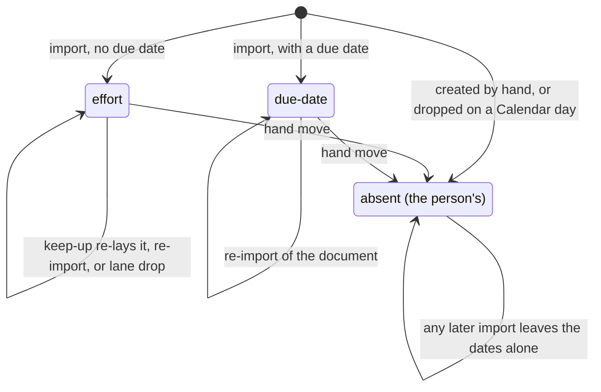

# Plan

```meta
type: domain
```

## Plan

```meta
type: aggregate
related: [.devbook/domain/work/domain.task.md#task, .devbook/domain/repositories/domain.md#repository-registry, .devbook/arc42/08-crosscutting-concepts.md#shared-data-types, .devbook/domain/work/domain.plan.invariants.md#plan]
aliases: [Roadmap Plan, RoadmapPlan, plan, the plan]
```

**Who placed an item's window**



The states are the values of `placed_by_import` on a
[Roadmap Item](domain.plan.md#roadmap-item), which defines a
[hand move](domain.plan.md#roadmap-item). Both transitions to the person's state are
[a hand move](domain.plan.invariants.md#invariant-a-hand-move-hands-the-window-to-the-person),
and none leaves it, because
[the importer never moves a window a person placed](domain.plan.invariants.md#invariant-the-importer-never-moves-a-window-a-person-placed)
and an import never deletes an item.

The single plan for the workspace, and the consistency boundary for every item,
milestone, and dependency in it.

*The plan* in these chapters means this aggregate. The features and requirements
also say *a plan* for one imported plan, which the roadmap holds as one
[Roadmap Item](#roadmap-item). Where both meanings are near, the chapters say
*item* for the one item.

The plan is the aggregate root rather than the Roadmap Item, because
**acyclicity is an invariant across items, not within one**. An item cannot tell
whether a dependency it is about to accept closes a loop three items away, and a
boundary around one item would push that rule outside the model. The plan is also
read and written as a whole, so the boundary and the transaction share a shape.
This mirrors
[Repository Registry](../repositories/domain.md#repository-registry),
the other singleton-registry aggregate in this product.

The rules the plan holds are in [its invariants](domain.plan.invariants.md#plan),
including those of the value objects below.

### Roadmap Item

```meta
type: entity
aliases: [RoadmapItem, roadmap_item_id, planned work, planned item]
related: [.devbook/domain/work/features.md#placing-a-plan-in-time, .devbook/domain/work/features.md#planning-work-that-has-no-task-yet, .devbook/domain/work/features.md#my-day, .devbook/arc42/adr/0072-the-tasks-pane-groups-by-plan-and-a-plan-is-queued-as-a-whole.md]
```

A single piece of planned work, identified by `roadmap_item_id`. It holds:

- a `title` and its [Roadmap Tag](#roadmap-tag);
- its [Planned Window](#planned-window) and [Planning Priority](#planning-priority);
- its [Repository Scope](#repository-scope) and [Planning Lane](#planning-lane);
- its [Dependency](#dependency) set;
- an optional [Task Link](#task-link) and a set of [Knowledge Refs](#knowledge-ref);
- optional `notes`;
- `placed_by_import`, when an import placed its window;
- `completed_on`, the day a person completed it by hand, while it stays completed;
- `in_my_day_on`, the day a person put the plan on [My Day](domain.md#my-day).

`placed_by_import` records which rule an import placed the window by, as drawn in
[Who placed an item's window](domain.plan.md#plan). The value reads:

- `effort`: the start comes from its predecessors, and the length from the
  gathered effort over the reader's pace.
- `due-date`: the end is the `due:` the plan wrote.
- Absent: a person placed the window.

A **hand move** is a person changing the window's dates by dragging or resizing
the bar, from the keyboard, or in the item's editor. A drop onto another lane, or
a Save that leaves the dates alone, is not one. A hand move
[hands the window to the person](domain.plan.invariants.md#invariant-a-hand-move-hands-the-window-to-the-person),
and from then on
[the importer never moves it](domain.plan.invariants.md#invariant-the-importer-never-moves-a-window-a-person-placed).

When a plan is dropped on a day of the Tasks Calendar, the import is told that
day. It places the window from it by the `effort` rule and leaves the value
absent, because the day was the person's. That day wins even over work that has
begun, and the end is counted from there for the points still open.

While the value is `effort` and its work is not finished, the item **keeps up
with its work** without being asked, over the reader's
[Working Week](domain.md#working-week) (ADR 0019), as
[its requirement](requirements.md#requirement-a-plan-sized-by-its-effort-keeps-up-with-its-work)
says. The value stays `effort`, because the window is still the importer's rule
(ADR 0013, ruling 5 as amended on 2026-09-27 and on 2026-10-07). See
[Placing a plan in time](features.md#placing-a-plan-in-time) for where the
re-laid window starts.

The effort is laid out one [part](domain.md#part) per repository, and the window the item
stores is the one
[its parts make together](requirements.md#requirement-each-repository-draws-its-own-part-at-its-own-pace).

`in_my_day_on` is the plan's My Day date, the counterpart of a task's (local ADR 0072).
It rides the plan document on the task feed (ADR 0018) with the rest of the item, and
whether the plan is in today's My Day is read from it by the task rule, under the
person's Clear My Day overnight setting (ADR 0032). It is not a window: it never moves
the bar. Putting a plan tag that no item carries on My Day creates the item, with the
tag as its title, the date, and a one-day window on that day for the person to place.

It has no status and no percentage, because execution belongs to the [Task](domain.task.md#task). An item
that gathers tasks shows their progress. An item that gathers none can be
**completed by hand**: `completed_on` records the day, and reopening clears it.
Once tasks carry the item,
[their progress wins](domain.plan.invariants.md#invariant-gathered-tasks-outrank-a-completion-by-hand)
and the day is kept but not read. The id is stable across every reschedule,
because it is a dependency endpoint and the tag other contexts file work under.

An item gathers the work it stands for two ways, by name and by tag, and
[counts something reached both ways once](domain.invariants.md#invariant-something-reached-both-ways-is-counted-once).
Over everything it gathers it reports its
[total registered effort](domain.md#effort), with the count of gathered things that
registered no estimate beside it. The item owns none of these values:
[Roadmap Item Gathering](domain.md#roadmap-item-gathering) gathers and totals them.

### Milestone

```meta
type: entity
aliases: [roadmap_milestone_id, fixed point]
```

A point in time the plan is read against, identified by `roadmap_milestone_id`.
It holds:

- a `title`;
- the single day it falls `on`;
- its `Milestone Kind`;
- its optional `Repository Scope` and `Planning Lane`.

A Milestone is an entity of this aggregate, not a degenerate Roadmap Item. It has
no duration, rescheduling it moves one date rather than two, and "Is this late"
is answered against a day rather than a span. It is also a dependency endpoint:
work waits on a release, and a release waits on work. Both entities live in one
aggregate so that a dependency between them is validated on one side of a
boundary.

### Planned Window

```meta
type: value-object
aliases: [PlannedWindow, start, end, span]
```

When an item is intended to run: `start` and `end`, both inclusive. Equality is
by value.

It is inclusive on both ends because that is how a plan is spoken: "through the
31st" means the 31st. An exclusive end would make the shortest piece of work
indistinguishable from no work.

### Repository Scope

```meta
type: value-object
aliases: [RepositoryScope, repository_aliases, repos, scope]
```

The repositories an item or milestone belongs to, as aliases. How the aliases are
normalized, and what an empty scope means, are
[invariants of the plan](domain.plan.invariants.md#invariant-scope-aliases-are-normalized-and-distinct).

Aliases are the shared key with
[Repositories](../repositories/domain.md#repository), held as
opaque strings and resolved by
[Repository Scope Resolution](domain.md#repository-scope-resolution).

### Dependency

```meta
type: value-object
aliases: [depends_on, depends_on_id, waits on, blocked by]
```

An edge from the node that must land first to the node that waits for it:
`depends_on_id`, referencing a [Roadmap Node](domain.md#roadmap-node) in the same plan.
What the plan accepts as a dependency is in
[its invariants](domain.plan.invariants.md#invariant-a-dependency-declared-twice-is-one-dependency).

It is held on the waiting node, because "what am I waiting for" is the question a
reader asks of an item and the direction in which a plan is edited.

### Planning Lane

```meta
type: value-object
aliases: [PlanningLane, lane, row]
```

A free-form row label within a [band](domain.md#band), such as "platform" or "migration":
whatever the person actually calls it. What a blank lane reads as is
[an invariant of the plan](domain.plan.invariants.md#invariant-a-blank-lane-is-the-default-lane).

It is a string rather than an enum, as `area` is on a
[Task](domain.task.md#task): the taxonomy is the person's, and an enum would
need a release for every new workstream.

### Task Link

```meta
type: value-object
aliases: [TaskLink, task_id]
```

An optional foreign id naming the
[Task](domain.task.md#task) that executes this
item. Equality is by value. The link
[may dangle](domain.plan.invariants.md#invariant-links-are-never-validated-or-repaired),
because a task can be deleted while the plan still intends the work. It reads as
unlinked, not as an error.

### Roadmap Tag

```meta
type: value-object
aliases: [RoadmapTag, tag, roadmap tag, slug]
related: [.devbook/domain/work/requirements.md#requirement-a-sync-never-creates-a-roadmap-item]
```

The slug other contexts file work under to say it belongs to this item. Equality
is by value. The tag starts from the item's title and is then freely editable in
its own right. Its shape, where it comes from, and what a rename does to it are
[invariants of the plan](domain.plan.invariants.md#invariant-every-item-has-a-tag).

The tag is load-bearing, because other contexts have written it down: a Task
filed under it, or a devbook chapter naming it in its `roadmap` list. Reslugging
on a rename would make every such reference silently stop matching. So the tag
drifts away from the title on purpose.

Tags are **not required to be unique** across items:
[two items may share one](domain.plan.invariants.md#invariant-two-items-may-share-a-tag)
to group them. A tag names a grouping, so the plan reports the tags in use and the
items under each.

The [task](domain.task.md#task)'s tag picker offers every roadmap tag, and a
devbook chapter names roadmap tags in its `roadmap` list. The tag's stability
across a rename is therefore a contract with them. On a Task the tag wears the
[Plan Sigil](domain.md#plan-sigil), while the item holds the bare slug.

An outside system can file work under a tag too. A [Source Label](domain.md#source-label)
written `+slug` on a GitHub issue or a spec-manager item becomes the plan tag on
its [Linked Task](domain.md#linked-task), and the item gathers that task
like any other. The sync that writes the tag
[never creates an item](requirements.md#requirement-a-sync-never-creates-a-roadmap-item):
a tag with no item waits on the [shelf](features.md#laying-out-a-plan-whose-tasks-arrived-first)
until the person places it (local ADR 0013, ruling 3).

### Knowledge Ref

```meta
type: value-object
aliases: [KnowledgeRef, knowledge_refs, knowledge reference]
```

A direct reference from the item to a devbook chapter that informs it:
`<path>#<slug>`, naming a chapter in one of the devbook folders. Equality is by
value; an item may hold several or none.

It may also name a note in the person's Brain as `#brain:<path from the Brain's
root>`, with an optional `#slug`. No repository path starts with `#`, so a Brain
address never matches a repository chapter. It resolves only for the Brain's
owner, from their own Brain. For anyone else, and where no Brain is set, it
reads as unresolved, never as an error. The address travels with the plan to the
person's other devices, and the note's content never does (local ADR 0053).

It is the knowledge counterpart of the `Task Link` and behaves the same way. The
chapter can be moved, renamed, or deleted while the plan still points at where it
was, so the reference
[may dangle](domain.plan.invariants.md#invariant-links-are-never-validated-or-repaired)
and reads as unresolved, not as an error. The plan
[never reads through it](domain.plan.invariants.md#invariant-a-knowledge-ref-is-never-read-through);
[Roadmap Item Gathering](domain.md#roadmap-item-gathering) looks it up when a reader asks.
Refusing a reference to something temporarily missing would lose its intent.

### Planning Priority

```meta
type: enum
aliases: [PlanningPriority, planning priority]
```

How much the plan wants this item relative to the others: `low`, `medium`,
`high`, `critical`.

It uses the same four words as [Priority](domain.task.md#priority) on a task,
so no conversation about priority starts with "which kind". They remain different
values owned by different contexts.

### Milestone Kind

```meta
type: enum
```

What kind of fixed point it is: `release`, `freeze`, `review`, `commitment`.

These are business kinds, not shapes. The view decides how each is drawn.
