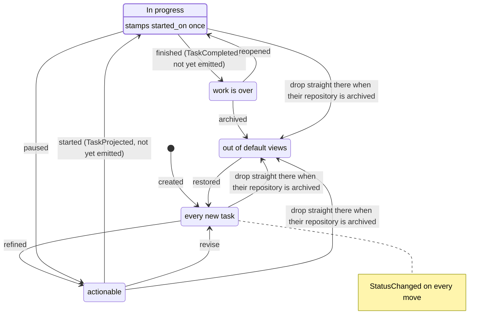
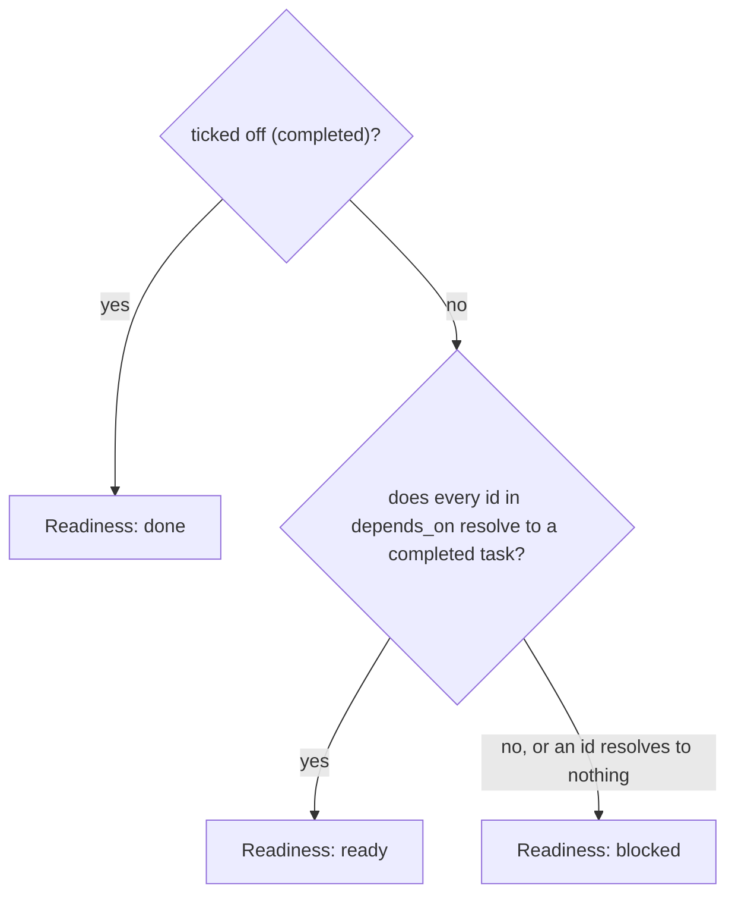

# Task

```meta
type: domain
```

## Task

```meta
type: aggregate
related: [.devbook/domain/inbox/domain.md#inbox-item, .devbook/arc42/08-crosscutting-concepts.md#shared-data-types, .devbook/arc42/08-crosscutting-concepts.md#task-sync, .devbook/arc42/adr/0005-azure-hosted-task-replica-for-multi-device-sync.md, .devbook/domain/work/domain.task.invariants.md#task]
aliases: [TaskItem, task_id, BacklogEntry, backlog_entry_id, backlog_item_id]
```

**Task lifecycle**

Five recorded states. The tick, readiness and the start date sit beside the status;
they are not states.



- The edges from `Draft`, `Ready` and `InProgress` to `Archived` are
  [dropping an archived repository's open tasks](../repositories/requirements.md#archiving-a-repository).
  `RefileRepositoryTasksCommand` sets each open task filed under that
  repository to `Archived` through `TaskItem.SetStatus`, outside the
  lifecycle's own transitions, as a person's `!archived` edit does. The task
  keeps its filing and nothing is deleted. `Done` and `Archived` tasks are left
  alone.

- The `Ready → InProgress` transition would emit `TaskProjected`, and `Done`
  would emit `TaskCompleted`. Both are documented, not yet emitted; see
  [Projection](domain.md#projection) for the policy and
  [its requirements](requirements.md#projection) for what it will do on each.
- [The first move into `InProgress` stamps Started](domain.task.invariants.md#invariant-the-first-move-into-progress-stamps-the-start),
  and pausing or reopening leaves the stamp where it is. A linked task's sync
  that only passes through `InProgress` on the way to `Done`
  [stamps no start](requirements.md#requirement-the-sync-walks-the-status-along-the-lifecycle).
- `Done` and `Archived` say the work is over. The tick that says the person has
  dealt with the task is [Completed](domain.md#completed), a separate fact and
  not a state in this diagram.
  [The list's checkbox also moves an open task to `done`](requirements.md#requirement-ticking-an-open-task-off-moves-it-to-done)
  in the same save. A finished task that still read "in progress" would be the
  list contradicting itself.
- Scheduling attributes do not appear in this diagram, and that is deliberate.
  A due date, a reminder, a repeat and a My Day stamp are facts about when work
  is wanted, not lifecycle states. An overdue task is still `ready`, and nothing
  has to move a task between states as a clock advances.

A refined, actionable item in the personal backlog and the consistency boundary
for all of its sub-items, projections, and usage history. It is the single source
of truth on the device that holds it. Even when it targets multiple repositories,
it is one logical item with one priority and one status. The rules it holds are in
[its invariants](domain.task.invariants.md#task).

A task that stands for an item in an outside system carries a [Source Ref](#source-ref)
and is a [Linked Task](domain.md#linked-task). The source then owns its title, status
and assignee (local ADR 0020).

The task also carries two attributes that place it in the person's own working
set rather than in any external system:

- `area`, its [Area](domain.md#area). What a blank area reads as is
  [an invariant of the task](domain.task.invariants.md#invariant-a-blank-area-is-unfiled).
- `order`, a manual rank used to hand-sequence tasks within the backlog. How the
  backlog lists the tasks nobody ranked is a requirement of
  [Manual ordering](requirements.md#requirement-unranked-tasks-fall-back-to-recency).

Both are freely re-settable and carry no lifecycle invariant of their own. Both
are aggregate state rather than a display preference, so both travel with the
task to the person's other machines. A sequence arranged by hand is an edit, and
an edit that did not travel would quietly revert on the other device.

Beyond that working-set placement the task carries five scheduling attributes.
All are optional, and none is load-bearing for the lifecycle.

- `due_on` is the task's [Due Date](domain.md#due-date).
- `remind_at` is its [Reminder](domain.md#reminder). Overdue is derived by comparison
  rather than stored. Delivery sits outside the aggregate: the task records that
  a reminder was wanted, not that one was sent.
- `recurrence` says the task repeats and is described by the `Recurrence` value
  object.
- `in_my_day_on` is the date behind [My Day](domain.md#my-day).
- `agenda_time` places the task in that day and is described by the
  [Agenda Time](#agenda-time) value object. It has no date of its own, so
  [a task outside My Day holds none](domain.task.invariants.md#invariant-a-task-outside-my-day-holds-no-agenda-time)
  and [a new My Day date drops it](domain.task.invariants.md#invariant-a-new-my-day-date-drops-the-agenda-time).

`completed_on` records that the task is [Completed](domain.md#completed); that term says
how the tick differs from `status`. The tick carries no invariant. The list's
checkbox writes two facts at once, because a person who ticks something off has
finished the work. That is the checkbox's choice, not a rule on the task. What it
does to the status is therefore a requirement of
[Archive and lifecycle](requirements.md#archive-and-lifecycle), and a
`completed:` token typed into the text moves no status. The phone's done and
undone are
[that same checkbox](requirements.md#requirement-a-tick-on-the-phone-is-the-desktops-tick).

`started_on` records that the task is [Started](domain.md#started).
[The first move into progress stamps it](domain.task.invariants.md#invariant-the-first-move-into-progress-stamps-the-start)
from the local date, whether the move is a lifecycle step or a status set from
the text. Nothing on the task reads it. It is recorded for the roadmap, which
draws a finished plan from its first task's start to its last task's tick.

It is written on the
metadata line as a `started:` token just before `completed:`. A token typed there
sets the date, and deleting it clears the date. A task still `in_progress` is
then stamped with today again on that save. Work that was already under way
before the stamp existed has none until its next transition into `in_progress`.

`depends_on` lists the task's [Dependencies](domain.md#task-dependency), held as plain
identifiers, the same rule `repo_ids` follows. Every `Task` is its own aggregate
root, so there is no object graph between them. [Readiness](#readiness) is read
from this list, and
[how it is derived](domain.task.invariants.md#invariant-readiness-is-derived-and-never-stored)
is an invariant. [Dependency](domain.md#task-dependency) says why an
unresolvable id still blocks and why no invariant prevents a cycle.

`planned_hours` lists the task's [Planned Hours](domain.md#planned-hours) in date order.
It is the task's own field and never text in it, so the text save neither writes
nor clears it. Each figure stays within
[the bounds a figure has](domain.task.invariants.md#invariant-a-planned-hours-figure-is-more-than-none-and-at-most-a-day),
and the task holds
[one figure a day](domain.task.invariants.md#invariant-a-task-holds-one-planned-hours-figure-a-day).
A recurring task's next occurrence starts with none, since the days belonged to
this one.

`attachment` names the one place on disk where the task's material lives, as an
[Attachment](#attachment). It carries no invariant and is never validated. Its
spelling on the metadata line is defined in
`.devbook/design/content-editing.md#scheduling-and-dependency-tokens`.

The task also carries one attribute that is not a fact about the work at all.
`view` once recorded which reading of the body a person last asked for: the
steps, or the Markdown block they are written in. The desktop now shows
the body as one Markdown editor and neither reads nor writes `view`. It is a retired display preference, kept because it is stored. Nothing in
the lifecycle or any invariant reads it, and a task that never
carried one has none.

It is written on the task's
metadata line, so [it survives a text save](requirements.md#requirement-a-view-token-on-the-line-survives-a-save),
and it travels to the person's other devices through the replica. Its spelling is in
`.devbook/design/content-editing.md#scheduling-and-dependency-tokens`.

A task spawned as the next occurrence of a repeating one carries
`recurrence_source_id`, naming the occurrence it followed. It is provenance, like `source_inbox_id`, and carries no invariant. A spawned task is
a separate aggregate, and the task it came from may since
have been archived or deleted.

A task created by importing a plan carries `import_plan_id` and
`import_item_id`, naming the plan and the item that produced it. Both are provenance with no invariant. Together they are
also the key a later import of the same plan uses to recognize the task an item
already produced. Re-importing an updated plan therefore brings a task under way
up to date instead of standing a second one beside it. Such an import
clears the plan's not-yet-started tasks by `import_plan_id` alone; see
[Re-importing an updated plan](features.md#re-importing-an-updated-plan).

`import_plan_id` is also added to the task's `tags`, so filing and filtering by plan
reuse the mechanism of filing against a
[roadmap tag](features.md#filing-a-task-against-a-roadmap-tag). It is that tag verbatim, with the plan sigil the
[Roadmap Tag](domain.plan.md#roadmap-tag) term describes, and
[the plan id keeps its sigil](domain.task.invariants.md#invariant-a-plan-id-keeps-its-sigil).
A plan written under a general `#slug` before the sigil existed is a
different plan from one written under `+slug`
(`.devbook/arc42/adr/0013-imported-plan-is-a-roadmap-item-laid-out-by-import.md`).

A task filed as a
[follow-up after an entry](features.md#filing-a-follow-up-after-an-entry) carries
`source_notification_id`, naming the notification whose answer asked for it. It is
provenance with no invariant, and the key that keeps a second delivery of the same answer from filing
a second task. Such a task carries its plan's tag but no `import_plan_id`, so a
re-import of the plan leaves it alone.

The task also carries an optional `effort`, its [Effort](domain.md#effort), within
[the bounds the task enforces](domain.task.invariants.md#invariant-effort-is-never-negative).
Deriving the estimate is not built here. The value
can be registered and shown, whether a person or an AI agent set it. A plan
totals it through
[Roadmap Item Gathering](domain.md#roadmap-item-gathering).

Two attributes exist so the same task can live on more than one of the person's
machines:

- `updated_at` is the moment the task last changed, in UTC.
  [Every edit restamps it](domain.task.invariants.md#invariant-every-edit-restamps-the-task),
  a change to `order` or `area` included, which is what makes those travel.
  On this device it is also what a save is checked against: a task read from the
  store carries the `updated_at` it was read at, and
  [a save made on an older version is refused](requirements.md#requirement-a-save-made-on-an-older-version-is-refused).
- `deleted_at` makes the task a [Tombstone](domain.md#tombstone).

Neither carries a lifecycle invariant, and the device writes both.

They are here rather than in the storage adapter because reconciliation is a
domain rule. When the same task is edited on two
machines, [the later edit wins whole](requirements.md#requirement-the-later-edit-wins-whole).
A deletion has the same
problem in sharper form, which is why it leaves a [Tombstone](domain.md#tombstone).

Devices reconcile with each other. The cloud
holds a replica that carries changes between them and is never the
authority; see
`.devbook/arc42/adr/0005-azure-hosted-task-replica-for-multi-device-sync.md`.

### Sub-Item

```meta
type: entity
aliases: [SubItem]
```

An ordered breakdown step owned by the task, with its own `title`,
`Sub-Item Status`, optional `notes` and `order`. It has identity within the
aggregate but no meaning outside it. Sub-items can be reordered, added, or removed
independently. They may project to task-list checkboxes inside the task's own
GitHub issue, but never as an issue of their own. `Projection
Ref` is owned by the task and a step has nowhere to record one, so a step
filed separately could be filed again undetected.

A step, in the product's language, is a sub-item. A step inherits its parent's deadline. A breakdown step
that needed its own priority would be a task. Type, priority, status vocabulary, tags and scheduling or
dependency attributes all stay on the task.

### Projection Ref

```meta
type: value-object
```

An immutable link to a downstream external artifact created from the task:
`repo_id`, `external_id`, and `target_type`. The target types in use are `issue`,
`pull-request` and `session`. A Copilot CLI task is an intended target, `cli-task`,
that nothing creates yet. Equality is by value. It points outward, where the
[Source Ref](#source-ref) points inward.

### Source Ref

```meta
type: value-object
aliases: [SourceRef, source_ref]
related: [.devbook/domain/work/domain.md#linked-task, .devbook/domain/work/domain.md#task-connector, .devbook/arc42/adr/0020-external-items-arrive-as-linked-tasks.md]
```

Where a [Linked Task](domain.md#linked-task) came from. Equality is by value. A task has at
most one, and a task without one is local work. It holds seven values:

- `connector_id`;
- `external_id`;
- `url`;
- `display_key`;
- `assignee`;
- `source_state`;
- `source_updated_at`.

`connector_id` is a string, not an enum, so a new
[Task Connector](domain.md#task-connector) needs no schema change. A device that does not
know the id still shows `display_key`. `external_id` is the source's stable id,
never a number that moves when the item is transferred. `assignee` and
`source_state` are the source's own values, kept for display and not the
task's status. No screen filters on the assignee ("Assigned to me" was
removed), though a sync still rewrites it.

Each sync rewrites the Source Ref. It is held in an additive `source_ref`
column (local ADR 0006) and travels in the replica payload. A
[Projection Ref](#projection-ref) points the other way: at an artifact created
from the task.

### Recurrence

```meta
type: value-object
aliases: [Repeat, repeat, recurrence, RepeatLabel, RecurrenceUnit, DayOfWeek]
```

How often a task repeats: an `interval`, a `Recurrence Unit`, and an optional
set of `Weekday`s the repeat is restricted to. "Every weekday" is interval 1,
unit week, weekdays Monday through Friday; "every other week" is interval 2,
unit week, with no weekday restriction. Equality is by value.

The value object describes the shape of the repeat only. When the next
occurrence falls is the `Occurrence Spawning` policy's calculation, anchored to `due_on`
rather than the completion date.

### Agenda Time

```meta
type: value-object
aliases: [agenda_time, AgendaTime, at, for]
related: [.devbook/domain/work/domain.md#my-day, .devbook/domain/work/features.md#my-day, .devbook/design/content-editing.md#scheduling-and-dependency-tokens]
```

Where a task sits in its My Day: a `start`, a local wall-clock time of day in
24-hour form, and a `duration` in whole minutes. The pair describes one block,
such as 10:45 for 45 minutes, which runs from 10:45 to 11:30. Equality is by
value.

The time carries no zone, like a [Reminder](domain.md#reminder): 10:45 means 10:45
on the reader's clock. A valid pair is an
[invariant of the task](domain.task.invariants.md#task):

- [a duration without a start is no agenda time](domain.task.invariants.md#invariant-a-duration-without-a-start-is-no-agenda-time);
- [a start alone is thirty minutes](domain.task.invariants.md#invariant-a-start-alone-is-thirty-minutes);
- [a duration is a positive whole number of minutes](domain.task.invariants.md#invariant-an-agenda-duration-is-a-positive-whole-number-of-minutes).

An agenda time has no date of its own. It borrows the date of
[My Day](domain.md#my-day), so it means something only while the task is in the reader's My Day. A task whose My Day date has passed keeps the value until the next change,
but nothing reads it. The [Task](#task) holds it on these terms:

- [a task outside My Day holds none](domain.task.invariants.md#invariant-a-task-outside-my-day-holds-no-agenda-time);
- [a new My Day date drops it](domain.task.invariants.md#invariant-a-new-my-day-date-drops-the-agenda-time);
- [a text save that moves My Day drops the slot carried along](domain.task.invariants.md#invariant-a-text-save-that-moves-my-day-drops-the-slot-carried-along).

The agenda time crosses the sync task feed as two plain values beside
`in_my_day_on`: the start as `HH:MM` and the duration in minutes. Both are absent
on a task with no slot, as in a document from a build that never sent them. The phone's `task_view` row reads them off the document.

Only the desktop sets an agenda time. The phone reads it for the Now and
Agenda groups and Focus, as [My Day](features.md#my-day) describes, and
clears one only by moving a task to tomorrow.

### Attachment

```meta
type: value-object
aliases: [attachment, files, attached folder, attached material]
```

Where a task's material is kept: a `path` naming a folder or an archive.
Equality is by value.

**One place and not a list.** "The files for this" is a
folder a person already keeps them in. A second place is not a second attachment: it is either the same folder further up
or a different task.

**A path and not a copy.** Task attachments are machine-local
(`.devbook/arc42/adr/0014-attachments-travel-through-a-blob-store-beside-the-replica.md`):
nothing is imported or stored beside the task, and the material stays
where its owner put it.

Whether the path resolves is the file system's answer, and differs by machine, so the value carries no invariant and is never
validated. A task written on the desktop is not invalid for
naming a drive the phone has never seen. Attaching claims where
material lives, not that the reader can reach it.

Two things are read off the path rather than stored:

- Its `name` is the last segment.
- The path's spelling decides whether it is an archive, not the disk. The
  value therefore stays comparable, and a renamed file cannot change what
  the task says.

A folder called `backup.zip` is an archive by this rule, which only decides which word to call it.

How much is in the place is deliberately not part of the value: a stored count
would stop being true when somebody added a file.

### Usage Event

```meta
type: value-object
```

An immutable audit record of a prompt copy/use: `timestamp` and `action`.
Equality is by value.

### AI Work Log

```meta
type: value-object
aliases: [AIWorkLog, AIWorkLogged]
```

An immutable record that an AI-assisted action contributed to the task. Equality
is by value. It holds:

- `timestamp`;
- `ai_tool`;
- `activity_kind`;
- optional `session_id`;
- optional `outcome_ref`.

### Task Type

```meta
type: enum
related: [.devbook/domain/work/domain.md#task-dependency]
aliases: [TaskType]
```

Classification of the task: `prompt`, `task`, `idea`, `test`. A follow-up is a
`Dependency` on the task it comes after rather than a type of its own. One
[filed from a gate answer](features.md#filing-a-follow-up-after-an-entry) is a
`prompt`.

### Task Status

```meta
type: enum
aliases: [TaskStatus]
```

Lifecycle state: `draft`, `ready`, `in_progress`, `done`, `archived`.

### Priority

```meta
type: enum
```

Ranking of the task, its **execution priority**: `low`, `medium`, `high`,
`critical`. A plan's [Planning Priority](domain.plan.md#planning-priority) is a
separate judgement, and
[neither writes the other](domain.plan.invariants.md#invariant-planning-priority-never-touches-the-task).

### Sub-Item Status

```meta
type: enum
```

Completion state of a sub-item: `pending`, `done`.

### Recurrence Unit

```meta
type: enum
```

The period a repeat is counted in: `day`, `week`, `month`, `year`.

### Weekday

```meta
type: enum
```

A day of the week, `monday` through `sunday`. Used only to restrict a weekly
`Recurrence`.

### Readiness

```meta
type: enum
aliases: [TaskReadiness, ready, blocked]
```

**Readiness derivation**



- Completing one task unblocks its dependents with nothing to recalculate, because
  [readiness is derived](domain.task.invariants.md#invariant-readiness-is-derived-and-never-stored).
- The first question is the [tick](domain.md#completed), not `Task Status`; see
  [A ticked task reads done](domain.task.invariants.md#invariant-a-ticked-task-reads-done).
- [An id that resolves to no visible task leaves the task blocked](domain.task.invariants.md#invariant-a-dependency-naming-no-task-still-blocks),
  and [a dependency loop leaves every member blocked](domain.task.invariants.md#invariant-every-task-in-a-dependency-loop-reads-blocked).
  [Dependency](domain.md#task-dependency) says why.

Where a task stands once the tasks it waits on are counted:
`done`, `ready`, `blocked`. It is read from `depends_on`.

There are three values because "not done" covers both the task that can
be picked up now and the one that cannot. Telling them apart is the whole
reason to write a dependency down.

Readiness is orthogonal to `Task Status`: status is the recorded lifecycle state,
readiness a conclusion about whether the task can be started. Readiness's
`done` is the [tick](domain.md#completed), not the status of the same name.
