# Work

```meta
type: features
```

> Features and sub-features this bounded context supports, described in
> business/ubiquitous language rather than implementation terms. The task's
> features come first, then the plan's, from [Owning a stored plan](#owning-a-stored-plan) on.

## Task creation

```meta
type: feature
related: [.devbook/domain/inbox/features.md#routing]
```

Create tasks manually or from triaged inbox items. New tasks default to `draft`.
A new task captures:

- its title and body;
- its type (prompt, task, idea, test);
- its tags;
- its project/repo link.

## Refinement and prioritization

```meta
type: feature
depends-on: [.devbook/domain/work/features.md#task-creation]
```

Edit and enrich tasks over time: set priority and status, add context links,
and flag oversized items with suggested splits. On the desktop a person edits the
task's Markdown content directly. They can also adjust these from the reading layout:

- type;
- priority;
- repository;
- status;
- metadata tags.

The task's repository picker lists **Brain** first, set off from the
repositories. Picking it clears the task's repository: Brain is the name the app
gives to filing a task against no repository (local ADR 0027).

Expanded tasks open into an inline Markdown editor for the full task body.
Compact tasks can stay on one line when they only need metadata-level
refinement.

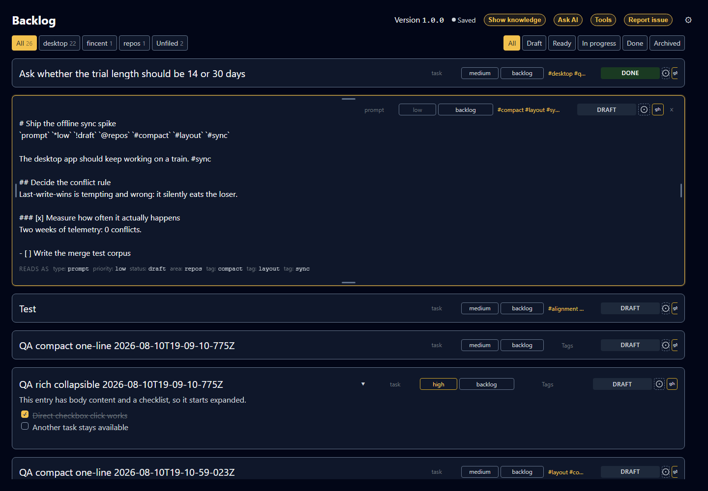

### Filing a task against a roadmap tag

```meta
type: sub-feature
related: [.devbook/domain/work/domain.plan.md#roadmap-tag, .devbook/domain/work/features.md#search-filter-and-organize]
```

Choose a task's tags from a picker that offers every
[Roadmap Item](domain.plan.md#roadmap-item) tag alongside the tags already
in use. A person files a task against planned work by picking the plan's own
vocabulary rather than retyping it. The tag then matches exactly, and the roadmap can gather the task back later.

The picker offers **every** roadmap tag, including ones no task has used yet. The
tag is the same slug the roadmap item holds, and it keeps
matching when the item's title is renamed. Tags remain free-form strings on the task, and nothing forces one to
come from the roadmap.

The picker offers each roadmap tag wearing its plan sigil, `+release-q4`, so a
reader can tell at a glance which tags file the task against planned work. The
[Roadmap Tag](domain.plan.md#roadmap-tag) term says how the sigil reads and how the
roadmap matches it.

### Sub-items and steps

```meta
type: sub-feature
related: [.devbook/domain/work/requirements.md#sub-items-and-steps]
```

Break a task into ordered sub-items with a title, a status (pending or done),
and notes. The parent shows its progress, such as 3/5 done. Sub-items can project
to GitHub issue task lists.

On the desktop a step is a `##` chapter written in the task's body. A person edits that text to add,
rename, reorder and remove steps. A step is finished with
`[x]` in its heading or `!done` on the line under it. On the phone a person ticks a
step from the checklist on the task's own page, while the task is in
today's My Day.

A step is a [Sub-Item](domain.task.md#sub-item); that chapter says what a step
carries and what stays on the task.

### Attached material

```meta
type: sub-feature
related: [.devbook/domain/work/domain.task.md#attachment]
```

Point a task at the folder or archive where its material is kept, such as the
review pack, the screenshots or the exported data. Take the pointer off again
when it is no longer needed. The task records the place and its name,
and whether it is a folder or an archive.

The [Attachment](domain.task.md#attachment) chapter owns the rules: one place per
task, and a pointer rather than a copy. Task attachments are
machine-local (local ADR 0014), so a path is meaningful on the machine that wrote
it. A task read elsewhere may name a place that is not there, and stays valid. Only where the material is
is recorded, not how much.

### Acceptance from scenario parts

```meta
type: sub-feature
related: [.devbook/domain/devbook/features.md#rendered-devbook-documents, .devbook/domain/sessions/features.md#scenario-evidence-from-a-verify-stage, .devbook/arc42/adr/0053-a-plan-or-a-task-may-reference-a-brain-note.md]
tests: [unit:dotnet:Backlog.UI.Components.UnitTests.ScenarioPartChecklistTests, unit:dotnet:Backlog.Modules.Work.Tasks.UnitTests.TaskDevbookReferenceTests.A_brain_note_is_kept_as_its_address, unit:dotnet:Backlog.Modules.Work.Tasks.UnitTests.ImportPlanDevbookReferenceTests.A_devbook_token_naming_a_brain_note_lands_on_the_task, unit:dotnet:Backlog.Infrastructure.Brain.UnitTests.BrainDevbookReferenceResolverTests, unit:dotnet:Backlog.Infrastructure.Devbook.UnitTests.DevbookReferenceResolverTests.A_brain_address_is_never_looked_up_in_the_repository_devbook, unit:dotnet:Backlog.Infrastructure.Mcp.UnitTests.DevbookReferenceToolsTests.A_brain_note_is_listed_with_the_brain_scope_and_its_note_path, unit:dotnet:Backlog.Desktop.UI.UnitTests.EntryDevbookReferencesTests.A_brain_note_is_a_brain_chip_that_says_when_it_is_not_in_this_brain_and_can_be_removed, unit:dotnet:Backlog.Desktop.UI.UnitTests.EntryDevbookReferencesTests.Scenario_parts_are_an_acceptance_checklist_with_how_many_pass, unit:dotnet:Backlog.Desktop.UI.UnitTests.EntryDevbookReferencesTests.A_failed_part_names_the_step_its_run_stopped_on, unit:dotnet:Backlog.Infrastructure.Devbook.UnitTests.DevbookReferenceResolverTests.A_failed_part_carries_the_step_its_run_stopped_on, unit:dotnet:Backlog.Infrastructure.Mcp.UnitTests.DevbookReferenceToolsTests.Listing_answers_every_part_state_and_the_failed_step, e2e:dotnet:Backlog.EndToEndTests.ScenarioEvidenceTests.A_task_referencing_the_parts_shows_the_acceptance_checklist]
```

A task can point at the parts of a journey that prove it. A journey is one
end-to-end walk, a `##` chapter of a context's scenarios file in the repository's
devbook. Each of its `###` parts is an outcome the journey reaches.

The task
points at a part as `<scenarios file>#<part>`. It
can also point at a journey or a whole scenarios file, which stand for every
part they hold. A requirement stands for the parts its `Proved by:` lines name. A
part reached two ways counts once.

The open task lists these parts under its Devbook references as an acceptance
checklist headed "Acceptance · scenario parts". Each row shows the part's dot and the
part. A quieter line names the journey by its anchor, which also names the
run folder. It says when the journey last ran, as
"place-an-order · 14 Oct 2026 09:30", or "Never run". A failed part whose run recorded the step it stopped on adds that step, as
"· step 2".

The list says how many parts pass and whether that proves the task, as
"2 of 3 passing · not proved" or "3 of 3 passing · proved". A part reads as passed
only when its last run passed on the journey as it stands now. A part that passed
before the journey was edited is stale, because the run proved a different journey,
and it shows no step.

Pressing a part opens its scenarios file in the Devbook pane at that part. The part stays marked and scrolled into view until the
reader picks another chapter or reference. A part the file no longer has opens the file and marks nothing.

When every part passes, the task is proved. That is a signal only: the task keeps its status until a person moves it.

A task's own text can name a scenario screenshot, as an image written
`scenario:<scenarios file>#<label>`. The task detail shows the body as
Markdown source, so the image reads as the text written. Drawing it waits for a rendered reading of the body. Until then the
screenshot is shown where its scenarios file is read in the Devbook pane
([Rendered devbook documents](../devbook/features.md#rendered-devbook-documents)).

A coding session gets the same answer. Listing a task's Devbook references gives
each part with its state, last run and failed step, and a count
with whether the task is proved.

A task's Devbook references may also name a note in the person's Brain, as
`#brain:<path from the Brain's root>`, optionally followed by `#heading`. It is
typed into the task's Devbook picker, written by Import's `devbook:` token, or set
over MCP. One that names no note, such as `#brain:` alone, is refused. It is never
looked up in the repository's devbook.

Only the Brain's owner sees it resolved, from their own Brain. The task shows it as
a Brain chip titled from the note, which opens the note on the Devbook pane's Brain
side. Anyone else, and an owner with no Brain set, sees the address unresolved,
never as an error. A Brain without the note says so on the chip. Either way the
chip can be removed.

Listing the references over MCP marks the note with `scope: "#brain"` and gives
its path from the Brain's root, which `read_knowledge_chapter` reads under
`#brain` ([MCP Brain scope](../brain/features.md#mcp-brain-scope)). A session run
on the task reads those notes before it works. The address travels with the task,
and the note's content never does (local ADR 0053).

## Bulk editing

```meta
type: feature
depends-on: [.devbook/domain/work/features.md#refinement-and-prioritization]
related: [.devbook/domain/work/features.md#search-filter-and-organize, .devbook/domain/work/features.md#my-day, .devbook/domain/work/features.md#recurring-tasks, .devbook/domain/work/features.md#multi-repo-targeting]
```

Select several tasks in the current view and set one field across all of them
at once. The selection is made in the list and carries a running count.

| Field | Set | Add | Withdraw | Clear |
|---|---|---|---|---|
| Repo | Yes, replacing whatever repos each task targeted | | | |
| Status, type, priority | Yes | | | |
| Tags | | The chosen tags, to every selected task | One named tag, from every selected task | |
| My Day, reminder, due date | Yes | | | Yes |

Tags are the one field a bulk change does not replace: each task's remaining tags
stay untouched. Status, type, and priority always hold a value, so they can only
be set.

A bulk change reaches only the field being set. A task already holding the target
value is left alone and counted as unchanged.

The outcome is a count of the tasks that changed. A task that
cannot be saved is reported alongside that count rather than abandoning the
rest of the batch. A batch that only partly succeeds says so.

Marking a batch done spawns a successor for each recurring task it holds, as
completing them one at a time does.

A selected task that leaves the current view, by a filter change or by the change itself, leaves the selection.

The selection can also be deleted as a whole. The act sits beside the
field changes, names how many tasks it will take, and applies as directly as
deleting one task. The outcome is reported as for a field
change, and deleting everything selected empties the selection.

## Effort registration

```meta
type: feature
depends-on: [.devbook/domain/work/features.md#refinement-and-prioritization]
related: [.devbook/domain/work/domain.task.md#task, .devbook/domain/work/features.md#gathering-work-under-an-item-and-totalling-its-effort]
```

Record a task's [Effort](domain.md#effort). The size of the work is then a fact
about the task rather than a guess made each time someone reads the plan it sits
under. A task with none is not estimated, which is a normal state. A re-estimate happens when the *understanding of
the size* changes, not when time passes.

An AI assistant may derive the estimate from the task's content, and a person
can always set or correct it by hand. The deriving is not built yet. This feature
makes the value **registrable and visible**, so a roadmap item that gathers this task
[adds up](features.md#gathering-work-under-an-item-and-totalling-its-effort) the points
registered here. An unestimated task is counted as unestimated there, never as zero.

## Open-work report

```meta
type: feature
depends-on: [.devbook/domain/work/features.md#effort-registration]
related: [.devbook/domain/work/features.md#gathering-work-under-an-item-and-totalling-its-effort, .devbook/domain/work/features.md#task-dependencies]
```

Say how much work is open, not only how it splits. The total is one line: how many tasks
are open, the points they carry, and how many carry none. It sits at the end of the
filter bar. In a narrow list it moves beside **New entry**, so the bar keeps its room for filters.
The Board has no **New entry** row, so there it stays on the bar.

It counts what the
repository scope leaves in view, before any status, tag or other filter narrows
the list, so pressing a filter never changes the total.
Open means not ticked off. The points follow the
[effort total's rule](features.md#gathering-work-under-an-item-and-totalling-its-effort):
zero is an estimate, and the unestimated count is said beside the sum rather
than folded into it.

The line is also the way into a report of that same open work, which has
these sections:

- The headline numbers, and what was ticked off in the last seven days, as tasks
  and as points under the same rule.
- Each plan's open tasks, points and progress, with the work filed under no plan
  as its own line.
- How the open work splits by status, priority, type and repository.
- What needs attention: the tasks overdue and due within the week, each named
  and opening from the report. It also says how many tasks are waiting and what
  they weigh.

Waiting work is totalled rather than listed, because each row in the pane
already names [what it waits on](#task-dependencies).

## Scheduling and recurrence

```meta
type: feature
depends-on: [.devbook/domain/work/features.md#refinement-and-prioritization]
related: [.devbook/domain/work/domain.task.md#task]
```

Say when a task is due, when to be reminded of it, and whether it comes back.
These are three separate facts: a deadline, an alarm, and a shape. A
backlog that could only say "Friday" could not tell the task due
that day from the one that should interrupt you that morning.

All three are optional and none changes the task lifecycle. A task
with a due date in the past is overdue, read by comparison rather than
recorded as a status, so nothing has to sweep the backlog.

The scheduling fields are written on the task's metadata line as named tokens,
such as `due:2026-08-21`, `remind:2026-08-21T09:00` and `repeat:weekly`. They sit beside the sigil tokens for type, priority, status, area and tags. They are
named because the punctuation namespace is nearly
exhausted, and five one-character marks for five date-shaped concepts would be
unreadable in a hand-edited file.

### Due dates

```meta
type: sub-feature
```

Commit a task to a calendar day, its [Due Date](domain.md#due-date). The channel showing it decides how the
date reads, such as "Today", "Friday, 21 August" or a localized format.

### Reminders

```meta
type: sub-feature
```

Ask to be reminded of a task at a chosen local date and time, its
[Reminder](domain.md#reminder). One whose time has passed reads as overdue until
it is cleared or the task is completed, so a reminder that came due while the app
was closed surfaces.

### Recurring tasks

```meta
type: sub-feature
related: [.devbook/domain/work/domain.md#occurrence-spawning, .devbook/domain/work/features.md#archive-and-lifecycle, .devbook/domain/work/requirements.md#recurring-tasks]
```

Repeat a task every day, week, month or year,
optionally restricted to particular weekdays so "every weekday" is expressible.
The repeat is anchored to the due date, not to when the work finished. A task completed three days late still falls due on its original
weekday.

Ticking a recurring task off, which is what [Completed](domain.md#completed)
means, leaves it completed and creates the next occurrence as a new task. The
finished occurrence stays as the record of what was done. A repeating task therefore accumulates one
completed task per occurrence, and archiving keeps those out of the default
views. [Occurrence Spawning](domain.md#occurrence-spawning) says what the new
occurrence carries over.

## My Day

```meta
type: feature
depends-on: [.devbook/domain/work/features.md#refinement-and-prioritization]
setting: .devbook/domain/work/context.md#clear-my-day-overnight
related: [.devbook/domain/work/features.md#scheduling-and-recurrence, .devbook/domain/work/domain.task.md#agenda-time, .devbook/domain/work/domain.md#my-day, .devbook/arc42/06-runtime-view.md#mobile-my-day-and-task-push, .devbook/design/content-editing.md#scheduling-and-dependency-tokens, .devbook/domain/work/requirements.md#my-day, .devbook/arc42/adr/0032-my-day-preferences-ride-the-task-feed.md, .devbook/arc42/adr/0072-the-tasks-pane-groups-by-plan-and-a-plan-is-queued-as-a-whole.md, .devbook/domain/work/domain.plan.md#roadmap-item]
```

Pick the tasks to work on today, separately from when they are due. A task
due next Friday can be in today's [My Day](domain.md#my-day), and a task due
today need not be.

My Day expires on its own unless the person turns
[Clear My Day overnight](context.md#clear-my-day-overnight) off. With it on,
the default, yesterday's list clears itself without a timer or an overnight sweep. A device that was switched off for a week comes back to an
empty My Day.

With it off, an unfinished task picked on an earlier day stays in today's My Day
until the person ticks it off or takes it out. A task ticked off today stays,
ticked, until the day ends. One ticked off on an earlier day is gone, and a task moved to tomorrow never shows today. The person sets the switch on the desktop,
and every paired device follows it.

A plan can be put on My Day too, by a My Day date on its
[Roadmap Item](domain.plan.md#roadmap-item) (local ADR 0072). The plan is in
today's My Day by exactly the rule a task is, under the same Clear My Day overnight
setting. Putting a plan tag that no Roadmap Item carries on My Day creates its item.
On the desktop, the plan shows its progress, its run state, and only its entries left
for you, held, or awaiting validation. The phone's Today tab shows the plan as one line
above the task groups, without its entries. My Day offers no suggestions.

A task in today's My Day may also carry an [Agenda Time](domain.task.md#agenda-time):
a start time and a duration that place it in the day, such as 10:45 for 45
minutes. It is set and cleared on the desktop only, and dropped when the task leaves My Day. A
task carried over from an earlier day shows none, because its slot
belonged to the day it was picked for.

On the desktop, the agenda time sits in the task's detail pane under
the My Day control, while the task is picked for today. The task row shows
the block beside My Day, such as `10:45–11:30`.

- A start is picked in 15-minute steps and a duration from 15, 30, 45, 60, 90 or 120
  minutes.
- A start picked alone means 30 minutes.
- Changing the start keeps the duration, and changing the duration keeps the start.
- Clearing removes the agenda time and leaves the task in My Day.
- A start or duration typed into the text off those steps is kept and shown as it is.

On the phone, My Day is the Today tab, the first of three tabs
(Today, Inbox, Notes) and the screen the app opens on. Under the phone's own
date it says how many of the day's tasks are ticked off, as `3 of 8 done` with
a bar. It shows My Day, never a due-date grouping,
and splits it into four groups:

**Today's groups**

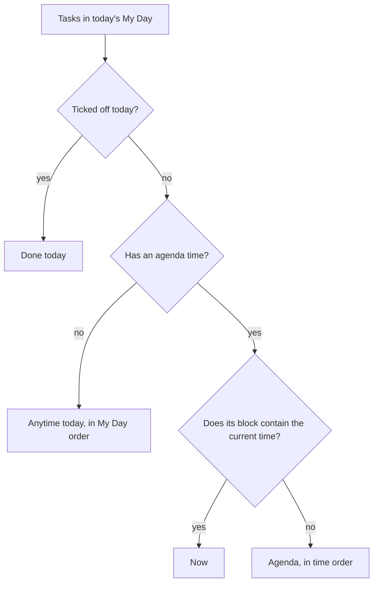

**Now** holds the timed task whose block contains the current time, as
a card at the top labelled `Now · until 11:30`. The card carries the task's first
open step, a bar of its steps, and the ways into Focus and the task's own page.
Between blocks it shows the next timed task, labelled
`Next · 14:00`. With none still to come there is no card.

- **Agenda:** the other open timed tasks in time order, each showing its
  block as `10:45–11:30`.
- **Anytime today:** the open tasks without an agenda time, in the order My
  Day keeps them.
- **Done today:** the tasks ticked off today.

Every row ticks its task off or back on, and opens the task's own page.

**The phone's screens**

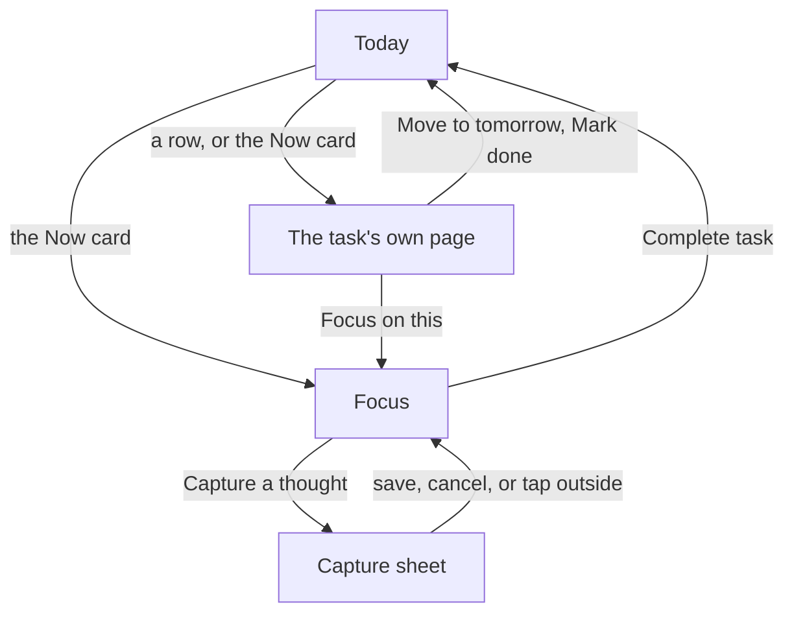

The task's own page shows, from top to bottom:

- a way back to Today, and the title;
- chips for the task's area, its block as `Today · 10:45–11:30` when it has an
  agenda time today, and its effort as `3 points`;
- **Focus on this**, when the task has an agenda time today;
- the task's steps as a checklist headed by how many are done, as `2 of 5`;
- the task's own text, read-only;
- **Move to tomorrow** and **Mark done**.

The steps, Move to tomorrow and Mark done change a task only while it is in
today's My Day and not yet ticked off. Any other task shows its steps
locked and without the two buttons or Focus.

**Focus** exists only for a task with an agenda time today that is not yet
ticked off; for any other task the task's own page opens instead.
It shows the task's area and when its block ends, as `Sync · until 11:30`,
and the title. A ring counts down to the end of the block every second, as
`28:40` left in this block, and past the end reads `Over by 03:12`. The countdown is the block itself, so there is no pause.

Below the ring sit the current step, the first not ticked off, as
`Step 2 of 5 · now`, then the steps in order. **Step done — next** ticks off the
current step. When none is left it becomes **Complete task**, which ticks off
the task. **Capture a thought** opens the capture sheet over Focus.

The phone changes four things about a task and nothing
else:

| On the phone | What it writes |
| --- | --- |
| Add a task | A new task picked for today. |
| Mark a task done or undone | The task's tick, the way the desktop's checkbox writes it. See [Completed](domain.md#completed). |
| Tick or untick a step | The status of one [Sub-Item](domain.task.md#sub-item). |
| Move a task to tomorrow | `myday:` set to the phone's local date plus one day. |

The Today screen adds through its capture button. The other three
changes apply only to a task in today's My Day. Editing, scheduling, the
agenda time and the rest of a task's life stay on the desktop. The phone's delivery is in
`.devbook/arc42/06-runtime-view.md#mobile-my-day-and-task-push`.

## Task dependencies

```meta
type: feature
depends-on: [.devbook/domain/work/features.md#refinement-and-prioritization]
related: [.devbook/domain/work/domain.task.md#task, .devbook/domain/work/features.md#manual-ordering]
```

Record that a task waits on other tasks, so prompts or tasks meant
to be worked in order say so. A task can wait on several others.

This differs from manual ordering. Ordering is the sequence a person
arranged the backlog in; a dependency is a constraint that holds in any list order.

### Readiness and chain order

```meta
type: sub-feature
```

Read off what can actually be started, as each task's
[Readiness](domain.task.md#readiness). A blocked task says what it is waiting for.
Finishing one task unblocks its dependents with nothing to recalculate.

Two questions get separate answers: which
task to pick up first, and which tasks could be started now. In a straight chain
those are the same task. When finishing one step unblocks three, they are not.

[A dependency naming a task that cannot be found still blocks](domain.task.invariants.md#invariant-a-dependency-naming-no-task-still-blocks),
and [dependency loops are named rather than broken](domain.task.invariants.md#invariant-every-task-in-a-dependency-loop-reads-blocked);
[Dependency](domain.md#task-dependency) says why.

### Marking a task blocked

```meta
type: sub-feature
related: [.devbook/domain/goals/features.md#raising-an-impediment, .devbook/domain/goals/features.md#linking-what-an-impediment-holds-back, .devbook/arc42/adr/0035-goals-and-impediments-replace-sprints.md]
```

Mark a task blocked by hand when something outside the backlog holds it up. Readiness differs: it reads blocked from `depends_on`. The mark is the
`blocked:` token on the task's metadata line, with the day it was set. An agent
sets or clears it with the `set_blocked` tool. Removing the token unblocks the task.

The mark is the task's alone and raises no impediment. A person who wants the block
tracked [raises an impediment](../goals/features.md#raising-an-impediment) and
[links the task](../goals/features.md#linking-what-an-impediment-holds-back) to it.
The task stores no impediment id, and Work never calls Goals.

### Waiting for someone

```meta
type: sub-feature
related: [.devbook/domain/work/domain.md#waiting-for, .devbook/design/content-editing.md#scheduling-and-dependency-tokens, .devbook/arc42/adr/0054-clarify-outcomes-follow-gtd-and-each-item-has-one-home.md]
tests: [unit:dotnet:Backlog.Modules.Work.Tasks.UnitTests.EntryWaitingForTests.The_waiting_for_survives_the_canonical_rewrite, unit:dotnet:Backlog.Modules.Work.Tasks.UnitTests.EntryWaitingForTests.A_passed_follow_up_date_reads_overdue, unit:dotnet:Backlog.Infrastructure.Sqlite.UnitTests.SqliteTaskWaitingForTests.A_database_written_before_the_waiting_for_columns_still_opens_and_reads, unit:dotnet:Backlog.Infrastructure.Sync.UnitTests.TaskReplicaWaitingForTests.A_waiting_for_survives_the_json_document, unit:dotnet:Backlog.Infrastructure.Mcp.UnitTests.WaitingForToolsTests.List_entries_names_who_an_entry_waits_on_and_when_to_follow_up, unit:dotnet:Backlog.Desktop.UI.UnitTests.WaitingForScopeTests.The_slice_keeps_the_waiting_tasks_soonest_follow_up_first_and_undated_last, unit:dotnet:Backlog.Desktop.UI.UnitTests.WaitingForScopeTests.The_editor_clears_the_follow_up_date_alone_or_the_whole_waiting_for]
```

Record who a task waits on outside the backlog, and when to chase them: its
[Waiting For](domain.md#waiting-for). It is the `waiting:` token on the task's
metadata line, free text, with an optional `followup:` date beside it. It is not
the "Waiting for" of a [dependency chain](#readiness-and-chain-order), which names
other entries.

- The open task's **Waiting on someone** group names who and the follow-up date,
  and clears either. Clearing who clears the date too.
- A follow-up date that has passed reads overdue on the task until the waiting-for
  is cleared or the task is ticked off.
- The filter bar's **Waiting** scope lists the open tasks waiting on someone,
  soonest follow-up first and undated last. Reordering is off while it is on,
  because that order is not the rank.
- `list_entries` and `read_item` name who and the date. The waiting-for crosses
  [sync](#multi-device-sync) as two fields of the task's document.

### Filing a follow-up after an entry

```meta
type: sub-feature
related: [.devbook/domain/work/requirements.md#filing-a-follow-up-after-an-entry, .devbook/domain/work/domain.md#task-dependency, .devbook/domain/notifications/features.md#asking-from-the-contexts, .devbook/domain/work/features.md#re-importing-an-updated-plan, .devbook/arc42/adr/0038-backlog-queues-session-requests-and-a-manager-session-dispatches-them.md]
```

File one new prompt that waits on an entry, when the person approves that entry's
delivery run and asks for a follow-up in the same answer. The person answers the
run's Personal Validation question with Approve + follow-up and a few words, on the
phone or desktop. Sessions records the approval and asks Tasks to file the
follow-up. The entry the run was working is the **gated entry**.

The follow-up is an ordinary [Task](domain.task.md#task), born as follows:

| Field | Value |
| --- | --- |
| Type | `prompt` |
| Status | `ready` |
| Waits on | the gated entry, as `after:<id>` |
| Tags | the gated entry's plan tag, when it has one |
| Repository | the gated entry's |
| Title | "Follow-up: " and the gated entry's title |
| Body | the person's words, as body text |
| Provenance | the id of the notification whose answer asked for it |

The gated entry's plan tag is its `import_plan_id`, or else the one plan tag it
carries. The follow-up carries that tag and no `import_plan_id`, so the plan still lists it.
[Re-importing the plan](#re-importing-an-updated-plan) leaves it alone, because
the re-import clears tasks by `import_plan_id`. A gated entry outside any plan gets
a follow-up with no plan tag. A follow-up of a follow-up stays in the plan through
the tag its gated entry carries. Sessions names the gated entry by its id, or by
its plan and item.

The notification id is the follow-up's provenance and its key. An answer handed
over twice files one follow-up, and a deleted follow-up is not filed again by the same answer.

The person's words stay body text. A line that looks like a sub-item, a heading or
a fence is kept as plain text, so the words cannot add steps or structure.

Nothing here creates a session request:
[only a click in the app requests a session](../sessions/requirements.md#requirement-only-a-click-in-the-app-requests-a-session),
as §1 of local
[ADR 0038](../../arc42/adr/0038-backlog-queues-session-requests-and-a-manager-session-dispatches-them.md)
decides. An attended `execute-plan` runs the follow-up like any other ready prompt
of its plan once the gated entry lands, and `run-plan-item` checks it before
doing anything.

## Multi-repo targeting

```meta
type: feature
depends-on: [.devbook/domain/work/features.md#task-creation]
related: [.devbook/domain/work/features.md#projection]
```

Let one task target multiple repositories (`repo_ids[]`) as a
single source of truth: one item, one priority, one status, in one view across all contexts.

## Projection

```meta
type: feature
depends-on: [.devbook/domain/work/features.md#multi-repo-targeting]
related: [.devbook/domain/insights/features.md#personal-productivity-dashboard, .devbook/domain/work/requirements.md#projection]
```

Spawn and close downstream artifacts from a task, without duplicating the task.
What ships is the issue push below, made when the person asks. The
automatic create-and-close is the intended [Projection](domain.md#projection)
policy, and what it will promise is in
[its requirements](requirements.md#projection).

### Issue projection and state read-back

```meta
type: sub-feature
feature-flag: .devbook/domain/work/context.md#github-integration
related: [.devbook/domain/repositories/features.md#github-access-resolution, .devbook/domain/insights/features.md#personal-productivity-dashboard, .devbook/arc42/adr/0042-repository-management-owns-pull-request-state.md#4-tasks-reads-pull-requests-through-its-own-port]
```

**The background check of a linked pull request**

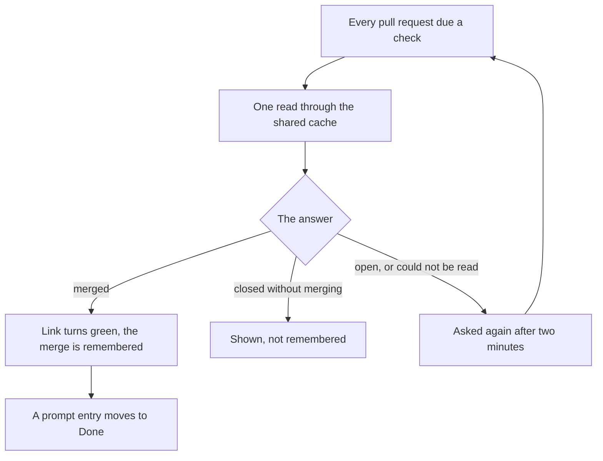

Push a task to its target repository as an issue carrying the task's title,
body, and tags. The resulting issue reference is kept on the task, so the link
is part of the item rather than a note about it. The task can then be asked to
re-read that issue's current state, and the pull request that references it.
Downstream progress is then visible from the backlog.

The pull requests a task records are also checked in the background, without the
person asking. The pull requests pane, Goals and the side panel share the cache that one read goes through. Merged and closed answers land on screen
before open ones.

A merge is remembered on this device. Repositories keeps it in app storage, so the backlog opens instantly and offline
and draws a merged link from the first frame. Tasks keeps only which of its
entries each merge has finished (`IPullRequestFinishMemory`). A restart therefore
neither moves an entry to Done twice nor forgets a move still owed. Neither fact is written to the
task: losing the memory costs one read per
pull request. An open pull request's status is never remembered, because a
stale one would offer a merge GitHub no longer allows.

A prompt entry moves to Done only when the merge is into the
repository's default branch or a `plan/` branch. It moves once per entry and merge,
and only where its lifecycle allows the move. A task or test entry stays the
person's to tick.

## Linked tasks

```meta
type: feature
related: [.devbook/domain/work/domain.md#linked-task, .devbook/domain/work/domain.md#connected-target, .devbook/domain/work/requirements.md#linked-tasks, .devbook/arc42/adr/0020-external-items-arrive-as-linked-tasks.md, .devbook/domain/repositories/requirements.md#archiving-a-repository]
```

Connect a GitHub repository or a spec-manager product, and every open item in it
appears on the Tasks list as a [Linked Task](domain.md#linked-task). The item
needs no triage and no copying. Each sync keeps the title, status and assignee
in step with the source on the terms
[its requirements](requirements.md#linked-tasks) set. It leaves the person's
own priority, My Day, area, sub-items and notes alone.

Every linked task shows a source badge on its row, in the editor header and in
My Day, and the badge opens the item at the source. The Tasks pane filters by
source but not by assignee ("Assigned to me" was removed), though
each sync still keeps the assignee. A label written `+slug` at the source files the
task under that plan. It then appears on the roadmap's
[shelf](features.md#laying-out-a-plan-whose-tasks-arrived-first)
without a step in Backlog.

Settings → Connectors shows each [Connected Target](domain.md#connected-target)
with two settings that decide where its tasks land:

- **Repository** picks one of the repositories in the
  [Repository Registry](../repositories/domain.md#repository-registry).
  The target's new tasks, and its tasks not yet filed under a repository, are
  filed under it. A spec-manager product's tasks can then sit under the
  repository the product is built in. Left empty, a GitHub repository files its
  tasks under itself.
- **Statuses** has one row for each status the source lists, in the source's
  order, each with a task status to pick. The empty choice keeps the status the
  fixed map gives and names it, such as "Default (In progress)". A
  spec-manager product lists its own statuses. A GitHub repository lists none,
  so it shows no rows.

A changed status applies to new tasks at once, and to an existing task when its
item next moves at the source.

The card also holds the target's other settings:

- how old an untouched item may be before the first sync skips it;
- whether the title follows the source;
- the sync interval;
- "Complete at the source", for a connector that can complete items.

A connector that can list its targets offers them to pick by name.

### Syncing a target

```meta
type: sub-feature
related: [.devbook/domain/work/domain.md#connected-target, .devbook/arc42/adr/0020-external-items-arrive-as-linked-tasks.md]
```

The desktop syncs each enabled target on its own timer, every fifteen minutes
unless the target sets another interval. **Sync now** on the target's card in
Settings → Connectors runs one at once and says on the card how it went. The
Tasks pane has no sync button.

A sync that fails writes nothing, and the card shows why in a sentence the
person can act on, with when it happened. The next sync still asks for what
changed since the last success, and its success clears the message.
Each successful sync logs how many items it fetched,
created, updated and archived.

A spec-manager product is read whole on every sync: the open backlog has no
"changed since" question, so only its archived items are asked for by date.

### Deleting the tasks of a disconnected source

```meta
type: sub-feature
related: [.devbook/domain/work/domain.md#connected-target, .devbook/domain/work/domain.md#tombstone, .devbook/domain/work/requirements.md#requirement-reconnecting-a-target-restores-the-tasks-deleted-with-it, .devbook/domain/work/requirements.md#requirement-a-deleted-linked-task-is-never-made-again, .devbook/arc42/adr/0020-external-items-arrive-as-linked-tasks.md]
```

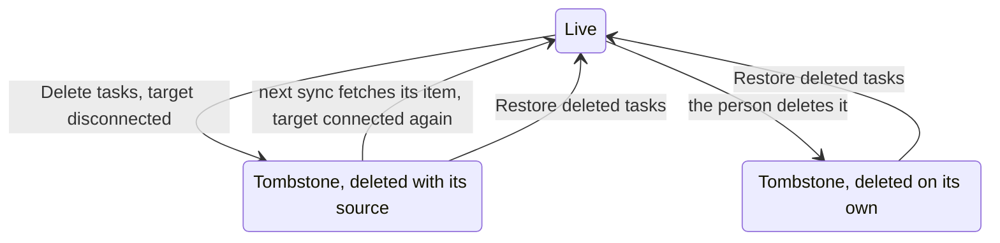

Disconnecting a target keeps its tasks on the list as they are. Settings →
Connectors lists each source that left tasks behind under **Disconnected
sources**, with how many tasks it left. **Delete tasks** asks first and then
makes every one of them a [Tombstone](domain.md#tombstone), whatever its status.

The confirmation says that the items at the source stay untouched and that the
deletion reaches the other devices. It also says that connecting the target
again brings the tasks back, and how many other tasks will wait on a missing
one. A source connected again before the delete runs is refused, because its
tasks belong to the sync again.

The sync that restores a task brings it up to date from the source. A first sync
fetches open items only, so a task whose item has closed since stays deleted
until the person restores it. A task deleted on its own is never brought back
by the sync.

### Restoring deleted tasks

```meta
type: sub-feature
related: [.devbook/domain/work/domain.md#connected-target, .devbook/domain/work/domain.md#tombstone, .devbook/domain/work/requirements.md#requirement-restore-deleted-tasks-restores-every-deleted-task-of-the-target, .devbook/arc42/adr/0020-external-items-arrive-as-linked-tasks.md]
```

A connected target whose linked tasks include deleted ones shows **Restore
deleted tasks** on its card in Settings → Connectors. The confirmation names
how many tasks come back, including those deleted one by one. Confirming restores every deleted task of that target and no other, and
the restore reaches the other devices. The next sync brings each task up to
date. A target disconnected before the person confirms is
refused, and nothing is restored.

### Promote to plan

```meta
type: sub-feature
related: [.devbook/domain/work/domain.plan.md#roadmap-item, .devbook/arc42/adr/0020-external-items-arrive-as-linked-tasks.md]
```

Dropped and never built: it would have turned a linked task into a Roadmap Item. The owner decided against it, and the target setting for what happened to the original task was removed. A linked
task reaches the roadmap only through its [plan label](domain.md#source-label),
and [a sync never creates a Roadmap Item](requirements.md#requirement-a-sync-never-creates-a-roadmap-item).

## Search, filter and organize

```meta
type: feature
related: [.devbook/domain/brain/features.md#bi-directional-linking, .devbook/arc42/adr/0022-the-shell-shows-one-main-view-picked-by-a-view-switch.md, .devbook/design/interaction-guidelines.md#shell-header, .devbook/arc42/adr/0027-the-brain-is-a-scope-beside-the-repositories.md, .devbook/domain/brain/features.md#brain-scope, .devbook/domain/repositories/requirements.md#archiving-a-repository, .devbook/domain/sessions/features.md#start-a-session-from-an-entry]
tests: [unit:dotnet:Backlog.Desktop.UI.UnitTests.TasksPlanSessionRequestTests.An_unpressed_plan_waiting_for_a_session_carries_the_mark_and_says_so, unit:dotnet:Backlog.Desktop.UI.UnitTests.TasksPlanSessionRequestTests.The_pressed_plan_keeps_its_waiting_chip_and_wears_no_mark_while_another_waiting_plan_does, unit:dotnet:Backlog.Desktop.UI.UnitTests.TasksSessionRequestTests.With_nothing_queued_the_trigger_still_shows_muted_at_0_and_the_panel_says_nothing_is_waiting, unit:dotnet:Backlog.Desktop.UI.UnitTests.TasksSessionRequestTests.With_the_action_not_offered_there_is_no_queue_on_the_bar, unit:dotnet:Backlog.Desktop.UI.UnitTests.HomeWorkspaceSurfaceTests.The_board_view_lays_the_tasks_out_in_columns_under_the_filter_bar_and_is_remembered_with_its_columns, unit:dotnet:Backlog.Desktop.UI.UnitTests.HomeWorkspaceSurfaceTests.The_calendar_tab_shows_the_grid_in_its_own_region_and_is_remembered, unit:dotnet:Backlog.Desktop.UI.UnitTests.HomeWorkspaceSurfaceTests.The_view_is_remembered_and_a_fresh_shell_instance_reopens_on_it, unit:dotnet:Backlog.Desktop.UI.UnitTests.HomeRepositoryScopeTests.A_remembered_scope_comes_back_anchor_first_with_the_devbook_option_offered, unit:dotnet:Backlog.Desktop.UI.UnitTests.HomeRepositoryScopeTests.A_remembered_repository_no_longer_configured_is_dropped, unit:dotnet:Backlog.Desktop.UI.UnitTests.HomeRepositoryScopeTests.A_remembered_plural_scope_restored_onto_the_roadmap_collapses_to_the_anchor, unit:dotnet:Backlog.Desktop.UI.UnitTests.HomeRepositoryScopeTests.A_scope_change_is_remembered_and_every_repository_writes_no_key, unit:dotnet:Backlog.Desktop.UI.UnitTests.TagFilterTests.A_pressed_plan_can_be_copied_as_its_tag, unit:dotnet:Backlog.Desktop.UI.UnitTests.TagFilterTests.No_plan_and_general_tags_offer_no_plan_to_copy, unit:dotnet:Backlog.Desktop.UI.UnitTests.TagFilterTests.Pressing_a_plan_further_along_the_strip_leads_it_with_its_copy, unit:dotnet:Backlog.Desktop.UI.UnitTests.TagFilterTests.A_plan_press_hands_the_focus_back_to_the_moved_chip]
```

Find and narrow the backlog:

- Search across title, body, tags and linked knowledge notes.
- Filter by [Area](domain.md#area), repo, type, status, priority, and recency.
- Read the tasks in grouped views, with Devbook content embedded inline.

The repository scope can hold several repositories at once while a screen that
can show several is in front. The scope narrows back to one on the
roadmap and on Tools, which read one repository or none. The screens that can show
several are:

- the task views;
- In progress;
- the Dashboard;
- the session list;
- the pull requests list.

The scope leads with a permanent **Brain** chip, the
[Brain scope](../brain/features.md#brain-scope): Brain is the scope of
everything filed against no repository.

- Pressed alone, it shows only the tasks with no repository, in every view that
  reads the scope.
- Ctrl adds it to the repositories already pressed, as it adds a repository.
- Nothing pressed still means every task.

Brain is the only way to narrow to tasks with no repository (local ADR 0027).

The repository scope is remembered on this device in the order it was chosen.
The app reopens on the same repositories, the first chosen still first,
and Brain in its place when it was pressed. The Devbook is then offered on
them with no chip to press. A repository no longer
configured is dropped, and a scope with none left is
every repository. A scope narrowed back to one comes back as that one. Where an
[archived repository](../repositories/domain.md#archived-repository)
appears in the scope, the Board and the pickers is set by
[its requirements](../repositories/requirements.md#archiving-a-repository).

The filtered tasks can be read two ways, picked in the header's view switch:
**Tasks**, the list with the open task beside it, and the
[Board](#board-view). Tasks reads by plan or flat, as the
[Plans view](#plans-view) says. The two share one filter bar, one open task and one selection, so
switching never loses what the reader narrowed to. The
[Calendar](../calendar/features.md#calendar-view) is a surface of its own, under a header
tab of its own, and shows the tasks as its [Tasks layer](#tasks-on-the-calendar). The
filter bar does not reach it.

Among the filters is the [Task Type](domain.task.md#task-type): prompt, task, idea or
test, one at a time. The Board narrows by type like the list. The filter bar belongs to
these two views only. The app reopens on the view last
chosen, and on Tasks by default. The Inbox and the Devbook open
beside any of them.

The source and type filters offer only what has open work, plus the one pressed.
In a narrow list, both fold into one **Filter** menu on the bar.

The tags on the filter bar sit in one row of their own, below the other filters,
and the strip shows a **More** toggle only while its tags overflow it. A pressed
[plan](domain.plan.md#roadmap-tag) leads the strip, whether the reader pressed it on the bar or arrived with it pressed from the roadmap. The plan
carries a copy button fused to its chip, which copies the plan tag verbatim,
`+` and all, while the
[`copy-entries`](context.md#copy-entries) flag is on. With the
[`session-requests`](../sessions/context.md#session-requests) flag on, the plan's
[queue icon](../sessions/features.md#start-a-session-from-an-entry) follows the
copy, and the waiting chip takes its place while a request is open. Any other plan chip
whose plan has an open request carries a waiting mark inside it, named in its tooltip.
The
[session queue](../sessions/features.md#start-a-session-from-an-entry) is a column
docked beside the list. At 48rem wide or narrower it folds back onto the end of the
bar, as a count of every open request, muted at 0, that opens the list of them. **No plan** and
the general tags offer no copy, and a plan offers none once it is let go. When
the reader presses a plan further along the strip, the plan moves to the front
with its copy, and the focus stays on the moved chip.

### Plans view

```meta
type: sub-feature
related: [.devbook/arc42/adr/0072-the-tasks-pane-groups-by-plan-and-a-plan-is-queued-as-a-whole.md, .devbook/domain/work/requirements.md#plans-view, .devbook/domain/work/domain.plan.md#roadmap-tag, .devbook/domain/work/features.md#task-dependencies, .devbook/domain/sessions/features.md#start-a-session-from-an-entry, .devbook/arc42/adr/0043-a-surface-can-open-in-its-own-window.md]
```

The Tasks list groups by plan. A **Plans / Flat** switch heads it, opening on Plans
the first time and remembered per window, as the window's other view choices are
(local ADR 0072). A plan here is a [Roadmap Tag](domain.plan.md#roadmap-tag) the entries in
view carry.

**Plans** sets a plan rail beside the main column. The rail lists, top to bottom:

- **My Day**, the plans and tasks picked for today;
- **Now, across plans**, the entries in a session in any plan;
- each plan, with a thin progress line, `done/total` and its run state as text, such
  as `Running`, `Queued 2nd`, `Blocked` or `2 ready`;
- **Unplanned**, with its count.

The main column shows the plan selected on the rail, expanded in three groups:

- **Now**: its entries in a session, each with the session and its stage.
- **Next**: its ready entries, queued with the plan while the plan is queued.
- **Later**: one line for the entries still waiting, naming what unlocks next, such
  as "#20 when #14 and #17 land", and one line for the done ones.

Its heading carries the plan's name, a bar split into done, in a session and ready,
"8 of 24 · 71 pts left", the plan branch, its run state, a Roadmap link, its copy and
its queue toggle. Each Later line opens its list. With nothing selected on the rail
the list stays one list.

The other plans follow, folded to one line each — name, progress line, done of total,
a note naming its queue place or its ready and waiting counts, and its queue toggle —
then the unplanned entries, whose **Select → new plan** narrows the list to Unplanned
with selection on.

**Flat** lists the entries in no plan, plus a plan entry the person put on
[My Day](#my-day). Every other plan entry lives under Plans only.

A plan is queued only as a whole, from its rail row or its own view, as
[Start a session from an entry](../sessions/features.md#start-a-session-from-an-entry)
says. Each of its entries then shows the state the plan's run gives it.

**Opening one plan**, from its heading, shows that plan alone under a **← Plans** link back,
with its entries in columns by dependency depth, its waves; the current wave, the first
not yet landed, sits on a soft background and the entries still waiting are faded. The
first wave holds the entries that [wait on](#task-dependencies) nothing in the plan,
and each next wave the entries whose last dependency is in the wave before. A **Waves /
List** toggle switches to its rows, and a run line names the plan branch the run lands
on, as `Lands on plan/zero-trust-auth · Unattended, asks nothing`.

In the Tasks list a row shows its status as coloured text, not a pill. It ends in two
small icon buttons: copy, shown while the row is hovered or focused, and queue. Every
other badge on the row stays.

### Manual ordering

```meta
type: sub-feature
related: [.devbook/domain/work/requirements.md#manual-ordering]
```

Hand-sequence tasks within the backlog by dragging them into a preferred
order, independent of recency or priority. Where a task nobody ranked lands is
[a requirement](requirements.md#requirement-unranked-tasks-fall-back-to-recency).

### Next actions

```meta
type: sub-feature
related: [.devbook/domain/work/domain.task.md#readiness, .devbook/domain/work/domain.md#context, .devbook/domain/work/domain.md#area, .devbook/domain/work/domain.md#waiting-for, .devbook/domain/brain/domain.md#para-category, .devbook/arc42/adr/0054-clarify-outcomes-follow-gtd-and-each-item-has-one-home.md]
tests: [unit:dotnet:Backlog.Desktop.UI.UnitTests.NextActionsScopeTests.The_slice_keeps_the_next_actions_grouped_by_context_then_no_context, unit:dotnet:Backlog.Desktop.UI.UnitTests.NextActionsScopeTests.The_area_chips_narrow_the_slice_and_name_the_unfiled_tasks, unit:dotnet:Backlog.Desktop.UI.UnitTests.NextActionsScopeTests.The_slice_composes_with_the_repository_scope, unit:dotnet:Backlog.Desktop.UI.UnitTests.NextActionsScopeTests.The_area_picker_suggests_the_brain_areas_first_then_the_areas_in_use, unit:dotnet:Backlog.Modules.Work.Tasks.UnitTests.EntryContextTagTests.A_context_on_the_metadata_line_survives_the_canonical_rewrite]
```

The filter bar's **Next actions** scope lists what can be picked up now:

- an open task whose [Readiness](domain.task.md#readiness) is ready;
- that waits on nobody, with no [Waiting For](domain.md#waiting-for);
- and that is not [marked blocked](#marking-a-task-blocked).

The tasks are grouped by [Context](domain.md#context), the tags starting `@`, by
name. The tasks with no context come last, under *No context*. A task with two
contexts is listed once, under the first by name. Rank decides the order within
a group. Reordering is off while the scope is on, because that order is not the
rank.

The scope composes with the repository scope, the Brain chip and the other scope
chips, as My Day does. While it is on, the area chips narrow it to one
[Area](domain.md#area), or to *No area*.

The open task's **Area** picker files the task under an area. It suggests the
Brain's area names first, then the areas already used on a task, and takes
whatever is typed.

### Board view

```meta
type: sub-feature
related: [.devbook/domain/work/domain.task.md#task, .devbook/domain/work/domain.md#effort, .devbook/domain/work/domain.plan.md#roadmap-tag, .devbook/domain/repositories/requirements.md#archiving-a-repository]
tests: [unit:dotnet:Backlog.Desktop.UI.UnitTests.TasksPaneBoardTests.Columns_by_plan_leave_out_finished_work_and_a_plan_with_nothing_left_has_no_column]
```

The same filtered tasks laid out as columns of cards, under the same filters
and beside the same open task. The columns can be:

- by status, the default: Draft, Ready, In progress and Done;
- by plan: one per [Roadmap Tag](domain.plan.md#roadmap-tag) with work left in view,
  then the tasks in no plan. A ticked-off or
  archived task is no card here, so a plan with nothing left draws no
  column;
- by repository, with the tasks filed against no repository in a column titled
  **Brain**, the name the scope gives them;
- by [Priority](domain.task.md#priority).

Each column says how many tasks it holds, the [Effort](domain.md#effort) they
add up to, and how many of them nobody has estimated. A task under two plans is
in both plan columns. The choice of columns is remembered with the view.

While the columns are by status, the status filter steps aside, since every
status is a column. A task can then be dragged to another column, but only a move
the [task lifecycle](domain.task.md#task) allows is taken. While a task is
held, the columns it may go to are marked, and the others say why not. A ready task, for example, has to be started before it can be
done. Dropping it makes the same status change as the task's status picker.

Each status column ends in a way to write a new task into that status.
With the task open beside it, the board scrolls sideways rather than squeezing its columns.

### Tasks on the Calendar

```meta
type: sub-feature
related: [.devbook/domain/calendar/features.md#calendar-view, .devbook/domain/calendar/features.md#planned-hours, .devbook/domain/calendar/domain.md#calendar-layer, .devbook/domain/work/domain.md#due-date, .devbook/domain/work/domain.md#planned-hours, .devbook/domain/calendar/context.md#show-tasks, .devbook/arc42/adr/0055-calendar-is-a-surface-of-its-own-that-reads-layers.md, .devbook/arc42/adr/0056-the-calendar-owns-its-grid-and-tasks-is-one-layer.md]
```

The [Calendar](../calendar/features.md#calendar-view) is a surface of its own, and the
tasks are its Tasks layer (local ADR 0056). The Calendar reads them through a port it
owns, which an adapter answers over Tasks' published contract, so Tasks registers
nothing for the Calendar. The layer lays out each task with a
[Due Date](domain.md#due-date) in the range, within the repository scope. The Tasks
filter bar does not narrow it, and the open task and the selection stay in Tasks. The
Calendar's [Show tasks](../calendar/context.md#show-tasks) choice turns the layer off.

Each day lists its tasks with their lifecycle state. An open task past its due date
stands out as overdue, and a finished one is struck through and never overdue. An
archived task is left out, as the Tasks view leaves it out by default. On the month,
past two a day folds the rest behind a count that opens the whole day. A recurring task
shows on its due date only, because the next occurrence is written when this one is
finished.

Pressing a task shows the Tasks view with that task selected and open. Dragging a task
to another day moves its due date. Only the due date places a task here: a task with no
due date is not on the Calendar, and gets one in Tasks.

The [planned hours](../calendar/features.md#planned-hours) on a day are the task's
[Planned Hours](domain.md#planned-hours). Every change the layer makes, a due date or
an hours figure, goes through Tasks' published contract, as the task's own editor makes
it.

## Prompt features

```meta
type: feature
```

Copy a prompt's text to the clipboard in one click. Each copy or use is logged
in the task's usage history, and a person can reopen earlier prompts from that
log. The copy button sits on the task's row, on its board card and in the open
entry while the [`copy-entries`](context.md#copy-entries) flag is on (the default). Off, the button is gone and the queue icon beside it stays.

### Copy as a runnable paste

```meta
type: sub-feature
related: [.devbook/domain/work/features.md#import, .devbook/domain/work/domain.task.md#task-type]
```

The copy hands over a prompt an AI session can run. It leads with one line that invokes the
`backlog-tools:run-plan-item` skill on the [Task](domain.task.md#task), by the id
Backlog knows it by. The title and body follow as written.

The metadata line stays behind, because it is the app's bookkeeping. The plan a task was [imported](#import) under, the repositories it
targets and the tasks it [waits on](#task-dependencies) are Backlog's to answer
when the session asks by that id. A session that can ask checks whether the task
is still outstanding, and tells Backlog when the work is
picked up and when it lands. A session that cannot ask reads a prompt with one
more line on top.

Every [type](domain.task.md#task-type) is copied this way, a `task` too. The session decides whether to run it.

### Start a session on a prompt

```meta
type: sub-feature
feature-flag: .devbook/domain/sessions/context.md#session-requests
related: [.devbook/domain/sessions/features.md#start-a-session-from-an-entry, .devbook/domain/work/features.md#multi-repo-targeting]
```

Queue a coding session that runs a prompt, in its repository's clone folder, without
copying it. The queue icon sits beside the copy button, on the row and
in the open entry. On a plan entry it is disabled: a plan is queued only as a whole
(local ADR 0072). Pressing it creates a session request in the Sessions context, and the
entry shows it is waiting for a session until the session links itself. The
[Sessions feature](../sessions/features.md#start-a-session-from-an-entry) says who is
offered it and what the waiting chip shows.

### Hand-off to Copilot CLI

```meta
type: sub-feature
feature-flag: .devbook/domain/work/context.md#copilot-cli
related: [.devbook/domain/insights/features.md#ai-activity-capture]
```

Hand a task to GitHub Copilot CLI as a task brief without retyping it. The
task's own Markdown is the brief: its title, metadata, body and sub-items. The
hand-off is recorded in the task's usage history, so the task itself shows that
AI was put to work on it.

## Import

```meta
type: feature
depends-on: [.devbook/domain/work/features.md#task-creation, .devbook/domain/work/features.md#task-dependencies, .devbook/domain/work/features.md#multi-repo-targeting]
related: [.devbook/domain/work/features.md#prompt-features, .devbook/domain/work/features.md#sub-items-and-steps, .devbook/domain/work/features.md#filing-a-task-against-a-roadmap-tag, .devbook/domain/work/domain.task.md#task-type, .devbook/domain/work/domain.task.md#task-status, .devbook/domain/repositories/features.md#repository-registration, .devbook/domain/inbox/domain.md#triage, .devbook/domain/work/requirements.md#import]
```

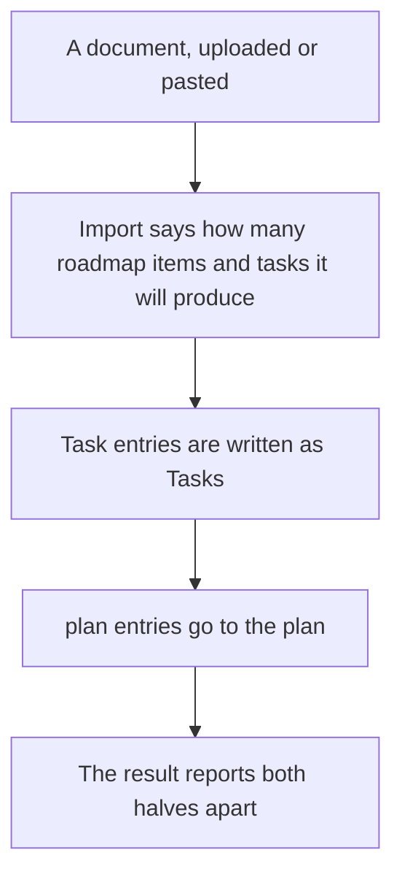

Bring in a plan that lists a sequence of work across one or more repositories,
in the order its entries depend on each other. Import turns the whole plan into
tasks in one step. Most plans
are sequences of AI prompts to run, which is the case Import was written for. An
uploaded file and a paste read the same plan. Import is a faster way of filling the backlog, not
a second way of holding work.

Each entry in the plan becomes one [Task](domain.task.md#task) of the
[type](domain.task.md#task-type) the plan states for it, one of the four types
[task creation](#task-creation) offers. `prompt` is the common case. An entry that states no
type becomes a plain `task`, the default for a hand-typed task. One plan can
therefore mix prompts to run, steps
only a person can do, and things worth coming back to later.

An entry may also state the [status](domain.task.md#task-status) it should arrive at.
Where the entry came from decides which status the task is born with:

| The entry | The task is born |
|---|---|
| Was drafted from an inbox item | `draft`, whatever status its text states |
| States a status | At that status, set directly rather than as a lifecycle step |
| States no status | `ready` |

A stated status is reachable whatever it is, the settled ones included. A plan
can therefore record a step finished before import, or hold back
one still being shaped as `draft`.

`ready` is the one default Import sets differently from a hand-typed task, which starts at `draft` while it is being shaped. A
plan is work already agreed. If every entry
landed at `draft`, somebody would have to promote each one by hand before
[Readiness](domain.task.md#readiness) showed any of it.

An entry drafted from an inbox item carries that item as its `source_inbox_id`.
That is the item a plan was drafted from (`sourceInboxId`), or for a batch routed together, the item the entry's `id:` maps to
(`sourceInboxIds`). A model wrote the entry about captured content and nobody
has read it yet, so the provenance decides the status, not the text. This
governs birth only: a later version that restates the status of a task already
under way still moves it.

The entry's instructions become the task's body. The order the plan
declares between entries becomes an ordinary
[task dependency](#task-dependencies) between the tasks import creates, with the
plan's local entry references resolved to the real task ids. "What's next" for an imported chain reads as for any other: by
[Readiness](domain.task.md#readiness), grouped by [repository](#multi-repo-targeting).

The plan itself becomes one of the task's tags, filed like a task
[filed against a roadmap tag](#filing-a-task-against-a-roadmap-tag). Everything
one plan brought in can then be found and filtered as a group.

A plan also carries work around a prompt that is not the prompt itself:

- a setup or dependency step the repository needs before the prompt can run,
  such as installing a plugin;
- a reminder to update that repository's devbook;
- a task only a person can do.

These land as ordinary
[sub-items](#sub-items-and-steps) on the task they belong to, ordered ahead of
the entry they gate, the same as hand-typed ones.

Every task import creates carries where it came from; see
[Task](domain.task.md#task), so a batch stays traceable to the plan and the item that produced each task.

A document may also carry entries that are not tasks. Import hands an entry
whose type word is `plan` to
[the plan](features.md#laying-out-imported-plans). Such an entry describes the plan as planned work:

- its title;
- its tag;
- its repositories;
- what it waits on;
- when it is due.

One document may hold `plan` entries and task entries together, or only one
kind. A `plan` entry is the one kind Import acts on that
nothing else in this context will. Pasted anywhere but Import, it is refused.
The decision is
`.devbook/arc42/adr/0013-imported-plan-is-a-roadmap-item-laid-out-by-import.md`.

A document of task entries alone can also be
laid out on the roadmap at once, but only when the person asks. It then gets one
item per plan tag its entries carry, titled from the tag and scoped to the
repositories those entries name. This is off by default, so a plan re-imported for its tasks does not grow an unwanted item.

Each level waits only on its own kind. A task entry's `after:`
naming a `plan` entry, or the other way round, is reported as unresolved.
A roadmap that refuses its half,
such as plans waiting on each other in a circle, leaves the tasks
written and says so.

### Repository resolution on import

```meta
type: sub-feature
related: [.devbook/domain/repositories/features.md#repository-registration, .devbook/domain/repositories/domain.md#repository-registry]
```

Resolve each entry's target repository by the name the plan's author wrote,
against the same [Repository Registry](../repositories/domain.md#repository-registry)
[multi-repo targeting](#multi-repo-targeting) already resolves `repo_ids`
against. A known name resolves to its `repo_id`. A name the registry has never seen is registered there on the spot,
before the task naming it is created. Import uses Repositories'
[registration capability](../repositories/features.md#repository-registration),
so a plan can introduce a repository just by mentioning it.

Import triggers registration; it does not perform it. The repository is
registered with whatever the plan states about it, at minimum its name. What a
registered repository holds stays Repository
Management's decision, and Import has only the ability to ask.

The Import dialog also offers a "Target repository" field for the whole batch.
When it is filled in, it becomes the resolved repository for every entry that
names none of its own. An entry that carries its own `repo:` token keeps it.

### Re-importing an updated plan

```meta
type: sub-feature
related: [.devbook/domain/work/domain.task.md#task, .devbook/domain/work/domain.task.md#task-status]
```

Bring in a later version of a plan already imported once, and have it replace
that plan rather than add to it. What happens to each task the plan produced
depends on its status:

| The task's status | What the re-import does |
|---|---|
| `draft` or `ready`, so nobody has started it | Deletes it, then writes the new version's entry in its place |
| `in_progress` | Keeps it and brings it up to date from the new version |
| `done` or `archived` | Skips the whole entry, a restated status included |

The plan's id is what a task remembers about where it came from. A task carrying
the same tag that came from somewhere else was never part of the plan and is not
touched.

An `in_progress` task takes these from the new version:

- its instructions;
- its type;
- its dependencies;
- its target repository;
- its setup, devbook and manual sub-items.

Status moves only when the new version restates it. Otherwise the task keeps the progress
it has made. A plan silent on an entry's status is not asking for work under way to return to `draft`.

A `done` or `archived` task is left alone, as the settled record of what was done.

Clearing is by plan, not by what the new version mentions. A
not-yet-started task the plan has stopped describing goes with the
version that described it, which is how a plan drops work nobody began. Each entry
keeps the same id across versions, so a task already under way or
finished is recognized as the same entry. An entry id
the plan never carried is created. A task
replaced this way is a new task, so a dependency on it written from outside the
plan stops resolving.

## AI assistance over the visible backlog

```meta
type: feature
feature-flag: .devbook/domain/work/context.md#ai-assistant
related: [.devbook/domain/devbook/features.md#repository-devbook-areas, .devbook/domain/insights/features.md#ai-productivity-tracking]
```

Ask questions about the work currently in view and get an answer grounded in it.
The answer comes from the tasks the active filters leave visible plus
the loaded backlog knowledge, not the entire backlog. Entries that were opened but never
edited are left out. The assembled context is capped so a large backlog
degrades into a partial answer rather than a failure. AI assistance is opt-in
and the product stays fully usable with it off.

## Archive and lifecycle

```meta
type: feature
related: [.devbook/domain/work/domain.task.md#task, .devbook/domain/work/requirements.md#archive-and-lifecycle]
```

Move tasks between active and archived states; archived tasks are excluded
from default views but always accessible and restorable.

Reopening a `done` task returns it to `in_progress`, whatever status it held
before. The earlier status is deliberately not kept, because reopening starts the work
again. [Task](domain.task.md#task) holds the lifecycle this follows.

Ticking a task off records that it is [Completed](domain.md#completed), a
separate fact from either status; that term says how the two differ. What the
checkbox and the status picker do to the tick and the status is in
[this feature's requirements](requirements.md#archive-and-lifecycle).

A task that moves to in progress is [Started](domain.md#started), shown as
`started:` on its metadata line beside `completed:`. The roadmap reads the two
together to draw a finished plan where its work ran. The detail panel
shows the day as a read-only **Started** badge beside the effort, on a task
that has one. The Board's In progress slot reads "Moves to In progress and
stamps Started" under "Drop to start", only when the task has no
stamp yet.

## Refresh from shared storage

```meta
type: feature
related: [.devbook/arc42/06-runtime-view.md#state-sync-and-webhook-forwarding, .devbook/domain/work/features.md#multi-device-sync, .devbook/arc42/adr/0005-azure-hosted-task-replica-for-multi-device-sync.md]
```

Deprecated, and removed from the product on 2026-09-16. Superseded by
[Multi-device sync](#multi-device-sync).

It refreshed the backlog when another process or device modified
the shared backlog file. Neither its setting in Settings →
Storage nor the check exists any more.

It was an interim mechanism that did not work. It assumed two machines could
share one backlog through a shared folder. That held while a task was its own
Markdown file and stopped when the store became a single binary
database. A file-sync product produced conflicted
copies of that database and silently reverted committed edits. Polling more
often did not help: the corruption was in the sharing, not in the staleness.
The sync itself now shows a synced change in the task list without reopening the
app.

## Multi-device sync

```meta
type: feature
related: [.devbook/domain/work/domain.task.md#task, .devbook/arc42/08-crosscutting-concepts.md#task-sync, .devbook/arc42/07-deployment-view.md#cloud-deployment-azure, .devbook/arc42/adr/0005-azure-hosted-task-replica-for-multi-device-sync.md, .devbook/domain/work/requirements.md#multi-device-sync, .devbook/domain/sync/features.md#syncing-between-devices]
depends-on: [.devbook/domain/work/features.md#task-creation]
```

Keep the same backlog on more than one of the person's machines, without either
giving up its own copy. Each device reads and writes its own store and
reconciles with the others through the sync service. The cloud carries a replica
of the tasks and is never the authority for them.

Working offline is the ordinary case. Every task can be
created, edited, completed and deleted with no connectivity, and connectivity only
lets the other machine find out sooner. The task list then shows what
arrived without reopening the app. A change to an entry being
edited waits until the editing is done rather than replacing
the text under the caret.

When the same task was edited in two places,
[the later edit wins whole](requirements.md#requirement-the-later-edit-wins-whole).
This deliberately loses the other edit. Merging field by field would need a
domain rule for reconciling two different priorities or statuses,
and the domain has none.

Both halves are built. In the [Sync](../sync/context.md) context,
[Pairing a device](../sync/features.md#pairing-a-device) gives each device its
identity, and the sync service refuses any call without a valid token. The
task change feed is pushed and pulled through the sync service, which
keeps devices, pairing codes and the task replica in Azure Cosmos DB. The
desktop's replica merge applies the later-edit-wins rule to each pulled copy; see
[Task Sync](../../arc42/08-crosscutting-concepts.md#task-sync).

## Backup to a repository

```meta
type: feature
related: [.devbook/domain/work/features.md#multi-device-sync, .devbook/domain/repositories/features.md, .devbook/arc42/adr/0010-backup-is-the-database-committed-to-a-repository.md, .devbook/arc42/adr/0003-sqlite-is-the-canonical-local-task-store.md]
```

Keep a copy of the backlog off the machine, by
committing it to a GitHub repository the person names. A backup is the whole
backlog as one file, the file the app reads, committed at a fixed
place. Every earlier backup is in the repository's
history, and the newest is always at the same address. A backup that would
commit exactly what the repository holds is skipped.

Backups run on a schedule, every day at a set time or every week on a set day
and time. **Back up now** on Settings → Storage &
backup runs one on demand. A scheduled backup missed while the app was closed is taken shortly after
the app next opens.

The page's headline answers whether the backlog is safe: *Backed up 3 h
ago — 7 daily copies kept.*, or *Not backed up yet.* It moves when a backup
completes while the page is open. The Backup card shows the same two figures,
**Last backup** and **Keeping n daily copies**. A line under them says whether the
last backup committed anything and when the next one is due. A daily copy is a
day on which this machine committed a new copy. Every commit stays in the
repository's history, so the count only grows.

A backup is one-way and never changes the backlog on the machine:
getting a backup back is a decision the person carries out by hand. That keeps a backup from
becoming the shared-folder arrangement that
[Refresh from shared storage](#refresh-from-shared-storage) records the cost of.
It is not [Multi-device sync](#multi-device-sync): a backup leaves and stays behind, while sync is a live copy that comes back.

### Checkpoint before an agent's write

```meta
type: feature
related: [.devbook/arc42/adr/0010-backup-is-the-database-committed-to-a-repository.md, .devbook/arc42/adr/0058-agents-and-devices-authenticate-by-grant-and-key-the-owner-by-github-sign-in.md]
```

Before the MCP server runs a tool that can write, the app keeps a checkpoint on this
machine, so an agent's mistake can be put back by hand. A checkpoint is a folder
`checkpoints/<UTC time>/` beside `backlog.db`: a consistent copy of the database, and
copies of the devbook state and remarks stores. One is taken at most every 30 minutes,
and the newest 10 are kept.

A checkpoint that cannot be taken is logged and never stops the agent's write.

Settings → Storage & backup lists the checkpoints read-only, with when each was taken,
its size, and **Show in folder**. There is no restore: as for a backup, going back is a
file copy the person makes with the app closed. A backup never carries the
`checkpoints/` folder.

## Owning a stored plan

```meta
type: feature
related: [.devbook/domain/work/domain.plan.md#plan]
```

Keep a plan that exists in its own right, so intent survives a restart and can be
written down before the work is refined. The plan lives with the person's own
storage location: point the workspace at a different folder and the plan moves
with it. A plan kept apart from the rest of their data is one they lose.

### Planning work that has no task yet

```meta
type: sub-feature
related: [.devbook/domain/work/domain.plan.md#roadmap-item, .devbook/domain/work/requirements.md#planning-work-that-has-no-task-yet]
```

Add an item to the plan with a title and dates alone. Most planning happens before
refinement, and a tool that first demands a refined work item is used after the
decisions are made elsewhere.

Some work is never refined: a launch post, a call, a decision. No task will say it
is done, so the person **completes the item by hand**, from the end of its bar or
from its editor, and reopens it if wrong. The item then reads as finished work,
drawn where it was planned.

Tasks have the last word. Once a task is filed under the item, its progress is
what the roadmap reads, and the hand completion waits until no task is left. See
[the requirements](requirements.md#planning-work-that-has-no-task-yet) and
[the invariant](domain.plan.invariants.md#invariant-gathered-tasks-outrank-a-completion-by-hand).

### Linking an item to the task that executes it

```meta
type: sub-feature
related: [.devbook/domain/work/domain.task.md#task]
```

Name the [Task](domain.task.md#task) that carries out a planned item, so the
plan shows real progress instead of a guess, while the work's status and priority
stay on the task. The link is optional in both directions and may dangle.

### Milestones

```meta
type: sub-feature
related: [.devbook/domain/work/domain.plan.md#milestone]
```

Mark the fixed points a plan is read against:

- a release;
- a freeze;
- a review;
- a commitment made to someone else.

A milestone is a day, not a short piece of work, and can be depended on as an
item can.

Milestones share one place at the top of the plan, not each repository's band,
because a release is a fact about the plan, not one project.

### A date the whole plan is read against

```meta
type: sub-feature
related: [.devbook/domain/work/domain.plan.md#milestone]
```

Say that a date, such as a release or a freeze, is one everything is measured
against. It is then drawn through the whole plan, so what lands before it reads
without tracing a vertical line by eye.

That is a planning judgement, so it is recorded on the milestone, not decided by
the view. A plan where every date claimed it would be a plan of lines.

## Syncing the plan between devices

```meta
type: feature
depends-on: [.devbook/domain/work/features.md#owning-a-stored-plan, .devbook/domain/work/features.md#multi-device-sync]
related: [.devbook/arc42/adr/0018-roadmap-plan-and-pace-ride-the-task-feed.md, .devbook/arc42/adr/0005-azure-hosted-task-replica-for-multi-device-sync.md, .devbook/domain/work/domain.plan.md#plan, .devbook/domain/work/domain.md#device, .devbook/domain/work/context.md#story-points-a-week]
```

Keep one plan on every device the person has paired. The whole plan travels
beside the tasks the devices already sync
([Multi-device sync](features.md#multi-device-sync)):

- its items;
- its milestones;
- its dependencies;
- its lanes;
- its dates;
- its band colours.

It travels only while sync is on and the device is paired. Otherwise the plan is
that device's own.

The plan is replaced whole, never merged. When two devices have both saved since
they last synced, the **newer save wins on every device** and the older is lost,
as with a task edited in two places. A merge item by item could also form a
dependency loop that neither plan held, while one whole plan was valid when saved.

A device that has **never saved a plan has nothing to send**, so a newly paired
machine shows the other device's plan rather than wiping it with an empty one.
How the plan is being looked at stays with the device: zoom and scroll do not
travel.

### Carrying the pace with the person

```meta
type: sub-feature
related: [.devbook/domain/work/context.md#story-points-a-week, .devbook/arc42/adr/0018-roadmap-plan-and-pace-ride-the-task-feed.md, .devbook/arc42/adr/0019-roadmap-counts-the-working-week.md, .devbook/domain/work/context.md#working-week, .devbook/domain/work/requirements.md#carrying-the-pace-with-the-person]
```

The pace travels too, so a bar sized by its effort is drawn the same length on
every device: the typed pace, the chosen source, and each repository's own pace
([Story points a week](context.md#story-points-a-week)). It travels apart from the
plan, so a pace changed on one device and the plan edited on another both
survive. Between two pace changes, the newer wins. A device that has never set a
pace sends none and reads the other's instead of offering its seven. Measured
paces do not travel: each device counts them from the finished work it holds.

The working week travels with the pace, in the same document under the same
newer-wins rule ([ADR 0019](../../arc42/adr/0019-roadmap-counts-the-working-week.md)),
with its [day overrides](domain.md#day-override). Every device then counts a bar
over the same hours.

The person has one working week. The dashboard's hour grids read the weekly pattern only, and its Hours worked part
reads the overrides too ([Working week](context.md#working-week)).
A pace saved without a working week reads the device's own until the next change
writes one. See [the requirements](requirements.md#carrying-the-pace-with-the-person).

## Tagging planned work

```meta
type: feature
depends-on: [.devbook/domain/work/features.md#owning-a-stored-plan]
related: [.devbook/domain/work/domain.plan.md#roadmap-tag]
```

Give every planned item a short [tag](domain.plan.md#roadmap-tag) other work can be
filed against, so a Task or a devbook chapter can say "this belongs to that plan
item" without the plan naming it first. The tag is derived from the item's title
at creation and is then editable on its own.

The tag does not move when the title is renamed, every item has one, and two items
may share one. Renaming and retagging are different acts, which makes a tag safe
to write elsewhere. The plan lists the tags in use and the items under each, so
grouping under a shared tag is first-class.

The tag is spelled two ways. The item holds the **bare slug**, `release-q4`. A
[Task](domain.task.md#task) filed under it wears the
[plan sigil](domain.md#plan-sigil), `+release-q4`, which the task's picker offers.
An imported plan becomes one item, and its tag, spelled the same way, is the plan's slug.
[Laying out imported plans](#laying-out-imported-plans) rests on that, and
`.devbook/arc42/adr/0013-imported-plan-is-a-roadmap-item-laid-out-by-import.md`
settles the spellings.

A saved item's dialog has up to two buttons beside the Tag field:

- a copy button, which copies the tag with its sigil, as the Tasks filter bar's plan
  chip does;
- the plan's [queue icon](../sessions/features.md#start-a-session-from-an-entry),
  which shows while [`session-requests`](../sessions/context.md#session-requests)
  is on.

A new item, or one without a tag, has no copy button.

## Gathering work under an item and totalling its effort

```meta
type: feature
depends-on: [.devbook/domain/work/features.md#tagging-planned-work]
related: [.devbook/domain/work/domain.md#roadmap-item-gathering, .devbook/domain/work/features.md#effort-registration, .devbook/domain/brain/features.md#topic-and-tag-grouping]
```

**Gathering an item's work and totalling its effort**

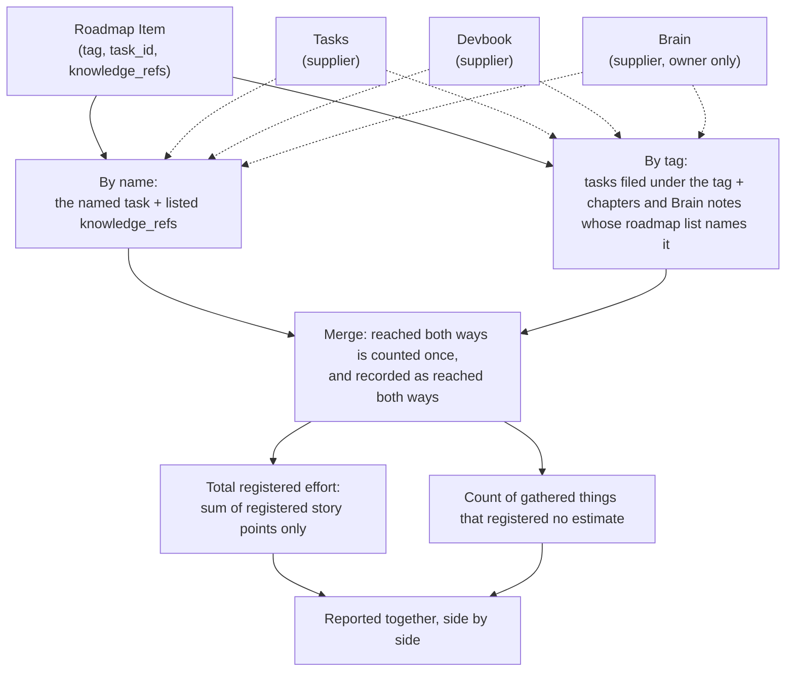

The rules are in [Roadmap Item Gathering](domain.md#roadmap-item-gathering) and
[its invariants](domain.invariants.md#roadmap-item-gathering). Gathering happens
on the **read** path only and
[writes nothing back](domain.invariants.md#invariant-gathering-never-writes).

An item gathers work by what it **names** and by what carries its **tag**, so its
size is never kept by hand.
Something reached both ways is shown once and marked, so a person about to remove
a link sees whether the tag would still hold the work. The item reports
**how many gathered things carry no estimate** beside its
[total registered effort](domain.md#effort), so a small total cannot hide a pile of unsized work.

The Brain's owner also gathers the Brain notes the item names as
`#brain:<path>` and those whose `roadmap` list names its tag. The item's detail
shows them as their own group of Brain chips, each opening its note in the
Brain. A note this device cannot read is listed by its address, unresolved, and
says why (local ADR 0053).

## Priority planning

```meta
type: feature
depends-on: [.devbook/domain/work/features.md#owning-a-stored-plan]
related: [.devbook/domain/work/domain.plan.md#planning-priority]
```

Decide what matters most across projects at once, and record it in the plan
rather than in each project. The plan's priority is its own judgement. A task's
priority never overwrites it and setting it never reaches into that task, so
reprioritising a quarter does not mean editing a dozen issues.

## Dependency planning

```meta
type: feature
depends-on: [.devbook/domain/work/features.md#owning-a-stored-plan]
related: [.devbook/domain/work/domain.plan.md#dependency, .devbook/domain/work/domain.md#plan-sequencing]
```

**Dependency validation flow**

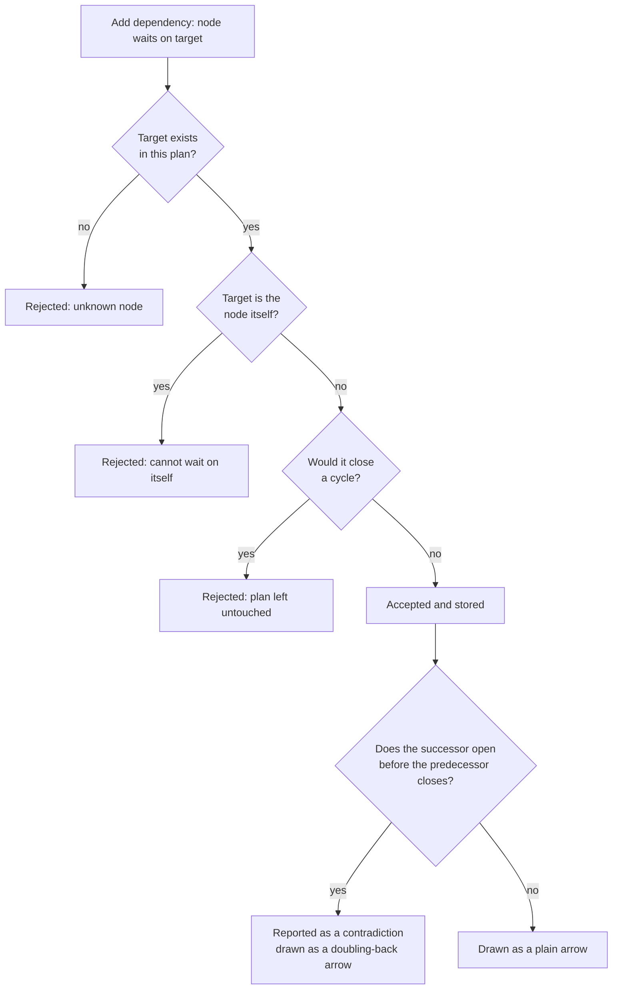

Record what has to land before what, between any two things in the plan: item to
item, item to milestone, milestone to item. The order is stated once, and
everything read off the plan respects it.

- The three rejections refuse to store: an
  [unknown node](domain.plan.invariants.md#invariant-a-dependency-names-a-node-in-the-plan),
  [a node waiting for itself](domain.plan.invariants.md#invariant-nothing-waits-for-itself)
  and [a cycle](domain.plan.invariants.md#invariant-a-cycle-is-refused).
- The contradiction check
  [never refuses anything](domain.invariants.md#invariant-a-contradiction-is-reported-never-corrected):
  dates that do not fit are a normal, temporary state, shown by the arrow that
  doubles back through the gutter.
- Cycle detection walks the whole graph reachable from the target, so the root
  checks it before accepting the edge.

### Refusing a circular plan

```meta
type: sub-feature
```

Reject a dependency that would make something wait, however indirectly, on
itself. The plan is left untouched and the reason is reported, because no order
could execute a circular plan.

### Surfacing contradictions instead of fixing them

```meta
type: sub-feature
related: [.devbook/domain/work/domain.md#plan-sequencing]
```

Show every [Contradiction](domain.md#contradiction) in the plan, reported and not
silently corrected, because quietly moving dependent work would hide that a date
does not fit. Only a window the importer still sizes by effort moves by itself,
and only while nothing has started there
([Placing a plan in time](#placing-a-plan-in-time)). That is the importer's own
rule applied again, not a person's date overruled.

## Repository-scoped planning

```meta
type: feature
depends-on: [.devbook/domain/work/features.md#owning-a-stored-plan]
related: [.devbook/domain/work/domain.plan.md#repository-scope, .devbook/domain/repositories/features.md#repository-registration]
```

Relate planned work to the repositories it happens in, by the repository identity
the rest of the product uses. One plan can span a portfolio and be read one
project at a time.

### Reading the plan by repository

```meta
type: sub-feature
related: [.devbook/domain/work/features.md#placing-a-plan-in-time, .devbook/domain/repositories/requirements.md#archiving-a-repository]
```

**Reading the plan by repository**

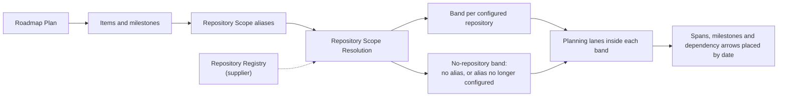

Group the plan into one [band](domain.md#band) per repository, with the person's
own lanes inside each. Each band draws only that repository's [part](domain.md#part)
of a piece of work, at that repository's own pace
([Placing a plan in time](#placing-a-plan-in-time)). The work stays findable under
any of its repositories.

- Resolution happens on the **read** path only.
  [An alias that no longer resolves is kept](domain.plan.invariants.md#invariant-an-unresolved-scope-alias-is-kept),
  so a repository removed today and configured again tomorrow leaves the plan as
  it was.
- An item naming several repositories is drawn in the band of each configured one,
  and the parts can carry different dates. Only the item's one window is stored.
- Dragging any part moves the whole item, because a part has no dates of its own.
  The move is a [hand move](domain.plan.md#roadmap-item), so the item is no longer
  placed by its effort. Every part draws over its one moved window
  ([Placing a plan in time](features.md#placing-a-plan-in-time)).

Work that names no repository, or only unconfigured ones, sits in a last band of
its own. That band takes no colour and shows no name, and a screen reader hears it
called "No repository". The chart always draws it, with one empty "Planned" lane
when nothing is filed there. There the person plans the next project before it has
a repository, by double-clicking or dragging on it.

An [archived repository](../repositories/domain.md#archived-repository)
is still configured, so its work never falls into that last band. How its own
band is drawn is set by
[its requirements](../repositories/requirements.md#archiving-a-repository).

### Surviving a repository that is no longer configured

```meta
type: sub-feature
related: [.devbook/domain/work/domain.md#repository-scope-resolution, .devbook/domain/repositories/requirements.md#archiving-a-repository]
```

The alias an item named is kept as written and reads as unresolved; nothing the
person typed is deleted because a registry changed. An
[archived repository](../repositories/domain.md#archived-repository) is
not this case, because the registry still holds it.

## Reading and rescheduling on a timeline

```meta
type: feature
depends-on: [.devbook/domain/work/features.md#dependency-planning, .devbook/domain/work/features.md#repository-scoped-planning]
related: [.devbook/design/interaction-guidelines.md, .devbook/design/interaction-guidelines.md#shell-header, .devbook/arc42/adr/0022-the-shell-shows-one-main-view-picked-by-a-view-switch.md, .devbook/domain/work/requirements.md#reading-and-rescheduling-on-a-timeline]
tests: [unit:dotnet:Backlog.Desktop.UI.UnitTests.HomeWorkspaceSurfaceTests.The_roadmap_view_replaces_the_task_list_inside_the_workspace, unit:dotnet:Backlog.Desktop.UI.UnitTests.HomeWorkspaceSurfaceTests.The_devbook_and_the_inbox_each_take_the_screen_over_the_roadmap, unit:dotnet:Backlog.Desktop.UI.UnitTests.HomeWorkspaceSurfaceTests.Escape_heard_at_the_document_leaves_the_roadmap_open, unit:dotnet:Backlog.Desktop.UI.UnitTests.HomeWorkspaceSurfaceTests.A_roadmap_surface_from_before_the_view_switch_reopens_as_the_roadmap_view]
```

**Rescheduling flow**

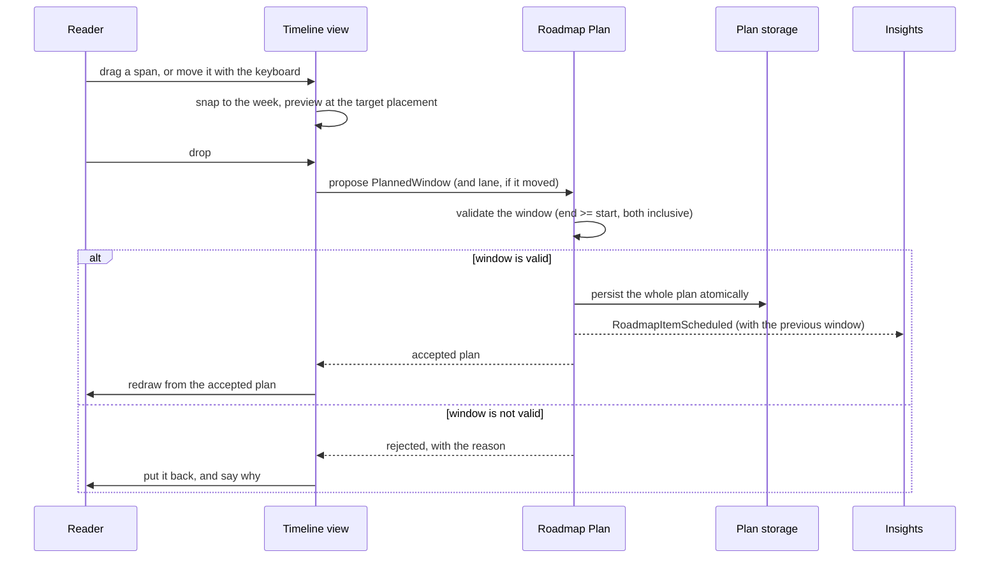

A reschedule starts as a *proposal*. The view never edits the plan, and nothing is
persisted until the plan accepts it.

- [A drop that moves nothing proposes nothing](requirements.md#requirement-a-drop-that-moves-nothing-proposes-nothing),
  so picking something up and putting it down never rewrites the plan.
- [A reschedule leaves the dependencies alone](domain.plan.invariants.md#invariant-a-reschedule-leaves-the-dependencies-alone):
  dependent work is not dragged along, and any contradiction is the reader's cue.
- The event carries the previous window, so a consumer can tell a first plan from
  a change without keeping history.

See the whole plan against time, with its bands, lanes, spans, milestones and
arrows, and change when something happens by moving it. A reschedule is stored as
a change to the plan.

The roadmap is the last of the views in the header's view switch, after Tasks
and Board, under its own Planning heading row and without the Tasks
filter bar. It is a view, not a takeover, so only another view replaces it. The
Inbox and the Devbook take the screen over it as over the task list, and closing
either returns to the roadmap.

Escape does not leave the roadmap: it puts a grabbed bar back and dismisses the
planning dialogs. A narrower window never closes it. Opening the Dashboard, Tools,
the session list or the pull requests list from it and closing them again returns
to it. A roadmap left open from before the view switch reopens as the roadmap
view.

### Rescheduling without a mouse

```meta
type: sub-feature
```

Every move and resize can be made from the keyboard, and each step is announced. A plan that could only be dragged could be read by some people and edited by none.

### Reading the near term closely

```meta
type: sub-feature
related: [.devbook/domain/work/features.md#looking-back-at-finished-plans, .devbook/domain/work/features.md#forecasting-work-in-flight, .devbook/domain/work/requirements.md#reading-the-near-term-closely, .devbook/domain/work/domain.md#actual-hours, .devbook/arc42/adr/0019-roadmap-counts-the-working-week.md]
```

The timeline fills the width it is given and is ruled finer the nearer it is to
today, the same way in both directions:

- last week, this week and next week: a column a day;
- the three weeks either side of those: a column a week;
- then months, for about a quarter;
- then quarters.

The four weeks before this one are always ruled: last week in days and the three
before it in weeks. Earlier months and quarters appear only when something drawn
reaches that far back. Forward, the axis reaches at least to the end of its
months, and further when the plan does. The work in flight sits around today,
where a single week column would stack every bar that started in it on a few
pixels. Every column widens by the same factor
until the chart from last week on fills the screen, so a short plan never leaves
the right empty. The chart opens on last week.

The day and week columns also show the person's
[working week](domain.md#working-week), with the dates they blocked or unblocked.
A date the person does not work, blocked or a weekend in the pattern, wears the
weekend's colours and hatching. A date they do work looks like any ordinary day.
A small marker on the
[column head](domain.md#column-head) is the only sign that a date differs from its
pattern.

Each head carries one hours figure. A head still to come shows its planned working
hours. A head that has begun, today and the current week included, shows the
[actual hours](domain.md#actual-hours) worked so far instead, such as "6.2h", or
"0h" for a worked day with no work recorded. A head never shows both, because
two figures side by side were hard to read. The tooltip can name both, such as
"6.2h worked of 8.5h planned".

A wide column reads the figure inline, such as "Wed 23 · 8.5h" and "W41 · 42.5h".
A narrow one shows it on a line under the label. The Hours switch on the toolbar
hides the line. It is on by default and stays with the device, because how the
axis is read is not part of the plan.

Every column keeps its width, because the axis is still time. Narrowing the days
off was rejected: a drag of the same distance would move a bar by a different
number of days ([ADR 0019](../../arc42/adr/0019-roadmap-counts-the-working-week.md)).
See [the requirements](requirements.md#reading-the-near-term-closely).

### Blocking and unblocking a day

```meta
type: sub-feature
related: [.devbook/domain/work/domain.md#day-override, .devbook/domain/work/requirements.md#blocking-and-unblocking-a-day, .devbook/domain/work/context.md#working-week, .devbook/arc42/adr/0019-roadmap-counts-the-working-week.md]
```

Take a single day off, or work a day the week does not, by pressing that day's
[column head](domain.md#column-head). A weekly pattern alone cannot say that next
Friday is a holiday, and a bar counted over it would land a day early.

Each press records a [day override](domain.md#day-override), and pressing again
returns the day to the weekly pattern. A past date can be changed too, because
measured paces count the hours that were actually there. The head is a real button
for the pointer, keyboard and screen reader, but does not look like one. The
weekly pattern stays in
[Working week setting](context.md#working-week). See
[the requirements](requirements.md#blocking-and-unblocking-a-day).

### Setting days off in a list

```meta
type: sub-feature
related: [.devbook/domain/work/domain.md#day-override, .devbook/domain/work/features.md#blocking-and-unblocking-a-day, .devbook/domain/work/requirements.md#setting-days-off-in-a-list, .devbook/domain/work/context.md#working-week, .devbook/arc42/adr/0019-roadmap-counts-the-working-week.md]
```

See every day off and extra worked day in one list, and set a two-week holiday in
one go. The **Days off** button on the roadmap toolbar opens the dialog. Only a
day column has a head to press, so the dialog is also how a person blocks a date
the axis shows inside a week column.

The dialog lists each [day override](domain.md#day-override) with its date,
weekday and whether it is blocked or unblocked, dates still to come first and past
ones behind "Show past". The person can add a range of days off. It blocks only
the dates the weekly pattern works, because a weekend inside a holiday needs no
override. The person can also add a single worked date, which unblocks a day the
pattern leaves off, and remove any entry.

The dialog writes the same overrides a press on a head writes, they travel the
same way inside the working week, and every bar is laid out again at each change.
See [the requirements](requirements.md#setting-days-off-in-a-list).

### Looking back at finished plans

```meta
type: sub-feature
related: [.devbook/domain/work/domain.plan.md#planned-window, .devbook/domain/work/domain.md#started, .devbook/domain/work/domain.md#completed, .devbook/domain/work/features.md#reading-the-near-term-closely, .devbook/domain/work/features.md#forecasting-work-in-flight, .devbook/domain/work/requirements.md#looking-back-at-finished-plans]
```

A plan whose tasks are all done is drawn where its work actually ran: from the day
its first task was started to the day its last was ticked off. Scrolling back
shows what was finished and how long it really took. When nothing says when the
work ended, the planned end stands, but never later than today, because finished
work cannot end in the future.

History is ruled as the horizon is, mirrored, as
[Reading the near term closely](#reading-the-near-term-closely) sets out.

A finished plan cannot be dragged, because its dates are read off the work.
Opening it still edits the stored item. A plan still being worked on is drawn from
its work too, to a forecast end
([Forecasting work in flight](#forecasting-work-in-flight)).

The Completed switch on the toolbar, beside Hours, takes the finished plans off
the chart when the person wants only what is left to do. It is the one narrowing
the roadmap offers. A filter bar by repository, priority, lane or tag was dropped,
because the bands already sort by repository and a plan is small enough to read
whole. Off, the lanes close up over the open work, and an arrow to a hidden plan
goes with it. The switch is on by default and stays with the device, as the Hours
switch does, because what is shown of the plan is not part of the plan.

### Archiving a finished plan's project note

```meta
type: sub-feature
related: [.devbook/arc42/adr/0052-the-app-may-write-links-into-a-brain-note-and-move-a-finished-project-note-to-the-archive.md, .devbook/arc42/adr/0053-a-plan-or-a-task-may-reference-a-brain-note.md, .devbook/domain/brain/domain.md#cross-linking, .devbook/domain/work/features.md#looking-back-at-finished-plans, .devbook/design/interaction-guidelines.md#feedback-and-toasts, .devbook/domain/work/requirements.md#archiving-a-finished-plans-project-note]
```

When a plan's last task is done, its project note still sits in the Brain's
projects area. A plan's project notes are the Brain notes it gathers, by a
`#brain:` Knowledge Ref or by its tag, that sit in the projects area of a Brain
with an archive area. A Brain without one is never offered the move.

If a plan finishes while the app is open, a toast offers **Move the project note
to the archive** for its first project note. On the press, the Brain's link
writer moves the file into the archive area, keeping its path below the area and
every byte inside it. The plan's Knowledge Refs that named the note follow it to
the new path, the heading they named kept. A refused move, such as a name already
taken in the archive, says why and leaves the plan as it was.

Dismissing the toast, or letting it time out, changes nothing. Either way the plan
is never offered again on this device, whatever happens to it later. A plan
already finished when the app opens is not offered, because the app cannot tell
when it finished, and a launch must not raise a toast for every old plan.

The weekly review lists every finished plan's project note still in the projects
area, offered or not: `list_brain_reviews` answers them under `toArchive`, with
the plan that gathers each.
See [the requirements](requirements.md#archiving-a-finished-plans-project-note).

### Forecasting work in flight

```meta
type: sub-feature
related: [.devbook/domain/work/domain.plan.md#planned-window, .devbook/domain/work/domain.md#effort, .devbook/domain/work/domain.md#working-week, .devbook/domain/work/features.md#looking-back-at-finished-plans, .devbook/domain/work/features.md#reading-the-near-term-closely, .devbook/domain/work/features.md#placing-a-plan-in-time, .devbook/domain/work/requirements.md#forecasting-work-in-flight, .devbook/domain/work/domain.md#started, .devbook/arc42/adr/0019-roadmap-counts-the-working-week.md]
```

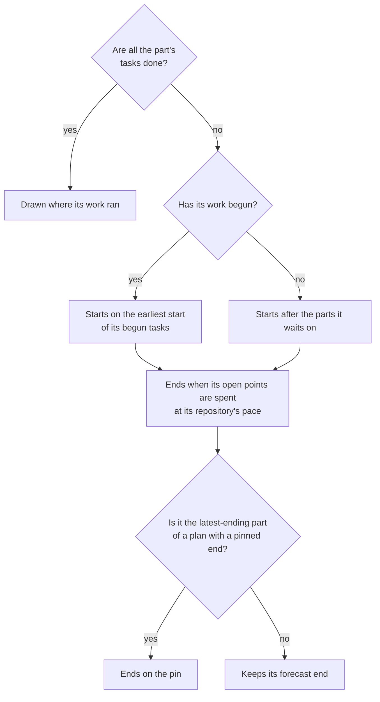

A plan is in flight when some of its tasks are in progress or done and some are
still open. Its forecast shows where it will really land, not where it was hoped
to. A planned window that stretches finished work over months, or ends before the
work left could, is the hope and not the reading.

A plan in flight is forecast one [part](domain.md#part) at a time, the same parts
[Placing a plan in time](#placing-a-plan-in-time) lays out.

The plan's forecast end is the latest part end. These rules apply on top of it:

- A begun part may start earlier or later than the plan's planned start, and that
  holds for a plan placed by hand too. A task's start is its own started date,
  else the start of the session linked to it, else the day the task was created.
- The open points count an unestimated task as one. The count starts on the first
  worked day on or after the later of today and the part's start. The hours are
  counted through the person's [working week](domain.md#working-week), the same
  way every other window is counted
  ([ADR 0019](../../arc42/adr/0019-roadmap-counts-the-working-week.md)).
- A pinned end is a person's date and outranks the forecast, but only on the part
  that ends latest. Every part tied for that end ends on the pin, and every other
  part keeps its own forecast. The pin never ends that part before the first day
  its open work can be drawn on.
- Pulling the end of an earlier part pins the plan's end as many days later as the
  pull moved it. The forecast still shows in the detail of the part the pin moved,
  with the pace it was read at, so pinning does not hide what the pace says.
- When the plan hands work over between repositories, every open part is placed
  after the parts it waits on, at its own repository's pace. None is given a
  share of the window by its size. A done part is drawn where its work ran, not
  stretched over the future.

The bar is locked like a finished one, because its dates are read off the work.

A finished part wears a done style of its own, because the lock and a full fill
do not tell it apart: every part of a plan in flight is locked. See
[the requirements](requirements.md#forecasting-work-in-flight).

The parts are never stored. A plan placed by hand or by its due date keeps its
[planned window](domain.plan.md#planned-window), and its forecast is read off the work
at every draw. A plan whose window is still sized by its effort stores the window
its parts make ([Placing a plan in time](#placing-a-plan-in-time)).

### Telling one project from another at a glance

```meta
type: sub-feature
related: [.devbook/design/color-scheme.md#band-identity-tokens, .devbook/domain/repositories/features.md#repository-identity-colour]
```

Draw each repository's band in that repository's own colour, so a plan spanning a
portfolio reads one project at a time without tracing rows back to a label.

The colour is an **identity and nothing more**: it says which repository, never a
status, severity or priority, and never alone. The band is labelled and every span
names its band when read aloud, so a reader who cannot tell two hues apart loses
nothing. Priority is the ordinal shade ramp on the spans, one colour.

**The plan does not decide or store the colour.** A repository's colour is a fact
about it, settled in the registry and told to the plan, as repository aliases are
held opaque. A colour of the plan's own could differ from the registry's and
would need rewriting whenever the choice changed.

The band for work under no repository, and the band carrying the plan's dates,
take no colour, because a colour here means "which repository".

## Editing the plan in place

```meta
type: feature
depends-on: [.devbook/domain/work/features.md#owning-a-stored-plan]
related: [.devbook/domain/work/domain.plan.md#plan, .devbook/domain/work/features.md#dependency-planning]
```

Add planned work, change it, and take it off the plan, from the place the plan is
read. Dates move, priorities change, and what something waits for turns up late.

An edit submits the whole item (title, window, priority, repositories, lane,
notes), because a partial edit cannot tell "leave this alone" from "clear this".
The item's identity survives every edit, so anything waiting on it still is.

Naming a repository is optional: an item saved with none lands in the band for
work under no repository.

### Editing what something waits for

```meta
type: sub-feature
related: [.devbook/domain/work/features.md#refusing-a-circular-plan]
```

Add and remove dependencies while looking at the item that has them. A dependency
is answered on the spot, not when the rest of the edit is saved, because it can be
refused for a reason no field explains: it would make the plan circular.

### Refusing an edit rather than half-applying it

```meta
type: sub-feature
```

An edit that cannot stand, such as one with no title or with dates that do not
make a window, changes nothing. It says why without closing the editor, so a
refusal never looks like a save.

## Publishing planned intent for observation

```meta
type: feature
depends-on: [.devbook/domain/work/features.md#owning-a-stored-plan]
related: [.devbook/domain/work/domain.md#roadmapitemscheduled, .devbook/domain/insights/features.md#personal-productivity-dashboard]
```

Announce when planned work is scheduled or moved, so
[Insights](../insights/features.md#personal-productivity-dashboard) can
compare intent against delivery. Roadmap publishes and does not subscribe: nothing
observed downstream reaches back in and edits the plan.

## Laying out imported plans

```meta
type: feature
depends-on: [.devbook/domain/work/features.md#tagging-planned-work, .devbook/domain/work/features.md#gathering-work-under-an-item-and-totalling-its-effort, .devbook/domain/work/features.md#dependency-planning]
related: [.devbook/arc42/adr/0013-imported-plan-is-a-roadmap-item-laid-out-by-import.md, .devbook/domain/work/features.md#import, .devbook/domain/work/features.md#re-importing-an-updated-plan, .devbook/domain/work/features.md#sequencing-work-into-tracks, .devbook/domain/work/features.md#reading-and-rescheduling-on-a-timeline, .devbook/domain/work/domain.md#roadmap-item-gathering]
```

Put a plan that was [imported](features.md#import) on the roadmap without
typing it in again. An imported plan becomes **one planned item**, tagged with the
plan's slug. The tasks the import created are gathered under it by the tag they
carry, so nothing links or copies them. The plan's steps are read inside that
item, sized by their registered effort, and its progress is the tasks' progress,
read every time and stored nowhere.

A plan reaches the roadmap two ways, both the same import.

- A **roadmap document** describes the items outright, in the entry text a
  task-level plan uses, with the type word `plan` on each entry. Each entry gives
  a title, the plan's tag, repositories, priority, what it waits on, and
  optionally a due day.
- Or **the tasks come first** and the plan is laid out later from their tag (see
  [the shelf](#laying-out-a-plan-whose-tasks-arrived-first)).

Either way, the person pressing Import is the person changing the plan, and the
item it creates is theirs to move. The reasoning is in
`.devbook/arc42/adr/0013-imported-plan-is-a-roadmap-item-laid-out-by-import.md`.

### Placing a plan in time

```meta
type: sub-feature
setting: [.devbook/domain/work/context.md#story-points-a-week]
related: [.devbook/domain/work/domain.plan.md#roadmap-item, .devbook/domain/work/domain.md#roadmap-item-gathering, .devbook/domain/work/domain.plan.md#dependency, .devbook/domain/work/features.md#reading-the-plan-by-repository, .devbook/domain/work/features.md#forecasting-work-in-flight, .devbook/domain/work/domain.plan.md#planned-window, .devbook/domain/work/domain.md#plan-sequencing, .devbook/domain/work/features.md#surfacing-contradictions-instead-of-fixing-them, .devbook/arc42/adr/0013-imported-plan-is-a-roadmap-item-laid-out-by-import.md#4-the-importer-places-the-window-velocity-is-the-readers, .devbook/arc42/adr/0019-roadmap-counts-the-working-week.md, .devbook/domain/work/domain.md#working-week, .devbook/domain/work/requirements.md#placing-a-plan-in-time]
```

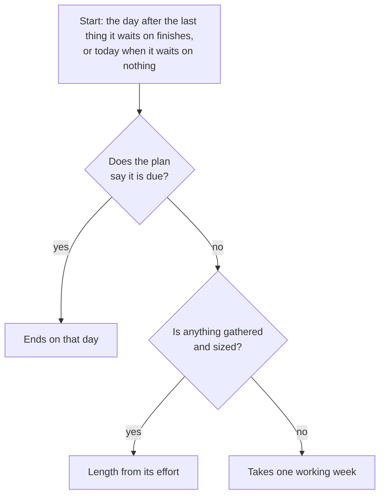

Give an imported plan a window nobody had to guess. In this chapter, *a plan* is
one imported plan and the [Roadmap Item](domain.plan.md#roadmap-item) that holds it.

The start is never in the document. The **length from its effort** is the story
points its tasks registered, divided by the person's
[pace](context.md#story-points-a-week) in points a working week.

The plan never starts on a day the person does not work; such a start moves to
their next working day. From there it counts their working hours forward,
skipping the days and hours they do not work, and ends on the day the hours run
out ([ADR 0019](../../arc42/adr/0019-roadmap-counts-the-working-week.md)). It is
never shorter than its start day. The hours are the person's
[working week](domain.md#working-week), so a date they blocked on the axis counts
none and a day off they unblocked counts its hours
([requirements](requirements.md#placing-a-plan-in-time)).

A due date that falls before the plan could start is kept. The plan is then placed
on that one day, so the [contradiction shows](#surfacing-contradictions-instead-of-fixing-them)
rather than being smoothed over.

The pace is the person's reading pace, not an estimate, kept per
[band](domain.md#band). [Story points a week](context.md#story-points-a-week)
says which pace each band uses and how it is measured, shown and stored.

**A plan filed under several repositories is laid out one
[part](domain.md#part) per repository**, each placed at its own pace. In the
example below, a plan holds one 8-point task in `app` and one 8-point task in
`site` that waits on it. `app` gets through 8 points a week and `site` 4.

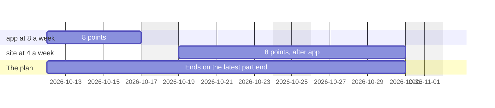

- **Each part counts the full points of its own tasks and of the shared tasks it
  carries.** An [own task](domain.md#own-task) is filed under that repository
  alone. A [shared task](domain.md#shared-task), filed under several, counts in
  full in each of its bands that still has own work open, so a shared sign-off
  never keeps open a band whose own work is done. When no band of a shared task
  has own work open, it counts where own work ended last, or in all its bands when
  none had any
  ([requirements](requirements.md#requirement-a-shared-task-counts-where-own-work-is-still-open)).
  A task filed under none goes to the first part.
- **A part waits on what its work waits on.** Every part waits on the plans this
  plan [depends on](domain.plan.md#dependency). A part also waits on every other part
  that holds a task one of its own tasks waits on: these are the waits
  [the gathering](domain.md#roadmap-item-gathering) carries. A wait on work the
  plan did not gather is not counted. A circle of waits between parts is broken at
  the earliest part still waiting, the way the gathering breaks one between tasks.
- **A part starts on the later of today and the day after the latest end among
  what it waits on.** A start on a day the person does not work moves to their next
  working day. From there the part's points are counted through the working week at
  its own repository's pace.
- **Work that hands over and back gets a part per phase.** When work passes from
  one repository to another and returns, the first repository has one part before
  the hand-over and one after it. Each is placed after the parts it waits on.
- **A part with nothing sized takes one working week**, as a plan does. A repository
  the plan names that holds none of its tasks draws its part over the plan's own
  window.

**The plan's own window ends on the latest part end** and starts on the earliest
part start. The importer stores that window, and contradictions, milestones and
the plans that wait on this one read it, so work that waits on a plan starts after
its last part ends. **Parts are worked out every time the
roadmap is drawn and never stored.**

Parts are placed this way only while the plan's window is still sized by its
effort, or while its work is [in flight](#forecasting-work-in-flight). A plan
moved by hand, or ending on its due date, draws every part over its one stored
window. Dragging any part moves the whole plan, a [hand move](domain.plan.md#roadmap-item)
like any other, after which the plan is no longer sized by its effort
([ADR 0013, ruling 4](../../arc42/adr/0013-imported-plan-is-a-roadmap-item-laid-out-by-import.md#4-the-importer-places-the-window-velocity-is-the-readers),
as amended on 2026-10-07).

**Keeping up with its work.** A plan whose window is still sized by its effort is
laid out again from what is **not done yet** every time the roadmap opens and
every time a task changes. It is laid out part by part, each at its own
repository's pace, from today. A part whose work has begun is drawn from the day
that work began
([Forecasting work in flight](#forecasting-work-in-flight)), and the plan keeps the
earliest part start as its own. A plan nobody has started whose start has passed
starts today, or on the next working day when the person does not work today.

Finished tasks do not count toward the plan's length, so a plan that ran late
shows the day the rest will land and one that ran ahead pulls its end in. A
changed pace, or a measured pace moving as work is finished, re-draws the same
way.

A finished plan keeps its window and is drawn over the days its work ran. A plan
moved by hand, or ending on its due date, keeps its dates (ADR 0013, ruling 5 as
amended on 2026-09-27 and on 2026-10-07).

An item the import placed remembers it in `placed_by_import`. The first time a
person moves it by hand, that memory is cleared and the importer never touches
its dates again. The item's editor shows the window as laid out, and a Save that
leaves the dates alone is not a hand move. Re-importing works like this:

- Re-importing the roadmap document brings the item's title, repositories,
  priority and dependencies up to date. It re-places only the windows the
  importer still owns.
- Re-importing the plan's tasks changes nothing on the item but the length of a
  window still sized by effort.
- **Nothing is ever removed** from the plan by an import. A plan the document has
  stopped describing stays planned, because taking work off the roadmap is a
  planning decision: other work waits on it. The person makes it
  [in place](#editing-the-plan-in-place).

Work that waits on a plan that moved follows it when nothing has started there
and its own window is still sized by effort. It starts the day after that plan
ends and keeps its length. Work that has begun, or was placed by hand or by a due
date, keeps its dates, and a resulting conflict is
[named, not moved](#surfacing-contradictions-instead-of-fixing-them).

An import says what it could not do rather than guessing:

- A plan entry with no tag is skipped and named, because the tag is how the next
  import finds it.
- A tag several planned items already carry updates the first of them and names
  the rest.
- A dependency that names nothing is dropped and named.
- A document whose dependencies would make the plan circular is
  [refused whole](#refusing-an-edit-rather-than-half-applying-it). Nothing is
  created and nothing revised, and the person sees which edge did not fit.

### Reading a plan's steps inside its item

```meta
type: sub-feature
related: [.devbook/domain/work/domain.md#roadmap-item-gathering, .devbook/domain/work/features.md#task-dependencies, .devbook/domain/work/features.md#effort-registration, .devbook/domain/work/features.md#sizing-a-track-by-the-effort-it-gathers]
```

Open a planned item on the timeline and see the steps it gathers laid end to end
inside its bar. They run in the order the tasks' own dependencies put them, ties
broken by which was written first. Each step is as wide as its share of the plan's effort.
A step nobody sized is drawn at a fixed small width and marked unsized. Each step
wears its task's status colour.

The item's bar fills with the effort done over the effort registered, with the
count of unsized steps beside it, so a small fill over unsized work cannot pass
for a plan nearly finished.

The widths are **proportions of the window, not dates**: a step drawn across a
Tuesday is not scheduled for Tuesday. This is the reading
[the tracks idea](#sizing-a-track-by-the-effort-it-gathers) asked for, and it
settles that idea's first question: dates stay and effort sizes the steps within
them.

Everything drawn here is read from Tasks each time the band draws, and again
whenever a gathered task is written or an import lays items out. The plan stores
no status, progress or order of its own.

### Laying out a plan whose tasks arrived first

```meta
type: sub-feature
related: [.devbook/domain/work/features.md#filing-a-task-against-a-roadmap-tag, .devbook/domain/work/features.md#planning-work-that-has-no-task-yet]
```

Find the plans that were imported as tasks and never placed. Every plan tag the
backlog carries that no planned item holds is listed on a **shelf** beside the
timeline. Picking one creates its item, tagged with that slug so it gathers the
tasks already there, and [places it](#placing-a-plan-in-time) from the effort
they registered.

The Import dialog offers the same at import, as an option that is off unless
asked for. A document of task entries with no `plan` entry can then be laid out as
one item per plan tag it carries. Someone only refreshing a plan's tasks does
not grow an item they did not ask for.

Only a tag written with the [plan sigil](domain.md#plan-sigil) reaches the shelf.
A plan filed under a general tag before the sigil existed still gathers under an
item whose tag matches it, but the item is the person's to create.

The shelf is a column beside the timeline, or beside the empty state when nothing
is planned yet, because the tasks-first order starts with no roadmap. It moves under the timeline on a narrow window. It holds one card
per plan, showing:

- the plan tag in full;
- how many tasks carry it;
- the points they registered, and how many registered none;
- for a plan whose tasks are filed in more than one repository, a line per
  repository with that repository's share.

Picking a card is one gesture, **Plan it**. It runs the same import a roadmap
document runs, with the effort those tasks registered: the item is titled from its
tag, filed under those repositories, and placed from that effort. The card then
leaves the shelf and what was planned is announced. A shelf with nothing to offer
is not drawn.

The [Calendar](../calendar/features.md#calendar-view) offers the same shelf as
**Plans without a window**, and there a plan is dropped on a day instead. The same
import places it, with one difference. The window opens on the first worked day
on or after the day it was dropped on, or today for a day already past. Its end is
counted from there as it would be from today.

The window opens there even when some of the plan's work has begun, and its end is
counted for the points still open. The window is the person's from then on, as one
dragged on the timeline is: it does not
[keep up with its work](#placing-a-plan-in-time), and a later import does not move
it.

## Sequencing work into tracks

```meta
type: feature
depends-on: [.devbook/domain/work/features.md#tagging-planned-work, .devbook/domain/work/features.md#gathering-work-under-an-item-and-totalling-its-effort]
related: [.devbook/domain/work/features.md#dependency-planning, .devbook/domain/work/features.md#reading-and-rescheduling-on-a-timeline, .devbook/domain/work/domain.plan.md#planning-lane, .devbook/domain/work/features.md#effort-registration, .devbook/domain/brain/features.md#topic-and-tag-grouping]
```

**An idea, written down to be argued with, not an agreed model.** No status
vocabulary has `idea`, so `proposed` carries it. Nothing below is settled, and the open questions matter as much as the description. Some are
answered by [laying out imported plans](#laying-out-imported-plans) and
`.devbook/arc42/adr/0013-imported-plan-is-a-roadmap-item-laid-out-by-import.md`;
each is marked below, and the rest are open.

Plan a repository's work as **tracks** rather than as dates. A track is an *area
within one repository* holding a chain of work that has to be done in order. Each
piece is written against the one before it, the way one feature depends on
another. What the plan then answers is not *when does this run*, but **what can be
picked up right now, and what would collide if two workers picked up at once**.

The goal is parallel work without conflicting changes. Two tracks are different
areas, so the head of each can be worked at the same time, while two pieces inside
one track cannot, because the later is written against the earlier. The plan then
states **safe concurrency** rather than a forecast. A
[Planned Window](domain.plan.md#planned-window) says two items overlap in *time*, never
whether they overlap in *code*.

The idea would be built on what this context already has, not beside it:

- The chain is the existing [Dependency](domain.plan.md#dependency). Acyclicity, and
  [Plan Sequencing](domain.md#plan-sequencing)'s reachability answers, are
  exactly what an ordered chain needs.
- The work a track holds is reached the way an item already reaches it: by named
  link and by tag, across the tasks and Devbook.
- **The repository line stays as it is.** A track sits inside a repository band
  exactly as lanes and items do today, so a portfolio still reads one project at
  a time.

**Open questions.** Each of these changes what the idea is, not merely how it is
built:

- **Replacement or addition?** *Answered: addition, so dates stay.*
  - The question: if dated planning went, the Planned Window and the timeline
    reading would go with it, and so would
    [RoadmapItemScheduled](domain.md#roadmapitemscheduled). That event is the one contract
    [Insights](../insights/features.md#personal-productivity-dashboard) consumes, so comparing
    intent against delivery would need a new answer or a different question. If
    both were kept, one plan would carry two ways of ordering the same work, and
    something would have to say which one a reader is looking at.
  - The answer: effort sizes the steps
    [inside a dated window](#reading-a-plans-steps-inside-its-item). The window,
    the timeline and the event all survive, and Insights' contract holds. The
    drawing itself says which reading a person is looking at: the bar is the
    window, and the steps inside it are proportions, never dates.
- **Is a track a [Planning Lane](domain.plan.md#planning-lane) with an order and a size,
  or a new node?** *Partly answered.* A lane today is a free-form label the person
  owns and nothing depends on. A track is ordered and depended upon. Making the
  lane ordered would change what every label already written means, so this is a
  rename with consequences rather than a small extension. An imported plan is an
  existing node, the [Roadmap Item](domain.plan.md#roadmap-item), and its steps are the
  tasks it gathers, so no new node and no ordered lane was needed. Whether a track
  drawn by hand, with no plan behind it, is a lane or an item stays open.
- **What is an "area", and who decides that two areas cannot collide?** The safety
  claim rests entirely on this. If an area is the person's own word, as a lane is,
  the guarantee is their judgement. The plan should then say so rather than imply
  otherwise. If the product derives it from paths the repository actually has,
  the plan starts holding repository facts it has deliberately never owned.
  [Repository Scope](domain.plan.md#repository-scope) keeps opaque aliases for exactly
  that reason, and resolving them is a supplier's job.
- **Does a track hold work, or gather it?** *Answered: it gathers.* If the chain
  runs between plan nodes, it is the existing Dependency and nothing moves. If it
  runs between tasks, the dependency is the Task's own. A task models one, `after:`,
  since `.devbook/arc42/adr/0007-import-reuses-the-entry-text-grammar.md`
  ([task dependencies](features.md#task-dependencies)). The Plan is the
  only aggregate that holds a dependency between two pieces of *planned* work, and
  the Task holds the one between two *tasks*. An item
  [reads the tasks' chain](#reading-a-plans-steps-inside-its-item) to order its
  steps and never holds it; the chain between plans stays here.
- **Do milestones survive?** *Answered: yes*, because dates do. A
  [Milestone](domain.plan.md#milestone) is a day, and a plan with no dates would have
  had nowhere to put one. With the window kept, it stays the fixed point an
  imported plan can wait on and be placed after.

### Sizing a track by the effort it gathers

```meta
type: sub-feature
related: [.devbook/domain/work/domain.md#roadmap-item-gathering, .devbook/domain/work/features.md#effort-registration]
```

Read how big a track is from the **total registered effort** of the work it
gathers (story points) instead of from a span of days. "This track is twice the
one beside it" is a judgement a person can make; "this track ends on the 14th"
mostly is not.

The arithmetic is that of
[gathering work under an item](#gathering-work-under-an-item-and-totalling-its-effort),
unchanged, for the same reason. A track hiding its unestimated work would read as small when it is least understood.

### Picking work that cannot collide

```meta
type: sub-feature
related: [.devbook/domain/work/domain.md#plan-sequencing]
```

Ask the plan what is safe to start now: the head of every track whose predecessor
has landed, with the tracks sharing an area held back. It is answered from the
chain and the areas instead of comparing two spans by eye.

Whether the plan may state this as a **guarantee** or only as advice is the
unresolved part, and it decides how much the idea is worth. See the open question
about what an area is.
