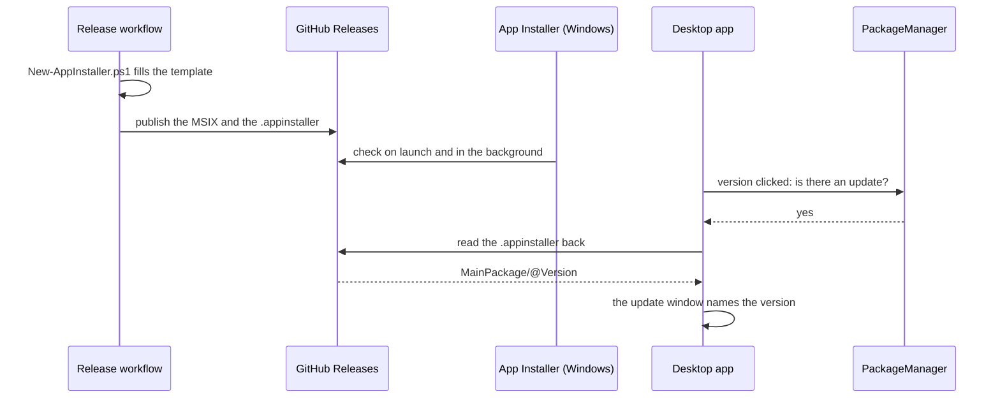

# Desktop Stack

```meta
status: adopted
related: [".devbook/tech/technology-graph.md", ".devbook/arc42/07-deployment-view.md#local-deployment-desktop"]
```

> The canonical, local-first Windows client. It owns the data and runs capture
> locally, so this is the richest layer of the graph.

## Windows

```meta
status: adopted
type: platform
related: [".devbook/arc42/07-deployment-view.md#local-deployment-desktop"]
```

The target operating system for the desktop client.

- **Used for** — hosting the desktop app, its background workers, and the local
  task store.
- **Why** — the personal-use scope is Windows-only, which allows a native
  Windows UI stack instead of a cross-platform compromise.

## Windows App SDK

```meta
status: adopted
type: framework
depends-on: [".devbook/tech/desktop.md#windows", ".devbook/tech/shared.md#net-runtime"]
```

The modern Windows application platform underneath the UI framework.

- **Used for** — windowing, app lifecycle, notifications, and OS integration.
- **Why** — the supported foundation for WinUI 3 desktop apps.

## WinUI 3

```meta
status: adopted
type: framework
depends-on: [".devbook/tech/desktop.md#windows-app-sdk", ".devbook/tech/shared.md#c-language"]
related: [".devbook/arc42/04-solution-strategy.md#technology-choices", ".devbook/arc42/adr/0001-desktop-stack-maui-blazor-hybrid.md"]
```

The native Windows head that `.devbook/tech/shared.md#net-maui` uses on this platform.

- **Used for** — hosting the desktop client's native shell, windowing, and OS
  integration; also hosts the WebView2 surface that renders the app's actual UI
  (`.devbook/tech/shared.md#blazor-hybrid`).
- **Why** — [ADR 0001](../arc42/adr/0001-desktop-stack-maui-blazor-hybrid.md)
  chose a MAUI shell over a plain WinUI 3 app, and MAUI's Windows head is WinUI 3.
  The app is authored as Razor components rather than WinUI XAML, and it keeps
  WinUI 3's native filesystem access and background workers.

## WebView2

```meta
status: adopted
type: framework
depends-on: [".devbook/tech/desktop.md#windows-app-sdk"]
related: [".devbook/tech/shared.md#blazor-hybrid", ".devbook/tech/testing.md#playwright", ".devbook/arc42/adr/0001-desktop-stack-maui-blazor-hybrid.md"]
```

The Chromium-based embedded browser the desktop UI actually renders in.

- **Used for** — hosting the `BlazorWebView` that draws every screen, and
  exposing a CDP debugging port so Playwright can attach to the running desktop
  app rather than only to the web harness.
- **Why** — that debugging port is one of the two decisive reasons ADR 0001 chose
  Blazor Hybrid over plain MAUI XAML. It is why Debug builds stay unpackaged:
  MSIX would break both the Aspire desktop resource and the CDP attach.

## Local Task Store

```meta
status: adopted
type: library
depends-on: [".devbook/tech/shared.md#sqlite", ".devbook/tech/shared.md#microsoftdatasqlite", ".devbook/tech/shared.md#json"]
related: [".devbook/arc42/adr/0003-sqlite-is-the-canonical-local-task-store.md", ".devbook/arc42/08-crosscutting-concepts.md#storage-and-sync"]
alternatives: ["Markdown files with YAML frontmatter", "LiteDB"]
```

The file-backed persistence layer, implemented in-app rather than bought in.

- **Used for** — `Backlog.Infrastructure.Sqlite` holds the tables
  [SQLite](shared.md#sqlite) lists. `RootedSqliteTaskRepository`,
  `RootedSqliteRoadmapPlanRepository` and `RootedSqliteInboxRepository` bind them
  to the workspace root the user chose. The desktop head and the web harness
  therefore open the same database the same way. Each adapter creates only its
  own tables. Settings and feature flags stay JSON files beside the database,
  per device on purpose.
- **Why** — [ADR 0003](../arc42/adr/0003-sqlite-is-the-canonical-local-task-store.md)
  chose one database that cannot disagree with itself over a markdown-document
  store with two derived indexes. Markdown remains the *content* of an entry, as
  a text column, not its storage format.

## Background Workers

```meta
status: candidate
type: library
depends-on: [".devbook/tech/shared.md#net-runtime"]
related: [".devbook/arc42/04-solution-strategy.md#thin-cloud-rich-desktop"]
```

In-process hosted services that poll external sources on the local machine.

- **Used for** — YouTube, website, and email capture, GitHub issue sync, and
  stale-item detection. It stays `candidate`: no hosted service is implemented
  yet, and the capture paths run on demand.
- **Why** — keeping fetching local is what keeps external credentials off the
  cloud (quality goal 2).

## System.Security.Cryptography.ProtectedData

```meta
status: adopted
type: package
version: "10.0.11"
depends-on: [".devbook/tech/desktop.md#windows", ".devbook/tech/shared.md#net-runtime"]
related: [".devbook/arc42/adr/0005-azure-hosted-task-replica-for-multi-device-sync.md#identity", ".devbook/arc42/adr/0030-stored-credentials-go-through-the-os-protected-envelope.md", ".devbook/domain/sync/features.md#pairing-a-device", ".devbook/domain/sync/domain.md#registration-credential"]
```

The .NET wrapper over Windows DPAPI.

- **Used for** — every credential the app stores, under `CurrentUser` scope:
  - `DpapiDeviceCredentialStore` in `Backlog.Infrastructure.Sync` seals the
    device's registration credential. On the desktop head it lives at
    `%LOCALAPPDATA%\Backlog\device-credential.json`. Each web harness keeps its own
    copy under its own path, so the two harnesses register as distinct devices.
  - `DpapiSpecManagerTokenStore` in `Backlog.Infrastructure.SpecManager` seals the
    spec-manager sign-in tokens.
  - `SecretEnvelope` seals the token and key values in `github.json`,
    `claude.json` and `azure-foundry.json`. The GitHub adapter holds it, and the
    Claude and Azure Foundry adapters compile it in.
- **Why** — it is the OS credential store local ADR 0005's Identity section names
  for Windows, and local ADR 0030 makes it the rule for every stored credential.
  The app has no key of its own to generate, rotate, or leak.

## Model Context Protocol C# SDK

```meta
status: adopted
type: package
version: "2.2.0"
depends-on: [".devbook/tech/shared.md#aspnet-core", ".devbook/tech/shared.md#net-runtime"]
related: [".devbook/arc42/adr/0012-backlog-is-an-mcp-server-inside-the-desktop-app.md", ".devbook/tech/ai-development.md#model-context-protocol-servers"]
```

The `ModelContextProtocol` packages the desktop app serves its own MCP server
with.

- **Used for** — `ModelContextProtocol.Core` in `Backlog.Infrastructure.Mcp`
  defines the tools, and `Backlog.Desktop.UI` references `ModelContextProtocol`.
  `ModelContextProtocol.AspNetCore` in the desktop head and its web harness hosts
  the Streamable HTTP endpoint that agents reach as the `backlog` server.
- **Why** — local ADR 0012 puts the server inside the running app, so it reads
  the same store the person does. The official SDK carries the protocol, so the
  repository writes only tools.

## Microsoft.CodeAnalysis.CSharp

```meta
status: adopted
type: package
version: "5.9.0"
depends-on: [".devbook/tech/shared.md#net-runtime"]
related: [".devbook/arc42/adr/0044-c4-zoom-navigation-is-a-second-tab-read-from-devbook-meta.md#3-the-code-level-is-syntax-trees-only", ".devbook/arc42/05-building-block-view.md"]
```

Roslyn's C# parser, used for syntax trees and nothing else.

- **Used for** — `CSharpCodeReader` in `Backlog.Infrastructure.Devbook` reads the
  C4 zoom tab's Code level. It parses each `*.cs` under a component's folder with
  `CSharpSyntaxTree.ParseText` and lists the types, their members, and the uses
  between types it can see by name. It reads on demand and caches by the files'
  timestamps. The package reaches only the desktop side: the mobile head does
  not reference the Devbook adapter.
- **Why** — local ADR 0044 §3 draws level 4 from the source and never from an
  authored diagram. Syntax trees need only the files: no compilation, no
  restore, no matching SDK. So a branch snapshot reads the same as a clone the
  app builds. Because nothing is compiled, the package version need not follow
  the SDK's compiler.

## GitHub CLI

```meta
status: adopted
type: tool
depends-on: [".devbook/tech/shared.md#github-platform"]
related: [".devbook/arc42/04-solution-strategy.md#thin-cloud-rich-desktop"]
alternatives: ["Octokit.NET", "raw REST calls"]
```

The local integration path to GitHub from the desktop (`gh`).

- **Used for** — creating and updating issues from backlog items without routing
  credentials through the cloud service. `ResolvingGitHubTransport` in
  `Backlog.Infrastructure.GitHub` is the seam. For a call that names no account, it
  asks `gh api user` who is signed in and borrows that login's github.com token
  with `gh auth token`. It holds that token in memory only, for five minutes, and
  sends the call over HTTP. `GhCliTransport`, one `gh api` process per call, is the
  fallback when `gh` holds no github.com token or points at another host. The
  clients above the seam (issues, activity, billing, identity) never see a token.
- **Why** — reuses the developer's existing authenticated GitHub session; also
  already the mandated tool for GitHub operations in this repository.

## MSIX Packaging

```meta
status: adopted
type: tool
depends-on: [".devbook/tech/desktop.md#windows-app-sdk"]
related: [".devbook/arc42/07-deployment-view.md#installation-and-updates", ".devbook/tech/tooling.md#powershell"]
```

The packaging and update format for the Windows client.

- **Used for** — building the desktop app as a signed, sideloadable MSIX and
  installing/updating it on the user's machines.
- **Why** — the standard distribution model for Windows App SDK applications.
- **How** — Release builds for Windows switch to `WindowsPackageType=MSIX` and
  emit a single signed MSIX (`AppxBundle=Never`, `SideloadOnly`). Debug stays
  unpackaged (`WindowsPackageType=None`), so the Aspire desktop resource and the
  WebView2 CDP attach used by Playwright keep working. The MSIX is published as a
  GitHub Release asset and installed by sideloading rather than through the
  Microsoft Store. Its `Identity Name` (`JSdotNet.Backlog.Desktop`) and
  `Publisher` (`CN=JSdotNet`) must match the App Installer's `MainPackage`
  exactly, or updates will not apply. The package is self-signed, so the signing
  certificate has to be trusted on the target machine before the first install.
- **Where it writes** — the manifest sets
  `desktop6:FileSystemWriteVirtualization` to `disabled`, with the
  `unvirtualizedResources` capability that requires. The packaged app therefore
  writes to the `%LOCALAPPDATA%\Backlog` it names on the Storage settings page,
  not to the package's `LocalCache\Local` redirect. Installs from before that
  opt-out left their state in the redirect, and `PackagedAppData` adopts it on
  the first start (see
  [Installation and Updates](../arc42/07-deployment-view.md#installation-and-updates)).
- **Checking a manifest change** — only a packaged Release build runs MakeAppx
  over the manifest, and PR CI builds with `WindowsPackageType=None`. A manifest
  change is therefore checked with an unsigned local publish
  (`-p:AppxPackageSigningEnabled=false`, MSIX left on).

## App Installer (`.appinstaller`)

```meta
status: adopted
type: format
depends-on: [".devbook/tech/desktop.md#msix-packaging"]
related: [".devbook/arc42/07-deployment-view.md#installation-and-updates"]
```

The XML manifest that turns a bare MSIX into an updatable install.



- **Used for** — declaring the stable update source and the current package, so
  the app can check for and pull newer versions from GitHub Releases.
- **Why** — App Installer's `UpdateSettings` (`OnLaunch` and
  `AutomaticBackgroundTask`) gives launch-time and background update checks
  without a custom update server. Clicking the version in the app header drives
  the same mechanism through `PackageManager`.
- **How** — `build/New-AppInstaller.ps1` generates it from
  `build/Backlog.Desktop.appinstaller.template` during the release workflow. Its
  own `Uri` points at the `latest` release download, which is stable. A tag,
  dispatch or Deploy All release takes Latest; a scheduled nightly takes it only
  when no higher-versioned release holds it. `MainPackage/@Uri` points at the tagged release asset. `Name`, `Publisher`,
  and `ProcessorArchitecture` are kept identical to the signed MSIX.
- **Version name** — `PackageManager` only answers whether an update exists. The
  app therefore reads the manifest back through `AppInstallerManifest` to name
  the version it would install. When the manifest is unreachable, the update is
  still offered without a version.
