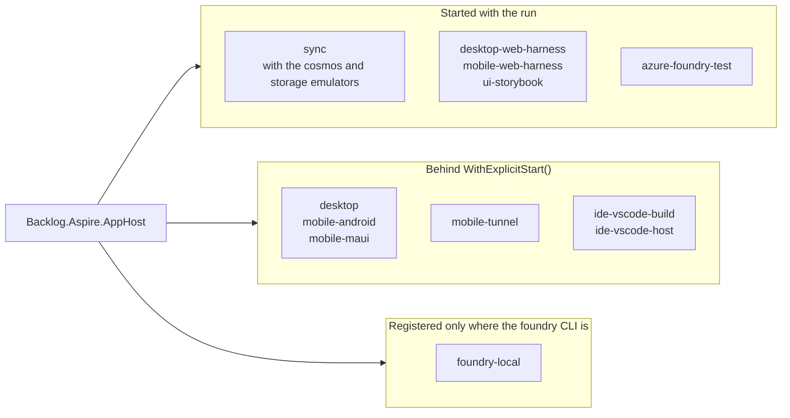

# Shared Technologies

```meta
rating: adopted
related: [".devbook/tech/technology-graph.md", ".devbook/arc42/02-constraints.md#technical-constraints"]
```

> Every layer file points at these chapters with `depends-on` instead of
> redefining them locally.

## Markdown

```meta
rating: adopted
type: format
related: [".devbook/arc42/02-constraints.md#technical-constraints", ".devbook/arc42/08-crosscutting-concepts.md#storage-and-sync", ".devbook/arc42/adr/0003-sqlite-is-the-canonical-local-task-store.md"]
```

The language of a task's content and of this repository's devbook folders.

- **Used for** —
  - an entry's text, a column in the SQLite store;
  - the documents in the five `.devbook/` folders;
  - the knowledge notes the product manages.
- **Why** — plain text is durable and diffable, and anyone can edit it without
  the app. [ADR 0003](../arc42/adr/0003-sqlite-is-the-canonical-local-task-store.md)
  draws the boundary: markdown is the *content* of a task, not its *storage
  format*.

## JSON

```meta
rating: adopted
type: format
related: [".devbook/arc42/08-crosscutting-concepts.md#storage-and-sync"]
```

The derived-data and settings format sitting beside the canonical stores.

- **Used for** —
  - the Archify artifact indexes (`_archify/index.json`);
  - settings;
  - the repo registry (`config/repos.json`);
  - the dev-tool catalog the DevPc module reads;
  - the owned-collection columns in the SQLite schema.
- **Why** — cheap to write from every channel's stack and fast to load, with no
  migration story for data that is rebuildable or user-scoped.

## YAML

```meta
rating: adopted
type: format
```

The structured-metadata format embedded in Markdown documents.

- **Used for** — the fenced `meta` blocks that make the devbook folders
  machine-readable, GitHub workflow and issue-template configuration, and
  `SKILL.md` front matter.
- **Why** — human-writable inside Markdown and trivially parseable by tooling.

## Mermaid

```meta
rating: adopted
type: format
depends-on: [".devbook/tech/shared.md#markdown"]
related: [".devbook/tech/tooling.md#archify"]
```

Diagram-as-text notation embedded directly in Markdown.

- **Used for** — the technology graph, C4/deployment/sequence diagrams in
  `.devbook/arc42`, and domain model/flow diagrams in `.devbook/domain`.
- **Why** — diagrams stay reviewable in the same diff as their prose, and GitHub
  and the app's Devbook viewer render them natively. A mermaid fence stays
  canonical even where an Archify artifact renders the same diagram more richly.

## .NET Runtime

```meta
rating: adopted
type: runtime
version: "10.0"
related: [".devbook/arc42/04-solution-strategy.md#technology-choices", ".devbook/arc42/09-architecture-decisions.md"]
alternatives: ["Node.js only", "Rust + Tauri"]
```

The primary managed runtime for the desktop, mobile, IDE (Visual Studio), and
cloud channels.

- **Used for** — hosting every C# component. `net10.0` is set once in the root
  `Directory.Build.props`; only the MAUI heads override it with a platform target
  framework moniker (TFM).
- **Why** — the organization's governed .NET guidance applies to the cloud
  service, and one runtime across channels maximizes shared code.

## C# Language

```meta
rating: adopted
type: language
version: "latest"
depends-on: [".devbook/tech/shared.md#net-runtime"]
related: [".devbook/arc42/04-solution-strategy.md#technology-choices"]
```

The main implementation language of the system.

- **Used for** — the desktop, mobile, Visual Studio extension, cloud service,
  harness hosts, and the whole test suite.
- **Why** — one language across four of the five channels keeps domain logic and
  contracts shareable. The solution sets `LangVersion=latest` and enables
  `Nullable` and `ImplicitUsings` everywhere.

## Node.js

```meta
rating: adopted
type: runtime
version: ">=18"
related: [".devbook/tech/ide.md#vs-code-extension-api"]
```

The JavaScript runtime hosting the VS Code extension and every repository-local
tool.

- **Used for** —
  - the VS Code extension host;
  - the devbook plugin's checker and inventory scripts under `.devbook/_tools/`;
  - the repository's `tools/devbook` writer and metadata check;
  - the vendored Archify renderer;
  - the `tools/diagrams` artifact commands.
- **Why** — the VS Code extension model mandates it, developer machines already
  have it, and the repository's tooling needs nothing beyond it.

## TypeScript

```meta
rating: adopted
type: language
version: "^7.0.0"
depends-on: [".devbook/tech/shared.md#nodejs"]
related: [".devbook/tech/ide.md#vs-code-extension-api"]
```

The implementation language for the VS Code channel.

- **Used for** — the VS Code extension and its webview UI, compiled with `tsc`
  in the pull-request workflow and watched by the `ide-vscode-build` Aspire
  resource.
- **Why** — the only first-class option for VS Code extensibility. The
  repository's Node tooling is plain ESM `.mjs`, so it needs no build step.

## .NET MAUI

```meta
rating: adopted
type: framework
version: "10.0.100"
depends-on: [".devbook/tech/desktop.md#winui-3", ".devbook/tech/mobile.md#android", ".devbook/tech/shared.md#c-language"]
related: [".devbook/arc42/04-solution-strategy.md#technology-choices", ".devbook/arc42/adr/0001-desktop-stack-maui-blazor-hybrid.md"]
alternatives: ["Plain WinUI 3", "Blazor WebAssembly PWA", "Kotlin native"]
```

The native app shell for the desktop and mobile channels: a WinUI 3 head on
Windows, native Android views on Android.

- **Used for** — the desktop client's native shell (per
  `.devbook/arc42/adr/0001-desktop-stack-maui-blazor-hybrid.md`) and the phone
  client's Android shell, platform integrations, and offline storage.
- **Why** — ADR 0001 accepts it for desktop, so the whole stack launches from one
  Aspire AppHost and Playwright can drive it.
  [Technology choices](../arc42/04-solution-strategy.md#technology-choices)
  names it as the preferred mobile stack, which keeps both channels in C# with
  the cloud service. Mobile's choice has no ADR of its own yet.
- **How** — one `$(MauiVersion)` property in the root `Directory.Build.props`
  keeps the two heads and `Microsoft.Maui.Core` in ServiceDefaults in step.

## Blazor Hybrid

```meta
rating: adopted
type: framework
depends-on: [".devbook/tech/shared.md#net-maui", ".devbook/tech/shared.md#razor-components"]
related: [".devbook/arc42/adr/0001-desktop-stack-maui-blazor-hybrid.md", ".devbook/tech/desktop.md#webview2"]
alternatives: ["XAML-only MAUI UI", "Plain WinUI 3", "Blazor WebAssembly PWA"]
```

Razor Components rendered inside the MAUI shell's embedded WebView, through
`Microsoft.AspNetCore.Components.WebView.Maui`.

- **Used for** — the desktop client's entire UI. The Android head renders the same
  components, with `Backlog.Mobile` hosting a `BlazorWebView` over
  `Backlog.Mobile.UI`.
- **Why** — ADR 0001 accepts it for desktop. The UI is Razor components, not
  XAML, so Playwright can attach over WebView2's Chrome DevTools Protocol (CDP)
  debugging port. Desktop gets a Chromium-based, Playwright-drivable surface and
  keeps full native filesystem and background-worker access.

## Razor Components

```meta
rating: adopted
type: framework
version: "10.0.11"
depends-on: [".devbook/tech/shared.md#aspnet-core", ".devbook/tech/shared.md#c-language"]
related: [".devbook/tech/testing.md#bunit", ".devbook/design/component-libraries.md"]
```

The component model every screen in the product is written in
(`Microsoft.AspNetCore.Components.Web`).

- **Used for** — the shared component library `Backlog.UI.Components`, the
  per-module UI projects, and both channel UI projects (`Backlog.Desktop.UI`,
  `Backlog.Mobile.UI`), each referencing the package directly.
- **Why** — one component model renders identically in the MAUI WebView and the
  Blazor Server harness hosts, so a component is written once and reviewed in a
  browser.

## Blazor Server

```meta
rating: adopted
type: framework
depends-on: [".devbook/tech/shared.md#razor-components", ".devbook/tech/shared.md#aspnet-core"]
related: [".devbook/tech/testing.md#playwright", ".devbook/tech/shared.md#net-aspire"]
```

The interactive-server render mode used by the development-time harness hosts
under `src/Harness/`.

- **Used for** — `desktop-web-harness` and `mobile-web-harness`, which host the
  Razor components the MAUI heads render. `ui-storybook` hosts the shared
  component library alone, with no module or infrastructure project in its graph.
- **Why** — Aspire cannot start a MAUI head as a project resource, and Playwright
  cannot drive one without an emulator. So the harnesses give the same UI a URL.
  Everything under `src/Harness/` is non-publishable and fenced off from shipping
  code by `Backlog.ArchitectureTests`.

## ASP.NET Core

```meta
rating: adopted
type: framework
depends-on: [".devbook/tech/shared.md#net-runtime", ".devbook/tech/shared.md#c-language"]
```

The web host underneath every HTTP surface in the solution
(`Microsoft.NET.Sdk.Web`).

- **Used for** — the sync service, the three harness hosts, and the local Azure
  Foundry test service.
- **Why** — the organization's governed .NET stack for services, and the base of
  Blazor Server and the Aspire service defaults.

## .NET Aspire

```meta
rating: adopted
type: framework
version: "13.6.0"
depends-on: [".devbook/tech/shared.md#aspnet-core", ".devbook/tech/shared.md#c-language"]
related: [".devbook/tech/tooling.md#aspire-cli", ".devbook/tech/shared.md#opentelemetry", ".devbook/arc42/07-deployment-view.md"]
alternatives: ["Docker Compose only", "no orchestration"]
```

The app model that composes every runnable piece of this repository into one
local run.



- **Used for** — composing one local run. Everything that needs a device, a
  CLI, or an account waits behind explicit start. `mobile-android` runs the
  Android head through the MSBuild `Run` target. `mobile-maui` is the parent
  registration from `Aspire.Hosting.Maui`, and its child
  `mobile-maui-android-emulator` runs the head. `mobile-tunnel` is the dev tunnel
  that publishes `sync` to an emulator. `Backlog.Aspire.ServiceDefaults` gives
  every host the same telemetry, resilience, service discovery, and health
  checks.
- **Exception** — `foundry-local` is guarded rather than deferred. It launches
  the `foundry` CLI as the app model comes up, so the AppHost registers it only
  on a machine that has the CLI.
- **Why** — one command starts the whole system with a dashboard, logs, and
  traces, which makes agent-driven QA possible. It spans every channel, so it is
  documented here and not in `cloud.md`.
- **How** — ports are always dynamic (`localhost:0`). Worktree sessions run
  `aspire start --isolated` for independent ports and user-secrets state. The
  AppHost opts in to the Aspire CLI bundle (`AspireUseCliBundle=true`). So
  `dotnet run` on it acquires through dnx the CLI pinned to the
  `Aspire.AppHost.Sdk` version, not a differently versioned CLI or none, and
  delegates to `aspire run`. `ASPIRE010`, the advisory for staying opted out, is
  not suppressed.

## OpenTelemetry

```meta
rating: adopted
type: library
version: "1.18.0"
depends-on: [".devbook/tech/shared.md#net-runtime"]
related: [".devbook/arc42/08-crosscutting-concepts.md", ".devbook/arc42/09-architecture-decisions.md", ".devbook/tech/shared.md#net-aspire"]
```

The observability stack wired into every host through `ServiceDefaults`.

- **Used for** — traces, metrics, and logs exported over the OpenTelemetry
  Protocol (OTLP) to the Aspire dashboard, with HTTP-client and runtime
  instrumentation (`OpenTelemetry.Extensions.Hosting`,
  `.Exporter.OpenTelemetryProtocol`, `.Instrumentation.Http`,
  `.Instrumentation.Runtime`).
- **Why** — org ADR 0010 governs observability for the sync service, and QA
  monitors the same wiring during the `phase-verify` stage of a `flow-*` run.

## SQLite

```meta
rating: adopted
type: library
depends-on: [".devbook/tech/shared.md#markdown"]
related: [".devbook/arc42/adr/0003-sqlite-is-the-canonical-local-task-store.md", ".devbook/arc42/08-crosscutting-concepts.md#storage-and-sync"]
alternatives: ["Markdown files with YAML frontmatter", "LiteDB", "Azure Cosmos DB"]
```

The embedded database that is the canonical local store for tasks.

- **Used for** — `backlog.db`. Three modules share it but not a schema:
  - Tasks keeps one `tasks` table: scalar columns for the scalar fields, JSON
    text columns for the six owned collections, and a column for the entry's
    markdown.
  - Roadmap Planning keeps the `roadmap_plan` table, one document row per
    workspace.
  - The Inbox keeps `inbox_items`, `inbox_lists` and `inbox_groups`.

  The phone keeps its outbox and task view in its own SQLite file, and the
  generated devbook database is SQLite too.
- **Why** — accepted by
  [ADR 0003](../arc42/adr/0003-sqlite-is-the-canonical-local-task-store.md),
  which retired three files that could disagree about one task. It supersedes
  "markdown is the canonical format" for storage, leaving markdown as the
  published entry language (ADR 0002).

## Microsoft.Data.Sqlite

```meta
rating: adopted
type: package
version: "10.0.11"
depends-on: [".devbook/tech/shared.md#sqlite", ".devbook/tech/shared.md#net-runtime"]
```

The ADO.NET provider the SQLite adapter is written against.

- **Used for** — `Backlog.Infrastructure.Sqlite`, `Backlog.Infrastructure.Devbook`
  and `Backlog.Mobile.UI`, the only three projects that reference it; everything
  else reaches a store through a port.
- **Why** — first-party and dependency-light. Schemas this small want no ORM.

## Microsoft.Extensions.DependencyInjection

```meta
rating: adopted
type: package
version: "10.0.12"
depends-on: [".devbook/tech/shared.md#net-runtime"]
```

The container abstraction each module registers itself into.

- **Used for** — the `Add<Module>Module()` extension methods that let a host
  compose modules without seeing their internals. Module projects reference the
  `.Abstractions` package only, never a container implementation.
- **Why** — the standard .NET composition seam; the abstractions alone keep a
  module host-agnostic.

## Microsoft.Extensions.Http

```meta
rating: adopted
type: package
version: "10.0.12"
depends-on: [".devbook/tech/shared.md#net-runtime"]
```

`IHttpClientFactory` and typed HTTP clients.

- **Used for** —
  - the outbound clients in `Backlog.Mobile.UI`;
  - the base every vendor adapter (GitHub, Claude, Azure Foundry) is configured
    through;
  - the named `capture-feeds` client `Backlog.Infrastructure.Capture` fetches
    YouTube and website feeds on.
- **Why** — correct socket lifetime handling, and one place to attach handlers.

## Microsoft.Extensions.Http.Resilience

```meta
rating: adopted
type: package
version: "10.9.0"
depends-on: [".devbook/tech/shared.md#microsoftextensionshttp"]
related: [".devbook/arc42/adr/guidelines/0015-resilience-for-outbound-dependencies.md"]
```

Standard retry, timeout, and circuit-breaker handlers for HTTP clients.

- **Used for** — the standard resilience handler `Backlog.Aspire.ServiceDefaults`
  applies to every registered client. The `capture-feeds` client in
  `Backlog.Infrastructure.Capture` replaces it with its own pipeline: one retry,
  a 10-second attempt timeout, and 15 seconds in total.
  `Backlog.Infrastructure.Sync` references the package directly, because its three
  replication clients replace the default with a pipeline that never retries a
  push.
- **Why** — every external call crosses a network the app does not control, and
  the shipped defaults beat ad-hoc retries. `capture-feeds` differs because a feed
  poll is a button press on the user's machine, not a background job. A re-sent
  push that already landed reports its items as refused, so replication never
  retries one.

## Polly

```meta
rating: adopted
type: package
version: "8.6.6"
depends-on: [".devbook/tech/shared.md#net-runtime"]
related: [".devbook/tech/shared.md#microsoftextensionshttpresilience", ".devbook/arc42/08-crosscutting-concepts.md#task-sync"]
```

The resilience pipeline library under the HTTP resilience handlers.

- **Used for** — a direct `Polly.Core` reference in
  `Backlog.Infrastructure.Sync` and `Backlog.Infrastructure.SpecManager`. Both
  catch what a resilience pipeline throws when it gives up and name the cause. In
  Sync, `SyncHttp` and `SyncTokenProvider` catch `TimeoutRejectedException` and
  `ExecutionRejectedException`. In SpecManager, the sign-in reads an
  `ExecutionRejectedException` as the server being out of reach.
- **Why** — those exception types are Polly's, not the handler package's. The
  central pin matches what `Microsoft.Extensions.Http.Resilience` resolves.

## Microsoft.Extensions.ServiceDiscovery

```meta
rating: adopted
type: package
version: "10.9.0"
depends-on: [".devbook/tech/shared.md#net-aspire"]
```

Logical-name resolution for service endpoints.

- **Used for** — resolving `sync` and `azure-foundry-test` from a harness or a
  channel host, so no run hard-codes a port.
- **Why** — Aspire assigns dynamic ports on every run; service discovery is what
  makes that safe.

## Microsoft.Extensions.Logging

```meta
rating: adopted
type: package
version: "10.0.12"
depends-on: [".devbook/tech/shared.md#net-runtime"]
related: [".devbook/tech/shared.md#opentelemetry"]
```

The logging abstraction, plus the debug provider on the two MAUI heads.

- **Used for** — application logging everywhere. Both heads add the debug
  provider, so a debugger-attached run has output without a console.
  `Backlog.Mobile` references `Microsoft.Extensions.Logging.Debug` directly.
  `Backlog.Desktop` gets it from the ASP.NET Core shared framework; naming the
  package there would raise NU1510.
- **Why** — it is the abstraction OpenTelemetry's log pipeline consumes.

## YamlDotNet

```meta
rating: hold
type: package
depends-on: [".devbook/tech/shared.md#net-runtime"]
related: [".devbook/arc42/adr/0003-sqlite-is-the-canonical-local-task-store.md"]
alternatives: ["Markdig", "hand-written meta-block parser"]
```

A YAML serializer that no project pins or references.

- **Used for** — nothing directly. It reaches the build transitively through the
  Aspire AppHost, at whatever version that resolution lands on.
  `Directory.Packages.props` carries no `PackageVersion` entry for it.
- **Why `hold`** — it was the frontmatter serializer for the markdown task store
  that `.devbook/arc42/adr/0003-sqlite-is-the-canonical-local-task-store.md`
  retired, which names its round-trip repair pass as a reason. Kept because the
  transitive dependency is still real; do not add new usage.

## GitHub Platform

```meta
rating: adopted
type: service
related: [".devbook/arc42/02-constraints.md#organizational--process-constraints"]
```

The external system of record for issues, repositories, and automation.

- **Used for** —
  - backlog issue sync
  - webhooks into the cloud service
  - repository health signals
  - release hosting
  - CI/CD
  - this repository itself
- **Why** — a hard organizational constraint: GitHub is the external issue
  system, so the product integrates with it rather than replacing it.

## Anthropic Claude Platform

```meta
rating: candidate
type: service
related: [".devbook/domain/productivity/features.md#ai-vendor-usage-import", ".devbook/tech/ai-development.md#claude-code"]
alternatives: ["Local accumulation of per-response token counts"]
```

The external source of measured Claude usage: token counts, cost, and Claude
Code session activity.

- **Used for** — importing usage evidence for productivity metrics through the
  Admin API's usage, cost, and Claude Code reports, via
  `Backlog.Infrastructure.Claude`.
- **Why** — it is the only authoritative record of what was spent.
- **Why `candidate`** — the reports are organization-scoped, and Anthropic
  documents the Admin API as unavailable to individual accounts. It pays off only
  for a person whose subscription sits behind an organization; the recorded
  alternative covers everyone else.

## GitHub Copilot Usage APIs

```meta
rating: candidate
type: service
depends-on: [".devbook/tech/shared.md#github-platform"]
related: [".devbook/domain/productivity/features.md#ai-vendor-usage-import"]
```

The organization-level record of Copilot seat activity and usage metrics.

- **Used for** — importing Copilot activity evidence alongside Claude usage, over
  the same transport the product already uses for issues (`CopilotUsageClient` in
  `Backlog.Infrastructure.GitHub`).
- **Why** — the reasoning of the
  [Anthropic Claude Platform](#anthropic-claude-platform), with a sharper limit.
  GitHub publishes no endpoint for an individual subscriber's own Copilot usage,
  and the organization endpoints are owner-only. So everything here depends on
  the person owning an organization.
