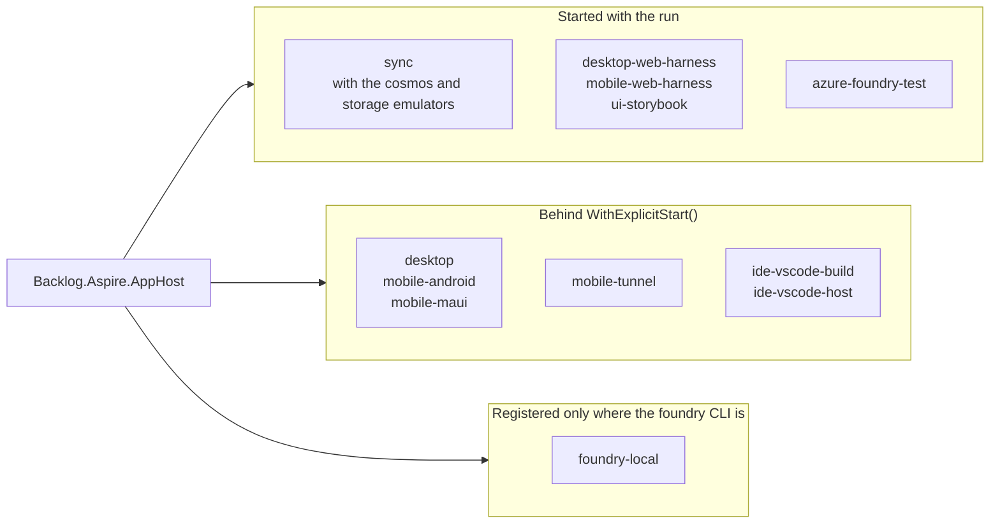

# Shared Technologies

```meta
status: adopted
related: [".devbook/tech/technology-graph.md", ".devbook/arc42/02-constraints.md#technical-constraints"]
```

> Every layer file points at these chapters with `depends-on` instead of
> redefining them locally.

## Markdown

```meta
status: adopted
type: format
related: [".devbook/arc42/02-constraints.md#technical-constraints", ".devbook/arc42/08-crosscutting-concepts.md#storage-and-sync", ".devbook/arc42/adr/0003-sqlite-is-the-canonical-local-task-store.md"]
```

The language a task's content is written in, and the format of this repository's
own devbook folders.

- **Used for** — the text of an entry, held as a column in the SQLite store; the
  documents in the five `.devbook/` folders; and the knowledge notes the product
  manages.
- **Why** — plain text is durable, diffable, greppable, and editable without the
  app.
  [ADR 0003](../arc42/adr/0003-sqlite-is-the-canonical-local-task-store.md)
  draws the boundary: markdown is the *content* of a task, not its *storage
  format*.

## JSON

```meta
status: adopted
type: format
related: [".devbook/arc42/08-crosscutting-concepts.md#storage-and-sync"]
```

The derived-data and settings format sitting beside the canonical stores.

- **Used for** — the Archify artifact indexes (`_archify/index.json`), settings, the repo registry
  (`config/repos.json`), the dev-tool catalog the DevPc module reads, and the
  owned-collection columns inside the SQLite schema.
- **Why** — cheap to write from every channel's stack and fast to load, with no
  migration story needed for data that is either rebuildable or user-scoped.

## YAML

```meta
status: adopted
type: format
```

The structured-metadata format embedded in Markdown documents.

- **Used for** — the fenced `meta` blocks that make the devbook folders
  machine-readable, GitHub workflow and issue-template configuration, and
  `SKILL.md` front matter.
- **Why** — human-writable inside Markdown and trivially parseable by tooling.

## Mermaid

```meta
status: adopted
type: format
depends-on: [".devbook/tech/shared.md#markdown"]
related: [".devbook/tech/tooling.md#archify"]
```

Diagram-as-text notation embedded directly in Markdown.

- **Used for** — the technology graph, C4/deployment/sequence diagrams in
  `.devbook/arc42`, and domain model/flow diagrams in `.devbook/domain`.
- **Why** — diagrams stay version-controlled and reviewable in the same diff as
  the prose they belong to. GitHub and the app's own Devbook viewer render them
  natively. A mermaid fence stays canonical even where an Archify artifact
  renders the same diagram more richly.

## .NET Runtime

```meta
status: adopted
type: runtime
version: "10.0"
related: [".devbook/arc42/04-solution-strategy.md#technology-choices", ".devbook/arc42/09-architecture-decisions.md"]
alternatives: ["Node.js only", "Rust + Tauri"]
```

The primary managed runtime for the desktop, mobile, IDE (Visual Studio), and
cloud channels.

- **Used for** — hosting every C#-based component of the system. `net10.0` is
  set once in the root `Directory.Build.props`; only the MAUI heads override it
  with a platform TFM.
- **Why** — the organization's governed .NET guidance applies to the cloud
  service, and reusing one runtime across channels maximizes shared code.

## C# Language

```meta
status: adopted
type: language
version: "latest"
depends-on: [".devbook/tech/shared.md#net-runtime"]
related: [".devbook/arc42/04-solution-strategy.md#technology-choices"]
```

The main implementation language of the system.

- **Used for** — desktop, mobile, Visual Studio extension, cloud service,
  harness hosts, and the whole test suite.
- **Why** — one language across four of the five channels keeps domain logic and
  contracts shareable. `LangVersion=latest`, with `Nullable` and
  `ImplicitUsings` enabled solution-wide.

## Node.js

```meta
status: adopted
type: runtime
version: ">=18"
related: [".devbook/tech/ide.md#vs-code-extension-api"]
```

The JavaScript runtime hosting the VS Code extension and every repository-local
tool.

- **Used for** — the VS Code extension host, the devbook plugin's checker and
  inventory scripts under `.devbook/_tools/`, the repository's own
  `tools/devbook` writer and metadata check, the vendored Archify renderer, and
  the `tools/diagrams` artifact commands.
- **Why** — mandated by the VS Code extension model, already present on
  developer machines, and it lets the repository's own tooling run with nothing
  installed beyond Node itself.

## TypeScript

```meta
status: adopted
type: language
version: "^7.0.0"
depends-on: [".devbook/tech/shared.md#nodejs"]
related: [".devbook/tech/ide.md#vs-code-extension-api"]
```

The implementation language for the VS Code channel.

- **Used for** — the VS Code extension and its webview UI, compiled with `tsc`
  in the pull-request workflow and watched by the `ide-vscode-build` Aspire
  resource.
- **Why** — the only first-class option for VS Code extensibility. The
  repository's own Node tooling is plain ESM `.mjs` instead, so it needs no
  build step.

## .NET MAUI

```meta
status: adopted
type: framework
version: "10.0.100"
depends-on: [".devbook/tech/desktop.md#winui-3", ".devbook/tech/mobile.md#android", ".devbook/tech/shared.md#c-language"]
related: [".devbook/arc42/04-solution-strategy.md#technology-choices", ".devbook/arc42/adr/0001-desktop-stack-maui-blazor-hybrid.md"]
alternatives: ["Plain WinUI 3", "Blazor WebAssembly PWA", "Kotlin native"]
```

The cross-platform native app shell used by both the desktop and mobile
channels: a WinUI 3 head on Windows, native Android views on Android.

- **Used for** — the desktop client's native shell (per
  `.devbook/arc42/adr/0001-desktop-stack-maui-blazor-hybrid.md`) and the phone client's
  native Android app shell, platform integrations, and offline storage.
- **Why** — ADR 0001 accepts it for desktop, so the whole stack can be launched
  from one Aspire AppHost and driven by Playwright.
  [Technology choices](../arc42/04-solution-strategy.md#technology-choices)
  names it as the preferred stack for mobile, which keeps both channels in C#
  alongside the cloud service. Mobile's choice is not yet hardened into its own
  ADR.
- **How** — the workload version is a single `$(MauiVersion)` property in the
  root `Directory.Build.props`, so the two heads and `Microsoft.Maui.Core` in
  ServiceDefaults cannot drift apart.

## Blazor Hybrid

```meta
status: adopted
type: framework
depends-on: [".devbook/tech/shared.md#net-maui", ".devbook/tech/shared.md#razor-components"]
related: [".devbook/arc42/adr/0001-desktop-stack-maui-blazor-hybrid.md", ".devbook/tech/desktop.md#webview2"]
alternatives: ["XAML-only MAUI UI", "Plain WinUI 3", "Blazor WebAssembly PWA"]
```

Razor Components rendered inside the MAUI shell's embedded WebView, through
`Microsoft.AspNetCore.Components.WebView.Maui`.

- **Used for** — the desktop client's entire UI. The desktop UI is Razor
  components, not XAML, so Playwright can attach over WebView2's CDP debugging
  port. The Android head renders the same components: `Backlog.Mobile` hosts a
  `BlazorWebView` over `Backlog.Mobile.UI`.
- **Why** — ADR 0001 accepts it for desktop. Unlike plain MAUI XAML, it gives
  desktop a Chromium-based, Playwright-drivable UI surface and keeps full native
  filesystem and background-worker access.

## Razor Components

```meta
status: adopted
type: framework
version: "10.0.11"
depends-on: [".devbook/tech/shared.md#aspnet-core", ".devbook/tech/shared.md#c-language"]
related: [".devbook/tech/testing.md#bunit", ".devbook/design/component-libraries.md"]
```

The component model every screen in the product is written in
(`Microsoft.AspNetCore.Components.Web`).

- **Used for** — the shared component library `Backlog.UI.Components`, the
  per-module UI projects, and both channel UI projects (`Backlog.Desktop.UI`,
  `Backlog.Mobile.UI`). Each of them references the package directly.
- **Why** — one component model renders identically inside the MAUI WebView and
  inside the Blazor Server harness hosts, so a component is written once and can
  be reviewed in a browser.

## Blazor Server

```meta
status: adopted
type: framework
depends-on: [".devbook/tech/shared.md#razor-components", ".devbook/tech/shared.md#aspnet-core"]
related: [".devbook/tech/testing.md#playwright", ".devbook/tech/shared.md#net-aspire"]
```

The interactive-server render mode used by the development-time harness hosts
under `src/Harness/`.

- **Used for** — `desktop-web-harness` and `mobile-web-harness`, which host the
  same Razor components the MAUI heads render, and `ui-storybook`, which hosts
  the shared component library alone with no module or infrastructure project in
  its graph.
- **Why** — Aspire cannot start a MAUI head as a project resource and Playwright
  cannot drive one without an emulator, so the harnesses give the same UI a URL.
  Everything under `src/Harness/` is non-publishable and is fenced off from
  shipping code by `Backlog.ArchitectureTests`.

## ASP.NET Core

```meta
status: adopted
type: framework
depends-on: [".devbook/tech/shared.md#net-runtime", ".devbook/tech/shared.md#c-language"]
```

The web host underneath every HTTP surface in the solution
(`Microsoft.NET.Sdk.Web`).

- **Used for** — the sync service, the three harness hosts, and the local Azure
  Foundry test service.
- **Why** — the organization's governed .NET stack for services; it is also what
  Blazor Server and the Aspire service defaults build on.

## .NET Aspire

```meta
status: adopted
type: framework
version: "13.6.0"
depends-on: [".devbook/tech/shared.md#aspnet-core", ".devbook/tech/shared.md#c-language"]
related: [".devbook/tech/tooling.md#aspire-cli", ".devbook/tech/shared.md#opentelemetry", ".devbook/arc42/07-deployment-view.md"]
alternatives: ["Docker Compose only", "no orchestration"]
```

The app model that composes every runnable piece of this repository into one
local run.



- **Used for** — composing one local run. Everything that needs a device, a
  CLI, or an account waits behind explicit start. `mobile-android` runs the
  Android head through the MSBuild `Run` target. `mobile-maui` is the parent
  registration from `Aspire.Hosting.Maui`, and its platform child
  `mobile-maui-android-emulator` runs the head. `mobile-tunnel` is the dev tunnel
  that publishes `sync` to an emulator. `Backlog.Aspire.ServiceDefaults` gives
  every host the same telemetry, resilience, service discovery, and health
  checks.
- **Exception** — `foundry-local` is guarded rather than deferred. Foundry Local
  launches the `foundry` CLI as the app model comes up, not when the resource is
  started. The AppHost therefore registers it only on a machine that has the CLI.
- **Why** — one command starts the whole system with a dashboard, logs, and
  traces, which is what makes agent-driven QA possible at all. It spans every
  channel rather than only the cloud service, which is why it is documented here
  and not in `cloud.md`.
- **How** — ports are always dynamic (`localhost:0`). Worktree sessions run
  `aspire start --isolated`, so parallel sessions get independent ports and
  user-secrets state. The AppHost opts in to the Aspire CLI bundle
  (`AspireUseCliBundle=true`). `dotnet run` on it therefore acquires, through
  dnx, the CLI pinned to the `Aspire.AppHost.Sdk` version and delegates to
  `aspire run`, rather than running a differently versioned CLI or none.
  `ASPIRE010`, the advisory for staying opted out, is not suppressed.

## OpenTelemetry

```meta
status: adopted
type: library
version: "1.18.0"
depends-on: [".devbook/tech/shared.md#net-runtime"]
related: [".devbook/arc42/08-crosscutting-concepts.md", ".devbook/arc42/09-architecture-decisions.md", ".devbook/tech/shared.md#net-aspire"]
```

The observability stack wired into every host through `ServiceDefaults`.

- **Used for** — traces, metrics, and logs exported over OTLP to the Aspire
  dashboard, with HTTP-client and runtime instrumentation enabled
  (`OpenTelemetry.Extensions.Hosting`, `.Exporter.OpenTelemetryProtocol`,
  `.Instrumentation.Http`, `.Instrumentation.Runtime`).
- **Why** — org ADR 0010 governs observability for the sync service, and the same
  wiring is what QA monitors during the `phase-verify` stage of a `flow-*` run.

## SQLite

```meta
status: adopted
type: library
depends-on: [".devbook/tech/shared.md#markdown"]
related: [".devbook/arc42/adr/0003-sqlite-is-the-canonical-local-task-store.md", ".devbook/arc42/08-crosscutting-concepts.md#storage-and-sync"]
alternatives: ["Markdown files with YAML frontmatter", "LiteDB", "Azure Cosmos DB"]
```

The embedded database that is the canonical local store for tasks.

- **Used for** — `backlog.db`. Three modules share it but not a schema:
  - Tasks keeps one `tasks` table. It has scalar columns for the scalar fields,
    JSON text columns for the six owned collections, and a column for the
    entry's markdown.
  - Roadmap Planning keeps the `roadmap_plan` table, a single document row per
    workspace.
  - The Inbox keeps `inbox_items`, `inbox_lists` and `inbox_groups`.

  The phone keeps its outbox and task view in a SQLite file of its own, and the
  generated devbook database is SQLite too.
- **Why** — accepted by
  [ADR 0003](../arc42/adr/0003-sqlite-is-the-canonical-local-task-store.md),
  which retired an arrangement of three files that could disagree about one
  task. It supersedes "markdown is the canonical format" for storage, without
  touching markdown as the published entry language (ADR 0002).

## Microsoft.Data.Sqlite

```meta
status: adopted
type: package
version: "10.0.11"
depends-on: [".devbook/tech/shared.md#sqlite", ".devbook/tech/shared.md#net-runtime"]
```

The ADO.NET provider the SQLite adapter is written against.

- **Used for** — `Backlog.Infrastructure.Sqlite`, `Backlog.Infrastructure.Devbook`
  and `Backlog.Mobile.UI`, the three projects that reference it; everything else
  reaches a store through a port.
- **Why** — the first-party, dependency-light provider. No ORM is wanted for
  schemas this small.

## Microsoft.Extensions.DependencyInjection

```meta
status: adopted
type: package
version: "10.0.12"
depends-on: [".devbook/tech/shared.md#net-runtime"]
```

The container abstraction each module registers itself into.

- **Used for** — the `Add<Module>Module()` extension methods that let a host
  compose modules without seeing their internals. Module projects reference the
  `.Abstractions` package only, never a container implementation.
- **Why** — the standard .NET composition seam, and taking only the abstractions
  keeps a module host-agnostic.

## Microsoft.Extensions.Http

```meta
status: adopted
type: package
version: "10.0.12"
depends-on: [".devbook/tech/shared.md#net-runtime"]
```

`IHttpClientFactory` and typed HTTP clients.

- **Used for** — the outbound clients in `Backlog.Mobile.UI`, the base every
  vendor adapter (GitHub, Claude, Azure Foundry) is configured through, and the
  named `capture-feeds` client `Backlog.Infrastructure.Capture` fetches YouTube
  and website feeds on.
- **Why** — correct socket lifetime handling, and one place to attach handlers.

## Microsoft.Extensions.Http.Resilience

```meta
status: adopted
type: package
version: "10.9.0"
depends-on: [".devbook/tech/shared.md#microsoftextensionshttp"]
related: [".devbook/arc42/adr/guidelines/0015-resilience-for-outbound-dependencies.md"]
```

Standard retry, timeout, and circuit-breaker handlers for HTTP clients.

- **Used for** — the standard resilience handler `Backlog.Aspire.ServiceDefaults`
  applies to every registered client. The `capture-feeds` client in
  `Backlog.Infrastructure.Capture` replaces that default with a pipeline of its
  own. Its own pipeline makes one retry, with a 10-second attempt timeout and 15
  seconds in total. It differs because a feed poll is a button press on the
  user's own machine, not a background job. `Backlog.Infrastructure.Sync`
  references the package directly, because its three replication clients also
  replace the default. Their pipeline never retries a push, since a re-sent
  push that already landed reports its items as refused.
- **Why** — every external call in this system crosses a network the app does not
  control, and the shipped defaults beat per-call ad-hoc retries.

## Polly

```meta
status: adopted
type: package
version: "8.6.6"
depends-on: [".devbook/tech/shared.md#net-runtime"]
related: [".devbook/tech/shared.md#microsoftextensionshttpresilience", ".devbook/arc42/08-crosscutting-concepts.md#task-sync"]
```

The resilience pipeline library under the HTTP resilience handlers.

- **Used for** — a direct `Polly.Core` reference in
  `Backlog.Infrastructure.Sync` and `Backlog.Infrastructure.SpecManager`. Both
  catch what a resilience pipeline throws when it gives up, and name the cause
  rather than falling into a catch-all. In Sync, `SyncHttp` and
  `SyncTokenProvider` catch `TimeoutRejectedException` and
  `ExecutionRejectedException`. In SpecManager, the sign-in reads an
  `ExecutionRejectedException` as the server being out of reach.
- **Why** — those exception types are Polly's, not the handler package's. The
  version is pinned centrally, so it matches what
  `Microsoft.Extensions.Http.Resilience` resolves.

## Microsoft.Extensions.ServiceDiscovery

```meta
status: adopted
type: package
version: "10.9.0"
depends-on: [".devbook/tech/shared.md#net-aspire"]
```

Logical-name resolution for service endpoints.

- **Used for** — resolving `sync` and `azure-foundry-test` from a harness or a
  channel host, so no run hard-codes a port.
- **Why** — Aspire assigns dynamic ports on every run; service discovery is what
  makes that safe.

## Microsoft.Extensions.Logging

```meta
status: adopted
type: package
version: "10.0.12"
depends-on: [".devbook/tech/shared.md#net-runtime"]
related: [".devbook/tech/shared.md#opentelemetry"]
```

The logging abstraction, plus the debug provider on the two MAUI heads.

- **Used for** — application logging everywhere. Both heads add the debug
  provider, so a debugger-attached run has output without a console.
  `Backlog.Mobile` references `Microsoft.Extensions.Logging.Debug` directly.
  `Backlog.Desktop` gets it from the ASP.NET Core shared framework, so naming the
  package there would only raise NU1510.
- **Why** — it is the abstraction OpenTelemetry's log pipeline consumes.

## YamlDotNet

```meta
status: hold
type: package
depends-on: [".devbook/tech/shared.md#net-runtime"]
related: [".devbook/arc42/adr/0003-sqlite-is-the-canonical-local-task-store.md"]
alternatives: ["Markdig", "hand-written meta-block parser"]
```

A YAML serializer that no project pins or references.

- **Used for** — nothing directly. It reaches the build transitively through the
  Aspire AppHost, at whatever version that resolution lands on.
  `Directory.Packages.props` carries no `PackageVersion` entry for it.
- **Why `hold`** — it was the frontmatter serializer for the markdown task store
  that `.devbook/arc42/adr/0003-sqlite-is-the-canonical-local-task-store.md` retired, and
  that ADR names its round-trip repair pass as one of the reasons for the move.
  Kept because the transitive dependency is still real; do not add new usage.

## GitHub Platform

```meta
status: adopted
type: service
related: [".devbook/arc42/02-constraints.md#organizational--process-constraints"]
```

The external system of record for issues, repositories, and automation.

- **Used for** — backlog issue sync, webhooks into the cloud service, repository
  health signals, release hosting, CI/CD, and this repository itself.
- **Why** — a hard organizational constraint: GitHub is the external issue
  system, so the product integrates with it rather than replacing it.

## Anthropic Claude Platform

```meta
status: candidate
type: service
related: [".devbook/domain/productivity/features.md#ai-vendor-usage-import", ".devbook/tech/ai-development.md#claude-code"]
alternatives: ["Local accumulation of per-response token counts"]
```

The external source of measured Claude usage: token counts, cost, and Claude
Code session activity.

- **Used for** — importing usage evidence for productivity metrics through the
  Admin API's usage, cost, and Claude Code reports, via
  `Backlog.Infrastructure.Claude`.
- **Why** — it is the only authoritative record of what was actually spent. It
  stays a candidate because the reports are organization-scoped. Anthropic
  documents the Admin API as unavailable to individual accounts, so this
  dependency pays off only for a person whose subscription sits behind an
  organization. The recorded alternative covers everyone else.

## GitHub Copilot Usage APIs

```meta
status: candidate
type: service
depends-on: [".devbook/tech/shared.md#github-platform"]
related: [".devbook/domain/productivity/features.md#ai-vendor-usage-import"]
```

The organization-level record of Copilot seat activity and usage metrics.

- **Used for** — importing Copilot activity evidence alongside Claude usage, over
  the same transport the product already uses for issues (`CopilotUsageClient` in
  `Backlog.Infrastructure.GitHub`).
- **Why** — the same reasoning as the
  [Anthropic Claude Platform](#anthropic-claude-platform), with a sharper limit.
  GitHub publishes no endpoint for an individual subscriber's own Copilot usage
  at all, and the organization endpoints are owner-only. Everything here
  therefore depends on the person owning an organization.
