# Technology Graph

```meta
status: adopted
related: [".devbook/arc42/04-solution-strategy.md#technology-choices", ".devbook/arc42/07-deployment-view.md", ".devbook/arc42/09-architecture-decisions.md", ".devbook/domain/devbook/features.md#technology-view"]
```

> The root view of `.devbook/tech`: which technologies this project is built with, how
> they layer on each other, and how mature each choice is. Individual
> technologies are documented as chapters in the layer files listed below.

Bootstrap is over for most of the stack. The shared runtimes and frameworks, the
desktop channel, the testing layer, and everything used to build and govern the
repository are in daily use and marked `adopted`.

These are still `candidate`:

- the Visual Studio channel (`Visual Studio Extensibility` and `WPF`) and the
  VS Code webview UI;
- the desktop's background workers, which are designed but not yet implemented;
- `Firebase Cloud Messaging`, the push transport to the phone;
- the `Anthropic Claude Platform` and the `GitHub Copilot Usage APIs`, the two
  sources of measured AI usage.

Three things sit at `trial`:

- the Azure tier the sync service runs on, provisioned and deployed by hand but
  not yet through its workflow or in real use;
- the unattended schedules;
- the inventory scripts this graph's package versions are checked against.

## Layers

| Layer | File | Covers |
|---|---|---|
| Shared | [`shared.md`](shared.md) | Formats, languages, runtimes, and the frameworks and packages used by more than one channel |
| Desktop | [`desktop.md`](desktop.md) | The canonical local-first Windows client |
| IDE | [`ide.md`](ide.md) | VS Code and Visual Studio extensions |
| Mobile | [`mobile.md`](mobile.md) | The Android capture-and-review client |
| Cloud | [`cloud.md`](cloud.md) | The thin Azure sync service and the managed AI service the product calls |
| Testing | [`testing.md`](testing.md) | Test frameworks, runners, and end-to-end validation |
| AI development | [`ai-development.md`](ai-development.md) | The agent harnesses, protocols, and file conventions this repository is built *with* |
| Tooling | [`tooling.md`](tooling.md) | Build, packaging, CI/CD, deployment, and governance tooling |

The table is in reading order: `shared.md` first and `tooling.md` last, as the
devbook convention pins them, with the layers between them by name.

## Graph

The application reads this metadata into the
[Technology view](../domain/devbook/features.md#technology-view) of its Devbook
pane: five views over the same graph, switched from one tab bar. **Overview**
tables every technology with its measures, **Dependencies** follows one
technology's edges hop by hop, **Complexity** places each by how many use it
against how much sits under it, **Clusters** opens the stack layer file by layer
file, and **Type lenses** reads one technology through the section its type
chooses. Every measure is computed from `depends-on`: used by, what breaks if it
changes, what it rests on, its depth, and a complexity band. A technology is
coloured by its type's family and drawn hollow until it is `adopted`, so its
place on the ladder below never rests on colour. Every pointer view has a list
or table companion the keyboard operates, and its status is changed from the
inspector, written back to its chapter here.

The source Mermaid graph below remains the portable fallback, for reading this
file anywhere the application is not. It keeps edges pointing from a technology
to what it sits on top of, mirroring each chapter's `depends-on` field.

```mermaid
flowchart LR
    subgraph Legend["Status legend"]
        CandidateLegend["candidate"]:::candidate
        TrialLegend["trial"]:::trial
        AdoptedLegend["adopted"]:::adopted
        HoldLegend["hold"]:::hold
        FoundationLegend["foundation / external"]:::foundation
    end

    subgraph Foundations["Foundations"]
        Windows["Windows"]:::adopted
        Android["Android"]:::adopted
        JavaJdk["Java JDK"]:::adopted
        GitHubPlatform["GitHub Platform"]:::adopted
        Anthropic["Anthropic Claude Platform"]:::candidate
        Foundry["Azure AI Foundry"]:::adopted
        Cosmos["Azure Cosmos DB"]:::trial
        KeyVault["Azure Key Vault"]:::trial
        AzureMonitor["Azure Monitor"]:::trial
        FCM["Firebase Cloud Messaging"]:::candidate
        Git["Git"]:::adopted
        PowerShell["PowerShell"]:::adopted
        AzureCli["Azure CLI"]:::adopted
        ClaudeCode["Claude Code"]:::adopted
        YAML["YAML"]:::adopted
        Markdown["Markdown"]:::adopted
        JSON["JSON"]:::adopted
        DotNet[".NET Runtime"]:::adopted
        NodeJS["Node.js"]:::adopted
    end

    subgraph Shared["Shared technologies"]
        Mermaid["Mermaid"]:::adopted
        CSharp["C# Language"]:::adopted
        TypeScript["TypeScript"]:::adopted
        AspNetCore["ASP.NET Core"]:::adopted
        RazorComponents["Razor Components"]:::adopted
        BlazorServer["Blazor Server"]:::adopted
        MAUI[".NET MAUI"]:::adopted
        BlazorHybrid["Blazor Hybrid"]:::adopted
        Aspire[".NET Aspire"]:::adopted
        Otel["OpenTelemetry"]:::adopted
        Sqlite["SQLite"]:::adopted
        DataSqlite["Microsoft.Data.Sqlite"]:::adopted
        MexDi["Microsoft.Extensions.DependencyInjection"]:::adopted
        MexHttp["Microsoft.Extensions.Http"]:::adopted
        MexResilience["Microsoft.Extensions.Http.Resilience"]:::adopted
        MexDiscovery["Microsoft.Extensions.ServiceDiscovery"]:::adopted
        MexLogging["Microsoft.Extensions.Logging"]:::adopted
        Polly["Polly"]:::adopted
        YamlDotNet["YamlDotNet"]:::hold
        CopilotUsage["GitHub Copilot Usage APIs"]:::candidate
    end

    subgraph ProductChannels["Product channels"]
        direction TB

        subgraph Desktop["Desktop - local-first Windows client"]
            WinAppSDK["Windows App SDK"]:::adopted
            WinUI["WinUI 3"]:::adopted
            WebView2["WebView2"]:::adopted
            LocalStore["Local Task Store"]:::adopted
            Workers["Background Workers"]:::candidate
            ProtectedData["System.Security.Cryptography.ProtectedData"]:::adopted
            McpSdk["Model Context Protocol C# SDK"]:::adopted
            GhCli["GitHub CLI"]:::adopted
            MSIX["MSIX Packaging"]:::adopted
            AppInstaller["App Installer (.appinstaller)"]:::adopted
        end

        subgraph Mobile["Mobile - Android capture and review"]
            OfflineStore["Local Offline Store"]:::adopted
            SkiaSharp["SkiaSharp"]:::adopted
            AndroidTools["Android SDK Build Tools"]:::adopted
            APK["APK Packaging"]:::adopted
        end

        subgraph IDE["IDE - editor extensions"]
            VSCodeApi["VS Code Extension API"]:::adopted
            Webview["VS Code Webview UI"]:::candidate
            VSSDK["Visual Studio Extensibility"]:::candidate
            WPF["WPF"]:::candidate
        end

        subgraph Cloud["Cloud - Azure services"]
            MinimalApis["ASP.NET Core Minimal APIs"]:::adopted
            JwtBearer["Microsoft.AspNetCore.Authentication.JwtBearer"]:::adopted
            JsonWebTokens["Microsoft.IdentityModel.JsonWebTokens"]:::adopted
            OpenApi["Microsoft.AspNetCore.OpenApi"]:::adopted
            AzureIdentity["Azure.Identity"]:::adopted
            BlobStorage["Azure Blob Storage"]:::trial
            ACA["Azure Container Apps"]:::trial
        end
    end

    subgraph Testing["Testing and validation"]
        XUnit["xUnit v3"]:::adopted
        MTP["Microsoft.Testing.Platform"]:::adopted
        TestSdk["Microsoft.NET.Test.Sdk"]:::adopted
        VsRunner["xunit.runner.visualstudio"]:::adopted
        TrxReport["Microsoft.Testing.Extensions.TrxReport"]:::adopted
        CodeCoverage["Microsoft.Testing.Extensions.CodeCoverage"]:::adopted
        MvcTesting["Microsoft.AspNetCore.Mvc.Testing"]:::adopted
        FakeTime["Microsoft.Extensions.TimeProvider.Testing"]:::adopted
        BUnit["bUnit"]:::adopted
        Playwright["Playwright"]:::adopted
    end

    subgraph AiDev["AI-assisted development"]
        Plugins["Claude Code Plugins"]:::adopted
        Skills["Agent Skills"]:::adopted
        Subagents["Subagents"]:::adopted
        MCP["Model Context Protocol Servers"]:::adopted
        DeliveryEngine["Delivery Engine"]:::adopted
        DeliverySchedule["Delivery Schedule"]:::trial
        Surfaces["Delivery Surfaces"]:::adopted
        BacklogTools["Backlog Tools Plugin"]:::adopted
        InstructionFiles["Repository Instruction Files"]:::adopted
        Hooks["Claude Code Hooks"]:::adopted
        DevbookPlugin["Devbook Plugin"]:::adopted
        DevbookConfig["Devbook Config"]:::adopted
        DevbookProcedures["Devbook Procedures"]:::retired
    end

    subgraph Tooling["Build and governance tooling"]
        DotNetSdk[".NET SDK"]:::adopted
        MSBuild["MSBuild"]:::adopted
        MauiWorkloads[".NET MAUI Workloads"]:::adopted
        NuGet["NuGet"]:::adopted
        CPM["Central Package Management"]:::adopted
        Npm["npm"]:::adopted
        Bicep["Bicep"]:::adopted
        Azd["Azure Developer CLI"]:::adopted
        AspireCli["Aspire CLI"]:::adopted
        Actions["GitHub Actions"]:::adopted
        CodeQL["CodeQL"]:::adopted
        Dependabot["Dependabot"]:::adopted
        KnowledgeMeta["devbook-meta Generator"]:::adopted
        DevbookTech["devbook-tech Inventory Scripts"]:::trial
        DbWriter["Devbook Database Writer"]:::adopted
        C4Hero["c4hero"]:::adopted
        Archify["Archify"]:::adopted
        Ajv["Ajv"]:::adopted
        SimpleIcons["simple-icons"]:::adopted
    end

    Mermaid --> Markdown
    CSharp --> DotNet
    TypeScript --> NodeJS
    AspNetCore --> DotNet
    AspNetCore --> CSharp
    RazorComponents --> AspNetCore
    RazorComponents --> CSharp
    BlazorServer --> RazorComponents
    BlazorServer --> AspNetCore
    MAUI --> WinUI
    MAUI --> Android
    MAUI --> CSharp
    BlazorHybrid --> MAUI
    BlazorHybrid --> RazorComponents
    Aspire --> AspNetCore
    Aspire --> CSharp
    Otel --> DotNet
    Sqlite --> Markdown
    DataSqlite --> Sqlite
    DataSqlite --> DotNet
    MexDi --> DotNet
    MexHttp --> DotNet
    MexResilience --> MexHttp
    MexDiscovery --> Aspire
    MexLogging --> DotNet
    Polly --> DotNet
    YamlDotNet --> DotNet
    CopilotUsage --> GitHubPlatform

    WinAppSDK --> Windows
    WinAppSDK --> DotNet
    WinUI --> WinAppSDK
    WinUI --> CSharp
    WebView2 --> WinAppSDK
    LocalStore --> Sqlite
    LocalStore --> DataSqlite
    LocalStore --> JSON
    Workers --> DotNet
    ProtectedData --> Windows
    ProtectedData --> DotNet
    McpSdk --> AspNetCore
    McpSdk --> DotNet
    GhCli --> GitHubPlatform
    MSIX --> WinAppSDK
    AppInstaller --> MSIX

    OfflineStore --> Sqlite
    OfflineStore --> DataSqlite
    OfflineStore --> JSON
    SkiaSharp --> DotNet
    AndroidTools --> Android
    AndroidTools --> JavaJdk
    APK --> Android
    APK --> AndroidTools

    VSCodeApi --> TypeScript
    VSCodeApi --> NodeJS
    Webview --> VSCodeApi
    VSSDK --> CSharp
    WPF --> VSSDK
    WPF --> DotNet

    MinimalApis --> AspNetCore
    MinimalApis --> CSharp
    JwtBearer --> AspNetCore
    JsonWebTokens --> DotNet
    OpenApi --> AspNetCore
    AzureIdentity --> DotNet
    ACA --> MinimalApis
    BlobStorage --> MinimalApis

    XUnit --> DotNet
    XUnit --> CSharp
    MTP --> XUnit
    TestSdk --> MTP
    VsRunner --> XUnit
    TrxReport --> MTP
    CodeCoverage --> MTP
    MvcTesting --> AspNetCore
    MvcTesting --> XUnit
    FakeTime --> DotNet
    BUnit --> RazorComponents
    BUnit --> XUnit
    Playwright --> BlazorServer
    Playwright --> WebView2

    Plugins --> ClaudeCode
    Skills --> Plugins
    Skills --> Markdown
    Skills --> YAML
    Subagents --> Plugins
    MCP --> ClaudeCode
    DeliveryEngine --> Plugins
    DeliverySchedule --> DeliveryEngine
    DeliverySchedule --> ClaudeCode
    Surfaces --> MCP
    Surfaces --> DeliveryEngine
    BacklogTools --> Plugins
    BacklogTools --> Skills
    BacklogTools --> Hooks
    InstructionFiles --> Markdown
    Hooks --> ClaudeCode
    DevbookPlugin --> Plugins
    DevbookPlugin --> Skills
    DevbookPlugin --> NodeJS
    DevbookConfig --> Plugins
    DevbookConfig --> JSON
    DevbookProcedures --> Plugins
    DevbookProcedures --> Skills

    DotNetSdk --> DotNet
    MSBuild --> DotNetSdk
    MauiWorkloads --> DotNetSdk
    MauiWorkloads --> MAUI
    NuGet --> DotNetSdk
    CPM --> NuGet
    Npm --> NodeJS
    Bicep --> AzureCli
    Azd --> Bicep
    AspireCli --> Aspire
    Actions --> GitHubPlatform
    CodeQL --> Actions
    Dependabot --> GitHubPlatform
    KnowledgeMeta --> NodeJS
    KnowledgeMeta --> JSON
    KnowledgeMeta --> DevbookPlugin
    DevbookTech --> NodeJS
    DevbookTech --> JSON
    DevbookTech --> DevbookPlugin
    DbWriter --> NodeJS
    DbWriter --> Sqlite
    C4Hero --> NodeJS
    Archify --> NodeJS
    Archify --> Mermaid
    Ajv --> Archify
    Ajv --> JSON
    SimpleIcons --> Archify

    classDef adopted fill:#1f6f4a,stroke:#9be7c3,color:#fff,stroke-width:2px
    classDef candidate fill:#2b3245,stroke:#8aa4ff,color:#fff,stroke-width:1.5px
    classDef trial fill:#2b4a45,stroke:#8ae0d4,color:#fff,stroke-width:1.5px
    classDef hold fill:#4a2b2b,stroke:#ffa8a8,color:#fff,stroke-width:1.5px
    classDef retired fill:#2e2e2e,stroke:#9a9a9a,color:#ccc,stroke-width:1px,stroke-dasharray:4 3
    classDef foundation fill:#3a2f14,stroke:#ffd166,color:#fff,stroke-width:1.5px
```

<details>
<summary>Mermaid source graph</summary>


</details>

Nodes without an outgoing edge are foundations: nothing in this project sits
below them. They fall into five groups:

- the three text formats: `Markdown`, `JSON`, `YAML`;
- the two base runtimes: `.NET Runtime`, `Node.js`;
- the two operating systems and the JDK: `Windows`, `Android`, `Java JDK`;
- the external services: `GitHub Platform`, `Anthropic Claude Platform`,
  `Azure AI Foundry`, `Azure Cosmos DB`, `Azure Key Vault`, `Azure Monitor`,
  `Firebase Cloud Messaging`;
- the four host-level tools: `Git`, `PowerShell`, `Azure CLI`, `Claude Code`.

## Status ladder

| Status | Meaning |
|---|---|
| `candidate` | Named as the intended choice, not yet validated by real use |
| `trial` | Being tried out in a limited, reversible way |
| `adopted` | In active use and the default choice for its role |
| `hold` | Kept but no longer expanded; avoid new usage |
| `retired` | No longer used; kept for history |

## AI development vocabulary

The [AI Coding Dictionary](https://www.aicodingdictionary.com/) names the
concepts of agent-driven development. This project is built that way, so its
terms describe real, checked-in things here rather than background theory. This
table is the index: it says what each term denotes **in this repository**, and
which chapter of [`ai-development.md`](ai-development.md) carries the technology
behind it. How each is used, stage by stage, is the AI adoption record in
[`.devbook/ai/`](../ai/adoption-map.md).

Terms below are the dictionary's; the right-hand column is this repository.

### The model

| Term | In this repository |
|---|---|
| Model provider | Two, in two different roles: the harness's own provider (Anthropic, via [Claude Code](ai-development.md#claude-code)), and the product's, [Azure AI Foundry](cloud.md#azure-ai-foundry) — `gpt-5-4`, `gpt-5-5`, `gpt-5-6-luna`, with a balanced model, a speech model and an embedding model behind Bicep parameters |
| Model, inference, next-token prediction, parameters, training | Vendor-side concepts. Nothing here configures them. |
| Harness | [Claude Code](ai-development.md#claude-code) |
| Effort | Not configured. `CLAUDE.md` records that this repository sets no model or effort override; runs take each plugin's default. |
| Token, input/output tokens, cache tokens, prefix cache | Measured, not configured: `Backlog.Infrastructure.Claude` imports token counts and cost from the Admin API, and `Backlog.Infrastructure.GitHub` does the same for Copilot, for the Productivity domain. |
| Non-determinism | Why the [testing layer](testing.md) exists in the shape it does — deterministic checks (`dotnet test`, the devbook-meta check, CodeQL) gate what a non-deterministic agent produces. |

### Sessions, context windows, and turns

| Term | In this repository |
|---|---|
| Agent | Every `flow-*` run of the [delivery engine](ai-development.md#delivery-engine), plus the specialist [subagents](ai-development.md#subagents) a stage is handed to |
| Session | One worktree's run: a [worktree session per change](../ai/02-code.md#worktree-session-per-change) is the isolation unit, on [Git](tooling.md#git); `.claude/` holds per-session state. |
| System prompt | Composed from the harness plus [repository instruction files](ai-development.md#repository-instruction-files) |
| Context window | The budget a run's record on the [delivery surfaces](ai-development.md#delivery-surfaces) exists to survive: a resumed session reattaches to it |
| Turn, stateful, stateless | Harness-level. The repository's own statefulness is the dashboard run record and the checked-in knowledge folders. |

### Tools and environment

| Term | In this repository |
|---|---|
| MCP | [Model Context Protocol servers](ai-development.md#model-context-protocol-servers): Backlog's own server, the Aspire and [Playwright](testing.md#playwright) servers, Microsoft Learn, and the [delivery surfaces](ai-development.md#delivery-surfaces). Guidance is not one of them — it is checked in under `.devbook/arc42/adr/guidelines/` and `.devbook/design/`. |
| Tool, tool call, tool result | The MCP surfaces above, plus the harness's own file and shell tools |
| Environment | The Aspire app model: [.NET Aspire](shared.md#net-aspire) is what gives an agent a running system to observe, with logs and traces |
| Filesystem | The worktree. `.agents/rules/context-loading.md` limits which knowledge folders a given workflow may read. |
| Sandbox | The git worktree, plus `aspire start --isolated` for ports and user-secrets state |
| Permission mode, permission request | Harness-level; the repository does not pin one. The equivalent repository-level gate is Personal Validation, which no run may skip. |

### Failure modes

| Term | In this repository |
|---|---|
| Knowledge cutoff | Why the `microsoft-learn` MCP server and the checked-in guidelines under `.devbook/arc42/adr/guidelines/` are consulted rather than answered from memory |
| Parametric vs. contextual knowledge | The whole reason the five `.devbook/` folders are checked in: project facts are read, not recalled |
| Attention degradation, smart zone | Why long runs hand off rather than continue, and why chapters are kept short |
| Hallucination | What deterministic checks catch: a broken `depends-on` fails the devbook-meta check, a wrong API fails the build |
| Sycophancy | Addressed procedurally: every `flow-*` run closes on a review and on Personal Validation, where a person rather than the agent decides |

### Handoffs

| Term | In this repository |
|---|---|
| Handoff, handoff artifact | The run record on the [delivery surfaces](ai-development.md#delivery-surfaces), so a resumed session reattaches instead of opening a duplicate |
| Compaction, autocompact, clearing | Harness-level. The repository's contribution is making a fresh session cheap to start: the standing brief plus the knowledge folders. |
| Primary source | The code, `Directory.Packages.props`, the workflows, `.devbook/arc42` — what a `.devbook/tech` chapter is written *from* |
| Secondary source | This folder. `.devbook/tech` records outcomes; `.devbook/arc42` keeps the reasoning, and where the two disagree `.devbook/arc42` wins. |
| Spec, ticket | Backlog entries (local ADR 0007) and the GitHub issues they sync with |

### Memory and steering

| Term | In this repository |
|---|---|
| AGENTS.md | `AGENTS.md`, imported by `CLAUDE.md` — see [repository instruction files](ai-development.md#repository-instruction-files) |
| Context pointer | Every `related` and `depends-on` reference, and the standing brief's links into `.agents/rules/` |
| Progressive disclosure | The design of the whole knowledge convention: a short brief points at scoped instruction files, which point at chapters, which point at each other |
| Skill | [Agent Skills](ai-development.md#agent-skills): the plugin `flow-*` and `schedule-*` skills, and the `.agents/skills/` procedures |
| Subagent | [Subagents](ai-development.md#subagents) — `architecture:architect`, `csharp-coding:coding`, `qa:qa`, and the rest |
| Memory system | Not adopted in the repository. Cross-session state is deliberately the checked-in devbook folders and the run record on the delivery surfaces, both of which a human can read. |

### Patterns of work

| Term | In this repository |
|---|---|
| Automated check | `dotnet test`, `dotnet build`, CodeQL, the devbook-meta check and `check-metadata.mjs`, `apksigner verify`, Archify's 9/9 validation |
| Automated review | The [scheduled merge review](../ai/05-unattended-runs.md#scheduled-merge-review), and the `phase-verify` stage every code-modifying flow runs |
| Human review | [Personal Validation](../ai/03-test.md#personal-validation-gate) — the gate no flow may skip and no agent may self-approve |
| Human-in-the-loop | The default mode of every `flow-*` run |
| AFK | The [unattended runs](../ai/05-unattended-runs.md) selected from the `delivery-schedule` catalog |
| AX | What `src/Harness/` is for: MAUI heads cannot be driven by an agent, so the same UI is given a URL that can be |
| DX | The Aspire one-command start, and MSBuild defaults a new project cannot forget |
| Design concept, grilling, prototyping | `.devbook/design/` and the `ux-design` plugin's wireframe and review skills |
| Vibe coding | Explicitly not the model here — the [code gate](../ai/02-code.md#code-gate-through-flow-code) exists to prevent it |

## How to read and extend this graph

- Each `## <Technology>` chapter in a layer file is one node. Its
  `depends-on` list is its outgoing edges, using
  `<path>#<heading-slug>` references.
- A technology is documented **once**, in the layer that owns it. Anything used
  by two or more channels moves to `shared.md`.
- Rationale lives in `.devbook/arc42` (solution strategy, ADRs). Chapters here link to
  it with `related` instead of restating it.
- When a node or edge changes, update the Mermaid source graph in the same
  change and run `node .devbook/_tools/devbook-meta/build.mjs --check`.
- The Technology view is generated from the `.devbook/tech` metadata and needs
  no editing of its own. The app reads the technologies and their edges from the
  layer files themselves, so it draws the same graph whether or not the devbook
  database has been built (local ADR 0004).

Full authoring rules: `.agents/rules/devbook-tech.md`.

## Open questions

- Mobile's shape has no ADR. `Backlog.Mobile` is implemented as .NET MAUI with
  Blazor Hybrid: its `MainPage` hosts a `BlazorWebView` over `Backlog.Mobile.UI`.
  Desktop's shape is recorded in
  [ADR 0001](../arc42/adr/0001-desktop-stack-maui-blazor-hybrid.md): MAUI Blazor
  Hybrid with a WinUI 3 head.
- Transitive package pinning is off on purpose
  ([Central Package Management](tooling.md#central-package-management)). Turning
  it on is a reviewed change nobody has scheduled. `YamlDotNet` is its visible
  symptom: no project references it, and it arrives only transitively, with no
  central pin.
- The Visual Studio channel has no project yet, so `Visual Studio Extensibility`
  and `WPF` remain named intentions rather than validated choices.
