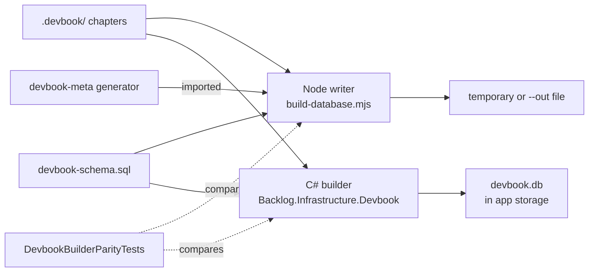

# Build and Governance Tooling

```meta
status: adopted
related: [".devbook/tech/technology-graph.md", ".devbook/tech/ai-development.md"]
```

> Technologies used to build, package, deploy, and govern this repository rather
> than to run the product. The agent harnesses and their plugins are a layer of
> their own, in [`ai-development.md`](ai-development.md).

## Git

```meta
status: adopted
type: tool
```

Source control for the repository and its worktree-based session model.

- **Used for** — versioning code, the knowledge folders, and all governance
  assets. `GitFileHistoryService` in `Backlog.Infrastructure.GitHub` also reads
  history as a product signal.
- **Why** — it is the non-negotiable baseline, and worktrees are how parallel
  agent sessions stay isolated.

## MSBuild

```meta
status: adopted
type: tool
depends-on: [".devbook/tech/tooling.md#net-sdk"]
related: [".devbook/tech/tooling.md#central-package-management"]
```

The build engine, and the directory-scoped property files that configure it.

| File | Sets | Why there |
|---|---|---|
| `Directory.Build.props` | `net10.0`, `LangVersion`, `Nullable`, `ImplicitUsings`, the product identity, and `$(MauiVersion)` | Every project needs them. |
| `tests/Directory.Build.props` | The shared runner and coverage package set, `OutputType=Exe`, the `Xunit` using, and the linked `RepositoryRoot.cs` | Every test project runs the same way. |
| `src/Harness/Directory.Build.props` | The non-publishable flags | An accidental `dotnet publish` of a harness fails loudly. |

- **Used for** — the three files above. Each subtree file re-imports the root
  one explicitly, because MSBuild loads only the nearest one.
- **Why** — a setting every project needs is declared once, so a new project
  cannot forget it.

## .NET SDK

```meta
status: adopted
type: tool
depends-on: [".devbook/tech/shared.md#net-runtime"]
related: [".devbook/tech/testing.md#microsofttestingplatform"]
```

The build and test toolchain for every C# component.

- **Used for** — `dotnet build`, `dotnet test`, and `dotnet publish` across
  desktop, mobile, IDE, cloud, and harness projects.
- **Why** — the single toolchain for the .NET side of the stack. `global.json`
  selects Microsoft.Testing.Platform as the test runner, which changes the
  command-line contract of `dotnet test`.

## .NET MAUI Workloads

```meta
status: adopted
type: tool
depends-on: [".devbook/tech/tooling.md#net-sdk", ".devbook/tech/shared.md#net-maui"]
```

The optional SDK workloads the two app heads need to build.

- **Used for** — `dotnet workload restore` in the pull-request workflow, and the
  targeted `dotnet workload install maui-windows` or `maui-android` in the two
  release workflows.
- **Why** — the MAUI heads do not build without them, and installing only the
  platform workload a release job needs keeps that job short.

## NuGet

```meta
status: adopted
type: tool
depends-on: [".devbook/tech/tooling.md#net-sdk"]
```

The package manager for .NET dependencies.

- **Used for** — restoring the packages `Directory.Packages.props` pins, plus
  the Aspire AppHost SDK.
- **Why** — the standard .NET package ecosystem.

## Central Package Management

```meta
status: adopted
type: tool
depends-on: [".devbook/tech/tooling.md#nuget"]
related: [".devbook/tech/shared.md#yamldotnet"]
```

One file declaring every package version in the solution.

- **Used for** — `Directory.Packages.props`, per org ADR 0002. Project files
  reference packages by name only. A project-local `Version` attribute has to be
  justified in a comment rather than used as a convenience.
- **Why** — one place to see and change what the solution resolves.
- **How** — `CentralPackageTransitivePinningEnabled` is off on purpose. Turning
  it on lifted the AppHost's transitive YamlDotNet, OpenTelemetry, and
  `Microsoft.Extensions.*` packages to whatever `Directory.Packages.props`
  declares for those names, only because the names appear there as direct
  versions. Adopting CPM was meant to change where versions are declared, not
  which ones resolve. Transitive governance is a separate, reviewed change. The
  chapter that owns each package carries its current version in its `version`
  field.

## npm

```meta
status: adopted
type: tool
depends-on: [".devbook/tech/shared.md#nodejs"]
```

The package manager for JavaScript/TypeScript dependencies.

- **Used for** — the VS Code extension's dev dependencies: `npm ci` then
  `npm run compile` in the pull-request workflow, and `npm run watch` as the
  `ide-vscode-build` Aspire resource.
- **Why** — the default package manager of the Node.js ecosystem. The
  repository's own Node tooling avoids it on purpose: Archify is vendored under
  `tools/archify/` with no `node_modules`, so `tools/diagrams` runs on a bare
  Node install.

## PowerShell

```meta
status: adopted
type: language
```

The scripting language for build, release, and hook automation on Windows.

- **Used for** — the scripts under `build/` (packaging, `Deploy-Azure.ps1`,
  `Get-SyncServiceVersion.ps1`, `Initialize-SelfHostedRunner.ps1`,
  `Install-AndroidApp.ps1`, `stop-aspire-before-pr.ps1`), and the `run:` steps of
  both release workflows and the Foundry deployment.
- **Why** — the release workflows run on Windows runners, and packaging, signing,
  and certificate handling are all PowerShell-native there.

## Bicep

```meta
status: adopted
type: language
depends-on: [".devbook/tech/tooling.md#azure-cli"]
related: [".devbook/tech/cloud.md#azure-ai-foundry"]
```

The infrastructure-as-code language for the Azure resources this repository
deploys.

- **Used for** — two templates. `infra/foundry/main.bicep` and its
  `.bicepparam` declare the AI Services account and its model deployments.
  `infra/sync/main.bicep` declares the cloud sync tier: Cosmos DB, a storage
  account with its `attachments` blob container, a container registry,
  Container Apps, Key Vault, Log Analytics, and Application Insights.
- **Why** — it is first-party and typed, and it previews a deployment with
  what-if before it deploys.

## Azure CLI

```meta
status: adopted
type: tool
related: [".devbook/tech/cloud.md#azure-ai-foundry", ".devbook/tech/tooling.md#github-actions"]
```

The deployment and diagnostics entry point for Azure.

- **Used for** — `.github/workflows/deploy-foundry.yml`, which builds the Bicep,
  validates, runs `deployment group what-if`, and then creates the deployment on
  a self-hosted runner.
- **Why** — it is what the self-hosted runner is already signed in to. When it
  is not, the workflow fails with an explicit message rather than deploying into
  the wrong subscription.

## Azure Developer CLI

```meta
status: adopted
type: tool
depends-on: [".devbook/tech/tooling.md#bicep"]
related: [".devbook/tech/cloud.md#azure-cosmos-db", ".devbook/tech/cloud.md#azure-container-apps", ".devbook/tech/tooling.md#github-actions", ".devbook/arc42/07-deployment-view.md#provisioning-and-delivery"]
alternatives: ["Azure CLI"]
```

The provision-and-deploy driver for the cloud sync tier.

- **Used for** — `azure.yaml` and `.github/workflows/deploy-sync.yml`, which
  provision `infra/sync/main.bicep` and then build, push, and deploy
  `Backlog.Modules.Sync.Api` as a container app.
- **Why** — the Azure CLI deploys a template but does not build and push a
  container image. `azd` does both from one service definition, so the workflow
  needs no hand-rolled build, tag, push, and update sequence. The foundry
  deployment stays on the Azure CLI because it deploys no code, so the half of
  `azd` that earns its keep here would go unused there.
- **How** — it is scoped to a resource group, so `azd` deploys into a group
  created by hand rather than creating one. With
  `azd auth login --federated-credential-provider github` the workflow stores no
  secret; the runner mints a short-lived OIDC token instead. See
  `docs/deployment/sync.md`.

## Aspire CLI

```meta
status: adopted
type: tool
depends-on: [".devbook/tech/shared.md#net-aspire"]
```

The local orchestration and diagnostics entry point.

- **Used for** — `aspire start --isolated --non-interactive --apphost …` for
  local runs, plus logs, traces, and deployment artifacts during QA.
- **Why** — the paired CLI for the app model. `--isolated` keeps parallel
  worktree sessions from fighting over ports and user-secrets state. How
  `dotnet run` on the AppHost reaches this CLI is in
  [.NET Aspire](shared.md#net-aspire).

## GitHub Actions

```meta
status: adopted
type: service
depends-on: [".devbook/tech/shared.md#github-platform"]
```

The CI/CD automation platform.

- **Used for** — the workflows under `.github/workflows/`:
  - `pull-request`: build, test, the TRX artifact, and the VS Code extension
    compile.
  - `nightly-tests`: the same build and suite at default parallelism, so a
    parallel flake surfaces there first.
  - `auto-merge`: turns on GitHub auto-merge for every pull request that is not
    a draft.
  - `codeql`.
  - `devbook-meta` and `devbook-metadata`: the two halves of the devbook gate.
  - `deploy-foundry`, `deploy-sync`, and `deploy-all`.
  - `release-desktop` and `release-mobile`.
  - `app-insights-exceptions`: the scheduled exceptions report.
- **Why** — native to the repository host, with least-privilege and OIDC support.
- **How** — every third-party action is pinned to a full commit SHA with the
  version in a trailing comment, so a moved tag cannot change what runs.

## CodeQL

```meta
status: adopted
type: tool
depends-on: [".devbook/tech/tooling.md#github-actions"]
```

Static application security testing.

- **Used for** — scanning the repository for security issues on push and
  schedule (`.github/workflows/codeql.yml`).
- **Why** — first-party scanning with no extra infrastructure.

## Dependabot

```meta
status: adopted
type: service
depends-on: [".devbook/tech/shared.md#github-platform"]
related: [".devbook/tech/tooling.md#central-package-management"]
```

Automated dependency and security updates.

- **Used for** — keeping NuGet, npm, and GitHub Actions dependencies current
  (`.github/dependabot.yml`).
- **Why** — low-effort supply-chain hygiene for a single-maintainer project.

## devbook-meta Generator

```meta
status: adopted
type: tool
version: "1.24.0"
depends-on: [".devbook/tech/shared.md#nodejs", ".devbook/tech/shared.md#json", ".devbook/tech/ai-development.md#devbook-plugin"]
related: [".devbook/tech/tooling.md#github-actions", ".devbook/arc42/adr/0016-knowledge-folders-adopt-the-devbook-convention.md"]
```

The devbook plugin's checker for the devbook folders' `meta` blocks and the
references between chapters.

- **Used for** — `node .devbook/_tools/devbook-meta/build.mjs --check`, which
  resolves every `depends-on` and `related` reference and reports a broken one.
  It also lints every click demo (`*.demo.html`) and resolves each `demo`
  address against it. The check writes nothing: it keeps no `_meta/` output, and
  what this repository reads is the [database](#devbook-database-writer) built
  from the same exported modules. `devbook:init` materialized the tool under
  `.devbook/_tools/devbook-meta/`, and `devbook:update` refreshes it.
- **Sync units** — beside the check, `units.mjs --groups` lists the sync units
  and their effective `sync` direction. It also lists what a sync sweep would
  skip: the orphans, and the groups it sets aside as mixed or oversized.
  [Sync direction](../../.agents/rules/devbook-chapter-metadata.md#sync-direction)
  defines a sync unit and what a sweep does with one.
- **Parse** — a `#` line inside a code fence does not start a chapter, and a
  comma inside a quoted list entry stays part of that entry. The
  [Devbook Database Writer](#devbook-database-writer) parses the same way, so
  its two writers agree with the generator.
- **Why** — it is what turns the metadata convention into something checkable,
  and it is where a broken reference is caught.
- **Caveat** — it checks the `.devbook/` layout only. The product still reads a
  root-level `.domain/` or `.arc42/` as the legacy fallback, but no check in this
  repository covers one (local ADR 0016).

| Workflow | Runs | Owned by | Fails a pull request on |
|---|---|---|---|
| `devbook-meta.yml` | `build.mjs --check` | the devbook plugin, which installs it beside the check | a reference that does not resolve |
| `devbook-metadata.yml` | `tools/devbook/check-metadata.mjs`, a caller of the generator's exported `validateDocument` | this repository | a status outside a folder's ladder, an unknown `type`, or a field no schema defines |

`--check` says nothing about the values in a `meta` block, which is why the
second check exists. It is a separate script in a separate workflow because
everything under `.devbook/_tools/` is refreshed rather than edited here.

## devbook-tech Inventory Scripts

```meta
status: trial
type: tool
depends-on: [".devbook/tech/shared.md#nodejs", ".devbook/tech/shared.md#json", ".devbook/tech/ai-development.md#devbook-plugin"]
related: [".devbook/tech/tooling.md#central-package-management", ".devbook/tech/tooling.md#npm"]
```

The devbook plugin's deterministic package scanners, materialized at
`.devbook/_tools/devbook-tech/`.

- **Used for** — `dotnet-packages.mjs` reads `Directory.Packages.props`,
  `global.json` and every project file. `frontend-packages.mjs` reads every
  `package.json` and lock file. Both print sorted JSON with no timestamp, which
  `devbook:tech-update` compares against the `version` fields in this folder. The
  output is evidence for one run and is not committed.
- **Why `trial`** — they were run by hand for the first refresh on 2026-09-27.
  The `tech-update` schedule that would run them unattended has not yet
  published a result.

## Devbook Database Writer

```meta
status: adopted
type: tool
depends-on: [".devbook/tech/shared.md#nodejs", ".devbook/tech/shared.md#sqlite"]
related: [".devbook/arc42/adr/0004-knowledge-index-is-a-generated-local-database.md", ".devbook/arc42/adr/0015-devbook-database-lives-in-app-storage-and-the-app-builds-it.md", ".devbook/arc42/08-crosscutting-concepts.md#devbook-database"]
```

The two writers of the generated devbook database: the desktop app's own C#
builder, which produces the database the app reads, and the repo-native Node
writer it is held to.



- **Used for** — the app builds `devbook.db` into its own storage, one per
  repository path, at `<devbook cache folder>/_databases/<name>-<hash>/devbook.db`.
  It builds in the background when a repository is first read. The database
  holds:
  - the reference graph and the resolved reading outline;
  - every chapter's text and hashes, with its count of open review notes;
  - the FTS5 index, the Archify artifact rows, and an empty embedding table.

  `node tools/devbook/build-database.mjs` builds the same tables from the
  command line. `--check` builds to a temporary file and deletes it, and
  `--out <file>` writes where it is told; neither writes into a repository.
  `--brain --root <folder>` builds a Brain (local ADR 0026) under its own
  convention, `tools/devbook/brain.mjs`. That convention takes the areas its
  `CONVENTIONS.md` declares as the folders, the `para`, `repos` and `tasks`
  fields as node attributes, and `repo:` links as edges with no node at their
  target.

  One difference between the writers is deliberate and stays. A Brain kept in
  a synced folder, OneDrive's Files On-Demand, is all reparse-point placeholders.
  The C# builder walks and indexes them, a cloud-only file by its name alone and
  unread. The Node writer skips every reparse point, as the installed
  generator's own walk does, so over such a Brain it indexes nothing. Matching
  it would mean changing the generator, which `devbook:update` owns, and reading
  the attributes Node does not expose; opening a placeholder to look downloads
  it. The parity test's Brain fixture is plain files, where the two agree.
- **Why** — twelve committed JSON artifacts were 1.8 MB of derived output that
  every branch collided on (local ADR 0004). A database kept beside the folders
  still had to be ignored per layout, and it existed only if somebody had run
  the script (local ADR 0015). Building it into the app's own storage gives every
  clone, worktree and branch snapshot search without a step.
- **How** — the Node writer imports the generator rather than forking it, for
  the graph, the outline, and each chapter's open-note count. No authored order
  file exists: the outline is the convention's (local ADR 0016). The Node writer
  builds the `.devbook/` layout only; the C# builder also reads a root-layout
  repository. `node:sqlite` provides SQLite and FTS5 with no dependency added.
  `.github/workflows/devbook-metadata.yml` runs the writer's tests and then
  `--check` against the real corpus as a **blocking** step. The parity test
  compares every table but `meta` and `problem` row for row, which is why the
  .NET test job installs Node.
- **Caveat** — two parsers read one corpus, and one of them ports code the
  devbook plugin owns and changes on release. The parity test keeps them in
  step: a release that changes the parse fails it, and the pull request that
  takes the release updates the C# port. The schema is one text,
  `tools/devbook/devbook-schema.sql`, which the Node tooling reads and the C#
  assembly embeds, so neither side restates it.

## Archify

```meta
status: adopted
type: tool
version: "2.16.0"
depends-on: [".devbook/tech/shared.md#nodejs", ".devbook/tech/shared.md#mermaid"]
related: [".devbook/tech/tooling.md#ajv", ".devbook/tech/tooling.md#simple-icons"]
```

A JSON-IR diagram renderer, vendored under `tools/archify/`.

- **Used for** — re-authoring a knowledge-chapter mermaid fence as a
  specification and rendering a self-contained HTML artifact from it. The
  desktop app shows that artifact in place of the drawn mermaid behind the
  `archify-diagrams` flag. `tools/diagrams/archify-artifacts.mjs` wraps it with
  `scan`, `scaffold`, `render`, and `verify`.
- **Why** — it is a visualization layer over the canonical fence, not a
  replacement. An artifact is matched to a diagram by the SHA-256 of the
  normalized fence. An edited diagram therefore misses the lookup and falls back
  to mermaid with an out-of-date note, rather than showing a stale picture.
- **How** — vendored with no `node_modules`, so the commands run on a bare Node
  install. A specification is accepted only at 9/9 checks. A few diagrams in the
  repository render at the `standard` profile instead of `showcase`, and say so
  in their filename.
- **What is committed** — the specifications and `_archify/index.json` only
  (local ADR 0034). The desktop app draws each artifact on demand from its
  specification, with the clone's `tools/archify` or the copy bundled beside the
  app, into `_archify-renders/` under the devbook cache folder. The cache key
  covers the specification, its type and quality, and the generator's content,
  so an upgrade redraws every diagram by itself. The upstream example renders
  are not vendored, and `.gitignore` keeps any local render out.

## c4hero

```meta
status: adopted
type: tool
version: "0.4.0"
depends-on: [".devbook/tech/shared.md#nodejs"]
related: [".devbook/tech/tooling.md#archify", ".devbook/design/component-libraries.md#c4-workspaces"]
```

A browser-based visual editor for C4 architecture diagrams that saves Structurizr
DSL, under the Apache-2.0 licence. It is **not vendored and not a runtime
dependency**.

- **Used for** — authoring `.devbook/arc42/_c4/*.dsl`, the C4 model kept beside
  the architecture chapters. The desktop app reads that DSL and draws it itself
  on the Architecture panel's C4 tab, behind the `c4-diagrams` flag.
  [C4 workspaces](../design/component-libraries.md#c4-workspaces) holds the
  tab's rules and what it offers. c4hero is what a person opens to change the model.
- **Why** — the model wanted a real editor, and this repository wanted no new
  build. c4hero is local-first and saves plain `.dsl` through the File System
  Access API. The authored artifact is therefore reviewable text in git, and the
  editor never has to be part of the product. The format is Structurizr DSL
  rather than one of our own, because Structurizr Lite, Studio and the JSON
  exporters already read it.
- **How** — a person opens it at `app.c4hero.com`, or runs it from a clone
  (Node 22+), and points it at the `_c4` folder. Nothing here installs it,
  vendors it, or shells out to it, and it has no CLI. The app reads the DSL with
  its own reader in `src/Core/Backlog.UI.Components/Diagrams/C4/`, not through
  anything c4hero ships. That reader is a second implementation of c4hero's
  dialect. It is pinned against c4hero's own conformance fixture and must report
  what it cannot read rather than guess; `tools/diagrams/C4.md` says why.

## Ajv

```meta
status: adopted
type: package
version: "^8.17.1"
depends-on: [".devbook/tech/tooling.md#archify", ".devbook/tech/shared.md#json"]
```

JSON Schema validation.

- **Used for** — validating an Archify specification before it renders, through
  the generated validators `tools/archify/scripts/generate-validators.mjs`
  produces.
- **Why** — a specification that fails validation must not produce an artifact,
  and the check is compiled rather than interpreted at render time.

## simple-icons

```meta
status: adopted
type: package
version: "16.28.0"
depends-on: [".devbook/tech/tooling.md#archify"]
```

The brand-mark icon set.

- **Used for** — the technology marks Archify draws into an artifact, generated
  into the renderer by `generate-brand-marks.mjs`.
- **Why** — it is pinned to an exact version, and both generators ship a
  `--check` mode that the vendored test script runs. A regenerated output
  therefore cannot drift from what is committed.
